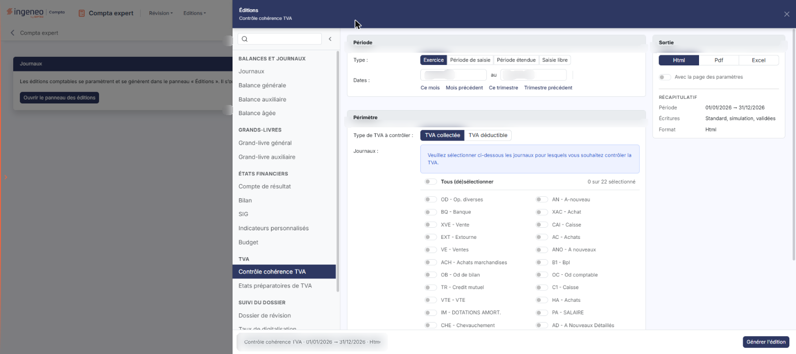
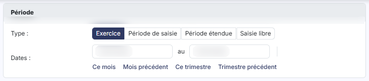
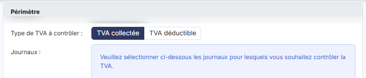
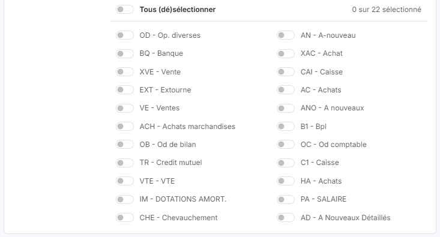
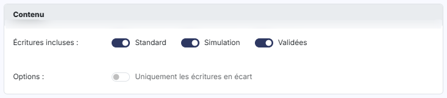
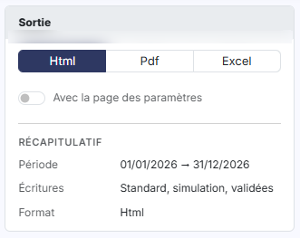

# Contrôle cohérence TVA


**Où le trouver :** Menu **Editions › Contrôle cohérence TVA**



**En bref** — Cette édition contrôle la cohérence entre le taux de TVA indiqué dans le compte et le montant présent dans chaque écriture concernée.

* Pour contrôler : choisissez vos critères dans le panneau des éditions, puis bouton \[Générer l'édition].


Cette option permet d'éditer un contrôle de cohérence de la TVA.

<figure><figcaption>
Écran « Contrôle cohérence TVA » de la nouvelle interface
</figcaption></figure>

Cette édition vérifie la cohérence entre le taux de TVA indiqué dans le compte et le montant présent dans chaque écriture concernée. Vous obtenez ainsi la liste des écritures dont le montant de TVA ne correspond pas au taux attendu — une saisie manuelle erronée, un taux modifié en cours d'exercice, un montant repris à la main sur une écriture importée.

Le panneau est un formulaire de paramétrage : vous y choisissez la période, la TVA à contrôler, les journaux à examiner, les écritures à retenir et le format du document, puis vous lancez l'édition avec le bouton **\[Générer l'édition]**. Le formulaire se présente en cartes, dans l'ordre suivant : « Période », « Périmètre » et « Contenu », complétées à droite par la carte « Sortie ».

## Le panneau d'éditions

<figure><figcaption>
Bouton [Ouvrir le panneau des éditions]
</figcaption></figure>

Cette édition ne s'ouvre plus dans une page de paramétrage : elle se paramètre et se génère dans le **panneau d'éditions**, commun à toutes les éditions comptables. Pour l'ouvrir, cliquez sur le menu **Éditions** de la barre du module, puis sur **Contrôle cohérence TVA** ; depuis l'écran Révision, ouvrez le menu ⋮ (Plus d'actions), puis **Éditions**, et choisissez l'édition dans la liste de gauche du panneau. La page qui s'affiche derrière porte le titre de l'édition et le bouton **\[Ouvrir le panneau des éditions]** : le panneau s'ouvre de lui-même ; si vous l'avez fermé, ce bouton le rouvre.

Le panneau est un tiroir intitulé « Éditions », suivi du nom de l'édition. **À gauche**, la liste des quinze éditions (quatorze depuis le module Comptabilité, où « Dossier de révision » n'apparaît pas dans « Suivi du dossier ») en cinq groupes — « Balances et journaux », « Grands-livres », « États financiers », « TVA » et « Suivi du dossier » — avec une zone « Rechercher une édition » et un bouton « Replier la liste » ; cliquer sur une autre édition change de formulaire sans quitter le panneau. **Au centre**, le formulaire, présenté en cartes. **À droite**, la carte « Sortie » et le « Récapitulatif » des critères retenus. **En en-tête**, la croix « Fermer ». **Dans le pied**, un résumé de l'édition (nom, dates, format) et, à droite, le bouton **\[Générer l'édition]**. Le pied ne porte pas de bouton \[Annuler] : le panneau se referme par la croix « Fermer » de l'en-tête.

## Carte « Période »

<figure><figcaption>
Rubrique « a) Carte « Période » »
</figcaption></figure>

| Champ          | Ce qu'il faut savoir                                                                                                                                                                                                                                                                                                                                                                                           |
| -------------- | -------------------------------------------------------------------------------------------------------------------------------------------------------------------------------------------------------------------------------------------------------------------------------------------------------------------------------------------------------------------------------------------------------------- |
| **Type**       | Choisissez la période à contrôler au moyen de quatre boutons : **Exercice**, **Période de saisie**, **Période étendue** et **Saisie libre**. Le logiciel se positionne par défaut sur **Exercice**.                                                                                                                                                                                                            |
| **Dates … au** | Les deux dates qui délimitent la période contrôlée. Le logiciel les renseigne d'après le type choisi. Elles restent saisissables à tout moment : modifier une date fait passer le type sur **Saisie libre**, et le calendrier s'ouvre au clic dans la zone de date. Le choix **Exercice** les renseigne aux bornes du dossier annuel, du premier au dernier jour de l'exercice : il ne les laisse pas à blanc. |
| **Raccourcis** | Sous les dates, « Ce mois », « Mois précédent », « Ce trimestre » et « Trimestre précédent » renseignent les deux dates et passent le type sur « Saisie libre ». Une ligne de rappel, par exemple « Période relative : Ce mois (dates du jour, recalculées à chaque chargement du modèle d'édition). », s'affiche alors sous les dates.                                                                        |

## Carte « Périmètre » : le type de TVA

<figure><figcaption>
Rubrique « b) Carte « Périmètre » : le type de TVA »
</figcaption></figure>

**Type de TVA à contrôler** : indiquez, au moyen de deux boutons, laquelle des deux TVA contrôler, **TVA collectée** ou **TVA déductible**. Le logiciel propose **TVA collectée**. Un seul type est contrôlé par édition : pour vérifier les deux, lancez deux éditions.

## Carte « Périmètre » : les journaux

<figure><figcaption>
Rubrique « c) Carte « Périmètre » : les journaux »
</figcaption></figure>

Le champ **Journaux :** commande le périmètre de l'édition. Un encadré bleu, en tête du champ, le rappelle : « Veuillez sélectionner ci-dessous les journaux pour lesquels vous souhaitez contrôler la TVA. »

Le champ présente un interrupteur par journal du dossier annuel, suivi du code et du libellé du journal. La liste dépend donc du dossier : elle reprend les journaux paramétrés dans le panneau Paramètres (onglet « Données », catégorie « Dossier et comptabilité », « Journaux »), dans l'ordre où le logiciel les présente.

**Tous (dé)sélectionner** : cet interrupteur, placé en tête de la liste, agit sur tous les journaux à la fois : activé il les retient tous, désactivé il les écarte tous. Vous pouvez ensuite corriger journal par journal.

**Tous les journaux sont désactivés à l'ouverture du panneau**, y compris l'interrupteur de tête : aucun journal n'est retenu par défaut.

## Carte « Contenu »

<figure><figcaption>
Rubrique « d) Carte « Contenu » »
</figcaption></figure>

| Champ                                 | Ce qu'il faut savoir                                          |
| ------------------------------------- | ------------------------------------------------------------- |
| **Écritures incluses**                | Trois interrupteurs, tous activés par défaut et indépendants. |
| **Uniquement les écritures en écart** | Le logiciel le désactive par défaut.                          |

## Carte « Sortie » et récapitulatif

<figure><figcaption>
Rubrique « e) Carte « Sortie » et récapitulatif »
</figcaption></figure>

La carte « Sortie » se trouve dans la colonne de droite. **Format :** choisissez le format du document au moyen de trois boutons, **Html**, **Pdf** et **Excel**. Le logiciel propose **Html**.

| Champ                           | Ce qu'il faut savoir                                                                                                         |
| ------------------------------- | ---------------------------------------------------------------------------------------------------------------------------- |
| **Avec la page des paramètres** | Interrupteur désactivé par défaut.                                                                                           |
| **Récapitulatif**               | Sous la carte « Sortie », il rappelle la période, les écritures retenues et le format. Il se met à jour au fil de vos choix. |

bouton **\[Générer l'édition]**

Il se trouve dans le pied du panneau et lance l'édition du contrôle avec les critères retenus, au format choisi. Il n'y a ni mémorisation des paramètres, ni notes de bas de page sur cette édition : l'en-tête du panneau ne porte que la croix « Fermer ». bouton **\[Retour au paramétrage]**, bouton **\[Ouvrir dans un onglet]**, bouton **\[Excel]** et bouton **\[Pdf]** ne sont pas affichés à l'ouverture : le panneau les prévoit après la génération.
