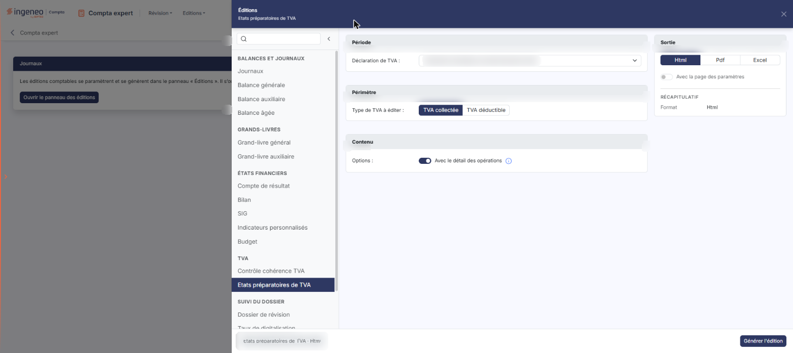
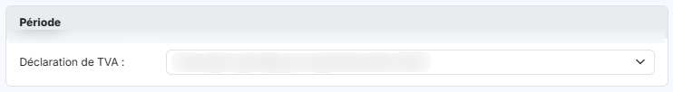
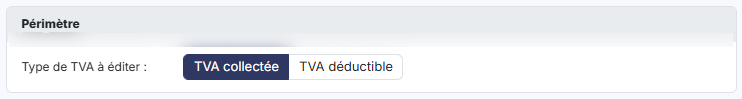
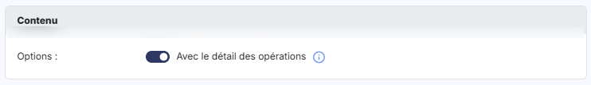
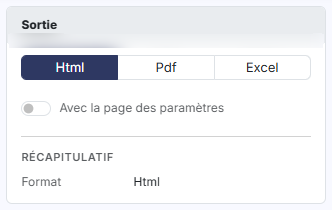

# Etats préparatoires de TVA


**Où le trouver :** Menu **Editions › Etats préparatoires de TVA**



**En bref** — Cette édition produit l'état préparatoire d'une déclaration de TVA, qui reprend la TVA collectée ou déductible pour justifier la déclaration avant sa transmission.

* Pour éditer : choisissez la déclaration et le format dans le panneau des éditions, puis bouton \[Générer l'édition].


Cette option permet d'éditer l'état préparatoire d'une déclaration de TVA.

<figure><figcaption>
Écran « Etats préparatoires de TVA » de la nouvelle interface
</figcaption></figure>

L'édition porte sur une déclaration de TVA que vous désignez.

Le panneau est un formulaire de paramétrage court : trois cartes, complétées à droite par la carte « Sortie », et cinq champs. Vous lancez l'édition avec le bouton **\[Générer l'édition]**.

## Le panneau d'éditions

<figure><figcaption>
Bouton [Ouvrir le panneau des éditions]
</figcaption></figure>

Cette édition ne s'ouvre plus dans une page de paramétrage : elle se paramètre et se génère dans le **panneau d'éditions**, commun à toutes les éditions comptables. Pour l'ouvrir, cliquez sur le menu **Éditions** de la barre du module, puis sur **Etats préparatoires de TVA** ; depuis l'écran Révision, ouvrez le menu ⋮ (Plus d'actions), puis **Éditions**, et choisissez l'édition dans la liste de gauche du panneau. La page qui s'affiche derrière porte le titre de l'édition et le bouton **\[Ouvrir le panneau des éditions]** : le panneau s'ouvre de lui-même ; si vous l'avez fermé, ce bouton le rouvre.

Le panneau est un tiroir intitulé « Éditions », suivi du nom de l'édition. **À gauche**, la liste des quinze éditions (quatorze depuis le module Comptabilité, où « Dossier de révision » n'apparaît pas dans « Suivi du dossier ») en cinq groupes — « Balances et journaux », « Grands-livres », « États financiers », « TVA » et « Suivi du dossier » — avec une zone « Rechercher une édition » et un bouton « Replier la liste » ; cliquer sur une autre édition change de formulaire sans quitter le panneau. **Au centre**, le formulaire, présenté en cartes. **À droite**, la carte « Sortie » et le « Récapitulatif » des critères retenus. **En en-tête**, la croix « Fermer ». **Dans le pied**, un résumé de l'édition (nom et format) et, à droite, le bouton **\[Générer l'édition]**. Le pied ne porte pas de bouton \[Annuler] : le panneau se referme par la croix « Fermer » de l'en-tête.

## Carte « Période »

<figure><figcaption>
Rubrique « a) Carte « Période » »
</figcaption></figure>

**Déclaration de TVA** : désignez la déclaration à justifier au moyen d'une liste déroulante.

La liste ne propose que les déclarations de TVA existantes sur le dossier annuel : elle ne comporte **aucune invite** du type « Sélectionnez », et le logiciel retient d'office la première déclaration. Chaque entrée porte le type de la déclaration suivi de sa période — par exemple une déclaration périodique annuelle et le mois auquel elle est rattachée.

Malgré son nom, la carte « Période » ne comporte ni dates ni type de période : la période éditée est celle de la déclaration que vous retenez.

## Carte « Périmètre »

<figure><figcaption>
Rubrique « b) Carte « Périmètre » »
</figcaption></figure>

**Type de TVA à éditer** : indiquez, au moyen de deux boutons, laquelle des deux TVA éditer, **TVA collectée** ou **TVA déductible**. Le logiciel propose **TVA collectée**. Un seul type est édité à la fois : pour obtenir les deux états, lancez deux éditions.

## Carte « Contenu »

<figure><figcaption>
Rubrique « c) Carte « Contenu » »
</figcaption></figure>

**Avec le détail des opérations** : interrupteur, activé par défaut. L'icône d'information placée à sa droite précise : « Si cette option est cochée, l'édition contiendra le détail de toutes les opérations prises en compte dans la déclaration. »

## Carte « Sortie » et récapitulatif

<figure><figcaption>
Rubrique « d) Carte « Sortie » et récapitulatif »
</figcaption></figure>

La carte « Sortie » se trouve dans la colonne de droite. **Format :** choisissez le format du document au moyen de trois boutons, **Html**, **Pdf** et **Excel**. Le logiciel propose **Html**.

| Champ                           | Ce qu'il faut savoir                                                                                                                                |
| ------------------------------- | --------------------------------------------------------------------------------------------------------------------------------------------------- |
| **Avec la page des paramètres** | Interrupteur désactivé par défaut.                                                                                                                  |
| **Récapitulatif**               | Sous la carte « Sortie », il rappelle le format retenu. Contrairement à d'autres éditions, il ne porte ni ligne « Période » ni ligne « Écritures ». |

bouton **\[Générer l'édition]**

Il se trouve dans le pied du panneau et lance l'édition de l'état préparatoire avec les critères retenus, au format choisi. Il n'y a ni mémorisation ni chargement des paramètres sur cette édition : l'en-tête du panneau ne porte que la croix « Fermer ». bouton **\[Retour au paramétrage]**, bouton **\[Ouvrir dans un onglet]**, bouton **\[Excel]** et bouton **\[Pdf]** ne sont pas affichés à l'ouverture : le panneau les prévoit après la génération.
