# Générateur d'états


**Où le trouver :** Menu **Editions › Générateur d'états**



**En bref** — Le générateur d'états permet de construire vos propres éditions et de les conserver. Cette page liste les états du dossier : création, modification, duplication, export et suppression.

* Pour créer un état : bouton \[Créer un générateur d'état], qui ouvre le panneau « Nouvel état ».
* Pour récupérer les modèles de l'éditeur : bouton \[Charger les nouveaux modèles].
* Pour exporter ou supprimer des états : cochez-les, puis bouton \[Exporter] ou bouton \[Supprimer].


Le générateur d'états vous permet de construire vos propres éditions et de les conserver pour les réutiliser. Cette page présente la liste des états déjà créés sur le dossier et vous permet d'en créer, d'en modifier, d'en dupliquer, d'en exporter ou d'en supprimer.

<figure>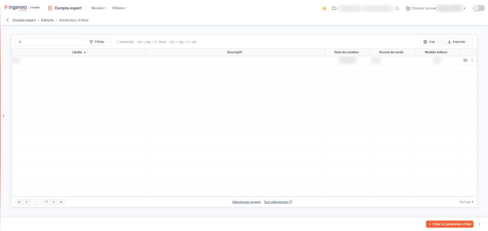<figcaption>
Écran « Générateur d'états » de la nouvelle interface
</figcaption></figure>

## La liste des états

La page ne comporte aucun filtre : la grille présente directement l'ensemble des états du dossier. Elle comporte les colonnes suivantes, précédées d'une colonne sans titre qui porte les commandes de chaque ligne :

* **Libellé** : le nom que vous avez donné à l'état. La grille est triée sur cette colonne, par ordre croissant, à l'ouverture de la page.
* **Descriptif** : le commentaire libre associé à l'état ; il peut rester vide.
* **Date de création** : la date à laquelle l'état a été créé.
* **Format de sortie** : le format dans lequel l'état est produit.
* **Modèle éditeur** : indique par Oui ou par Non s'il s'agit d'un modèle livré par l'éditeur.

Les cinq colonnes sont triables : cliquez sur le titre d'une colonne pour trier la liste dessus. Pour changer leur ordre d'affichage, passez par la fenêtre « Personnalisation de colonnes », qui vous invite à faire glisser les lignes de haut en bas ou de bas en haut pour les réordonner.

La ligne de titre de la grille porte, à gauche, une case qui sélectionne toutes les lignes de la page affichée, et une seconde case qui étend la sélection à toutes les pages. À droite se trouvent trois pictogrammes : la « Roue crantée » ouvre la personnalisation des colonnes, l'« Entonnoir » ouvre la fenêtre « Filtres », et l'« Imprimante » lance l'impression de la grille.

Sous la grille, un pagineur vous permet d'aller à la première ou à la dernière page, de passer à la page précédente ou suivante, ou d'atteindre directement une page en saisissant son numéro. Le nombre d'états affichés et le nombre total sont rappelés à droite.

## Les commandes de chaque ligne

<figure><figcaption>
Bouton [Créer un générateur d'état]
</figcaption></figure>

<figure>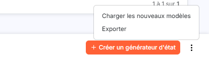<figcaption>
Bouton [Exporter]
</figcaption></figure>

<figure>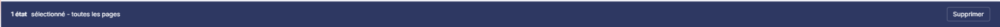<figcaption>
Bouton [Supprimer]
</figcaption></figure>

<figure>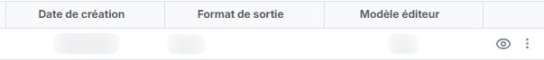<figcaption>
Rubrique « b) Les commandes de chaque ligne »
</figcaption></figure>

Chaque état de la liste porte jusqu'à quatre pictogrammes, dont l'infobulle indique l'action :

* « Modifier » : ouvre, dans un panneau à droite dont le titre porte le libellé de l'état, la fiche de l'état pour en revoir la définition.
* « Afficher l'aperçu » : produit l'état afin d'en visualiser le résultat.
* « Supprimer » : supprime l'état de la liste.
* « Dupliquer » : crée un nouvel état reprenant la définition de celui-ci, ce qui vous évite de recommencer une construction proche d'une existante.

Les pictogrammes réellement affichés dépendent des droits accordés à votre profil : chacun d'eux est lié à un droit distinct, et celui dont vous ne disposez pas n'apparaît sur aucune ligne de la liste.

Les boutons suivants sont présentés en bas de la page.

bouton **\[Créer un générateur d'état]**

Il ouvre à droite le panneau « Nouvel état », qui est la fiche de création d'un nouvel état.

bouton **\[Charger les nouveaux modèles]**

Il ajoute à votre liste les modèles d'états livrés par l'éditeur qui n'y figurent pas encore.

bouton **\[Exporter]**

Il produit un fichier reprenant les états sélectionnés dans la liste. Cochez les états concernés avant de l'utiliser.

bouton **\[Supprimer]**

Il supprime les états sélectionnés dans la liste. Cochez les états concernés avant de l'utiliser.

## Autres vues de l'écran

<figure>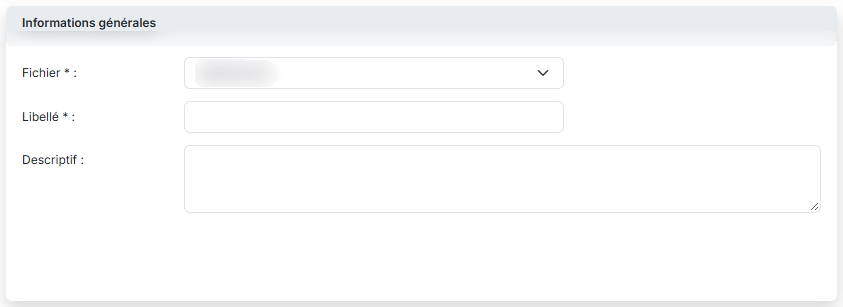<figcaption>
c) La fiche d'un état
</figcaption></figure>

<figure>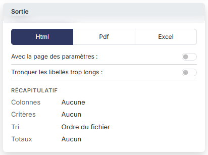<figcaption>
c) La fiche d'un état
</figcaption></figure>

<figure>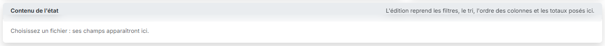<figcaption>
c) La fiche d'un état
</figcaption></figure>

<figure>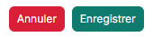<figcaption>
Bouton [Enregistrer]
</figcaption></figure>

<figure><figcaption>
Bouton [Annuler]
</figcaption></figure>

<figure>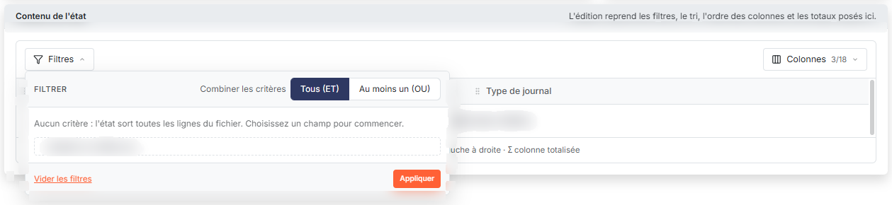<figcaption>
Bouton [Filtres]
</figcaption></figure>

<figure>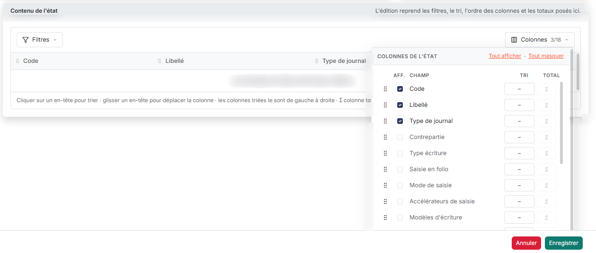<figcaption>
Bouton [Colonnes]
</figcaption></figure>

<figure>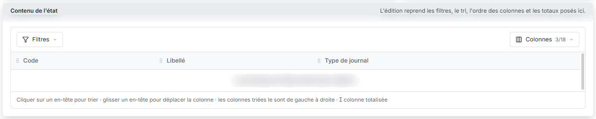<figcaption>
e) Le contenu de l'état : colonnes et critères
</figcaption></figure>
