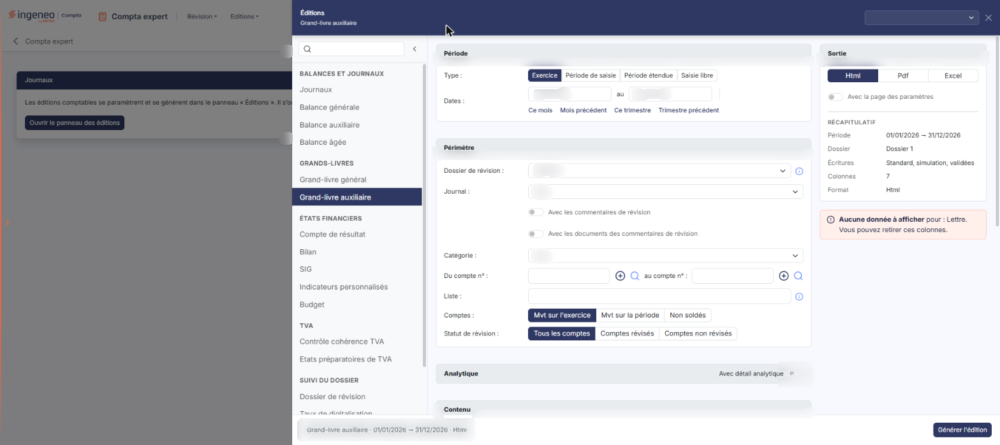
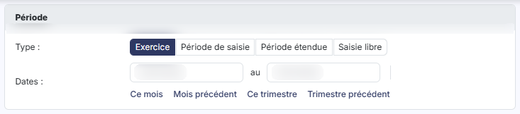
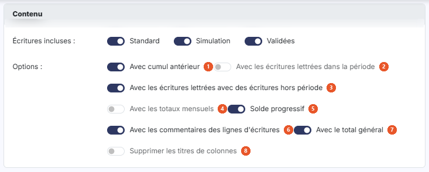
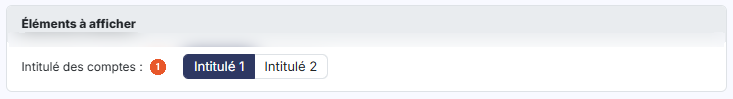
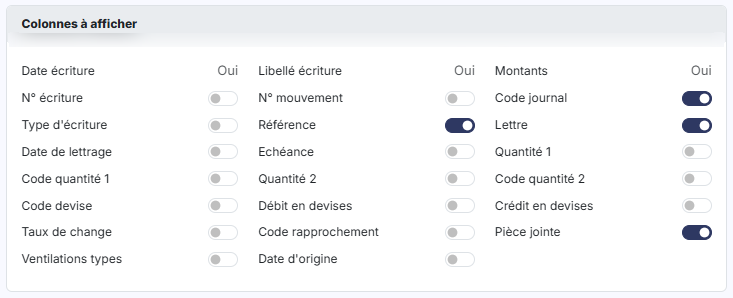
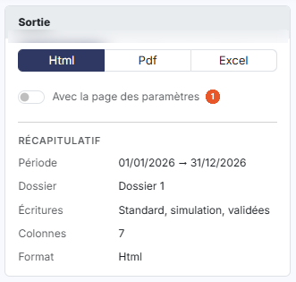

# Grand-livre auxiliaire


**Où le trouver :** Menu **Editions › Grand-livre auxiliaire**



**En bref** — Cette édition produit les lignes d'écritures passées sur les comptes auxiliaires, pour les comptes, la période et les colonnes que vous choisissez, dans le panneau des éditions.

* Pour éditer : choisissez la période et le périmètre, puis bouton \[Générer l'édition].
* Pour adapter le document : cochez les colonnes voulues dans la carte « Colonnes à afficher », puis bouton \[Générer l'édition].


Cette page vous permet d'éditer les lignes d'écritures passées sur les comptes auxiliaires. Vous choisissez les comptes et la période à retenir, les colonnes à faire figurer dans le document, puis le format dans lequel il est produit. Tout se règle dans un panneau, sous la forme de cartes : « Période », « Périmètre », « Analytique », « Contenu », « Éléments à afficher » et « Colonnes à afficher », complétées à droite par la carte « Sortie ».

<figure><figcaption>
Écran « Grand-livre auxiliaire » de la nouvelle interface
</figcaption></figure>

## Le panneau d'éditions

<figure><figcaption>
Bouton [Ouvrir le panneau des éditions]
</figcaption></figure>

Cette édition ne s'ouvre plus dans une page de paramétrage : elle se paramètre et se génère dans le **panneau d'éditions**, commun à toutes les éditions comptables. Pour l'ouvrir, cliquez sur le menu **Éditions** de la barre du module, puis sur **Grand-livre auxiliaire** ; depuis l'écran Révision, ouvrez le menu ⋮ (Plus d'actions), puis **Éditions**, et choisissez l'édition dans la liste de gauche du panneau. La page qui s'affiche derrière porte le titre de l'édition et le bouton **\[Ouvrir le panneau des éditions]** : le panneau s'ouvre de lui-même ; si vous l'avez fermé, ce bouton le rouvre.

Le panneau est un tiroir intitulé « Éditions », suivi du nom de l'édition. **À gauche**, la liste des quinze éditions en cinq groupes — « Balances et journaux », « Grands-livres », « États financiers », « TVA » et « Suivi du dossier » — avec une zone « Rechercher une édition » et un bouton « Replier la liste » ; cliquer sur une autre édition change de formulaire sans quitter le panneau. **Au centre**, le formulaire, présenté en cartes. **À droite**, la carte « Sortie » et le « Récapitulatif » des critères retenus. **En en-tête**, la liste des paramétrages enregistrés (voir plus bas) et la croix « Fermer ». **Dans le pied**, un résumé de l'édition (nom, dates, format) et, à droite, le bouton **\[Générer l'édition]**. Le pied ne porte pas de bouton \[Annuler] : le panneau se referme par la croix « Fermer » de l'en-tête.

## Carte « Période »

<figure><figcaption>
Rubrique « Carte « Période » »
</figcaption></figure>

| Champ          | Ce qu'il faut savoir                                                                                                                                                                                                                                                                                                                                                                                                                                                                                                                                                                              |
| -------------- | ------------------------------------------------------------------------------------------------------------------------------------------------------------------------------------------------------------------------------------------------------------------------------------------------------------------------------------------------------------------------------------------------------------------------------------------------------------------------------------------------------------------------------------------------------------------------------------------------- |
| **Type**       | Choisissez la période sur laquelle porte l'édition, au moyen de quatre boutons : « Exercice », « Période de saisie », « Période étendue » et « Saisie libre ». Ce choix renseigne automatiquement la fourchette de dates. La valeur retenue à l'ouverture dépend du dossier de révision en cours sur le dossier annuel : le logiciel retient « Exercice » lorsqu'un dossier de révision de clôture est en cours, « Saisie libre » avec les dates de ce dossier lorsqu'un dossier de révision de situation est en cours, et « Période de saisie » lorsqu'aucun dossier de révision n'est en cours. |
| **Dates … au** | Le logiciel renseigne les deux dates d'après le type choisi. Elles restent saisissables à tout moment : modifier une date fait passer le type sur « Saisie libre ». Il n'y a plus de pictogramme « Calendrier » : le calendrier s'ouvre au clic dans la zone de date.                                                                                                                                                                                                                                                                                                                             |
| **Raccourcis** | Sous les dates, « Ce mois », « Mois précédent », « Ce trimestre » et « Trimestre précédent » renseignent les deux dates et passent le type sur « Saisie libre ». Une ligne de rappel, par exemple « Période relative : Ce mois (dates du jour, recalculées à chaque chargement du modèle d'édition). », précise alors que ces dates sont recalculées à chaque chargement du modèle d'édition.                                                                                                                                                                                                     |

## Carte « Périmètre »

<figure><figcaption>
Rubrique « Carte « Périmètre » »
</figcaption></figure>

| Champ                                                  | Ce qu'il faut savoir                                                                                                                                                                                                                                                                                                                                                                                                                                                                                       |
| ------------------------------------------------------ | ---------------------------------------------------------------------------------------------------------------------------------------------------------------------------------------------------------------------------------------------------------------------------------------------------------------------------------------------------------------------------------------------------------------------------------------------------------------------------------------------------------- |
| 1. **Dossier de révision**                             | Liste proposant « Aucun », puis chacun des dossiers de révision du dossier annuel. Une info-bulle précise : « Sélectionnez le dossier de révision pris en compte par l'édition : ses commentaires de révision si l'option « Avec les commentaires de révision » est active, et les écritures de simulation de son journal si l'option « Avec les écritures de simulation » est active. « Aucun » : seules les écritures de simulation des journaux non rattachés à un dossier de révision sont retenues. » |
| 2. **Journal**                                         | 
Vous pouvez restreindre l'édition à un seul journal. La liste reprend les journaux du dossier ; l'entrée « Tous », proposée par défaut, retient l'ensemble des journaux. Ces deux options, comme la liste « Dossier de révision », ne sont proposées que dans le module Compta expert.
                                                                                                                                                                                                           |
| 3. **Avec les commentaires de révision**               | Option.                                                                                                                                                                                                                                                                                                                                                                                                                                                                                                    |
| 4. **Avec les documents des commentaires de révision** | Option.                                                                                                                                                                                                                                                                                                                                                                                                                                                                                                    |
| 5. **Catégorie**                                       | Choisissez la catégorie de comptes auxiliaires pour laquelle vous souhaitez éditer le grand-livre, parmi « Tous », « Divers », « Clients », « Fournisseurs » et « Salariés ». Le logiciel propose « Tous » par défaut.                                                                                                                                                                                                                                                                                     |
| 6. **Du compte n°**                                    | **au compte n° :** vous avez la possibilité de ne retenir qu'une partie du plan comptable auxiliaire en indiquant le compte de début et le compte de fin. À droite de chaque zone se trouvent un bouton « + » (info-bulle « Créer ») et une loupe ; la loupe vous permet de rechercher le compte au lieu de le saisir.                                                                                                                                                                                     |
| 7. **Liste**                                           | Vous pouvez indiquer des comptes ou des racines de comptes qui ne se suivent pas. L'infobulle du pictogramme « Information » rappelle la règle de saisie : « Séparez les numéros de comptes ou les racines par des points virgules ou des tirets. »                                                                                                                                                                                                                                                        |
| 8. **Comptes**                                         | 
Vous affinez encore l'édition en indiquant un filtre sur les comptes : • « Mvt sur l'exercice » (choix proposé par défaut) • « Mvt sur la période » • « Non soldés »
                                                                                                                                                                                                                                                                                                                       |
| 9. **Statut de révision**                              | Trois choix vous permettent de retenir « Tous les comptes », les seuls « Comptes révisés » ou les seuls « Comptes non révisés ». Le logiciel retient « Tous les comptes » par défaut.                                                                                                                                                                                                                                                                                                                      |
| **Du compte collectif n°**                             | **au compte n° :** ces deux zones, qui s'appliquent aux comptes collectifs, ne s'affichent pas tant que « Catégorie » vaut « Tous ».                                                                                                                                                                                                                                                                                                                                                                       |
| **Remarque**                                           | Les critères de choix des comptes sont cumulatifs.                                                                                                                                                                                                                                                                                                                                                                                                                                                         |

## Carte « Analytique »

<figure><figcaption>
Rubrique « Carte « Analytique » »
</figcaption></figure>

| Champ                                   | Ce qu'il faut savoir                                                                                                                                                                                    |
| --------------------------------------- | ------------------------------------------------------------------------------------------------------------------------------------------------------------------------------------------------------- |
| 1. **Avec détail analytique**           | Tant que cette option est sur Non — son état par défaut —, la carte reste repliée et ne contient que ce seul champ. Dès que vous la positionnez sur Oui, le logiciel affiche les champs suivants.       |
| **Axes**                                | Liste à choix multiple, positionnée sur « Tous les axes » par défaut, avec une case par axe du dossier. Il n'y a plus de choix « Type d'axe » (« Liste » ou « Agrégat »).                               |
| **Sections**                            | Liste à choix multiple, positionnée sur « Toutes les sections » par défaut, avec une case par section. Il n'y a plus de choix « Type de section ».                                                      |
| **Présentation**                        | Ce choix est proposé deux fois, une fois en regard des axes et une fois en regard des sections. Il indique si l'édition reprend le « Code » ou le « Libellé ». Le logiciel retient « Code » par défaut. |
| **Présentation de l'édition**           | « Détail des sections par compte » (choix par défaut) ou « Détail des comptes par section ».                                                                                                            |
| **Inclure les écritures non ventilées** | Option.                                                                                                                                                                                                 |

## Carte « Contenu »

<figure><figcaption>
Rubrique « Carte « Contenu » »
</figcaption></figure>

| Champ                                                              | Ce qu'il faut savoir                                                                                                                                                                                                   |
| ------------------------------------------------------------------ | ---------------------------------------------------------------------------------------------------------------------------------------------------------------------------------------------------------------------- |
| 1. **Avec cumul antérieur**                                        | Option.                                                                                                                                                                                                                |
| 2. **Avec les écritures lettrées dans la période**                 | Option.                                                                                                                                                                                                                |
| 3. **Avec les écritures lettrées avec des écritures hors période** | Option active par défaut.                                                                                                                                                                                              |
| 4. **Avec les totaux mensuels**                                    | Option.                                                                                                                                                                                                                |
| 5. **Solde progressif**                                            | Interrupteur activé par défaut.                                                                                                                                                                                        |
| 6. **Avec les commentaires des lignes d'écritures**                | Option active par défaut.                                                                                                                                                                                              |
| 7. **Avec le total général**                                       | Option active par défaut.                                                                                                                                                                                              |
| 8. **Supprimer les titres de colonnes**                            | Option.                                                                                                                                                                                                                |
| **Écritures incluses**                                             | Trois interrupteurs, tous activés par défaut. « Standard » fait figurer dans l'édition les écritures ordinaires de la comptabilité, « Simulation » les écritures de simulation et « Validées » les écritures validées. |

## Carte « Éléments à afficher »

<figure><figcaption>
Rubrique « Carte « Éléments à afficher » »
</figcaption></figure>

**Intitulé des comptes** : vous choisissez lequel des deux intitulés du compte est repris dans l'édition, « Intitulé 1 » ou « Intitulé 2 ». Le logiciel retient « Intitulé 1 » par défaut.

## Carte « Colonnes à afficher »

<figure><figcaption>
Rubrique « Carte « Colonnes à afficher » »
</figcaption></figure>

Cette carte remplace le bouton \[Choix des champs] et sa fenêtre « Eléments à afficher » : la liste de toutes les colonnes que vous pouvez faire figurer dans votre édition est présentée directement dans le formulaire, sans fenêtre à ouvrir et sans bouton Enregistrer ni bouton Fermer.

Les trois premières lignes — « Date écriture », « Libellé écriture » et « Montants » — portent la mention « Oui » en simple texte, sans interrupteur : ces colonnes sont indispensables à ce type d'édition et ne peuvent pas être retirées.

Les autres lignes sont à votre main, chacune commandée par un interrupteur : « N° écriture », « N° mouvement », « Code journal », « Type d'écriture », « Référence », « Lettre », « Date de lettrage », « Echéance », « Quantité 1 », « Code quantité 1 », « Quantité 2 », « Code quantité 2 », « Code devise », « Débit en devises », « Crédit en devises », « Taux de change », « Code rapprochement », « Date d'origine », « Pièce jointe » et « Ventilations types ». À l'ouverture, « Code journal », « Référence », « Lettre » et « Pièce jointe » sont activées, les autres désactivées ; le récapitulatif indique le nombre de colonnes retenues (7 à l'ouverture).

Si une colonne activée ne contient aucune donnée pour les critères choisis, un encadré orange apparaît sous le récapitulatif : « Aucune donnée à afficher pour : … Vous pouvez retirer ces colonnes. » Il ne signale pas une erreur : il disparaît lorsque la colonne concernée est désactivée.

## Carte « Sortie » et récapitulatif

<figure><figcaption>
Rubrique « Carte « Sortie » et récapitulatif »
</figcaption></figure>

La carte « Sortie » se trouve dans la colonne de droite, sous le titre du panneau. **Format :** trois boutons, « Html », « Pdf » et « Excel ».

| Champ                              | Ce qu'il faut savoir                                                                                                                                                                                                                                                                                                                                                                                                             |
| ---------------------------------- | -------------------------------------------------------------------------------------------------------------------------------------------------------------------------------------------------------------------------------------------------------------------------------------------------------------------------------------------------------------------------------------------------------------------------------- |
| 1. **Avec la page des paramètres** | 
Interrupteur désactivé par défaut. • « Html » : c'est le format proposé par défaut. • « Pdf » : le logiciel fait alors apparaître les choix « Orientation » et « Largeur ».
                                                                                                                                                                                                                                         |
| **Orientation**                    | Ce choix n'apparaît que si le format retenu est « Pdf ». Il vous permet d'imprimer en « Portrait » (choix par défaut) ou en « Paysage ».                                                                                                                                                                                                                                                                                         |
| **Largeur**                        | Ce choix n'apparaît lui aussi que si le format retenu est « Pdf ». La largeur « Ajustée » réduit la taille lorsque la largeur des colonnes dépasse la largeur de la page (info-bulle : « Ajuste la taille si la largeur des colonnes dépasse la largeur de la page ») ; la largeur « Fixe » ne la modifie pas. Attention : lorsque vous passez le format à « Pdf », le logiciel positionne de lui-même ce choix sur « Ajustée ». |
| **Récapitulatif**                  | Sous la carte « Sortie », il rappelle les critères retenus (période, dossier de révision, écritures, format, et selon l'édition les journaux, l'analytique ou le nombre de colonnes). Il se met à jour au fil de vos choix.                                                                                                                                                                                                      |

## Paramétrages enregistrés et génération

**Les paramétrages enregistrés**

La zone « Nouveau paramétrage… », en haut à droite du panneau, remplace les anciens boutons \[Mémoriser les paramètres] et \[Charger les paramètres]. Son chevron (« Afficher les paramètres enregistrés ») ouvre une liste : l'entrée « Nouveau paramètre — À partir des critères affichés », puis, sous le nom de l'édition et avec leur nombre, les paramétrages déjà enregistrés **pour cette édition** (un paramétrage enregistré pour une autre édition n'y figure pas). Au survol d'un paramétrage, deux icônes permettent de le dupliquer ou de le supprimer.

| Champ                                 | Ce qu'il faut savoir                                                                                                                                                                                                                                                                                                                            |
| ------------------------------------- | ----------------------------------------------------------------------------------------------------------------------------------------------------------------------------------------------------------------------------------------------------------------------------------------------------------------------------------------------- |
| **Enregistrer les critères affichés** | Saisissez un nom dans la zone « Nouveau paramétrage… », puis validez par la touche Entrée ou par le bouton d'enregistrement placé à droite de la zone (info-bulle « Enregistrer comme nouveau paramètre (Entrée) »).                                                                                                                            |
| **Reprendre un paramétrage**          | Cliquez sur son nom dans la liste. Le formulaire se remplit avec ses critères, y compris le format de sortie, et le nom s'affiche dans la zone d'en-tête. Une icône d'enregistrement placée à côté du nom (info-bulle « Modifié – mettre à jour « nom » (Entrée) ») permet de remettre à jour le paramétrage chargé avec les critères affichés. |

bouton **\[Générer l'édition]**

Il se trouve dans le pied du panneau et lance la génération du document dans le format que vous avez retenu. bouton **\[Retour au paramétrage]**, bouton **\[Ouvrir dans un onglet]**, bouton **\[Excel]** et bouton **\[Pdf]** ne sont pas affichés à l'ouverture : le panneau les prévoit après la génération.
