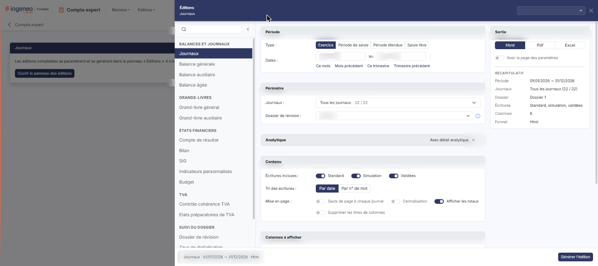
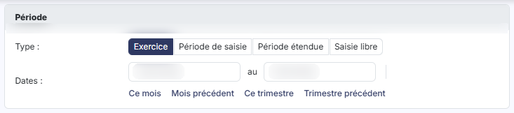
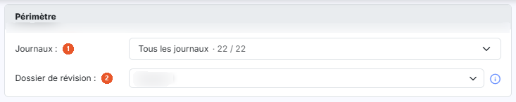
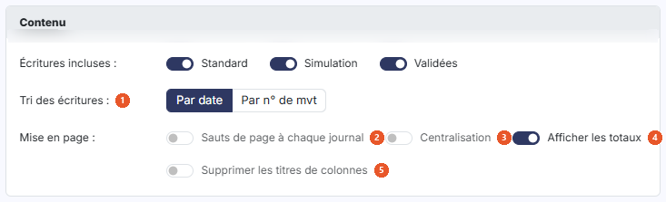
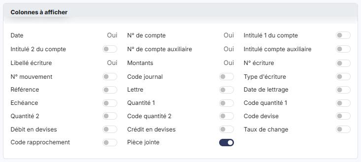
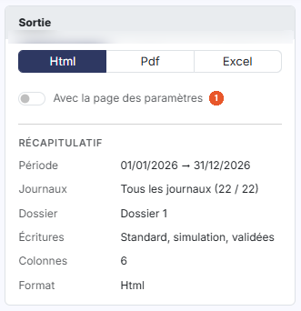

# Journaux — édition


**Où le trouver :** Menu **Editions › Journaux**



**En bref** — Cette édition produit les journaux comptables dans lesquels les écritures ont été saisies, à partir de critères réglés dans le panneau des éditions.

* Pour éditer : réglez les cartes « Période », « Périmètre », « Contenu » et « Colonnes à afficher », puis bouton \[Générer l'édition].
* Pour rouvrir le panneau fermé : bouton \[Ouvrir le panneau des éditions].


Cette option permet d'éditer les journaux comptables dans lesquels les écritures ont été saisies. L'édition se paramètre dans un panneau, sous la forme d'un formulaire réparti en cartes (« Période », « Périmètre », « Analytique », « Contenu » et « Colonnes à afficher »), complété à droite par la carte « Sortie » et, en bas, par le pied du panneau.

<figure><figcaption>
Écran « Journaux » de la nouvelle interface
</figcaption></figure>

## Le panneau d'éditions

<figure><figcaption>
Bouton [Ouvrir le panneau des éditions]
</figcaption></figure>

Cette édition ne s'ouvre plus dans une page de paramétrage : elle se paramètre et se génère dans le **panneau d'éditions**, commun à toutes les éditions comptables. Pour l'ouvrir, cliquez sur le menu **Éditions** de la barre du module, puis sur **Journaux** ; depuis l'écran Révision, ouvrez le menu ⋮ (Plus d'actions), puis **Éditions**, et choisissez l'édition dans la liste de gauche du panneau. La page qui s'affiche derrière porte le titre de l'édition et le bouton **\[Ouvrir le panneau des éditions]** : le panneau s'ouvre de lui-même ; si vous l'avez fermé, ce bouton le rouvre.

Le panneau est un tiroir intitulé « Éditions », suivi du nom de l'édition. **À gauche**, la liste des quinze éditions en cinq groupes — « Balances et journaux », « Grands-livres », « États financiers », « TVA » et « Suivi du dossier » — avec une zone « Rechercher une édition » et un bouton « Replier la liste » ; cliquer sur une autre édition change de formulaire sans quitter le panneau. **Au centre**, le formulaire, présenté en cartes. **À droite**, la carte « Sortie » et le « Récapitulatif » des critères retenus. **En en-tête**, la liste des paramétrages enregistrés (voir plus bas) et la croix « Fermer ». **Dans le pied**, un résumé de l'édition (nom, dates, format) et, à droite, le bouton **\[Générer l'édition]**. Le pied ne porte pas de bouton \[Annuler] : le panneau se referme par la croix « Fermer » de l'en-tête.

## Carte « Période »

<figure><figcaption>
Rubrique « Carte « Période » »
</figcaption></figure>

| Champ          | Ce qu'il faut savoir                                                                                                                                                                                                                                                                                                                                                                                                                           |
| -------------- | ---------------------------------------------------------------------------------------------------------------------------------------------------------------------------------------------------------------------------------------------------------------------------------------------------------------------------------------------------------------------------------------------------------------------------------------------- |
| **Type**       | Choisissez la période sur laquelle porte l'édition, au moyen de quatre boutons : « Exercice », « Période de saisie », « Période étendue » et « Saisie libre ». Le choix retenu à l'ouverture dépend du dossier de révision en cours : « Période de saisie » si aucun dossier de révision n'est en cours, « Exercice » si le dossier de révision en cours est un dossier de clôture, et « Saisie libre » s'il s'agit d'un dossier de situation. |
| **Dates … au** | Le logiciel renseigne les deux dates d'après le type choisi. Elles restent saisissables à tout moment : modifier une date fait passer le type sur « Saisie libre ». Il n'y a plus de pictogramme « Calendrier » : le calendrier s'ouvre au clic dans la zone de date.                                                                                                                                                                          |
| **Raccourcis** | Sous les dates, « Ce mois », « Mois précédent », « Ce trimestre » et « Trimestre précédent » renseignent les deux dates et passent le type sur « Saisie libre ». Une ligne de rappel, par exemple « Période relative : Ce mois (dates du jour, recalculées à chaque chargement du modèle d'édition). », précise alors que ces dates sont recalculées à chaque chargement du modèle d'édition.                                                  |

## Carte « Périmètre »

<figure><figcaption>
Rubrique « Carte « Périmètre » »
</figcaption></figure>

| Champ                      | Ce qu'il faut savoir                                                                                                                                                                                                                                                                                                                                                                                                                                                                                                                                                                                                                                                                                                                                                                                       |
| -------------------------- | ---------------------------------------------------------------------------------------------------------------------------------------------------------------------------------------------------------------------------------------------------------------------------------------------------------------------------------------------------------------------------------------------------------------------------------------------------------------------------------------------------------------------------------------------------------------------------------------------------------------------------------------------------------------------------------------------------------------------------------------------------------------------------------------------------------- |
| 1. **Journaux**            | Liste à choix multiple, intitulée « Tous les journaux · 22 / 22 » à l'ouverture, qui reprend tous les journaux du dossier annuel en cours : elle remplace les anciens champs « Journal », « Seulement la sélection » et « Tous les journaux sauf ». À l'ouverture, tous les journaux sont retenus ; si vous souhaitez restreindre l'édition, ouvrez la liste : les journaux y sont regroupés par type (« Achats », « Ventes », « Opérations diverses », « Banques », etc.), chacun avec son code, son libellé et une case à cocher. « Tout » et « Aucun » agissent sur l'ensemble de la liste, un « Aucun » propre à chaque groupe sur le groupe seul ; le pied de la liste indique le nombre de journaux sélectionnés (« 22 journaux sélectionnés ») et porte le bouton \[Valider], qui referme la liste. |
| 2. **Dossier de révision** | Liste proposant « Aucun », puis chacun des dossiers de révision du dossier annuel. Une info-bulle précise : « Sélectionnez le dossier de révision pris en compte par l'édition : ses commentaires de révision si l'option « Avec les commentaires de révision » est active, et les écritures de simulation de son journal si l'option « Avec les écritures de simulation » est active. « Aucun » : seules les écritures de simulation des journaux non rattachés à un dossier de révision sont retenues. »                                                                                                                                                                                                                                                                                                 |

## Carte « Analytique »

<figure><figcaption>
Rubrique « Carte « Analytique » »
</figcaption></figure>

| Champ                                   | Ce qu'il faut savoir                                                                                                                                                                                                                                                     |
| --------------------------------------- | ------------------------------------------------------------------------------------------------------------------------------------------------------------------------------------------------------------------------------------------------------------------------ |
| 1. **Avec détail analytique**           | Interrupteur désactivé par défaut ; la carte reste repliée. Si vous le passez à Oui, le logiciel déplie la carte et affiche les choix suivants.                                                                                                                          |
| **Axes**                                | Liste à choix multiple, positionnée sur « Tous les axes » par défaut, avec une case par axe du dossier. Il n'y a plus de choix « Type d'axe » (« Liste » ou « Agrégat »).                                                                                                |
| **Présentation**                        | Le premier des deux choix de ce nom, placé sous « Axes », indique si l'axe est présenté par son « Code » (choix par défaut) ou par son « Libellé ».                                                                                                                      |
| **Sections**                            | Liste à choix multiple, positionnée sur « Toutes les sections » par défaut, avec une case par section. Elle est accessible d'emblée : il n'est plus nécessaire de désigner d'abord un axe précis. Il n'y a plus de choix « Type de section » (« Liste » ou « Agrégat »). |
| **Présentation**                        | Le second choix de ce nom, placé sous « Sections », indique si la section est présentée par son « Code » ou par son « Libellé » (choix par défaut).                                                                                                                      |
| **Exclure les écritures non ventilées** | Positionné sur Non par défaut.                                                                                                                                                                                                                                           |
| **Exclure les lignes non ventilées**    | Second interrupteur, placé à droite du précédent et désactivé par défaut.                                                                                                                                                                                                |

## Carte « Contenu »

<figure><figcaption>
Rubrique « Carte « Contenu » »
</figcaption></figure>

| Champ                                   | Ce qu'il faut savoir                                                                                                                                                                                                   |
| --------------------------------------- | ---------------------------------------------------------------------------------------------------------------------------------------------------------------------------------------------------------------------- |
| 1. **Tri des écritures**                | Choisissez si vous souhaitez que les écritures soient présentées par ordre chronologique (« Par date », choix par défaut) ou dans l'ordre dans lequel elles ont été saisies (« Par n° de mvt »).                       |
| 2. **Sauts de page à chaque journal**   | Choix désactivé par défaut.                                                                                                                                                                                            |
| 3. **Centralisation**                   | Choix désactivé par défaut.                                                                                                                                                                                            |
| 4. **Afficher les totaux**              | Choix activé par défaut.                                                                                                                                                                                               |
| 5. **Supprimer les titres de colonnes** | Choix désactivé par défaut.                                                                                                                                                                                            |
| **Écritures incluses**                  | Trois interrupteurs, tous activés par défaut. « Standard » fait figurer dans l'édition les écritures ordinaires de la comptabilité, « Simulation » les écritures de simulation et « Validées » les écritures validées. |

## Carte « Colonnes à afficher »

<figure><figcaption>
Rubrique « Carte « Colonnes à afficher » »
</figcaption></figure>

Cette carte remplace le bouton \[Choix des champs] et sa fenêtre « Eléments à afficher » : toutes les colonnes que vous pouvez faire figurer dans votre édition sont listées directement dans le formulaire, sans fenêtre à ouvrir et sans bouton Enregistrer ni bouton Fermer.

Certaines colonnes ne sont pas supprimables de l'édition car elles sont indispensables à ce type de document : la date, le n° de compte, le n° de compte auxiliaire, le libellé de l'écriture et les montants portent la mention « Oui » en simple texte, sans interrupteur.

Les autres colonnes sont commandées par un interrupteur : l'intitulé 1 du compte, l'intitulé 2 du compte, l'intitulé du compte auxiliaire, le n° d'écriture, le n° de mouvement, le code journal, le type d'écriture, la référence, la lettre, la date de lettrage, l'échéance, la quantité 1 et son code, la quantité 2 et son code, le code devise, le débit en devises, le crédit en devises, le taux de change, le code rapprochement et la pièce jointe. Ils sont tous positionnés sur Non par défaut, à l'exception de la pièce jointe, qui est sur Oui. Le récapitulatif indique le nombre de colonnes retenues (6 à l'ouverture).

Si une colonne cochée ne contient aucune donnée pour les critères choisis, un encadré orange apparaît sous le récapitulatif : « Aucune donnée à afficher pour : … Vous pouvez retirer ces colonnes. » Il ne signale pas une erreur : il disparaît lorsque la colonne concernée est décochée.

## Carte « Sortie » et récapitulatif

<figure><figcaption>
Rubrique « Carte « Sortie » et récapitulatif »
</figcaption></figure>

La carte « Sortie » se trouve dans la colonne de droite, sous le titre du panneau. **Format :** trois boutons, « Html », « Pdf » et « Excel ».

| Champ                              | Ce qu'il faut savoir                                                                                                                                                                                                                                                                                                                                                                                                             |
| ---------------------------------- | -------------------------------------------------------------------------------------------------------------------------------------------------------------------------------------------------------------------------------------------------------------------------------------------------------------------------------------------------------------------------------------------------------------------------------- |
| 1. **Avec la page des paramètres** | 
Interrupteur désactivé par défaut. • Html : c'est le format sélectionné par défaut. • Pdf : pour ce format, le logiciel affiche deux choix supplémentaires, « Orientation » et « Largeur ».
                                                                                                                                                                                                                         |
| **Orientation**                    | Ce choix n'apparaît que si le format retenu est « Pdf ». Il vous permet d'imprimer en « Portrait » (choix par défaut) ou en « Paysage ».                                                                                                                                                                                                                                                                                         |
| **Largeur**                        | Ce choix n'apparaît lui aussi que si le format retenu est « Pdf ». La largeur « Ajustée » réduit la taille lorsque la largeur des colonnes dépasse la largeur de la page (info-bulle : « Ajuste la taille si la largeur des colonnes dépasse la largeur de la page ») ; la largeur « Fixe » ne la modifie pas. Attention : lorsque vous passez le format à « Pdf », le logiciel positionne de lui-même ce choix sur « Ajustée ». |
| **Récapitulatif**                  | Sous la carte « Sortie », il rappelle les critères retenus (période, dossier de révision, écritures, format, et selon l'édition les journaux, l'analytique ou le nombre de colonnes). Il se met à jour au fil de vos choix.                                                                                                                                                                                                      |

## Paramétrages enregistrés et génération

**Les paramétrages enregistrés**

La zone « Nouveau paramétrage… », en haut à droite du panneau, remplace les anciens boutons \[Mémoriser les paramètres] et \[Charger les paramètres]. Son chevron (« Afficher les paramètres enregistrés ») ouvre une liste : l'entrée « Nouveau paramètre — À partir des critères affichés », puis, sous le nom de l'édition et avec leur nombre, les paramétrages déjà enregistrés **pour cette édition** (un paramétrage enregistré pour une autre édition n'y figure pas). Au survol d'un paramétrage, deux icônes permettent de le dupliquer ou de le supprimer.

| Champ                                 | Ce qu'il faut savoir                                                                                                                                                                                                                                                                                                                            |
| ------------------------------------- | ----------------------------------------------------------------------------------------------------------------------------------------------------------------------------------------------------------------------------------------------------------------------------------------------------------------------------------------------- |
| **Enregistrer les critères affichés** | Saisissez un nom dans la zone « Nouveau paramétrage… », puis validez par la touche Entrée ou par le bouton d'enregistrement placé à droite de la zone (info-bulle « Enregistrer comme nouveau paramètre (Entrée) »).                                                                                                                            |
| **Reprendre un paramétrage**          | Cliquez sur son nom dans la liste. Le formulaire se remplit avec ses critères, y compris le format de sortie, et le nom s'affiche dans la zone d'en-tête. Une icône d'enregistrement placée à côté du nom (info-bulle « Modifié – mettre à jour « nom » (Entrée) ») permet de remettre à jour le paramétrage chargé avec les critères affichés. |

bouton **\[Générer l'édition]**

Il se trouve dans le pied du panneau et lance la génération du document dans le format que vous avez retenu. bouton **\[Retour au paramétrage]**, bouton **\[Ouvrir dans un onglet]**, bouton **\[Excel]** et bouton **\[Pdf]** ne sont pas affichés à l'ouverture : le panneau les prévoit après la génération.
