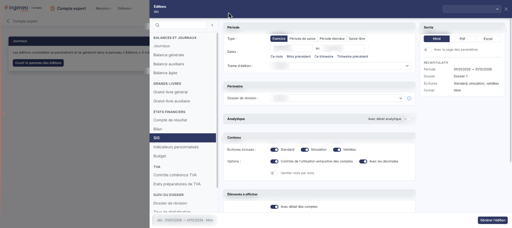
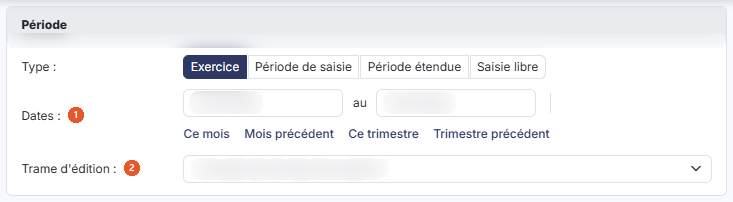
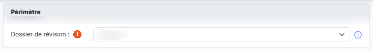
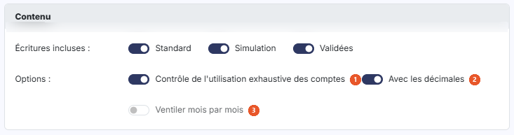
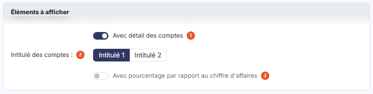
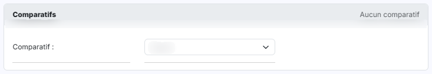
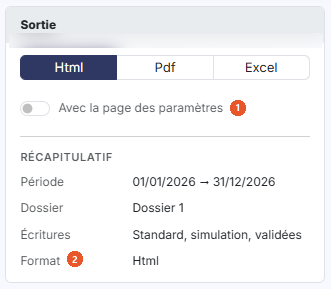

# SIG


**Où le trouver :** Menu **Editions › SIG**



**En bref** — Cette édition produit les soldes intermédiaires de gestion du dossier, avec en option le détail analytique, le détail des comptes et des comparatifs.

* Pour éditer : choisissez la période et le périmètre, puis bouton \[Générer l'édition].
* Pour comparer avec d'autres périodes : renseignez la carte « Comparatifs », puis bouton \[Générer l'édition].


Cette page vous permet d'éditer les soldes intermédiaires de gestion du dossier.

<figure><figcaption>
Écran « SIG » de la nouvelle interface
</figcaption></figure>

## Le panneau d'éditions

<figure><figcaption>
Bouton [Ouvrir le panneau des éditions]
</figcaption></figure>

Cette édition ne s'ouvre plus dans une page de paramétrage : elle se paramètre et se génère dans le **panneau d'éditions**, commun à toutes les éditions comptables. Pour l'ouvrir, cliquez sur le menu **Éditions** de la barre du module, puis sur **SIG** ; depuis l'écran Révision, ouvrez le menu ⋮ (Plus d'actions), puis **Éditions**, et choisissez l'édition dans la liste de gauche du panneau. La page qui s'affiche derrière porte le titre de l'édition et le bouton **\[Ouvrir le panneau des éditions]** : le panneau s'ouvre de lui-même ; si vous l'avez fermé, ce bouton le rouvre.

Le panneau est un tiroir intitulé « Éditions », suivi du nom de l'édition. **À gauche**, la liste des quinze éditions en cinq groupes — « Balances et journaux », « Grands-livres », « États financiers », « TVA » et « Suivi du dossier » — avec une zone « Rechercher une édition » et un bouton « Replier la liste » ; cliquer sur une autre édition change de formulaire sans quitter le panneau. **Au centre**, le formulaire, présenté en cartes. **À droite**, la carte « Sortie » et le « Récapitulatif » des critères retenus. **En en-tête**, la liste des paramétrages enregistrés (voir plus bas) et la croix « Fermer ». **Dans le pied**, un résumé de l'édition (nom, dates, format) et, à droite, le bouton **\[Générer l'édition]**. Le pied ne porte pas de bouton \[Annuler] : le panneau se referme par la croix « Fermer » de l'en-tête.

L'écran se présente sous la forme d'un formulaire de paramétrage réparti en six cartes, dans l'ordre suivant : « Période », « Périmètre », « Analytique », « Contenu », « Éléments à afficher » et « Comparatifs ». Vous lancez l'édition avec le bouton **\[Générer l'édition]**, en bas du tiroir.

## Carte « Période »

<figure><figcaption>
Rubrique « Carte « Période » »
</figcaption></figure>

| Champ                  | Ce qu'il faut savoir                                                                                                                                                                                                                                                                                                                                                                                                                                                                                                                                                                                              |
| ---------------------- | ----------------------------------------------------------------------------------------------------------------------------------------------------------------------------------------------------------------------------------------------------------------------------------------------------------------------------------------------------------------------------------------------------------------------------------------------------------------------------------------------------------------------------------------------------------------------------------------------------------------- |
| 1. **Dates**           | Du … au … : le logiciel renseigne ces deux dates d'après la période choisie ci-dessus. Elles restent saisissables à tout moment, directement ou avec le calendrier, qui s'ouvre au clic dans la zone de date : modifier une date fait passer le type sur « Saisie libre ».                                                                                                                                                                                                                                                                                                                                        |
| 2. **Trame d'édition** | Choisissez la trame d'édition de soldes intermédiaires de gestion parmi la liste. Les trames dont le libellé est encadré d'astérisques sont livrées avec le logiciel (« _SIG BA_ », « _SIG Négoce_ » et « _SIG Production_ ») ; les autres sont celles que vous avez paramétrées dans le panneau Paramètres, rubrique « Modèles », « Documents », « États financiers ».                                                                                                                                                                                                                                           |
| **Type**               | Choisissez la période sur laquelle porte l'édition avec les boutons « Exercice », « Période de saisie », « Période étendue » et « Saisie libre ». Sous les dates, les raccourcis « Ce mois », « Mois précédent », « Ce trimestre » et « Trimestre précédent » renseignent les deux dates et passent le type sur « Saisie libre ». Le choix retenu à l'ouverture dépend du dossier de révision en cours : « Période de saisie » si aucun dossier de révision n'est en cours, « Exercice » si le dossier de révision en cours est un dossier de clôture, et « Saisie libre » s'il s'agit d'un dossier de situation. |

## Carte « Périmètre »

<figure><figcaption>
Rubrique « Carte « Périmètre » »
</figcaption></figure>

**Dossier de révision** : sélectionnez le dossier de révision dont vous voulez tenir compte. Le logiciel rappelle la règle dans l'infobulle du champ : « Sélectionnez le dossier de révision pris en compte par l'édition : ses commentaires de révision si l'option « Avec les commentaires de révision » est active, et les écritures de simulation de son journal si l'option « Avec les écritures de simulation » est active. « Aucun » : seules les écritures de simulation des journaux non rattachés à un dossier de révision sont retenues. »

## Carte « Analytique »

<figure><figcaption>
Rubrique « Carte « Analytique » »
</figcaption></figure>

**Avec détail analytique** : cet interrupteur, placé dans l'en-tête de la carte, est désactivé par défaut. Si vous activez l'interrupteur, le logiciel déplie la carte et affiche les champs suivants, et une ligne « Analytique » s'ajoute au « Récapitulatif » :

* **Axes** : liste déroulante qui retient par défaut tous les axes.
* **Sections** : liste déroulante qui retient par défaut toutes les sections.
* **Présentation de l'édition** : « Détail des sections par compte » (choix par défaut) ou « Détail des comptes par section ».
* **Inclure les écritures non ventilées** : interrupteur désactivé par défaut.
* **Edition unitaire par section** : interrupteur désactivé par défaut.

## Carte « Contenu »

<figure><figcaption>
Rubrique « Carte « Contenu » »
</figcaption></figure>

| Champ                                                   | Ce qu'il faut savoir                                                                        |
| ------------------------------------------------------- | ------------------------------------------------------------------------------------------- |
| 1. **Contrôle de l'utilisation exhaustive des comptes** | Activé par défaut.                                                                          |
| 2. **Avec les décimales**                               | Activé par défaut.                                                                          |
| 3. **Ventiler mois par mois**                           | Désactivé par défaut.                                                                       |
| **Écritures incluses**                                  | Trois interrupteurs, « Standard », « Simulation » et « Validées », tous activés par défaut. |


Attention : ce choix retire la carte « Comparatifs » du formulaire. Vous ne pouvez donc pas comparer à un autre dossier annuel en même temps que vous ventilez mois par mois. Le logiciel fait apparaître à la place le champ :


**Position du total** : choisissez si le total figure en première colonne (« Total à gauche ») ou en dernière colonne (« Total à droite », choix par défaut).

## Carte « Éléments à afficher »

<figure><figcaption>
Rubrique « Carte « Éléments à afficher » »
</figcaption></figure>

| Champ                                                     | Ce qu'il faut savoir                                                                                                     |
| --------------------------------------------------------- | ------------------------------------------------------------------------------------------------------------------------ |
| 1. **Avec détail des comptes**                            | Activé par défaut.                                                                                                       |
| 2. **Intitulé des comptes**                               | Choisissez si les comptes détaillés sont désignés par leur « Intitulé 1 » (choix par défaut) ou par leur « Intitulé 2 ». |
| 3. **Avec pourcentage par rapport au chiffre d'affaires** | Désactivé par défaut.                                                                                                    |

## Carte « Comparatifs »

<figure><figcaption>
Rubrique « Carte « Comparatifs » »
</figcaption></figure>

La carte indique « Aucun comparatif » à l'ouverture, puis « 1 comparatif actif » ou « 2 comparatifs actifs » selon vos choix. Dans la même édition, vous pouvez comparer les valeurs à celles de deux autres dossiers annuels, présentés côte à côte en deux colonnes, « Comparatif 1 » et « Comparatif 2 ».

**Comparatif** : sélectionnez dans chaque liste le dossier annuel sur lequel opérer la comparaison ; la valeur par défaut est « Aucun ». Vous pouvez désigner un exercice nommément, ou l'un des deux choix génériques « n-1 (générique) » et « n-2 (générique) », qui suivent l'exercice courant d'une année sur l'autre.

Dès que vous désignez un dossier annuel, le logiciel affiche pour ce comparatif les champs suivants, ainsi qu'un lien « Retirer » qui retire le comparatif :

* **Période** : « Tout l'exercice » (choix par défaut) ou « Saisie libre ».
* **Dossier de révision** : « Aucun » par défaut.
* **Jusqu'au** : date de fin de la période comparée. Elle reste en lecture seule tant que le choix ci-dessus vaut « Tout l'exercice ».
* **Avec solde** : case du comparatif.
* **Avec variation en valeur** : case du comparatif.
* **Avec variation en %** : case du comparatif.

## Carte « Sortie » (à droite du formulaire)

<figure><figcaption>
Rubrique « Carte « Sortie » (à droite du formulaire) »
</figcaption></figure>

| Champ                              | Ce qu'il faut savoir                                                                                                                                                                                                                                                                                                                |
| ---------------------------------- | ----------------------------------------------------------------------------------------------------------------------------------------------------------------------------------------------------------------------------------------------------------------------------------------------------------------------------------- |
| 1. **Avec la page des paramètres** | Interrupteur désactivé par défaut.                                                                                                                                                                                                                                                                                                  |
| 2. **Format**                      | 
Vous avez le choix entre trois formats, présentés en boutons. • Html : c'est le format sélectionné par défaut. • Pdf : pour ce format, le logiciel affiche deux choix supplémentaires, « Orientation » et « Largeur ».
                                                                                                 |
| **Orientation**                    | Ce choix n'apparaît que si le format retenu est « Pdf ». Il vous permet d'imprimer en « Portrait » (choix par défaut) ou en « Paysage ».                                                                                                                                                                                            |
| **Largeur**                        | Ce choix n'apparaît lui aussi que si le format retenu est « Pdf ». La largeur « Ajustée » réduit la taille lorsque la largeur des colonnes dépasse la largeur de la page ; la largeur « Fixe » ne la modifie pas. Attention : lorsque vous passez le format à « Pdf », le logiciel positionne de lui-même ce choix sur « Ajustée ». |

Sous ces choix, le « Récapitulatif » rappelle la période, le dossier de révision, les écritures incluses et le format retenus (avec l'orientation pour le Pdf).

## Paramétrages enregistrés et génération

**Les paramétrages enregistrés**

La zone « Nouveau paramétrage… », en haut à droite du panneau, remplace les anciens boutons \[Mémoriser les paramètres] et \[Charger les paramètres]. Son chevron (« Afficher les paramètres enregistrés ») ouvre une liste : l'entrée « Nouveau paramètre — À partir des critères affichés », puis, sous le nom de l'édition et avec leur nombre, les paramétrages déjà enregistrés **pour cette édition** (un paramétrage enregistré pour une autre édition n'y figure pas). Au survol d'un paramétrage, deux icônes permettent de le dupliquer ou de le supprimer.

| Champ                                 | Ce qu'il faut savoir                                                                                                                                                                                                                                                                                                                            |
| ------------------------------------- | ----------------------------------------------------------------------------------------------------------------------------------------------------------------------------------------------------------------------------------------------------------------------------------------------------------------------------------------------- |
| **Enregistrer les critères affichés** | Saisissez un nom dans la zone « Nouveau paramétrage… », puis validez par la touche Entrée ou par le bouton d'enregistrement placé à droite de la zone (info-bulle « Enregistrer comme nouveau paramètre (Entrée) »).                                                                                                                            |
| **Reprendre un paramétrage**          | Cliquez sur son nom dans la liste. Le formulaire se remplit avec ses critères, y compris le format de sortie, et le nom s'affiche dans la zone d'en-tête. Une icône d'enregistrement placée à côté du nom (info-bulle « Modifié – mettre à jour « nom » (Entrée) ») permet de remettre à jour le paramétrage chargé avec les critères affichés. |

bouton **\[Générer l'édition]**

Il se trouve dans le pied du panneau et lance la génération du document dans le format que vous avez retenu. bouton **\[Retour au paramétrage]**, bouton **\[Ouvrir dans un onglet]**, bouton **\[Excel]** et bouton **\[Pdf]** ne sont pas affichés à l'ouverture : le panneau les prévoit après la génération.
