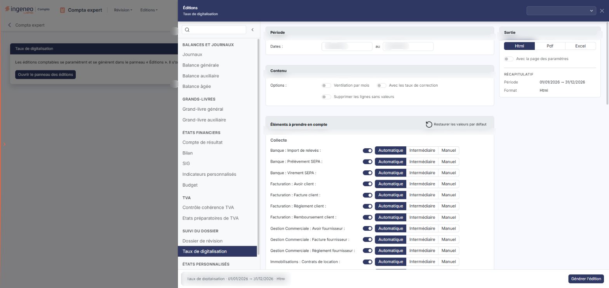
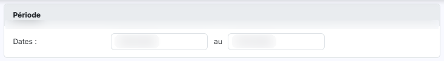
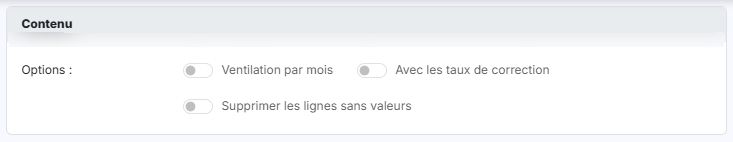
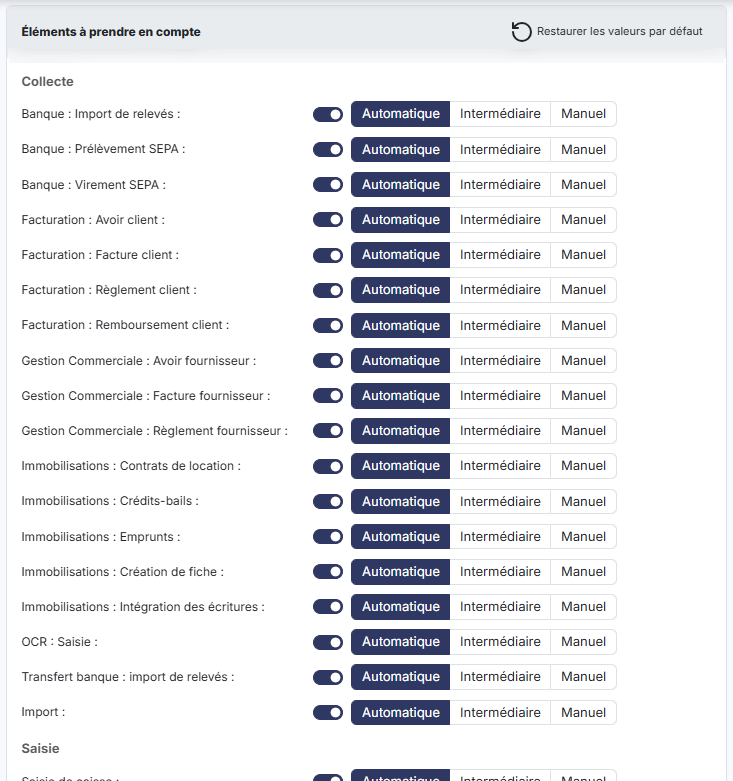
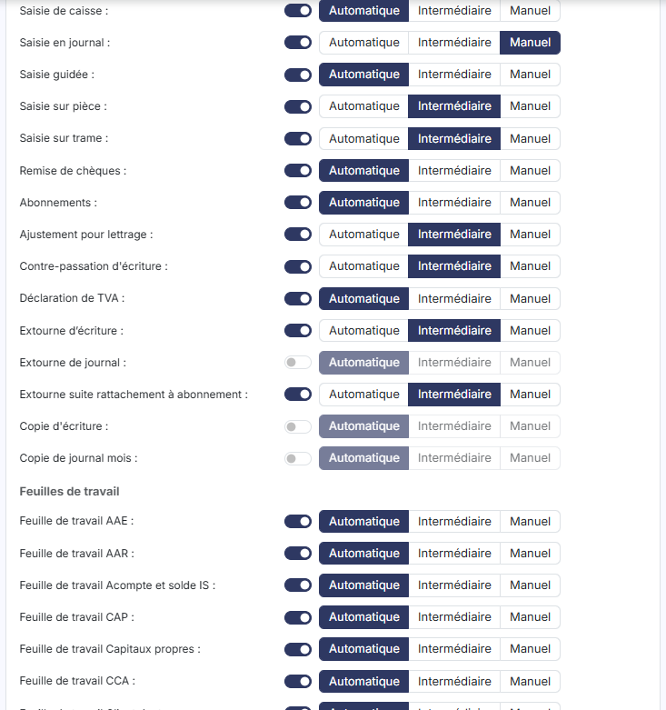
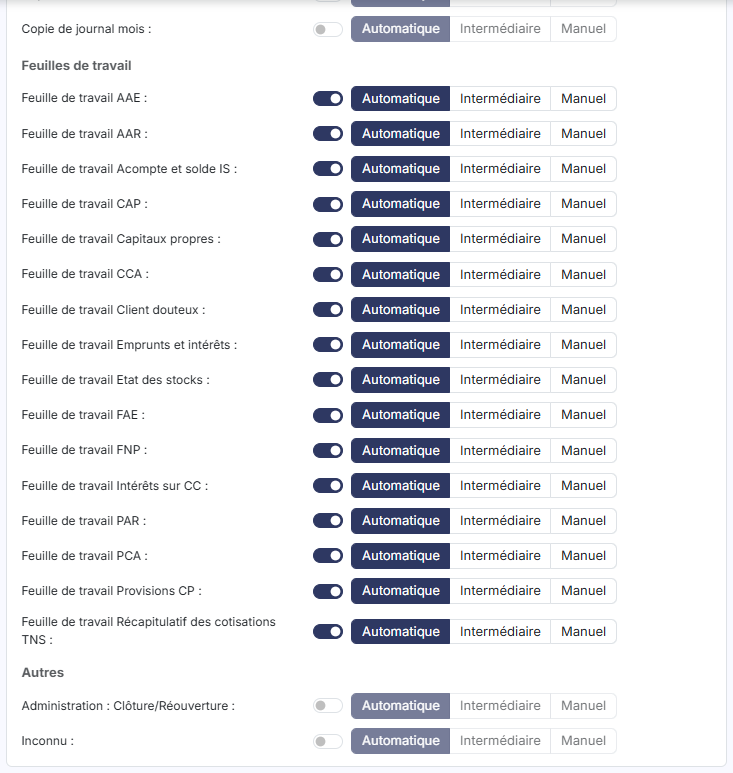
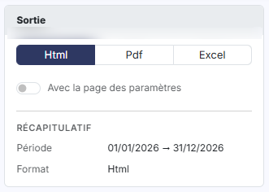

# Taux de digitalisation


**Où le trouver :** Menu **Editions › Taux de digitalisation**



**En bref** — Cette édition mesure la part des écritures du dossier annuel créées automatiquement ou semi-automatiquement, indicateur de performance et de productivité du dossier.

* Pour éditer : choisissez le format dans le panneau des éditions, puis bouton \[Générer l'édition].
* Pour renoncer : croix « Fermer » du panneau (le pied n'a pas de bouton \[Annuler]).


Cette page vous permet d'analyser comment les écritures contenues dans le dossier annuel ont été créées.

<figure><figcaption>
Écran « Taux de digitalisation » de la nouvelle interface
</figcaption></figure>

Vous la déclenchez avec le bouton **\[Générer l'édition]**. Le formulaire est présenté dans le panneau d'éditions en trois cartes, « Période », « Contenu » et « Éléments à prendre en compte », complétées à droite par la carte « Sortie ».

Pour l'ouvrir, dans l'écran Révision, cliquez sur ⋮ (Plus d'actions), puis sur « Éditions » ; dans la liste de gauche du panneau qui s'ouvre, choisissez « Taux de digitalisation » (groupe « Suivi du dossier »).

Cette édition ne s'ouvre plus dans une page de paramétrage : elle se paramètre et se génère dans le **panneau d'éditions**, commun à toutes les éditions comptables. La page qui s'affiche derrière porte le titre de l'édition et le bouton **\[Ouvrir le panneau des éditions]** : le panneau s'ouvre de lui-même ; si vous l'avez fermé, ce bouton le rouvre.

Le panneau est un tiroir intitulé « Éditions », suivi du nom de l'édition. **À gauche**, la liste des quinze éditions en cinq groupes — « Balances et journaux », « Grands-livres », « États financiers », « TVA » et « Suivi du dossier » — avec une zone « Rechercher une édition » et un bouton « Replier la liste » ; cliquer sur une autre édition change de formulaire sans quitter le panneau. **Au centre**, le formulaire, présenté en cartes. **À droite**, la carte « Sortie » et le « Récapitulatif » des critères retenus. **En en-tête**, la liste des paramétrages enregistrés (voir plus bas) et la croix « Fermer ». **Dans le pied**, un résumé de l'édition (nom, dates, format) et, à droite, le bouton **\[Générer l'édition]**. Le pied ne porte pas de bouton \[Annuler] : le panneau se referme par la croix « Fermer » de l'en-tête.

## Carte « Période »

<figure><figcaption>
Rubrique « a) Carte « Période » »
</figcaption></figure>

**Dates : … au** le logiciel vous propose par défaut une période que vous pouvez restreindre. Ces deux dates sont directement saisissables. Il n'y a plus de pictogramme « Calendrier » : le calendrier s'ouvre au clic dans la zone de date.

## Carte « Contenu »

<figure><figcaption>
Rubrique « b) Carte « Contenu » »
</figcaption></figure>

| Champ                                 | Ce qu'il faut savoir                                                                |
| ------------------------------------- | ----------------------------------------------------------------------------------- |
| **Ventilation par mois**              | Interrupteur désactivé par défaut. Le logiciel n'en explique pas l'effet à l'écran. |
| **Avec les taux de correction**       | Interrupteur désactivé par défaut.                                                  |
| **Supprimer les lignes sans valeurs** | Interrupteur désactivé par défaut.                                                  |

## Carte « Éléments à prendre en compte »

<figure><figcaption>
Rubrique « c) Carte « Éléments à prendre en compte » »
</figcaption></figure>

<figure><figcaption>
Rubrique « c) Carte « Éléments à prendre en compte » »
</figcaption></figure>

<figure><figcaption>
Rubrique « c) Carte « Éléments à prendre en compte » »
</figcaption></figure>

Cette carte reprend la liste des origines possibles pour une écriture, regroupées sous quatre intertitres identiques aux catégories de l'édition : « Collecte », « Saisie », « Feuilles de travail » et « Autres ». Il n'y a pas de fenêtre à ouvrir : les lignes se modifient directement dans le panneau.

Chaque ligne se compose du libellé de l'origine, d'un interrupteur et de trois boutons, « Automatique », « Intermédiaire » et « Manuel » ; le tableau à trois colonnes et ses en-têtes ont disparu.

**Libellé** : le libellé de l'origine.

**Interrupteur de la ligne** (ancienne colonne « A intégrer »).

**Automatique / Intermédiaire / Manuel** (ancienne colonne « Type de saisie retenu »).

L'en-tête de la carte porte le **Bouton « Restaurer les valeurs par défaut »**. La carte n'a ni bouton « Enregistrer » ni bouton « Fermer » : le panneau se ferme avec la croix du bandeau.

## Carte « Sortie » (à droite du formulaire)

<figure><figcaption>
Rubrique « d) Carte « Sortie » (à droite du formulaire) »
</figcaption></figure>

| Champ                           | Ce qu'il faut savoir                                                                                                                                                                                                                                                                                                                |
| ------------------------------- | ----------------------------------------------------------------------------------------------------------------------------------------------------------------------------------------------------------------------------------------------------------------------------------------------------------------------------------- |
| **Avec la page des paramètres** | Interrupteur désactivé par défaut.                                                                                                                                                                                                                                                                                                  |
| **Format**                      | 
Vous avez le choix entre trois formats, présentés en boutons. • Html : c'est le format sélectionné par défaut. • Pdf : pour ce format, le logiciel affiche deux choix supplémentaires, « Orientation » et « Largeur ».
                                                                                                 |
| **Orientation**                 | Ce choix n'apparaît que si le format retenu est « Pdf ». Il vous permet d'imprimer en « Portrait » (choix par défaut) ou en « Paysage ».                                                                                                                                                                                            |
| **Largeur**                     | Ce choix n'apparaît lui aussi que si le format retenu est « Pdf ». La largeur « Ajustée » réduit la taille lorsque la largeur des colonnes dépasse la largeur de la page ; la largeur « Fixe » ne la modifie pas. Attention : lorsque vous passez le format à « Pdf », le logiciel positionne de lui-même ce choix sur « Ajustée ». |

## Le bouton et les paramétrages enregistrés

bouton **\[Générer l'édition]**

Il lance la génération du document dans le format que vous avez retenu.

**Liste « Nouveau paramétrage… »**

Placée en haut du tiroir, elle remplace les anciens boutons \[Mémoriser les paramètres] et \[Charger les paramètres]. Elle propose « Nouveau paramètre » (« À partir des critères affichés ») puis les paramétrages déjà enregistrés pour cette édition, regroupés sous l'intitulé « Taux de digitalisation » suivi de leur nombre. Sélectionnez un paramétrage pour charger les critères.

## Autres vues de l'écran

<figure><figcaption>
Bouton [Ouvrir le panneau des éditions]
</figcaption></figure>
