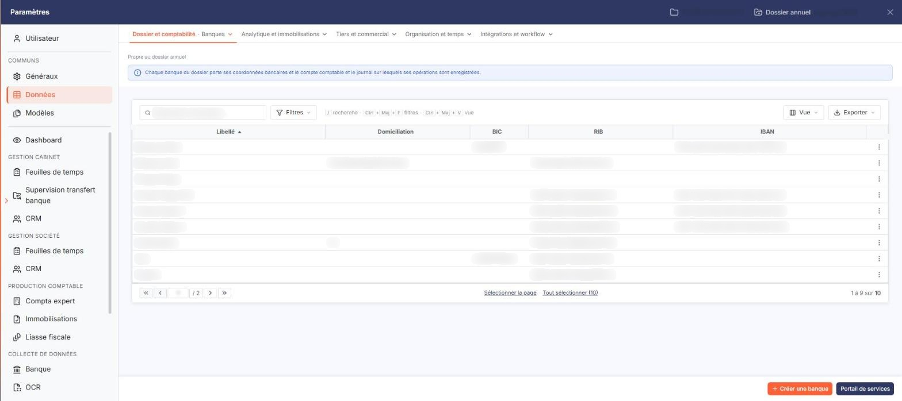
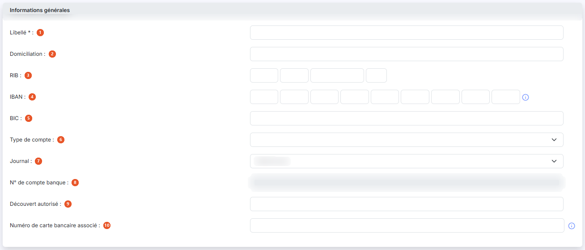
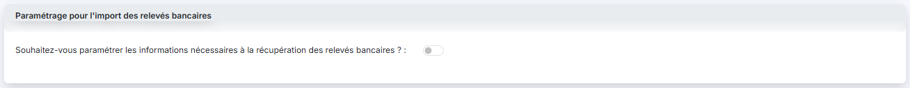
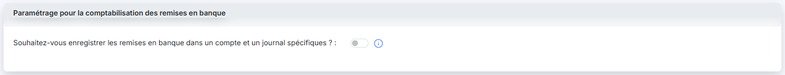

# Banques


**Où le trouver :** Panneau **Paramètres** › **Données** › **Dossier et comptabilité** › **Banques**



**En bref** — Ce fichier recense les comptes bancaires de la société, communs à plusieurs modules, pour les remises en banque, les virements SEPA et la récupération des écritures.

* Pour créer une banque : bouton \[Nouveau], renseignez la fiche, puis bouton \[Enregistrer].
* Pour supprimer des banques : cochez-les dans la liste, puis bouton \[Supprimer].


Le fichier "Banques" recense les comptes bancaires de la société. Il est utilisé dans plusieurs modules Ingeneo Compta (Comptabilité, Caisse, Gestion commerciale, etc.) et a plusieurs utilités (gestion des remises en banque, des virements SEPA, de la récupération automatique des écritures, etc.). Il est donc commun à tous les modules qui l'utilisent.

<figure><figcaption>
Écran « Banques » de la nouvelle interface
</figcaption></figure>

Les banques peuvent être créées manuellement dans ce fichier ou automatiquement lors du paramétrage des comptes dont vous souhaitez récupérer les écritures (voir le module "Scrap banque", onglet "Relevés bancaires", "a) Paramétrage d'un compte bancaire").

## La liste des banques

<figure><figcaption>
Bouton [Nouveau]
</figcaption></figure>

Le logiciel affiche la liste des banques déjà enregistrées, triée par ordre croissant de libellé. Les colonnes sont les suivantes : **Libellé**, **Domiciliation**, **BIC**, **RIB** et **IBAN**. Chacune de ces colonnes peut servir de critère de tri : cliquez sur son en-tête.

Une banque peut n'avoir aucune coordonnée bancaire : les colonnes **Domiciliation**, **BIC**, **RIB** et **IBAN** restent alors vides. Seul le libellé est obligatoire.

La première colonne de la grille ne porte pas d'en-tête : elle regroupe les commandes. Sur chaque ligne, vous y trouvez une case à cocher de sélection, le pictogramme « Crayon » qui ouvre la fiche de la banque, et le pictogramme « Croix verte » qui la supprime.

Dans l'en-tête de cette même colonne, vous disposez d'une case à cocher qui sélectionne toutes les lignes de la page affichée, d'une seconde case (carré orange) qui étend la sélection à toutes les pages, du pictogramme « Roue crantée » qui vous permet de choisir les colonnes affichées, du pictogramme « Entonnoir » qui ouvre la fenêtre « Filtres », et du pictogramme « Imprimante » qui imprime la grille.

bouton **\[Nouveau]**

Le logiciel ouvre une fiche vierge pour créer une banque. Les trois rubriques décrites ci-dessous y sont présentes, mais les champs de traçabilité (dates et auteurs de création et de modification) n'apparaissent qu'une fois la banque enregistrée.

bouton **\[Supprimer]**

Le logiciel supprime les banques dont vous avez coché la case de sélection.

## Rubrique « Informations générales »

<figure><figcaption>
Rubrique « Rubrique « Informations générales » »
</figcaption></figure>

Si la banque a été créée automatiquement, plusieurs de ses informations sont déjà renseignées.

| Champ                                                      | Ce qu'il faut savoir                                                                                                                                                                                                                                                                                                              |
| ---------------------------------------------------------- | --------------------------------------------------------------------------------------------------------------------------------------------------------------------------------------------------------------------------------------------------------------------------------------------------------------------------------- |
| 
1. <strong>Libellé</strong> <em>Obligatoire</em>
 | Champ obligatoire. Il permet de différencier les banques entre elles, il doit donc être unique.                                                                                                                                                                                                                                   |
| 2. **Domiciliation**                                       | —                                                                                                                                                                                                                                                                                                                                 |
| 3. **RIB**                                                 | Il se saisit en quatre zones accolées (code banque, code guichet, numéro de compte, clé). S'il est saisi, sa validité est vérifiée à l'aide de la clé.                                                                                                                                                                            |
| 4. **IBAN**                                                | Il se saisit en neuf zones accolées. S'il est saisi, sa validité est vérifiée.                                                                                                                                                                                                                                                    |
| 5. **BIC**                                                 | —                                                                                                                                                                                                                                                                                                                                 |
| 6. **Type de compte**                                      | Purement informatif. La liste propose une valeur vide, puis « Article 83 », « Assurance Vie », « Carte bancaire », « Compte chèque », « Compte de dépôt », « Compte épargne », « Compte joint », « Compte titres », « Emprunt », « Plan Épargne Entreprise », « Plan Épargne Retraite » et « Réserve spéciale de participation ». |
| 7. **Journal**                                             | Le sélecteur propose la liste des journaux de type banque existants dans le dossier.                                                                                                                                                                                                                                              |
| 8. **N° de compte banque**                                 | Ce champ n'est pas modifiable. Il s'agit du numéro de compte banque associé au journal, repris depuis le fichier "Journaux".                                                                                                                                                                                                      |
| 9. **Découvert autorisé**                                  | Ce montant peut être utilisé dans les indicateurs ou dans les alertes du module Vision.                                                                                                                                                                                                                                           |
| 10. **Numéro de carte bancaire associé**                   | Le pictogramme d'information placé à droite du champ rappelle que « Ce numéro est notamment utile en cas d'import de fichier OFX. »                                                                                                                                                                                               |
| **Date de création**                                       | **Créée par :** ces deux champs ne sont pas modifiables. Le logiciel les renseigne lui-même.                                                                                                                                                                                                                                      |
| **Date de modification**                                   | **Modifiée par :** ces deux champs ne sont pas modifiables. Le logiciel les renseigne lui-même lorsque la fiche a été modifiée.                                                                                                                                                                                                   |

## Rubrique « Paramétrage pour l'import des relevés bancaires »

<figure><figcaption>
Rubrique « Rubrique « Paramétrage pour l'import des relevés bancaires » »
</figcaption></figure>

Cette rubrique ne contient d'abord qu'une question : **Souhaitez-vous paramétrer les informations nécessaires à la récupération des relevés bancaires ? :**

Si ce compte banque est utilisé par Scrap banque, vous devez impérativement répondre « Oui » à cette question. Le logiciel déplie alors les champs suivants.

| Champ                                                            | Ce qu'il faut savoir                                                                                                                                                                                                                                                                                                                                                                                                                               |
| ---------------------------------------------------------------- | -------------------------------------------------------------------------------------------------------------------------------------------------------------------------------------------------------------------------------------------------------------------------------------------------------------------------------------------------------------------------------------------------------------------------------------------------- |
| **Date de début de récupération**                                | Ce champ n'est pas modifiable. Le pictogramme d'information indique que « Cette date est celle que vous avez indiquée lors du premier import pour cette banque. »                                                                                                                                                                                                                                                                                  |
| **Date de dernière récupération**                                | 
Ce champ n'est pas modifiable. Le pictogramme d'information indique qu'il s'agit de la « Date de la dernière récupération d'écriture automatique ou date de la dernière demande d'import manuel. » Ces deux dates n'apparaissent pas lors de la création d'une banque : aucune récupération n'a encore eu lieu.
                                                                                                                          |
| 
<strong>Compte d'attente</strong> <em>Obligatoire</em>
 | Champ obligatoire. Entrez le numéro de compte qui sera affecté à toutes les lignes de contrepartie des lignes d'écritures de banque pour lesquelles aucune règle de traduction n'a été prévue. Ainsi les écritures seront bien générées et vous devrez les reclasser dans le logiciel de comptabilité. Le bouton \[+] placé à droite du champ vous permet de créer le compte, et le pictogramme « Loupe » de le rechercher dans le plan comptable. |
| **Référence par défaut des écritures**                           | Entrez la référence qui sera affectée à toutes les écritures ventilées dans le compte d'attente.                                                                                                                                                                                                                                                                                                                                                   |

## Rubrique « Paramétrage pour la comptabilisation des remises en banque »

<figure><figcaption>
Rubrique « Rubrique « Paramétrage pour la comptabilisation des remises en banque » »
</figcaption></figure>

Cette rubrique ne contient d'abord qu'une question : **Souhaitez-vous enregistrer les remises en banque dans un compte et un journal spécifiques ? :** Le pictogramme d'information placé à droite rappelle l'effet des deux réponses possibles : si vous cochez « Non », les remises en banque saisies dans la saisie de caisse et les paiements SEPA seront enregistrées dans le compte et le journal de la banque ; si vous cochez « Oui », vous devez paramétrer le compte comptable et le journal dans lesquels ces opérations seront comptabilisées.

Les remises en banque sont donc enregistrées par défaut dans le compte banque associé au journal.

Cependant, si vous utilisez Scrap banque, vous allez récupérer une nouvelle fois les écritures de remise en banque.

Pour éviter cette double comptabilisation, vous avez la possibilité de paramétrer un autre compte (compte de transit) et un autre journal d'intégration des écritures de remise en banque.

Ainsi, quand vous validerez une remise en banque, les comptes clients seront crédités et le compte de transit sera débité du total.

Quand vous récupérerez l'écriture de remise en banque par scraping, la contrepartie de votre banque devra être enregistrée dans le compte de transit.

Répondez « Oui » pour faire apparaître les deux champs suivants, tous deux obligatoires.

| Champ                                                        | Ce qu'il faut savoir                                                                                                                                                                                                                              |
| ------------------------------------------------------------ | ------------------------------------------------------------------------------------------------------------------------------------------------------------------------------------------------------------------------------------------------- |
| 
<strong>N° de compte</strong> <em>Obligatoire</em>
 | Entrez le numéro du compte de transit. Le bouton \[+] placé à droite du champ vous permet de le créer, et le pictogramme « Loupe » de le rechercher dans le plan comptable.                                                                       |
| 
<strong>Journal</strong> <em>Obligatoire</em>
      | Sélectionnez le journal dans lequel les remises en banque seront comptabilisées. Le sélecteur de cette rubrique propose davantage de journaux que celui de la rubrique « Informations générales », qui n'affiche que les journaux de type banque. |

bouton **\[Enregistrer]**

Le logiciel contrôle la saisie puis enregistre la fiche de la banque.

bouton **\[Retour]**

Le logiciel referme la fiche et vous ramène à la liste des banques, sans enregistrer vos modifications.
