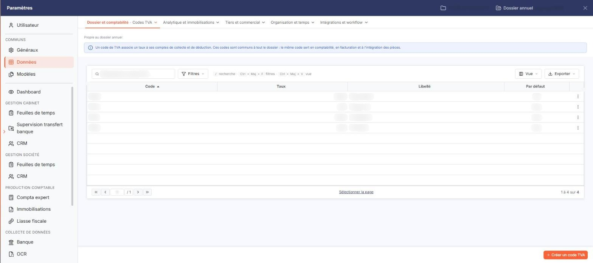
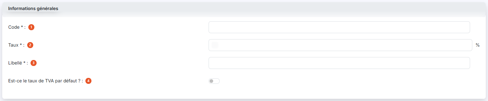
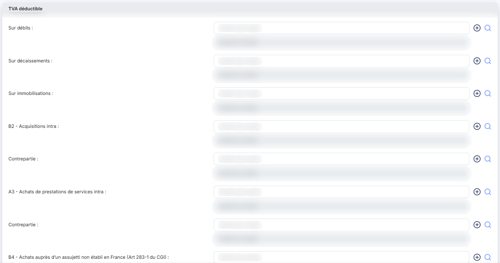
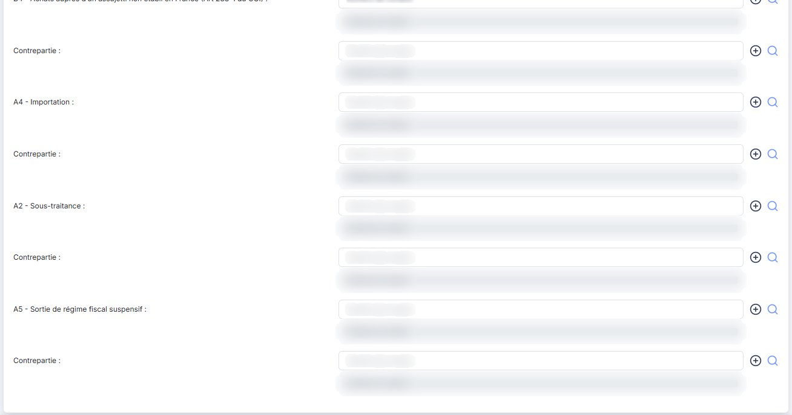
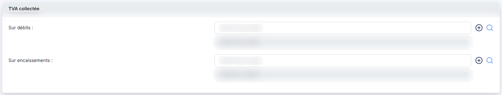

# Codes TVA


**Où le trouver :** Panneau **Paramètres** › **Données** › **Dossier et comptabilité** › **Codes TVA**



**En bref** — Ce fichier recense les codes de TVA du dossier, avec leur taux et les comptes de TVA déductible et collectée utilisés pour générer les écritures.

* Pour créer un code de TVA : bouton \[Nouveau], renseignez le code, puis les comptes de TVA déductible et de TVA collectée, puis bouton \[Enregistrer].
* Pour retrouver un code : ouvrez la fenêtre de filtres, saisissez vos critères, puis bouton \[Filtrer].


Ce fichier recense les codes de TVA du dossier : leur taux et les comptes dans lesquels la TVA sera comptabilisée lors de la génération des écritures.

<figure><figcaption>
Écran « Codes TVA » de la nouvelle interface
</figcaption></figure>

Les codes TVA sont utilisés par plusieurs modules du logiciel ; toute modification dans le fichier des codes TVA dans un module est donc immédiatement visible dans les autres modules.

Un code TVA ne peut pas être supprimé s'il est utilisé dans au moins un article ou une pièce commerciale.

## La liste des codes TVA

<figure><figcaption>
Bouton [Nouveau]
</figcaption></figure>

Le logiciel affiche la liste des codes TVA du dossier, triée par ordre croissant de code. Les colonnes sont les suivantes :

| Champ          | Ce qu'il faut savoir                                                                           |
| -------------- | ---------------------------------------------------------------------------------------------- |
| **Code**       | Le code de TVA, tel que vous l'avez saisi à la création.                                       |
| **Taux**       | Le taux de TVA, avec deux décimales.                                                           |
| **Libellé**    | Le libellé du code.                                                                            |
| **Par défaut** | Indique « Oui » pour le code désigné comme taux de TVA par défaut, et « Non » pour les autres. |

Chacune de ces quatre colonnes peut servir de critère de tri : cliquez sur son en-tête.

La première colonne de la grille ne porte pas d'en-tête : elle regroupe les commandes. Sur chaque ligne, vous y trouvez une case à cocher « Sélectionner », puis les pictogrammes « Crayon » (Modifier), « Croix » (Supprimer) et « Ajout » (Dupliquer). La suppression et la duplication d'un code ne sont accessibles que par ces pictogrammes de ligne.

Dans l'en-tête de cette même colonne, vous disposez d'une case à cocher qui sélectionne toutes les lignes de la page affichée, du pictogramme « Roue crantée » qui vous permet de choisir les colonnes affichées, du pictogramme « Entonnoir » qui ouvre la fenêtre « Filtres », et du pictogramme « Imprimante » qui imprime la grille.

**Pictogramme « Entonnoir » — la fenêtre « Filtres »**

Vous y composez vos critères de recherche : chaque critère se compose d'une valeur et d'un opérateur, et deux critères peuvent être combinés par les opérateurs Et et Ou.

La fenêtre propose non seulement les colonnes affichées dans la grille, mais aussi celles qui y sont masquées par défaut : les comptes de TVA déductible et de TVA collectée renseignés sur chaque code.

Cinq boutons sont proposés au bas de la fenêtre :

* bouton **\[Filtrer]** : le logiciel applique la recherche.
* bouton **\[Mémoriser les paramètres]** : le logiciel conserve vos critères pour vos prochaines connexions.
* bouton **\[Charger les paramètres]** : le logiciel rappelle les critères que vous avez mémorisés.
* bouton **\[Vider les filtres]** : le logiciel efface tous les critères.
* bouton **\[Fermer]** : le logiciel referme la fenêtre.

bouton **\[Nouveau]**

Le logiciel ouvre une fiche vierge pour créer un code TVA. Les trois rubriques décrites ci-dessous y sont présentes, avec les mêmes champs qu'en modification : le taux est proposé à 0, le code est saisissable, et la question du taux par défaut est positionnée sur « Non ».

## Rubrique « Informations générales »

<figure><figcaption>
Rubrique « Rubrique « Informations générales » »
</figcaption></figure>

| Champ                                                      | Ce qu'il faut savoir                                                                                                                                                |
| ---------------------------------------------------------- | ------------------------------------------------------------------------------------------------------------------------------------------------------------------- |
| 
1. <strong>Code</strong> <em>Obligatoire</em>
    | Il doit être unique. Il se saisit à la création du code TVA et n'est plus modifiable ensuite : lorsque vous ouvrez la fiche d'un code existant, le champ est grisé. |
| 
2. <strong>Taux</strong> <em>Obligatoire</em>
    | Saisissez le taux ; le logiciel affiche le symbole % à droite du champ.                                                                                             |
| 
3. <strong>Libellé</strong> <em>Obligatoire</em>
 | —                                                                                                                                                                   |
| 4. **Est-ce le taux de TVA par défaut ?**                  | Répondez « Oui » pour que ce code soit proposé chaque fois qu'un code TVA est demandé. Un seul code TVA peut être le taux par défaut.                               |

## Rubrique « TVA déductible »

<figure><figcaption>
Rubrique « Rubrique « TVA déductible » »
</figcaption></figure>

<figure><figcaption>
Rubrique « Rubrique « TVA déductible » »
</figcaption></figure>

Indiquez ici tous les numéros de comptes qui devront être utilisés lors de la génération d'écritures liées à ce code TVA pour la TVA déductible, ainsi que les comptes de contrepartie lorsque c'est nécessaire.

Chaque ligne se saisit de la même façon : entrez le numéro de compte, ou utilisez le bouton \[+] pour créer le compte, ou le pictogramme « Loupe » pour le rechercher dans le plan comptable. Le logiciel affiche à droite l'intitulé du compte, que vous ne pouvez pas modifier.

Les lignes proposées sont, dans cet ordre : **Sur débits**, **Sur décaissements**, **Sur immobilisations**, **B2 - Acquisitions intra**, **A3 - Achats de prestations de services intra**, **B4 - Achats auprès d'un assujetti non établi en France (Art 283-1 du CGI)**, **A4 - Importation**, **A2 - Sous-traitance** et **A5 - Sortie de régime fiscal suspensif**.

Les six lignes de **B2 - Acquisitions intra** à **A5 - Sortie de régime fiscal suspensif** comportent en outre, à leur droite, un champ **Contrepartie :** qui se renseigne de la même façon — au numéro de compte et à la loupe près, ce second champ n'offrant pas de bouton de création de compte. Aucune contrepartie n'est demandée sur les trois premières lignes.

Aucun de ces comptes n'est obligatoire : renseignez ceux qui correspondent aux opérations du dossier.

## Rubrique « TVA collectée »

<figure><figcaption>
Rubrique « Rubrique « TVA collectée » »
</figcaption></figure>

Indiquez ici tous les numéros de comptes qui devront être utilisés lors de la génération d'écritures liées à ce code TVA pour la TVA collectée. Cette rubrique compte deux lignes, **Sur débits** et **Sur encaissements**, qui se saisissent comme celles de la TVA déductible et ne sont pas obligatoires.

bouton **\[Enregistrer]**

Le logiciel contrôle la saisie puis enregistre le code TVA.

bouton **\[Retour]**

Le logiciel referme la fiche et vous ramène à la liste des codes TVA, sans enregistrer vos modifications.
