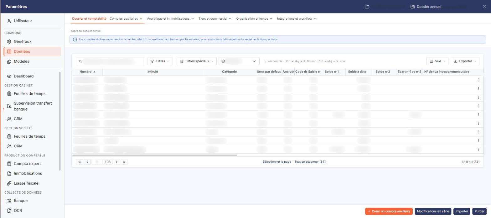
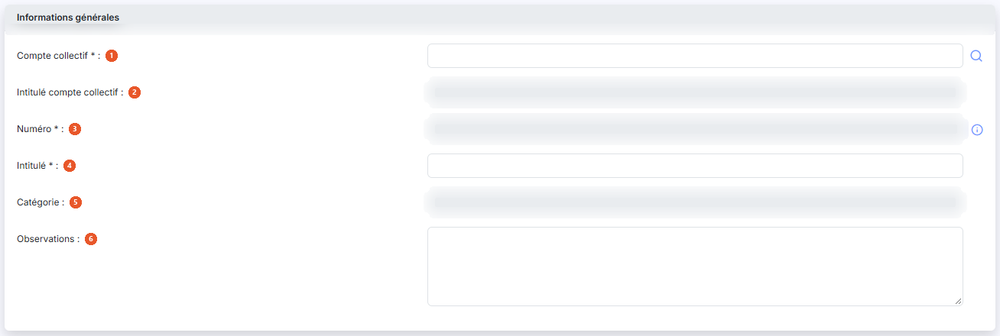
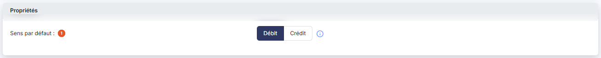
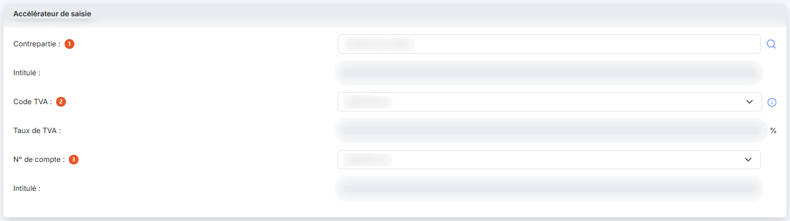
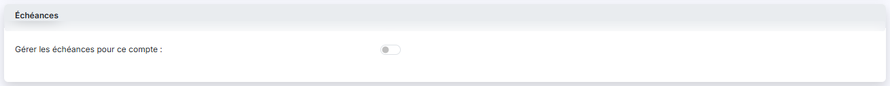
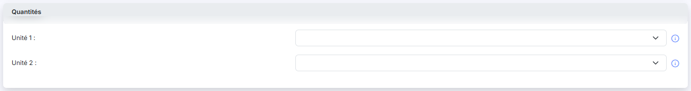
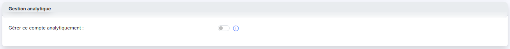
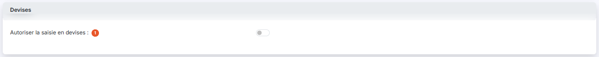

# Comptes auxiliaires


**Où le trouver :** Panneau **Paramètres** › **Données** › **Dossier et comptabilité** › **Comptes auxiliaires**



**En bref** — Cet écran permet d'administrer les comptes auxiliaires de l'exercice : clients, fournisseurs, salariés et divers, avec leurs adresses, coordonnées bancaires et documents rattachés.

* Pour créer un compte auxiliaire : bouton \[Nouveau], renseignez le compte collectif et la fiche, puis bouton \[Enregistrer].
* Pour reprendre des comptes d'un fichier : bouton \[Importer].
* Pour modifier plusieurs comptes d'un coup : bouton \[Modifications en série].


Cette option permet d'administrer les comptes auxiliaires de l'exercice (dossier annuel) en cours.

<figure><figcaption>
Écran « Comptes auxiliaires » de la nouvelle interface
</figcaption></figure>

La suppression d'un compte n'est possible qu'à la condition qu'aucune écriture n'ait été passée sur l'exercice pour le compte concerné.

## La liste des comptes auxiliaires

<figure><figcaption>
Bouton [Nouveau]
</figcaption></figure>

Au-dessus de la grille, une ligne vous permet de restreindre l'affichage :

| Champ            | Ce qu'il faut savoir                                                            |
| ---------------- | ------------------------------------------------------------------------------- |
| **N° de compte** | Saisissez tout ou partie d'un numéro de compte.                                 |
| **Catégorie**    | Choisissez « Tous », « Divers », « Clients », « Fournisseurs » ou « Salariés ». |

Un groupe de deux boutons vous permet ensuite d'afficher « Tous les comptes » — c'est le choix retenu à l'ouverture de l'écran — ou seulement les « Comptes mouvementés ».

Le bouton **\[Filtrer]** applique vos critères ; le bouton **\[Annuler les filtres]**, qui apparaît alors, vous ramène à la liste complète.

La grille présente ensuite les comptes, triés par ordre croissant de numéro. Elle compte de nombreuses colonnes et défile horizontalement : les dernières ne sont pas visibles sans faire défiler la grille vers la droite. Ce sont, dans l'ordre : **Numéro**, **Intitulé**, **Catégorie**, **Sens par défaut**, **Analytique**, **Code devise**, **Saisie en devise**, **Solde n-1**, **Solde à date**, **Solde n-2**, **Ecart n-1 vs n-2**, **N° de tva intracommunautaire**, **N° de siren**, **Capital**, **Code Naf**, **Soumis TVA autoliquidée**, **Contrepartie (Accélérateur)**, **Code TVA (Accélérateur)**, **N° de compte TVA (Accélérateur)**, **Gérer les échéances**, **Unité 1**, **Mode de règlement**, **Code DGFIP** et **Code juridique usuel**. Toutes peuvent servir de critère de tri, sauf **Ecart n-1 vs n-2**.

La première colonne de la grille ne porte pas d'en-tête : elle regroupe les commandes. Sur chaque ligne, vous y trouvez une case à cocher de sélection, puis les pictogrammes « Crayon » (Modifier), « Croix » (Supprimer) et « Ajout » (Dupliquer).

Dans l'en-tête de cette même colonne, vous disposez d'une case à cocher qui sélectionne toutes les lignes de la page affichée, d'une seconde case (carré orange) qui étend la sélection à toutes les pages, du pictogramme « Roue crantée » qui vous permet de choisir les colonnes affichées, du pictogramme « Entonnoir » qui ouvre la fenêtre « Filtres », et du pictogramme « Imprimante » qui imprime la grille.

bouton **\[Nouveau]**

Le logiciel ouvre une fiche vierge pour créer un compte auxiliaire.

bouton **\[Modifications en série]**

Ce bouton permet d'opérer simultanément les mêmes modifications à une sélection de comptes.

* **Rubrique « Sélection »**
* **Rubrique « Comptes à modifier »**
* **Rubrique « Eléments à modifier »**

bouton **\[Réaffectation]**

Ce bouton ouvre le traitement de réaffectation des comptes auxiliaires.

bouton **\[Importer]**

Ce bouton ouvre l'import d'un fichier de comptes auxiliaires.

bouton **\[Purger]**

Cette option permet de supprimer tous les comptes auxiliaires pour, par exemple, charger un autre modèle de plan comptable.

Seuls les comptes non mouvementés dans l'exercice en cours et non utilisés dans les paramétrages sont supprimés.

bouton **\[Supprimer]**

Le logiciel supprime les comptes dont vous avez coché la case de sélection, dans les conditions rappelées en tête de cette page.

## Rubrique « Informations générales »

<figure><figcaption>
Rubrique « Rubrique « Informations générales » »
</figcaption></figure>

| Champ                                                               | Ce qu'il faut savoir                                                                                                                                                                                                                                                                                                                                                                                                                                                                                                                                                                                                                                                                                                                                                             |
| ------------------------------------------------------------------- | -------------------------------------------------------------------------------------------------------------------------------------------------------------------------------------------------------------------------------------------------------------------------------------------------------------------------------------------------------------------------------------------------------------------------------------------------------------------------------------------------------------------------------------------------------------------------------------------------------------------------------------------------------------------------------------------------------------------------------------------------------------------------------- |
| 
1. <strong>Compte collectif</strong> <em>Obligatoire</em>
 | Le compte collectif doit obligatoirement être renseigné. Un compte auxiliaire est obligatoirement rattaché à un seul compte collectif.                                                                                                                                                                                                                                                                                                                                                                                                                                                                                                                                                                                                                                           |
| 2. **Intitulé compte collectif**                                    | Il est affiché automatiquement pour contrôle et n'est pas modifiable.                                                                                                                                                                                                                                                                                                                                                                                                                                                                                                                                                                                                                                                                                                            |
| 3. **Numéro**                                                       | 
Le numéro de compte doit être unique et n'est plus modifiable après création du compte. Le pictogramme d'information placé à côté du champ rappelle que « Les caractères autorisés sont les lettres majuscules et les chiffres. » Si dans le menu "Paramètres", sous-menu "Paramètres généraux" vous avez indiqué un préfixe, il est automatiquement proposé en fonction de la catégorie de compte que le logiciel a détectée à l'aide du compte collectif. En effet, un compte auxiliaire ne peut être rattaché qu'à une seule catégorie de comptes collectifs. Le compte collectif qui est associé au compte auxiliaire sera donc modifiable en saisie pourvu que le nouveau compte collectif soit de la même catégorie (clients, fournisseurs, salariés ou divers).
 |
| 
4. <strong>Intitulé</strong> <em>Obligatoire</em>
         | Ce champ pourra être automatiquement repris dans les libellés d'écritures et est modifiable à tout moment.                                                                                                                                                                                                                                                                                                                                                                                                                                                                                                                                                                                                                                                                       |
| 5. **Catégorie**                                                    | Non modifiable. La catégorie est automatiquement renseignée en fonction du compte collectif auquel vous avez rattaché le compte. Le logiciel gère 4 catégories de comptes auxiliaires : Clients / Fournisseurs / Salariés et Divers.                                                                                                                                                                                                                                                                                                                                                                                                                                                                                                                                             |
| 6. **Observations**                                                 | Zone de saisie libre sur plusieurs lignes.                                                                                                                                                                                                                                                                                                                                                                                                                                                                                                                                                                                                                                                                                                                                       |
| **Créé le**                                                         | **Par :** ces deux champs ne sont pas modifiables. Le logiciel les renseigne lui-même à la création du compte. Deux champs **Modifié le :** et **Par :** les complètent lorsque le compte a été modifié.                                                                                                                                                                                                                                                                                                                                                                                                                                                                                                                                                                         |
| **N° de TVA intracommunautaire**                                    | Ce numéro unique à chaque entreprise est désormais obligatoire sur toutes les factures aussi bien pour l'émetteur que pour le destinataire. Il est également utilisé dans Ingeneo Compta pour la reconnaissance des fournisseurs dans le module OCR.                                                                                                                                                                                                                                                                                                                                                                                                                                                                                                                             |
| **N° de Siren**                                                     | Champ facultatif. Si vous renseignez le Siren, le bouton **\[Lire Siren]**, qui utilise une API, renseignera automatiquement une adresse qu'il intitulera "Adresse principale".                                                                                                                                                                                                                                                                                                                                                                                                                                                                                                                                                                                                  |
| **Forme juridique**                                                 | Saisissez-la, ou utilisez le pictogramme « Loupe » pour la rechercher.                                                                                                                                                                                                                                                                                                                                                                                                                                                                                                                                                                                                                                                                                                           |
| **Capital**                                                         | Saisissez le montant du capital du tiers.                                                                                                                                                                                                                                                                                                                                                                                                                                                                                                                                                                                                                                                                                                                                        |
| **Code DGFIP**                                                      | **Code juridique usuel :** ces deux champs ne sont pas modifiables.                                                                                                                                                                                                                                                                                                                                                                                                                                                                                                                                                                                                                                                                                                              |
| **Code NAF**                                                        | Ce champ n'est pas modifiable ; le logiciel affiche à sa droite le libellé du code.                                                                                                                                                                                                                                                                                                                                                                                                                                                                                                                                                                                                                                                                                              |
| **Mode de règlement**                                               | Champ facultatif. Il s'agit du mode de règlement par défaut qui sera repris en différents lieux du logiciel. Le sélecteur propose une valeur vide, puis les modes de règlement du dossier.                                                                                                                                                                                                                                                                                                                                                                                                                                                                                                                                                                                       |
| **Soumis à TVA autoliquidée**                                       | Ce champ n'est présenté que sur un compte de catégorie « Fournisseurs ». Il est notamment utile pour générer les écritures d'autoliquidation de la TVA dans le module OCR lorsqu'un fournisseur est situé dans la zone CEE. Choisissez entre « Non soumis », « Acquisitions intracommunautaires de biens », « Prestations de services intracommunautaires », « Importations hors EU » et « Sous-traitance BTP ».                                                                                                                                                                                                                                                                                                                                                                 |

## Rubrique « Adresses »

Le logiciel affiche la liste des adresses du compte, avec les colonnes **Intitulé**, **Contact** et **Adresse par défaut**. Chaque ligne porte les pictogrammes « Crayon » (Modifier), « Croix » (Supprimer) et « Ajout » (Dupliquer), et le bouton \[Nouveau] placé sous la liste vous permet d'en ajouter une. Tant qu'aucune adresse n'est enregistrée, le logiciel affiche « Liste vide ».

Une fiche peut contenir autant d'adresses que vous le souhaitez. Chaque adresse doit contenir au moins un intitulé, un nom de contact et sa civilité.

Lorsque vous indiquez qu'une adresse est l'adresse par défaut, c'est elle qui sera affectée lors de la création de toute nouvelle pièce commerciale.

Le "Code Officiel Géographique Insee" est nécessaire pour la DAS2.

Les adresses sont communes aux fichiers clients et comptes auxiliaires.

## Rubrique « Propriétés »

<figure><figcaption>
Rubrique « Rubrique « Propriétés » »
</figcaption></figure>

**Sens par défaut** : définit si lors de la saisie le curseur sera positionné par défaut sur un montant au débit ou un montant au crédit. Le pictogramme d'information placé à côté du champ rappelle que ce choix « Permettra, lors de la saisie d'écritures, de positionner directement le curseur sur la cellule définie. »

Si la catégorie est "Fournisseurs", le sens par défaut se positionne automatiquement sur "Crédit".

Si la catégorie est "Clients", le sens par défaut se positionne automatiquement sur "Débit".

Si la catégorie est "Salariés", le sens par défaut se positionne automatiquement sur "Crédit".

Si la catégorie est "Divers", le sens par défaut se positionne automatiquement sur "Débit".

## Rubrique « Accélérateur de saisie »

<figure><figcaption>
Rubrique « Rubrique « Accélérateur de saisie » »
</figcaption></figure>

Cette fonctionnalité est disponible dans la saisie en journal si elle a été activée pour le journal considéré. Elle est particulièrement utile pour les écritures récurrentes.

Vous avez la possibilité de définir un accélérateur de saisie qui générera automatiquement une écriture lorsque le compte de votre formulaire sera saisi sur la première ligne d'un mouvement.

| Champ               | Ce qu'il faut savoir                                                                                                                                                                                                                                                                                                                                                                            |
| ------------------- | ----------------------------------------------------------------------------------------------------------------------------------------------------------------------------------------------------------------------------------------------------------------------------------------------------------------------------------------------------------------------------------------------- |
| 1. **Contrepartie** | Définit le compte utilisé pour générer l'écriture. Saisissez son numéro, ou utilisez le pictogramme « Loupe » pour le rechercher ; le logiciel affiche son intitulé à droite.                                                                                                                                                                                                                   |
| 2. **Code TVA**     | Si un code et un taux sont renseignés, l'écriture générée comprend une ligne de TVA dont le montant est calculé automatiquement. Le pictogramme d'information placé à côté du champ rappelle d'« Indiquez un code TVA si vous souhaitez générer automatiquement une ligne de TVA. » Le logiciel affiche le taux correspondant dans le champ **Taux de TVA :**, que vous ne pouvez pas modifier. |
| 3. **N° de compte** | Choisissez parmi les comptes de TVA celui qui devra être repris dans l'écriture. Le logiciel affiche son intitulé à droite. Sur un compte de catégorie « Fournisseurs », le sélecteur propose les comptes de TVA déductible renseignés dans le fichier "Codes TVA".                                                                                                                             |

## Rubrique « Échéances »

<figure><figcaption>
Rubrique « Rubrique « Échéances » »
</figcaption></figure>

Cette option n'est accessible que si vous avez activé la gestion des échéances dans le menu "Paramétrages", sous-menu "Paramètres généraux".

La rubrique vous pose une seule question : **Gérer les échéances pour ce compte :**

Si vous indiquez vouloir gérer les échéances pour le compte, vous pourrez saisir une date d'échéance sur les lignes d'écritures liées à ce compte.

Vous devez également indiquer si vous souhaitez que le logiciel renseigne automatiquement la date d'échéance et si oui, quel délai de règlement devra s'appliquer pour calculer la date. La date d'échéance automatiquement renseignée restera modifiable dans la saisie.

La gestion de cette option nécessite d'avoir défini au préalable des délais de règlement dans le menu "Fichiers", sous-menu "Délais de règlement".

## Rubrique « Quantités »

<figure><figcaption>
Rubrique « Rubrique « Quantités » »
</figcaption></figure>

La rubrique vous pose une seule question : **Gérer les quantités pour ce compte :**

Si dans les paramètres généraux, vous avez indiqué que vous souhaitiez gérer des quantités dans les lignes d'écritures, vous avez la possibilité, pour chaque compte, de définir les unités correspondant à ces quantités.

Choisissez pour les deux quantités saisissables par ligne d'écriture, l'unité que vous souhaitez y associer.

Les différents types d'unités sont paramétrables dans le menu "Paramètres", sous-option "Unités".

## Rubrique « Gestion analytique »

<figure><figcaption>
Rubrique « Rubrique « Gestion analytique » »
</figcaption></figure>

Cette rubrique n'apparaît que si vous avez activé l'analytique dans le menu "Paramétrages", sous-menu "Paramètres généraux".

La rubrique vous pose une seule question : **Gérer ce compte analytiquement :**

Si vous souhaitez gérer ce compte analytiquement, vous devez également indiquer quels axes sont concernés (au moins 1) et pour chacun des axes, s'il y a une ventilation type à appliquer lors de l'enregistrement d'une ligne d'écriture sur ce compte. La ventilation type est facultative.

## Rubrique « Prestataire »

Cette rubrique n'est disponible que pour les comptes auxiliaires de catégorie "Fournisseurs".

| Champ                                          | Ce qu'il faut savoir                                                                                                                                                                                                          |
| ---------------------------------------------- | ----------------------------------------------------------------------------------------------------------------------------------------------------------------------------------------------------------------------------- |
| **Prestataire de services au sens de la DAS2** | Si le compte auxiliaire correspond à un prestataire de services, répondez « Oui » pour l'intégrer à votre déclaration DAS2. Entrez ensuite la profession et s'il s'agit d'une "Personne morale" ou d'une "Personne physique". |
| **Prestataire de services au sens de la TVA**  | Le pictogramme d'information placé à côté du champ précise que cette option est « A activer uniquement pour les prestataires de services qui n'ont pas opté pour la TVA sur les débits. »                                     |

## Rubrique « Coordonnées bancaires »

Le logiciel affiche la liste des coordonnées bancaires du tiers, avec les colonnes **Intitulé**, **Iban** et **Défaut**, et une colonne de commandes. Tant qu'aucune n'est enregistrée, le logiciel affiche « Liste vide ». Le bouton \[Nouveau] placé sous la liste vous permet d'en créer une : vous avez la possibilité de créer autant de banques que nécessaire pour un tiers.

| Champ                 | Ce qu'il faut savoir                                                                                                                                 |
| --------------------- | ---------------------------------------------------------------------------------------------------------------------------------------------------- |
| **Libellé**           | Il doit être unique car c'est lui qui permet de différencier les banques entre elles.                                                                |
| **Banque par défaut** | Si vous répondez "Oui", c'est cette banque qui vous sera systématiquement proposée pour le tiers en question à chaque fois que cela sera nécessaire. |

**Référence unique de mandat** et **Date de signature de mandat :** ces deux champs (qui n'apparaissent que si le compte auxiliaire est de type "Clients") sont utilisés pour déclencher les prélèvements automatiques. Reportez-vous à l'aide traitant de ce sujet pour plus d'informations.

## Rubrique « Devises »

<figure><figcaption>
Rubrique « Rubrique « Devises » »
</figcaption></figure>

| Champ                                 | Ce qu'il faut savoir                                                                                                                                                                                                                                                                                                        |
| ------------------------------------- | --------------------------------------------------------------------------------------------------------------------------------------------------------------------------------------------------------------------------------------------------------------------------------------------------------------------------- |
| 1. **Autoriser la saisie en devises** | 
Si cette option est activée, vous pourrez saisir, dans ce compte, des écritures dans d'autres devises que la devise locale indiquée dans le menu "Paramètres généraux", sous-option "Multimodules". Pour saisir des écritures en devises, il faut que cette même option soit activée dans les journaux concernés.
 |
| **Devise par défaut pour ce compte**  | Cette option n'est affichée que si vous avez autorisé la saisie en devises. Choisissez dans le sélecteur la devise qui sera proposée par défaut lors de la saisie d'une écriture sur ce compte. La devise pourra être modifiée lors de la saisie de chaque écriture.                                                        |

Reportez-vous au menu "Fichiers", sous-menu "Devises" pour en savoir plus sur le paramétrage des devises utilisables dans un dossier annuel.

## Rubrique « Approbation »

Cette rubrique n'est disponible que pour les comptes auxiliaires de catégorie "Fournisseurs". Elle enchaîne jusqu'à trois questions, chacune n'apparaissant qu'en fonction de la réponse donnée à la précédente.

| Champ                                                                                   | Ce qu'il faut savoir                                                                                                                                                                                                                                                                                                                             |
| --------------------------------------------------------------------------------------- | ------------------------------------------------------------------------------------------------------------------------------------------------------------------------------------------------------------------------------------------------------------------------------------------------------------------------------------------------ |
| **Les factures de ce fournisseurs doivent-elles être approuvées automatiquement ?**     | Le pictogramme d'information placé à côté du champ précise que « Si vous répondez « Oui », les factures prises en charge se verront attribuer le statut électronique « Approuvée » automatiquement. Cette option est faite par exemple pour des fournisseurs tels qu'EDF. »                                                                      |
| **Souhaitez-vous attribuer un circuit d’approbation particulier pour ce fournisseur ?** | Cette deuxième question n'apparaît que si vous avez répondu « Non » à la première. Le pictogramme d'information placé à côté du champ précise que « Si vous répondez « Non » tous les utilisateur disposant du droit d’approbation pourront approuver les factures de ce fournisseur. »                                                          |
| **Souhaitez-vous mettre en place un circuit de validation personnalisé ?**              | Cette troisième question n'apparaît que si vous avez répondu « Oui » à la deuxième. Le logiciel affiche à sa droite le rappel suivant : « Si vous répondez « Non » vous pourrez sélectionner un circuit de validation parmi les modèles déjà paramétrés. Si vous répondez « Oui », vous pourrez le définir spécifiquement pour ce fournisseur. » |

Lorsque cette troisième question est positionnée sur « Non », le logiciel affiche le sélecteur **Libellé du circuit d'approbation :**, qui propose les circuits déjà paramétrés.

## Rubrique « Soldes »

Cette rubrique contient un certain nombre de valeurs, qui sont calculées et mises à jour par le logiciel au moment où vous entrez dans la fiche du compte. Aucune n'est modifiable : **Solde à date**, **Solde n-1**, **Mouvementé en n-1**, **Ecart n vs n-1**, **Solde n-2** et **Ecart n-1 vs n-2**.

## Rubrique « Documents »

Le logiciel affiche la liste des documents rattachés au compte, avec les colonnes **Description**, **Nom du fichier**, **Date** et **Créé par**, et une colonne de commandes. Tant qu'aucun document n'est rattaché, le logiciel affiche « Liste vide ».

Trois boutons placés sous la liste vous permettent d'en ajouter un, selon sa provenance :

* bouton **\[Nouveau doc depuis mon poste]**
* bouton **\[Nouveau doc depuis la GED]**
* bouton **\[Nouveau doc depuis l'OCR]**

bouton **\[Enregistrer]**

Le logiciel contrôle la saisie puis enregistre la fiche du compte auxiliaire.

bouton **\[Retour]**

Le logiciel referme la fiche et vous ramène à la liste des comptes auxiliaires, sans enregistrer vos modifications.
