# Configuration


**Où le trouver :** Panneau **Paramètres** › **Compta expert** › **Configuration**



**En bref** — Cet écran définit les fonctionnalités utilisées dans le logiciel et les règles de gestion communes à tous les utilisateurs : plan comptable, TVA, lettrage, affectation du résultat et extournes.

* Pour partir des valeurs prévues par le logiciel : bouton \[Charger les valeurs par défaut], contrôlez-les, puis bouton \[Enregistrer].
* Pour valider vos réglages des huit rubriques : bouton \[Enregistrer].


Cette option permet de définir les fonctionnalités que vous souhaitez utiliser dans le logiciel, ainsi que certaines règles de gestion qui s'appliqueront à tous les utilisateurs.

<figure>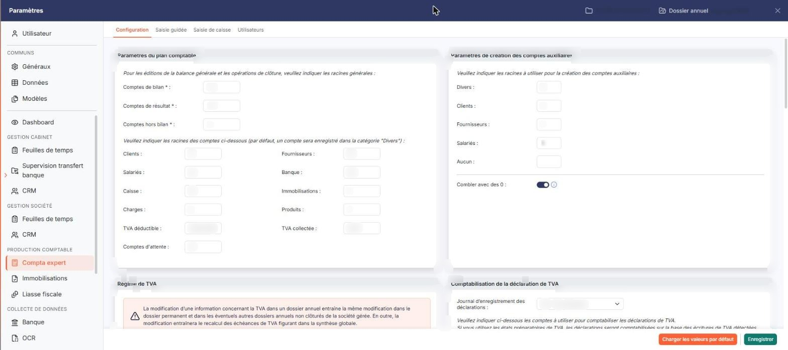<figcaption>
Écran « Configuration » de la nouvelle interface
</figcaption></figure>

L'écran se compose de huit rubriques présentées à la suite, et de deux boutons en pied de page.

## Rubrique « Paramètres du plan comptable »

<figure>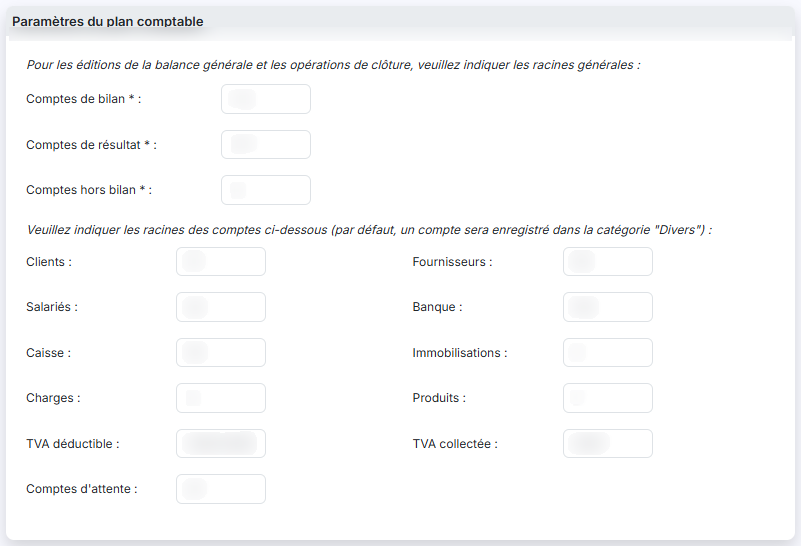<figcaption>
Rubrique « Rubrique « Paramètres du plan comptable » »
</figcaption></figure>

Le logiciel vous demande d'abord d'indiquer les racines générales, utilisées pour les éditions de la balance générale et pour les opérations de clôture : **Comptes de bilan**, **Comptes de résultat** et **Comptes hors bilan**. Ces trois zones sont obligatoires. Elles permettent de distinguer les trois familles de comptes et n'ont normalement pas à être modifiées, sauf si le logiciel est utilisé dans un autre pays que la France. Pour clôturer un exercice, les comptes hors bilan devront impérativement être soldés.

Vous indiquez ensuite les racines des comptes par nature : **Clients**, **Fournisseurs**, **Salariés**, **Banque**, **Caisse**, **Immobilisations**, **Charges**, **Produits**, **TVA déductible**, **TVA collectée** et **Comptes d'attente**. Aucune de ces zones n'est obligatoire : par défaut, un compte est enregistré dans la catégorie « Divers ». Paramétrer ces racines facilite les recherches, ainsi que les propositions que le logiciel peut vous faire chaque fois qu'un compte comptable est demandé.

## Rubrique « Paramètres de création des comptes auxiliaires »

<figure>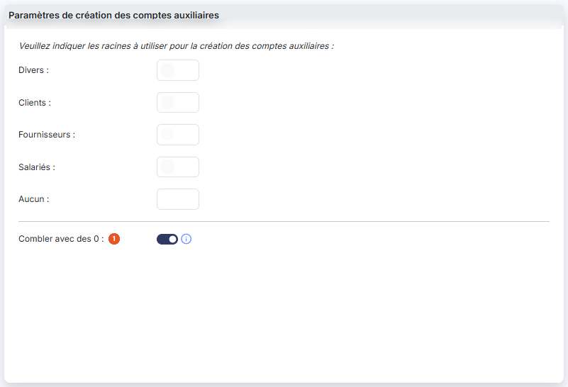<figcaption>
Rubrique « Rubrique « Paramètres de création des comptes auxiliaires » »
</figcaption></figure>

Pour chaque catégorie de compte auxiliaire, vous pouvez indiquer la racine, de quatre caractères au maximum, qui sera systématiquement proposée lors de la création des comptes. Les catégories sont, dans l'ordre : **Divers**, **Clients**, **Fournisseurs**, **Salariés** et **Aucun**. Aucune de ces zones n'est obligatoire.

**Combler avec des 0** : si vous choisissez cette option, lorsque vous créez un n° de compte auxiliaire dont le nombre de caractères est inférieur au nombre paramétré dans Multimodules, le logiciel comble avec des 0. Cette option ne touche pas aux codes auxiliaires.

## Rubrique « Régime de TVA »

<figure>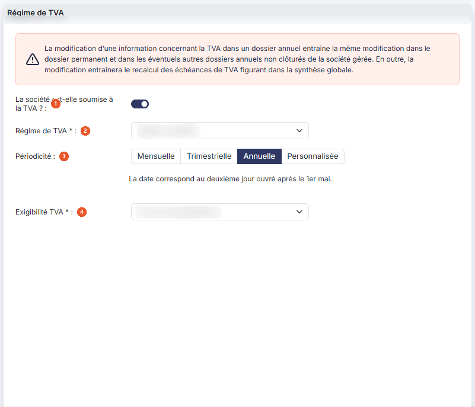<figcaption>
Rubrique « Rubrique « Régime de TVA » »
</figcaption></figure>

Le logiciel vous avertit en tête de rubrique : « La modification d'une information concernant la TVA dans un dossier annuel entraîne la même modification dans le dossier permanent et dans les éventuels autres dossiers annuels non clôturés de la société gérée. En outre, la modification entraînera le recalcul des échéances de TVA figurant dans la synthèse globale. » Vous consultez cette synthèse par le pictogramme « Étoile » du bandeau en haut de l'écran, dont l'infobulle indique « Synthèse du portefeuille ».

| Champ                                         | Ce qu'il faut savoir                                                                                                                                                                                                                                                                                                                                                                                                                                                                                                                                   |
| --------------------------------------------- | ------------------------------------------------------------------------------------------------------------------------------------------------------------------------------------------------------------------------------------------------------------------------------------------------------------------------------------------------------------------------------------------------------------------------------------------------------------------------------------------------------------------------------------------------------ |
| 1. **La société est-elle soumise à la TVA ?** | Si vous répondez **Oui**, vous devez renseigner les trois informations suivantes. Si vous répondez **Non**, ces trois zones ne sont plus affichées, la rubrique « Comptabilisation de la déclaration de TVA » disparaît elle aussi, et le logiciel vous pose à la place deux autres questions : **La société est-elle soumise à la taxe sur les salaires ? :** et **La société est-elle soumise à la TVS ? :**                                                                                                                                         |
| 2. **Régime de TVA**                          | Choisissez entre franchise de TVA, mini réel, régime réel, régime réel agricole, régime simplifié, régime simplifié agricole, taxe générale sur la consommation et TVA groupe. Ce choix conditionne la liste des comptes que vous aurez à renseigner dans la rubrique suivante.                                                                                                                                                                                                                                                                        |
| 3. **Périodicité**                            | Choisissez entre **Mensuelle**, **Trimestrielle**, **Annuelle** et **Personnalisée**. Le logiciel affiche sous ces boutons une phrase rappelant la date d'échéance qui découle de votre choix — en périodicité annuelle : « La date correspond au deuxième jour ouvré après le 1er mai. » En périodicité **Personnalisée**, cette phrase laisse la place à un tableau de deux colonnes, **N° échéance** et **Jour**, dans lequel vous définissez vous-même les échéances à l'aide du bouton **\[Nouvelle ligne]** et du bouton **\[Supprimer ligne]**. |
| 4. **Exigibilité TVA**                        | Choisissez entre **Sur les encaissements**, **Sur les débits** et **Mixte**.                                                                                                                                                                                                                                                                                                                                                                                                                                                                           |

## Rubrique « Comptabilisation de la déclaration de TVA »

<figure>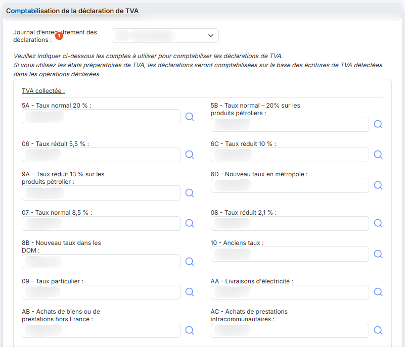<figcaption>
Rubrique « Rubrique « Comptabilisation de la déclaration de TVA » »
</figcaption></figure>

<figure>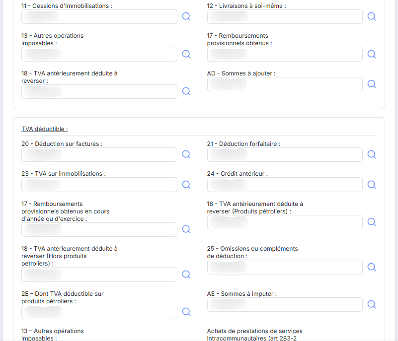<figcaption>
Rubrique « Rubrique « Comptabilisation de la déclaration de TVA » »
</figcaption></figure>

<figure>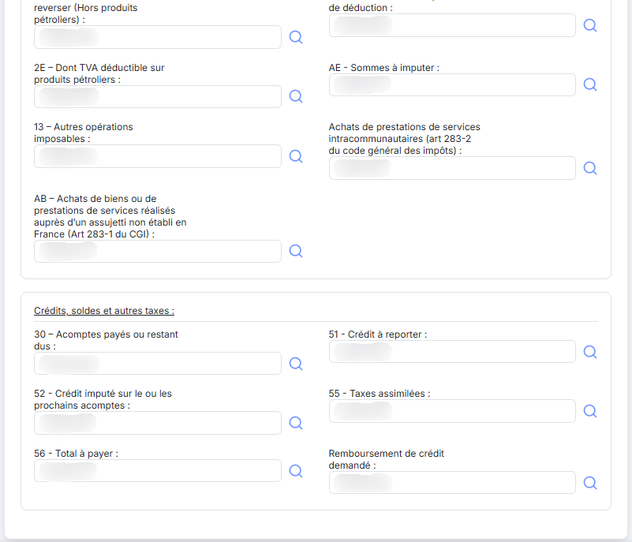<figcaption>
Rubrique « Rubrique « Comptabilisation de la déclaration de TVA » »
</figcaption></figure>

**Journal d'enregistrement des déclarations** : choisissez le journal dans lequel les déclarations de TVA seront comptabilisées.

Le logiciel vous demande ensuite d'indiquer les comptes à utiliser pour comptabiliser les déclarations de TVA, et vous prévient que « si vous utilisez les états préparatoires de TVA, les déclarations seront comptabilisées sur la base des écritures de TVA détectées dans les opérations déclarées ».

Les lignes à renseigner sont celles du formulaire de déclaration correspondant au **Régime de TVA** que vous avez choisi dans la rubrique précédente : **la liste change entièrement si vous changez de régime**. Elles sont regroupées en trois blocs — **TVA collectée**, **TVA déductible** et **Crédits, soldes et autres taxes** — et reprennent les repères et libellés du formulaire déclaratif. Pour chaque ligne, indiquez le numéro de compte correspondant : la zone rappelle en filigrane la cellule du formulaire déclaratif concernée — par exemple « Cellule FW » — et le pictogramme « Loupe » placé à sa droite vous aide à rechercher le compte.

## Rubrique « Archivage des déclarations de TVA »

<figure>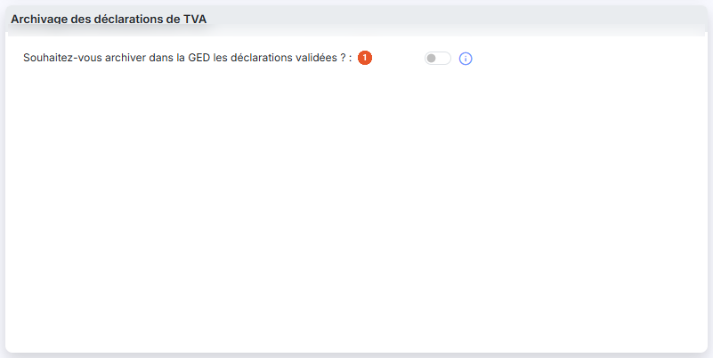<figcaption>
Rubrique « Rubrique « Archivage des déclarations de TVA » »
</figcaption></figure>

| Champ                                                                          | Ce qu'il faut savoir                                                                                                                                                                                                                                                                                                                             |
| ------------------------------------------------------------------------------ | ------------------------------------------------------------------------------------------------------------------------------------------------------------------------------------------------------------------------------------------------------------------------------------------------------------------------------------------------ |
| 1. **Souhaitez-vous archiver dans la GED les déclarations validées ?**         | Si vous indiquez « Oui », chaque déclaration de TVA télétransmise sera enregistrée dans la GED. Un répertoire y sera automatiquement créé, pour chaque dossier annuel, lors de la télétransmission d'une déclaration dans le dossier annuel.                                                                                                     |
| **Souhaitez-vous une arborescence avec années puis les déclarations de TVA ?** | Cette question n'est affichée que si vous avez répondu **Oui** à la précédente. Si vous répondez « Oui », un répertoire sera créé par année civile avec un sous-répertoire contenant toutes les déclarations de TVA ; si vous répondez "Non", un répertoire sera créé pour les "Déclarations de TVA" avec des sous-répertoires par année civile. |

## Rubrique « Lettrage - Ecritures d'ajustement »

<figure>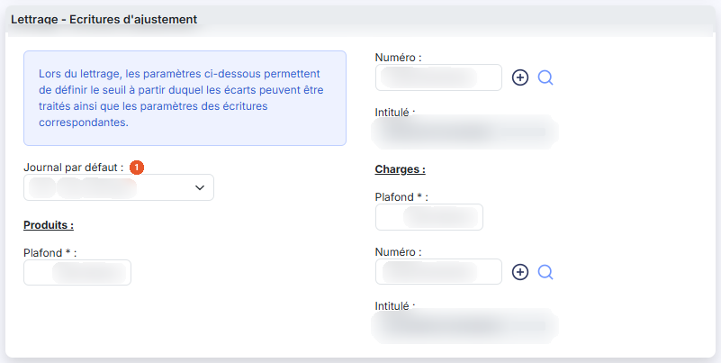<figcaption>
Rubrique « Rubrique « Lettrage - Ecritures d'ajustement » »
</figcaption></figure>

Le logiciel l'annonce en tête de rubrique : « Lors du lettrage, les paramètres ci-dessous permettent de définir le seuil à partir duquel les écarts peuvent être traités ainsi que les paramètres des écritures correspondantes ». Ces écritures sont générées lors du lettrage à l'aide du bouton **\[Ecriture d'ajustement]** de l'écran de lettrage.

**Journal par défaut** : le journal dans lequel les écritures d'ajustement seront déversées par défaut.

Deux blocs suivent, **Produits** puis **Charges**, comportant chacun les mêmes trois zones :

* **Plafond** : obligatoire. Montant de l'écart en deçà duquel une écriture d'ajustement peut être générée.
* **Numéro** : le compte de contrepartie de l'écriture d'ajustement. Le bouton \[+] placé à droite vous permet de créer ce compte, et le pictogramme « Loupe » de le rechercher.
* **Intitulé** : renseigné par le logiciel d'après le compte que vous avez indiqué ; vous ne pouvez pas le modifier.

## Rubrique « Affectation du résultat »

<figure>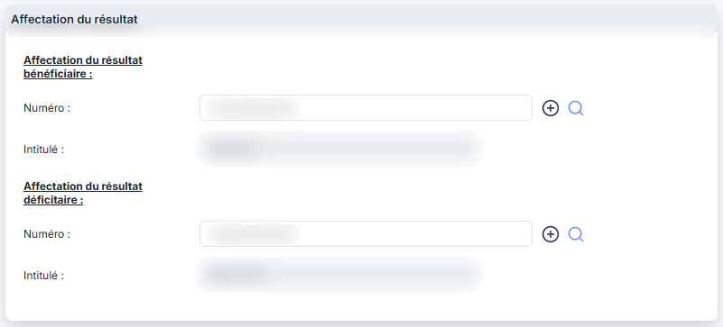<figcaption>
Rubrique « Rubrique « Affectation du résultat » »
</figcaption></figure>

Cette rubrique définit le compte dans lequel sera généré le résultat de l'exercice, lors de l'édition des états financiers comme lors de la clôture et de la réouverture des exercices.

Elle comporte deux blocs, **Affectation du résultat bénéficiaire** et **Affectation du résultat déficitaire**, avec pour chacun une zone **Numéro :** — accompagnée du bouton \[+] qui crée le compte et du pictogramme « Loupe » qui le recherche — et une zone **Intitulé :** que le logiciel renseigne lui-même et que vous ne pouvez pas modifier.

## Rubrique « Extournes lors de la clôture »

<figure>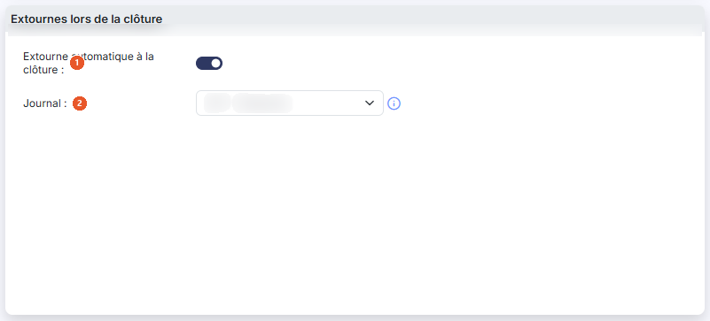<figcaption>
Rubrique « Rubrique « Extournes lors de la clôture » »
</figcaption></figure>

Si vous avez saisi des écritures de provision dans un journal, vous pouvez en demander l'extourne automatique à la date du premier jour du nouvel exercice.

| Champ                                    | Ce qu'il faut savoir                                                                                                                                                                                                                                                                                                                                |
| ---------------------------------------- | --------------------------------------------------------------------------------------------------------------------------------------------------------------------------------------------------------------------------------------------------------------------------------------------------------------------------------------------------- |
| 1. **Extourne automatique à la clôture** | À **Oui**, le logiciel vous demande le journal concerné.                                                                                                                                                                                                                                                                                            |
| 2. **Journal**                           | Seules les écritures de ce journal datées du dernier jour de l'exercice seront automatiquement extournées au premier jour du nouvel exercice. Cette liste propose tous les journaux du dossier, alors que celles des rubriques « Comptabilisation de la déclaration de TVA » et « Lettrage - Ecritures d'ajustement » n'en proposent qu'une partie. |

bouton **\[Enregistrer]**

Enregistre l'ensemble des huit rubriques.

bouton **\[Charger les valeurs par défaut]**

Ce bouton charge les valeurs prévues et vérifie que les comptes existent bien dans le plan comptable. Si ce n'est pas le cas, le numéro de compte est affiché en gris et en italique. Il ne remplace pas l'enregistrement : vous devez ensuite valider par le bouton **\[Enregistrer]**.
