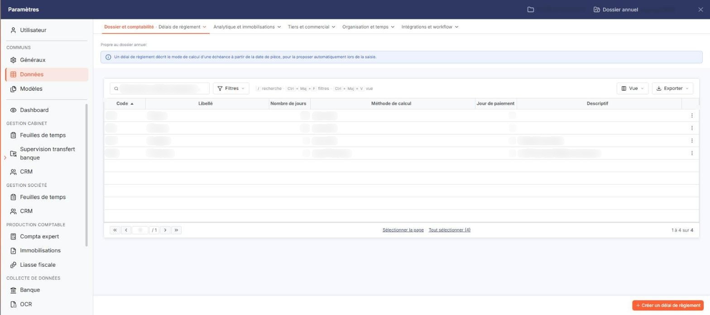
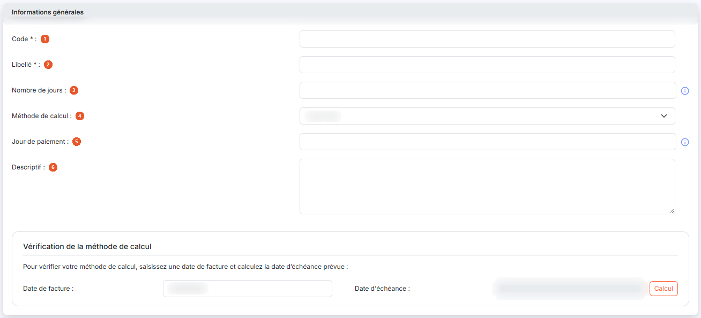

# Délais de règlement


**Où le trouver :** Panneau **Paramètres** › **Données** › **Dossier et comptabilité** › **Délais de règlement**



**En bref** — Cet écran permet de définir les délais de règlement qui servent à calculer les échéances à partir de la date d'une pièce comptable.

* Pour créer un délai : bouton \[Nouveau], renseignez le code, le libellé et les champs de calcul, puis bouton \[Enregistrer].
* Pour contrôler vos critères : saisissez une date dans la fiche, puis bouton \[Calcul].


Cette option permet de définir les délais de règlement qui seront utilisés pour calculer les échéances à partir de la date d’une pièce comptable.

<figure><figcaption>
Écran « Délais de règlement » de la nouvelle interface
</figcaption></figure>

Le logiciel affiche la liste des délais de règlement déjà enregistrés, avec les colonnes suivantes : **Code**, **Libellé**, **Nombre de jours**, **Méthode de calcul**, **Jour de paiement** et **Descriptif**. La liste est triée par défaut sur le code, par ordre croissant, et chaque colonne peut servir de critère de tri.

Dans l'en-tête de la première colonne, vous disposez d'une case à cocher qui sélectionne toutes les lignes de la page affichée, d'une seconde case qui étend la sélection à toutes les pages, du pictogramme « Roue crantée » qui personnalise les colonnes affichées, du pictogramme « Entonnoir » qui ouvre la fenêtre « Filtres » et du pictogramme « Imprimante » qui imprime la grille.

Sur chaque ligne, vous disposez d'une case à cocher de sélection, du pictogramme « Crayon » qui ouvre la fiche du délai de règlement, et du pictogramme « Croix » qui le supprime.

Un délai de règlement ne peut pas être supprimé s'il est utilisé dans au moins une fiche client, une pièce commerciale ou un compte général ou auxiliaire.

bouton **\[Nouveau]**

Vous ouvrez la fiche de création d'un délai de règlement.

bouton **\[Exporter]**

Vous exportez le contenu de la liste dans un fichier.

bouton **\[Supprimer]**

Vous supprimez les délais de règlement que vous avez cochés dans la liste.

## Rubrique « Informations générales »

<figure><figcaption>
Rubrique « Rubrique « Informations générales » »
</figcaption></figure>

La fiche d'un délai de règlement ne comporte qu'une seule rubrique.

| Champ                                                      | Ce qu'il faut savoir                                                                                                                                                                                                                                                                                                                                                                                                                                                                                                                                                                                                                                                                                                                                                                                                                                                                                                                                                                                                                                                                                                                                                                                                                                                                                                                                                                                                                                                                                                                                                                                                        |
| ---------------------------------------------------------- | --------------------------------------------------------------------------------------------------------------------------------------------------------------------------------------------------------------------------------------------------------------------------------------------------------------------------------------------------------------------------------------------------------------------------------------------------------------------------------------------------------------------------------------------------------------------------------------------------------------------------------------------------------------------------------------------------------------------------------------------------------------------------------------------------------------------------------------------------------------------------------------------------------------------------------------------------------------------------------------------------------------------------------------------------------------------------------------------------------------------------------------------------------------------------------------------------------------------------------------------------------------------------------------------------------------------------------------------------------------------------------------------------------------------------------------------------------------------------------------------------------------------------------------------------------------------------------------------------------------------------- |
| 
1. <strong>Code</strong> <em>Obligatoire</em>
    | Doit être unique. Vous le saisissez à la création ; en modification, le logiciel l'affiche en lecture seule et vous ne pouvez plus le changer.                                                                                                                                                                                                                                                                                                                                                                                                                                                                                                                                                                                                                                                                                                                                                                                                                                                                                                                                                                                                                                                                                                                                                                                                                                                                                                                                                                                                                                                                              |
| 
2. <strong>Libellé</strong> <em>Obligatoire</em>
 | 
 Les champs suivants permettent de définir la manière dont est calculé le délai de règlement. Ces champs sont combinés entre eux.
                                                                                                                                                                                                                                                                                                                                                                                                                                                                                                                                                                                                                                                                                                                                                                                                                                                                                                                                                                                                                                                                                                                                                                                                                                                                                                                                                                                                                                                                                 |
| 3. **Nombre de jours**                                     | Nombre de jours à ajouter au jour de votre pièce comptable et pris en compte par le champ « Méthode de calcul ». Si ce champ est laissé vide ou si « 0 » est saisi, les champs suivants prendront comme base le jour de la pièce comptable. Le pictogramme d'information rappelle : « Pour une période d'un mois fixe, saisir "30" jours. »                                                                                                                                                                                                                                                                                                                                                                                                                                                                                                                                                                                                                                                                                                                                                                                                                                                                                                                                                                                                                                                                                                                                                                                                                                                                                 |
| 4. **Méthode de calcul**                                   | 
Vous choisissez la méthode dans une liste déroulante. À la création, le logiciel propose « Jours nets ». La liste ne comporte pas de valeur vide : une méthode est donc toujours retenue. • <strong>Jours nets</strong> : ajoute à la date de la pièce le nombre de jours défini dans le champ « Nombre de jours ». Exemple : 15 jours nets pour une pièce du 15/01/N renvoie au 30/01/N. Si le nombre de jours saisi est « 30 », un mois fixe est ajouté à la date de la pièce. Exemple : 30 jours nets pour une pièce du 15/02/N renvoie au 15/03/N. - <strong>Jours fin de mois</strong> : ajoute à la date de la pièce le nombre de jours défini dans le champ « Nombre de jours » et renvoie à la fin du mois obtenu. Exemple : 20 jours fin de mois pour une pièce du 15/03/N renvoie au 30/04/N. - <strong>Fin de décade</strong> : ajoute à la date de la pièce le nombre de jours défini dans le champ « Nombre de jours » et renvoie à la fin de la décade (tranche de 10 jours) dans laquelle se situe le jour obtenu. Exemple : Fin de décade pour une pièce du 01/03/N renvoie au 10/03/N. - <strong>Fin de mois + N jours</strong> : renvoie à la fin du mois et ajoute le nombre de jours défini dans le champ « Nombre de jours ». Exemple : Fin de mois + 20 jours pour une pièce du 15/03/N renvoie au 20/04/N. - <strong>Fin de trimestre</strong> : renvoie à la fin du trimestre civil dans lequel se situe le jour obtenu. - <strong>Fin de trimestre + N jours</strong> : renvoie à la fin du trimestre civil et ajoute le nombre de jours défini dans le champ « Nombre de jours ».
 |
| 5. **Jour de paiement**                                    | Renvoie au jour du prochain mois ayant le rang défini dans ce champ suivant le jour obtenu par l’application des critères définis dans « Nombre de jours » et « Méthode de calcul ». Exemple : 20 jours fin de mois le 15 pour une pièce du 15/03/N renvoie : 04/04 (20 jours), puis 30/04 (Fin de mois), et enfin 15/05/N (prochain jour ayant le 15ème rang dans un mois). Le pictogramme d'information rappelle : « Définit un jour fixe dans le mois. »                                                                                                                                                                                                                                                                                                                                                                                                                                                                                                                                                                                                                                                                                                                                                                                                                                                                                                                                                                                                                                                                                                                                                                 |
| 6. **Descriptif**                                          | Vous y saisissez un texte libre sur plusieurs lignes, repris dans la colonne « Descriptif » de la liste.                                                                                                                                                                                                                                                                                                                                                                                                                                                                                                                                                                                                                                                                                                                                                                                                                                                                                                                                                                                                                                                                                                                                                                                                                                                                                                                                                                                                                                                                                                                    |

En bas de la rubrique, le logiciel affiche la phrase « Pour vérifier votre méthode de calcul, saisissez une date de facture et calculez la date d’échéance prévue : », puis les deux champs **Date de facture :** — que le logiciel préremplit à la date du jour et que vous pouvez modifier, au clavier ou par le pictogramme « Calendrier » — et **Date d'échéance :**, en lecture seule, vide tant que le calcul n'a pas été demandé.

bouton **\[Calcul]**

Vous contrôlez les critères saisis grâce à un exemple de calcul. Pour ce faire, saisissez une date dans le champ « Date de facture » puis cliquez sur \[Calcul] : le logiciel renseigne la date d'échéance obtenue.

bouton **\[Enregistrer]**

Vous enregistrez le délai de règlement et le logiciel vous ramène à la liste.

bouton **\[Retour]**

Vous quittez la fiche sans enregistrer vos modifications.

## Autres vues de l'écran

<figure><figcaption>
Bouton [Nouveau]
</figcaption></figure>
