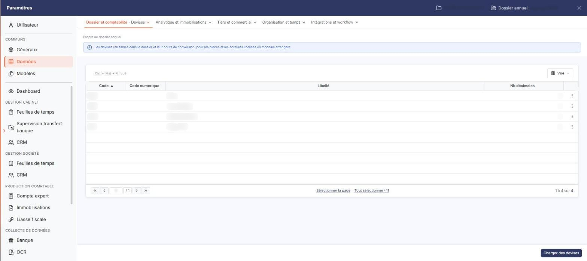
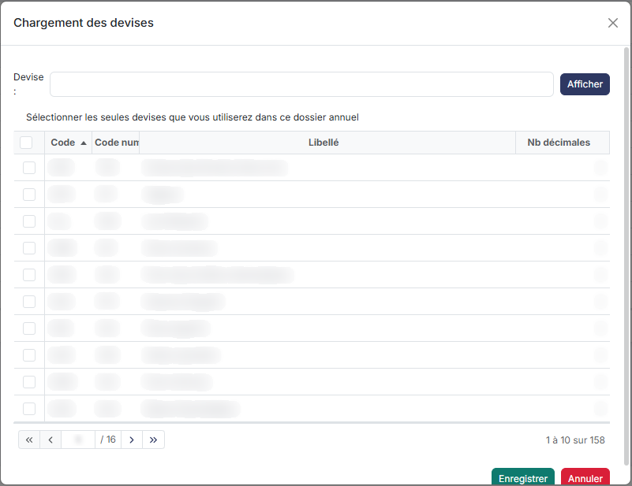

# Devises


**Où le trouver :** Panneau **Paramètres** › **Données** › **Dossier et comptabilité** › **Devises**



**En bref** — Cet écran liste les devises retenues pour le dossier annuel en cours, parmi le fichier complet des devises du logiciel, pour raccourcir la liste proposée en saisie.

* Pour retenir des devises : bouton \[Charger des devises], seul bouton du pied du panneau.
* Pour retirer une devise : menu ⋮ « Autres actions » de sa ligne, puis « Supprimer ».


Le logiciel contient le fichier complet des devises mais pour faciliter la saisie d'écritures avec une liste plus courte et éviter les erreurs, vous devez indiquer celles seules qui pourront être utilisées dans le dossier annuel. Cet écran est donc la liste des devises retenues pour le dossier annuel en cours.

<figure><figcaption>
Écran « Devises » de la nouvelle interface
</figcaption></figure>

Une devise ne s'ouvre pas : cet écran ne comporte aucune fiche de devise, et aucun bouton ne permet d'en créer une à la main. La liste s'alimente uniquement par le bouton \[Charger des devises].

Cet écran se trouve dans le panneau Paramètres : onglet « Données », catégorie « Dossier et comptabilité », puis « Devises ». Il porte la mention « Propre au dossier annuel » et un encadré bleu : « Les devises utilisables dans le dossier et leur cours de conversion, pour les pièces et les écritures libellées en monnaie étrangère. »

## La liste des devises

Le logiciel affiche les devises du dossier annuel, triées par ordre croissant de code. Les colonnes sont les suivantes :

| Champ              | Ce qu'il faut savoir                                                                                                       |
| ------------------ | -------------------------------------------------------------------------------------------------------------------------- |
| **Code**           | Le code mnémonique international de la devise, par exemple XPF.                                                            |
| **Code numerique** | Le code numérique de la devise.                                                                                            |
| **Libellé**        | Le nom de la devise, par exemple Franc CFP.                                                                                |
| **Nb décimales**   | Le nombre de décimales géré pour cette devise. Il varie d'une devise à l'autre : le Franc CFP, par exemple, n'en a aucune. |

Chacune de ces quatre colonnes peut servir de critère de tri : cliquez sur son en-tête.

La dernière colonne de la grille ne porte pas d'en-tête : sur chaque ligne, elle porte, à droite, le menu « Autres actions » (trois points), qui ne propose que « Supprimer » et supprime la devise. Il n'y a pas d'autre commande de ligne. Il n'y a plus de case à cocher : un clic sur une ligne la sélectionne, et le pied de la liste propose « Sélectionner la page » et « Tout sélectionner » suivi du nombre de devises.

Comme les autres listes du panneau Paramètres, la grille est surmontée du bouton **\[Vue]** ; en revanche elle n'offre ni barre « Rechercher… », ni bouton **\[Filtres]**, ni bouton **\[Exporter]**.

bouton **\[Charger des devises]**

Il se trouve dans le pied du panneau, à droite : c'est le seul bouton du pied.

**Menu « Autres actions » de la ligne : « Supprimer »**

Le pied du panneau ne porte plus de bouton \[Supprimer] : la suppression d'une devise passe par le menu « Autres actions » de sa ligne.

## Autres vues de l'écran

<figure><figcaption>
Bouton [Chargement devises]
</figcaption></figure>
