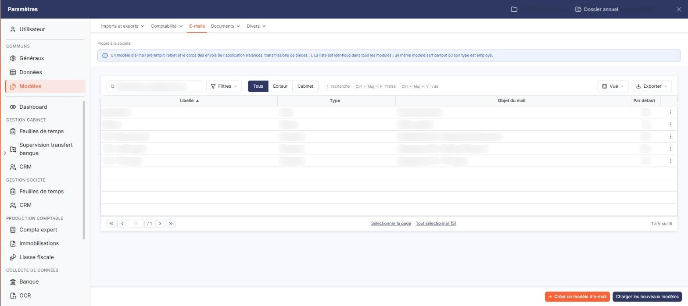
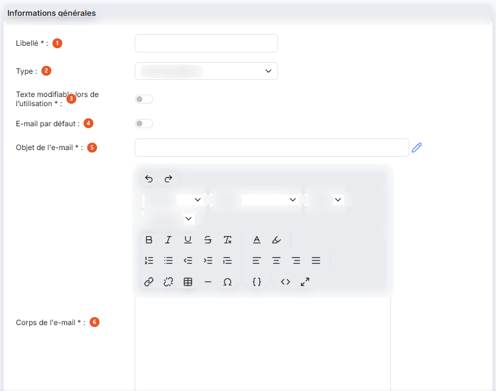
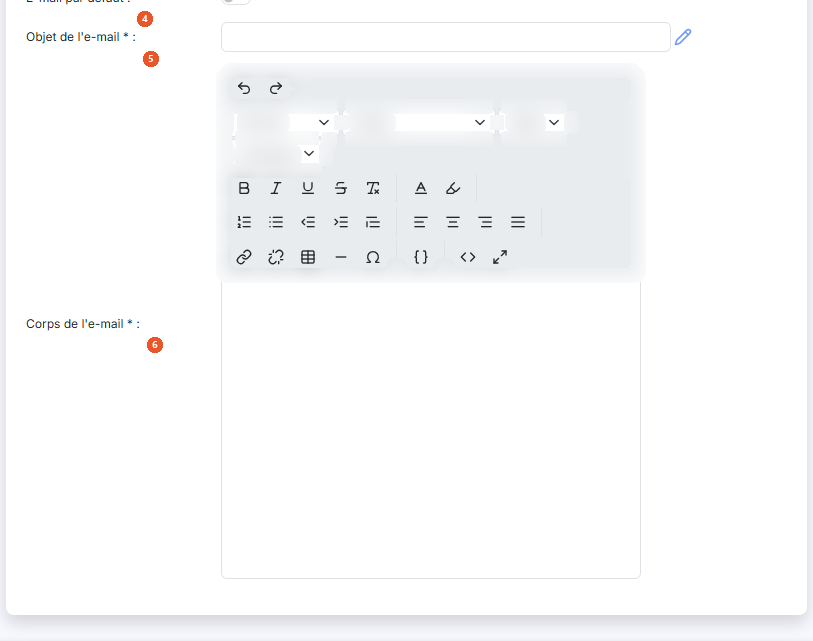
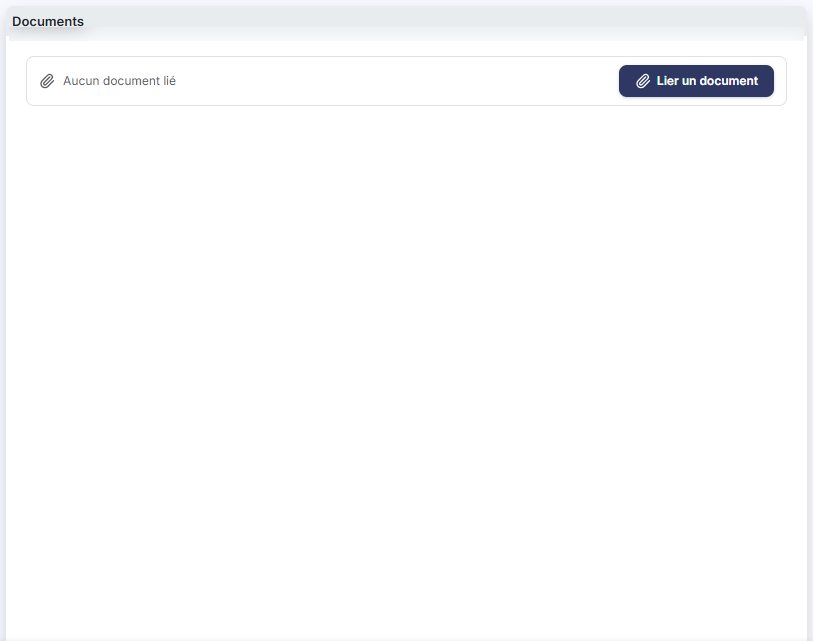
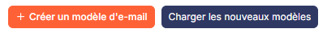

# E-mails


**Où le trouver :** Panneau **Paramètres** › **Modèles** › **E-mails**



**En bref** — Cet écran permet de préparer les e-mails que le logiciel envoie pour vous : objet, corps du message et documents joints, que vous choisissez ensuite au moment de l'envoi.

* Pour créer un modèle : bouton \[Nouveau], renseignez la fiche, puis bouton \[Enregistrer].
* Pour joindre un document : bouton \[Nouveau doc depuis mon poste], \[Nouveau doc depuis la GED] ou \[Nouveau doc depuis l'OCR].
* Pour récupérer les modèles de l'éditeur : bouton \[Charger les nouveaux modèles].


Cette option vous permet de préparer les e-mails que le logiciel enverra pour vous : l'objet, le corps du message et les documents qui l'accompagnent. Vous choisissez ensuite le modèle au moment de l'envoi, sans avoir à réécrire le message.

<figure><figcaption>
Écran « E-mails » de la nouvelle interface
</figcaption></figure>

Un modèle est rattaché à un **type**, qui dit à quelle occasion il vous sera proposé : envoi de pièces, relance, envoi de déclarations, courrier client, et d'autres encore. Pour chaque type, vous pouvez désigner un modèle comme étant celui proposé par défaut.

Le corps du message peut contenir des **champs de fusion** : au lieu d'écrire le nom du client ou l'adresse du cabinet, vous insérez un code que le logiciel remplace par la bonne valeur au moment de l'envoi. Un même modèle sert ainsi pour tous vos destinataires.

La liste présente quatre colonnes, classées par défaut par ordre croissant de libellé : **Libellé**, **Type**, **Objet du mail** et **Par défaut**. Chacune peut servir de critère de tri : cliquez sur son en-tête. La colonne **Par défaut** est tronquée par le bord droit du cadre, mais ses valeurs « Oui » et « Non » restent lisibles.

En haut de la colonne de gauche, vous disposez d'une case à cocher qui sélectionne toutes les lignes de la page affichée, d'une seconde case qui étend la sélection à toutes les pages, du pictogramme « Engrenage » qui ouvre la personnalisation des colonnes, du pictogramme « Entonnoir » qui ouvre la fenêtre « Filtres », et du pictogramme « Imprimante » qui lance l'impression de la liste.

Sur chaque ligne, vous disposez d'une case à cocher « Sélectionner », du pictogramme « Croix » qui supprime le modèle et du pictogramme « Ajout » qui le duplique.

Le pictogramme « Crayon », qui ouvre la fiche du modèle, n'est en revanche **pas proposé sur toutes les lignes** : les modèles livrés par l'éditeur ne s'ouvrent pas, et vous ne pouvez donc pas consulter leur paramétrage. Aucune colonne de la liste ne vous le signale ; pour les repérer, employez le critère **Modèle éditeur** de la fenêtre « Filtres ». Pour partir de l'un d'eux, dupliquez-le : la copie, elle, vous appartient et s'ouvre normalement.

bouton **\[Nouveau]**

Ouvre la fiche de création d'un modèle d'e-mail.

bouton **\[Charger les nouveaux modèles]**

Charge dans le dossier les éventuels nouveaux modèles mis à disposition par l'éditeur. Le logiciel ouvre la fenêtre « Nouveaux modèles », qui vous invite à choisir les modèles à charger et à valider. Sélectionnez-les à l'aide des cases à cocher, puis cliquez sur bouton **\[Valider]** pour les reprendre ou sur bouton **\[Annuler]** pour renoncer.

bouton **\[Exporter]**

Si vous gérez plusieurs sociétés, ce bouton vous permet de recopier dans les autres les modèles d'e-mails que vous avez créés dans celle-ci. Il ne produit pas de fichier.

Sélectionnez les modèles à recopier dans la liste à l'aide des cases à cocher, puis cliquez sur bouton **\[Exporter]**. Le logiciel ouvre la fenêtre « Exporter », qui vous rappelle le nombre d'enregistrements sélectionnés.

Trois choix vous sont proposés pour désigner les sociétés destinataires : **Toutes les sociétés** recopie les données vers toutes les sociétés auxquelles vous avez accès, **Liées à ce modèle** vers toutes les sociétés créées sur la base de ce modèle, et **Autres** vers les seules sociétés que vous désignez.

Dans ce dernier cas, choisissez-les dans le tableau qui vous est présenté, dont les colonnes sont **Code client**, **Raison sociale** et **Accès autorisé** ; c'est cette dernière colonne que vous positionnez à « Oui » pour chaque société retenue. Si le nombre de sociétés est important, saisissez un mot dans la zone **Société** et cliquez sur bouton **\[Afficher]** pour restreindre la liste.

La question **Souhaitez-vous remplacer les enregistrements ayant le même libellé ?**, en bas de la fenêtre, commande l'écrasement des modèles de même libellé déjà présents dans les sociétés destinataires. Le logiciel positionne « Non ».

Une fois votre sélection terminée, cliquez sur bouton **\[Valider]**, ou sur bouton **\[Fermer]** pour renoncer. La copie n'est pas immédiate : l'écran vous prévient qu'elle se fera lors de la prochaine utilisation de chaque société gérée concernée.

bouton **\[Supprimer]**

Supprime les modèles que vous avez cochés dans la liste.

La fiche d'un modèle, en création comme en modification, présente deux rubriques dans cet ordre : « Informations générales » et « Documents ». Elle se termine par les boutons bouton **\[Enregistrer]**, qui enregistre le modèle, et bouton **\[Retour]**, qui vous ramène à la liste sans rien enregistrer.

## Rubrique « Informations générales »

<figure><figcaption>
Rubrique « Rubrique « Informations générales » »
</figcaption></figure>

<figure><figcaption>
Rubrique « Rubrique « Informations générales » »
</figcaption></figure>

| Champ                                                                                     | Ce qu'il faut savoir                                                                                                                                                                                                                                                                                                                                                                                                                                                                                                                                                                                                                                                                                                                                                                                                                                                                                                                                                |
| ----------------------------------------------------------------------------------------- | ------------------------------------------------------------------------------------------------------------------------------------------------------------------------------------------------------------------------------------------------------------------------------------------------------------------------------------------------------------------------------------------------------------------------------------------------------------------------------------------------------------------------------------------------------------------------------------------------------------------------------------------------------------------------------------------------------------------------------------------------------------------------------------------------------------------------------------------------------------------------------------------------------------------------------------------------------------------- |
| 
1. <strong>Libellé</strong> <em>Obligatoire</em>
                                | C'est sous ce libellé que le modèle est présenté dans la liste et proposé au moment de l'envoi. Ce libellé ne se saisit qu'à la création : en modification, la zone vous est présentée désactivée, sur fond gris, et ne vous laisse rien écrire.                                                                                                                                                                                                                                                                                                                                                                                                                                                                                                                                                                                                                                                                                                                    |
| 2. **Type**                                                                               | 
L'occasion à laquelle le modèle vous sera proposé. Huit valeurs vous sont offertes, présentées par ordre alphabétique : <strong>Changement de mot de passe</strong>, <strong>Courrier client</strong>, <strong>Création utilisateur</strong>, <strong>Demandes infos client</strong>, <strong>Envoi de pièces</strong>, <strong>Envoi déclarations</strong>, <strong>Envoi dossier CAC</strong> et <strong>Relance</strong>. Le logiciel positionne <strong>Envoi de pièces</strong> à la création. Cette liste est commune à tout le logiciel : elle n'est pas restreinte aux envois de la comptabilité. La colonne <strong>Type</strong> de la liste peut afficher une valeur qui ne figure pas dans ce choix, par exemple « Declaration » pour les modèles de déclaration de TVA livrés par l'éditeur. Le choix du type ne change ni les champs de la fiche ni les rubriques présentées : il ne commande que le moment où le modèle vous sera proposé.
 |
| 
3. <strong>Texte modifiable lors de l'utilisation</strong> <em>Obligatoire</em>
 | Répondez « Oui » pour pouvoir retoucher l'objet et le corps du message au moment de l'envoi, « Non » pour que le texte du modèle soit envoyé tel quel. Le logiciel positionne « Non » à la création.                                                                                                                                                                                                                                                                                                                                                                                                                                                                                                                                                                                                                                                                                                                                                                |
| 4. **E-mail par défaut**                                                                  | Répondez « Oui » pour que ce modèle soit celui que le logiciel propose spontanément. Le logiciel positionne « Non » à la création. Plusieurs modèles peuvent porter « Oui » en même temps dès lors qu'ils sont de types différents.                                                                                                                                                                                                                                                                                                                                                                                                                                                                                                                                                                                                                                                                                                                                 |
| 
5. <strong>Objet de l'e-mail</strong> <em>Obligatoire</em>
                      | C'est l'objet du message envoyé. Le pictogramme « Crayon », à droite de la zone, ouvre la fenêtre « Champs », où vous choisissez un champ de fusion à insérer dans l'objet.                                                                                                                                                                                                                                                                                                                                                                                                                                                                                                                                                                                                                                                                                                                                                                                         |
| 
6. <strong>Corps de l'e-mail</strong> <em>Obligatoire</em>
                      | C'est le texte du message. Vous le saisissez dans un éditeur de texte enrichi, dont la barre d'outils vous permet de mettre en gras, en italique ou en souligné, de choisir la police, la taille, la couleur du texte et celle du fond, de composer des listes numérotées ou à puces, de gérer les retraits et les alignements, d'insérer un lien, un tableau, une ligne horizontale, un caractère spécial ou un modèle de texte, de couper, copier, coller, annuler et rétablir, d'afficher la source du message et de passer l'éditeur en plein écran.                                                                                                                                                                                                                                                                                                                                                                                                            |

## Rubrique « Documents »

<figure><figcaption>
Rubrique « Rubrique « Documents » »
</figcaption></figure>

Cette rubrique vous permet de joindre au modèle les documents qui accompagneront systématiquement l'envoi. Tant qu'aucun document n'est attaché, la grille affiche « Liste vide ».

Elle présente quatre colonnes — **Description**, **Nom du fichier**, **Date** et **Créé par** — précédées d'une colonne de commandes.

Trois boutons vous permettent d'ajouter un document, selon l'endroit où il se trouve.

bouton **\[Nouveau doc depuis mon poste]** : le document est pris sur votre ordinateur.

bouton **\[Nouveau doc depuis la GED]** : le document est pris dans la gestion électronique de documents.

bouton **\[Nouveau doc depuis l'OCR]** : le document est pris parmi les pièces de l'OCR.

## La fenêtre « Champs »

Le pictogramme « Crayon » placé à droite de l'objet ouvre la fenêtre « Champs ». Vous y choisissez un champ de fusion — un code que le logiciel remplacera, au moment de l'envoi, par la valeur qui convient au destinataire.

Les champs sont rangés sous trois bandeaux, repliés à l'ouverture de la fenêtre : « Emetteur », « Société gérée » et « Cabinet ». Cliquez sur un bandeau pour le déplier. Chaque bandeau présente deux colonnes : le code, à reporter dans le message, et le libellé qui dit ce qu'il désigne.

Prenez garde à choisir le bon bandeau : « Société gérée » et « Cabinet » proposent les mêmes libellés — la ville, la civilité du contact… — et seuls leurs codes les distinguent. Une fois le code inséré dans le message, plus rien ne vous rappelle de quel bandeau il vient.

Le bouton **\[Annuler]** referme la fenêtre sans rien insérer.

Le pictogramme « Entonnoir » ouvre la fenêtre « Filtres », qui vous permet de restreindre la liste. Vous y retrouvez d'abord les quatre colonnes affichées — **Libellé**, **Type**, **Objet du mail** et **Par défaut** — puis trois colonnes masquées par défaut, que vous pouvez également utiliser comme critères : **Message**, **Modèle éditeur** et **Texte modifiable lors de l'utilisation**.

Chaque critère se compose d'un opérateur et d'une valeur, que vous pouvez combiner par « Et » ou « Ou » avec un second couple. La fenêtre offre cinq boutons : bouton **\[Filtrer]** applique les critères à la liste, bouton **\[Mémoriser les paramètres]** conserve la sélection de critères, bouton **\[Charger les paramètres]** la rappelle, bouton **\[Vider les filtres]** efface les critères saisis et bouton **\[Fermer]** referme la fenêtre.

## Autres vues de l'écran

<figure><figcaption>
Bouton [Nouveau]
</figcaption></figure>
