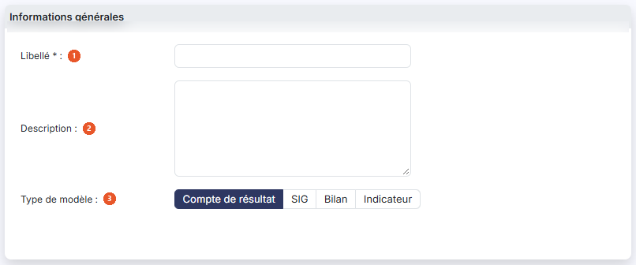
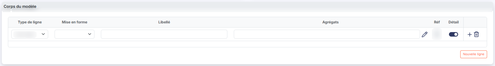
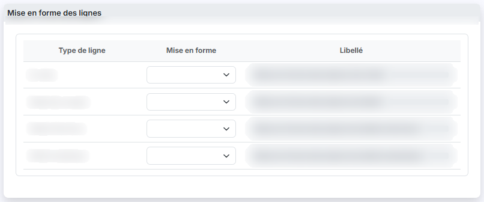

# Etats financiers


**Où le trouver :** Panneau **Paramètres** › **Modèles** › **Documents** › **Etats financiers**



**En bref** — Cet écran permet d'administrer les modèles qui servent à éditer les états financiers du dossier : modèles livrés par l'éditeur, duplication, création et formules.

* Pour récupérer les nouveaux modèles de l'éditeur : bouton \[Charger les nouveaux modèles].
* Pour créer un modèle : bouton \[Nouveau], ou dupliquez un modèle livré avec le pictogramme « Ajout » puis modifiez la copie.
* Pour copier vos modèles dans d'autres sociétés : bouton \[Exporter].


Cette option permet d'administrer les modèles qui servent à éditer les états financiers du dossier.

<figure><figcaption>
Écran « Etats financiers » de la nouvelle interface
</figcaption></figure>

Le logiciel est livré avec un ensemble de modèles préparés par l'éditeur : leur libellé est encadré d'astérisques. Ces modèles vous servent de base pour créer les vôtres — dupliquez-les avec le pictogramme « Ajout », puis modifiez la copie. Vous pouvez aussi créer un modèle à partir de rien avec le bouton **\[Nouveau]**.

Les modèles d'états financiers sont de quatre types : compte de résultat, soldes intermédiaires de gestion, bilan et indicateur.

Au-dessus de la liste, un seul critère vous est proposé.

**Type de modèle** : choisissez dans la liste le type de modèle que vous voulez voir : **Tous**, **Compte de résultat**, **SIG**, **Bilan** ou **Indicateur**. La liste est reconstituée dès que vous changez ce choix : il n'y a pas de bouton à actionner. Le logiciel affiche **Tous** à l'ouverture de l'écran.

La liste présente trois colonnes, classées par défaut par ordre croissant de libellé : **Libellé**, **Type de modèle** et **Description**. Chacune peut servir de critère de tri : cliquez sur son en-tête. La colonne **Description** est un texte libre — l'éditeur y note la date de mise à jour de ses modèles, et vous pouvez y porter vos propres consignes d'emploi. Elle est tronquée à l'affichage lorsqu'elle est longue.

En haut de la colonne de gauche, vous disposez d'une case à cocher qui sélectionne toutes les lignes de la page affichée, d'une seconde case qui étend la sélection à toutes les pages, du pictogramme « Engrenage » qui ouvre la personnalisation des colonnes, du pictogramme « Entonnoir » qui ouvre la fenêtre « Filtres », et du pictogramme « Imprimante » qui lance l'impression de la liste.

Sur chaque ligne, vous disposez d'une case à cocher « Sélectionner », du pictogramme « Croix » qui supprime le modèle et du pictogramme « Ajout » qui le duplique.

Le pictogramme « Crayon », qui ouvre la fiche du modèle, n'est en revanche **pas proposé sur toutes les lignes** : les modèles livrés par l'éditeur ne s'ouvrent pas, et vous ne pouvez donc pas consulter leur paramétrage. Pour partir de l'un d'eux, dupliquez-le : la copie, elle, vous appartient et s'ouvre normalement.

bouton **\[Nouveau]**

Ouvre la fiche de création d'un modèle d'état financier.

bouton **\[Charger les nouveaux modèles]**

Charge dans le dossier annuel les éventuels nouveaux modèles mis à disposition par l'éditeur. Le logiciel ouvre la fenêtre « Nouveaux modèles », qui vous invite à choisir les modèles à charger et à valider. Sélectionnez-les à l'aide des cases à cocher, puis cliquez sur bouton **\[Valider]** pour les reprendre ou sur bouton **\[Annuler]** pour renoncer.

bouton **\[Exporter]**

Si vous gérez plusieurs sociétés, ce bouton vous permet de recopier dans les autres les modèles d'états financiers que vous avez créés dans celle-ci.

Sélectionnez les modèles à recopier dans la liste à l'aide des cases à cocher, puis cliquez sur bouton **\[Exporter]**. Le logiciel ouvre la fenêtre « Exporter », qui vous rappelle le nombre d'enregistrements sélectionnés.

Trois choix vous sont proposés pour désigner les sociétés destinataires : **Toutes les sociétés** recopie les données vers toutes les sociétés auxquelles vous avez accès, **Liées à ce modèle** vers toutes les sociétés créées sur la base de ce modèle, et **Autres** vers les seules sociétés que vous désignez.

Dans ce dernier cas, choisissez-les dans le tableau qui vous est présenté, dont les colonnes sont **Code client**, **Raison sociale** et **Accès autorisé** ; c'est cette dernière colonne que vous positionnez à « Oui » pour chaque société retenue. Si le nombre de sociétés est important, saisissez un mot dans la zone **Société** et cliquez sur bouton **\[Afficher]** pour restreindre la liste.

La question **Souhaitez-vous remplacer les enregistrements ayant le même libellé ?**, en bas de la fenêtre, commande l'écrasement des modèles de même libellé déjà présents dans les sociétés destinataires. Le logiciel positionne « Non ».

Une fois votre sélection terminée, cliquez sur bouton **\[Valider]**, ou sur bouton **\[Fermer]** pour renoncer. La copie n'est pas immédiate : l'écran vous prévient qu'elle se fera lors de la prochaine utilisation de chaque société gérée concernée.

bouton **\[Supprimer]**

Supprime les modèles que vous avez cochés dans la liste.

La fiche d'un modèle, en création comme en modification, présente deux rubriques dans cet ordre : « Informations générales » et « Corps du modèle ». Elle se termine par les boutons bouton **\[Enregistrer]**, qui enregistre le modèle, et bouton **\[Retour]**, qui vous ramène à la liste sans rien enregistrer.

## Rubrique « Informations générales »

<figure><figcaption>
Rubrique « Rubrique « Informations générales » »
</figcaption></figure>

| Champ                                                   | Ce qu'il faut savoir                                                                                                                                                                                                                                                                                                                                                                                                                                                                                                                                                                                         |
| ------------------------------------------------------- | ------------------------------------------------------------------------------------------------------------------------------------------------------------------------------------------------------------------------------------------------------------------------------------------------------------------------------------------------------------------------------------------------------------------------------------------------------------------------------------------------------------------------------------------------------------------------------------------------------------ |
| 1. **Libellé**                                          | C'est ce libellé qui vous sera proposé dans les sélecteurs de modèle des éditions.                                                                                                                                                                                                                                                                                                                                                                                                                                                                                                                           |
| 2. **Description**                                      | Zone de texte libre, sur plusieurs lignes.                                                                                                                                                                                                                                                                                                                                                                                                                                                                                                                                                                   |
| 3. **Type de modèle**                                   | 
Choisissez entre <strong>Compte de résultat</strong>, <strong>SIG</strong>, <strong>Bilan</strong> et <strong>Indicateur</strong>. Le logiciel positionne <strong>Compte de résultat</strong> à la création. Ce choix ne se fait <strong>qu'une fois</strong> : il commande toute la constitution du corps du modèle, et il n'est plus modifiable une fois le modèle enregistré. En modification, les quatre boutons vous sont donc présentés en grisé et ne réagissent pas à vos clics. Les trois champs suivants ne vous sont proposés que si le type de modèle est <strong>Indicateur</strong>.
 |
| **Nombre de colonnes**                                  | Choisissez dans la liste le nombre de colonnes de montants que le modèle comportera, de **1** à **15**, en plus de la colonne de gauche qui porte les libellés des lignes. Le logiciel positionne **1** à la création. Comme le type de modèle, cette valeur n'est plus modifiable une fois le modèle enregistré.                                                                                                                                                                                                                                                                                            |
| **Utilisable comme une feuille de travail en révision** | Répondez « Oui » pour que l'indicateur soit accessible, en plus des éditions, depuis la page de révision et depuis l'option « Feuilles de travail personnalisées ». Le logiciel positionne « Non » à la création. Le pictogramme d'information placé à droite du champ rappelle cette règle et précise que le paramètre ne pourra plus être remis à « Non » si l'indicateur est utilisé dans au moins une feuille de travail personnalisée. En modification, le champ **Nombre de colonnes** vous est présenté désactivé.                                                                                    |
| **N° de compte de rattachement**                        | Affiché uniquement si vous avez répondu « Oui » à la question précédente. Saisissez le numéro du compte auquel la feuille de travail sera rattachée, ou recherchez-le avec le pictogramme « Loupe ».                                                                                                                                                                                                                                                                                                                                                                                                         |

## Rubrique « Corps du modèle »

<figure><figcaption>
Bouton [Nouveau]
</figcaption></figure>

<figure><figcaption>
Rubrique « Rubrique « Corps du modèle » »
</figcaption></figure>

Un modèle est composé de lignes, chacune s'affichant avec une mise en forme et portant une valeur calculée à partir d'agrégats de comptes ou d'autres lignes du modèle.

La rubrique présente deux tableaux, l'un au-dessus de l'autre : le premier décrit les lignes du modèle, le second la mise en forme par type de ligne.

Le bouton **\[Nouveau]**, sous le premier tableau, ajoute une ligne au modèle. Sur chaque ligne déjà saisie, deux pictogrammes vous sont proposés : « Double flèche verticale », dont l'infobulle indique « Insérer », et « Croix », dont l'infobulle indique « Effacer ».

Les colonnes du premier tableau dépendent du type de modèle.

Pour un **Compte de résultat** : **Type de ligne**, **Mise en forme**, **Libellé**, **Agrégats**, **Réf** et **Détail**.

Pour un **Indicateur** : **Mise en forme**, **Libellé**, puis autant de couples **colonne de montant** / **Réf** que vous avez demandé de colonnes, et **Détail**. Il n'y a ni **Type de ligne** ni **Agrégats** : le passage d'un type de modèle à l'autre change la structure du tableau, et pas seulement son affichage.

Pour chaque ligne, vous définissez les éléments suivants.

| Champ             | Ce qu'il faut savoir                                                                                                                                                                                                                                                                                                                                                                                                                                                                                                                                                                                                                                                                                                                                                                                                                                                                                                                                                                                                                                                                                                                                                                                                                                                                                                   |
| ----------------- | ---------------------------------------------------------------------------------------------------------------------------------------------------------------------------------------------------------------------------------------------------------------------------------------------------------------------------------------------------------------------------------------------------------------------------------------------------------------------------------------------------------------------------------------------------------------------------------------------------------------------------------------------------------------------------------------------------------------------------------------------------------------------------------------------------------------------------------------------------------------------------------------------------------------------------------------------------------------------------------------------------------------------------------------------------------------------------------------------------------------------------------------------------------------------------------------------------------------------------------------------------------------------------------------------------------------------- |
| **Type de ligne** | 
Le contenu de cette liste varie selon le type de modèle. Elle vous permet d'indiquer si la ligne est une ligne « spécifique » — par exemple le total de l'actif d'un bilan ou le chiffre d'affaires d'un compte de résultat — pour laquelle un traitement particulier est prévu, ou une ligne « générique », que vous identifiez par le choix <strong>Autre ligne</strong>. Pour un compte de résultat, quatre valeurs vous sont proposées : <strong>Autre ligne</strong>, <strong>Chiffre d'affaires</strong>, <strong>Résultat</strong> et <strong>Ligne sans contrôle</strong>. Pour un bilan, trois valeurs vous sont proposées, et elles diffèrent d'une partie à l'autre : <strong>Autre ligne</strong>, <strong>Total actif</strong> et <strong>Ligne sans contrôle</strong> dans la partie « Actif », <strong>Autre ligne</strong>, <strong>Total passif</strong> et <strong>Ligne sans contrôle</strong> dans la partie « Passif ». Le logiciel positionne <strong>Autre ligne</strong> sur une ligne nouvelle. Une ligne spécifique déclenche des traitements particuliers, des contrôles ou des comparatifs, tandis que toutes les lignes définies comme <strong>Autre ligne</strong> se comportent de la même manière, selon les propriétés d'affichage et de calcul que vous leur avez données.
 |
| **Mise en forme** | Choisissez dans la liste la mise en forme que prendra la ligne à l'affichage. Elle vous aide d'une part à lire la constitution du modèle — repérage des totaux, des sous-totaux —, d'autre part à personnaliser la présentation de vos états financiers. Trente mises en forme vous sont proposées, combinant le style du texte (normal, gras, italique) et le fond (blanc, ou bandeau, menu et grille en trois intensités). Les couleurs des fonds sont celles de votre thème.                                                                                                                                                                                                                                                                                                                                                                                                                                                                                                                                                                                                                                                                                                                                                                                                                                        |
| **Libellé**       | Le libellé de la ligne, tel qu'il apparaîtra à l'édition.                                                                                                                                                                                                                                                                                                                                                                                                                                                                                                                                                                                                                                                                                                                                                                                                                                                                                                                                                                                                                                                                                                                                                                                                                                                              |
| **Agrégats**      | Cette colonne peut contenir une formule de calcul, qui définit la valeur portée par la ligne, une valeur fixe — texte ou nombre — ou rester vide. Pour définir ou consulter le contenu d'une cellule, cliquez sur le pictogramme « Crayon » placé à sa droite.                                                                                                                                                                                                                                                                                                                                                                                                                                                                                                                                                                                                                                                                                                                                                                                                                                                                                                                                                                                                                                                         |
| **Réf**           | À sa création, chaque ligne reçoit automatiquement une référence, une lettre attribuée dans l'ordre alphabétique. Cette colonne ne se saisit pas. C'est cette référence que vous utilisez dans les formules pour reprendre la valeur d'une autre ligne.                                                                                                                                                                                                                                                                                                                                                                                                                                                                                                                                                                                                                                                                                                                                                                                                                                                                                                                                                                                                                                                                |
| **Détail**        | 
Répondez « Oui » pour autoriser l'affichage du détail sous cette ligne à l'édition. L'infobulle de l'en-tête de la colonne précise que ce détail ne s'affiche que si l'édition est lancée avec l'option « Avec le détail des comptes ». Sur un modèle de type <strong>Indicateur</strong>, la colonne de montant <strong>ne porte pas de titre figé : son en-tête est une zone de saisie</strong>. Saisissez-y le nom que vous voulez donner à la colonne — il apparaîtra ainsi à l'édition. Vous disposez d'une zone de ce genre par colonne demandée. Le <strong>second tableau</strong> de la rubrique vous permet de fixer la mise en forme des lignes que le logiciel ajoute lui-même à l'édition. Il comporte trois colonnes — <strong>Type de ligne</strong>, qui ne se saisit pas, <strong>Mise en forme</strong> et <strong>Libellé</strong> — et quatre lignes, dans cet ordre : <strong>En-tête</strong>, <strong>Détail de compte</strong>, <strong>Détail d'écriture</strong> et <strong>Détail analytique</strong>.
                                                                                                                                                                                                                                                                         |
| **En-tête**       | La mise en forme de toutes les lignes d'en-tête. Si vous n'en définissez pas, le logiciel applique une mise en forme par défaut.                                                                                                                                                                                                                                                                                                                                                                                                                                                                                                                                                                                                                                                                                                                                                                                                                                                                                                                                                                                                                                                                                                                                                                                       |

**Détail de compte**, **Détail d'écriture** et **Détail analytique** : à l'édition d'un état financier, vous pouvez demander l'affichage, sous chaque agrégat, d'une ligne de détail par compte, par écriture ou par section analytique — c'est un paramètre de l'édition. Ces trois lignes vous permettent de donner une mise en forme particulière à chacun de ces détails. Si vous n'en définissez pas et que vous demandez le détail à l'édition, les lignes correspondantes prennent la mise en forme de la ligne immédiatement au-dessus d'elles.

La colonne **Libellé** porte, pour chacune des quatre lignes, un libellé par défaut que vous pouvez remplacer.

## L'éditeur de formule

Le pictogramme « Crayon » d'une cellule d'agrégat ou de montant ouvre l'éditeur de formule, où vous définissez ce que la cellule contiendra. La fenêtre porte le nom de la cellule concernée, par exemple « Cellule A - Détail », et se termine par les boutons bouton **\[Enregistrer]** et bouton **\[Annuler]**. Les fonctions utilisables y sont proposées sous forme de boutons, sur deux rangées, la seconde reprenant les mêmes fonctions pour l'exercice précédent ; un pictogramme d'information placé en fin de rangée affiche la description de chacune d'elles.

| Champ                | Ce qu'il faut savoir                                                                                                                                                                                                                                                                                                                                                                         |
| -------------------- | -------------------------------------------------------------------------------------------------------------------------------------------------------------------------------------------------------------------------------------------------------------------------------------------------------------------------------------------------------------------------------------------- |
| **Visible**          | Activé par défaut. Désactivez-le pour que rien ne s'affiche à l'emplacement de la cellule. Cela vous permet d'aérer vos éditions et vos feuilles de travail, en n'affichant pas les cellules des lignes de titre, par exemple.                                                                                                                                                               |
| **Type**             | Définit si la cellule est un champ numérique — seul cas où une formule est possible —, un champ texte, un champ date, ou un champ booléen, qui présentera un interrupteur Oui/Non.                                                                                                                                                                                                           |
| **Formule actuelle** | Accessible pour les seuls champs numériques. Elle contient la formule que le logiciel exécutera pour déterminer le contenu du champ, à l'édition de l'état financier ou de la feuille de travail personnalisée. Une formule peut combiner les différentes fonctions présentées sous la zone de saisie ; certaines attendent des racines de comptes, d'autres le contenu de lignes du modèle. |

Pour vous familiariser avec les formules, dupliquez un modèle d'état financier livré par l'éditeur et regardez comment ses formules sont construites : vous pourrez les modifier pour en vérifier les effets.

**Fonctionnement des différentes fonctions**

**\[Valeur]** totalise les valeurs contenues dans les lignes précédentes du modèle. La référence utilisable de chaque ligne figure dans la colonne **Réf**, à droite de la cellule. Chaque référence doit être précédée d'un point d'exclamation, et les références doivent être séparées par des points-virgules. Par exemple, depuis la ligne de référence R : \[Valeur]\(!C;!D;!E;!F;!H;!I;!J;!K)

Vous ne pouvez jamais faire référence, depuis une ligne, à une ligne située en dessous : les formules sont calculées de bas en haut, on ne peut donc pas appeler une valeur qui n'est pas encore calculée.

Toutes les autres fonctions attendent le même type d'argument : une racine de compte, une plage de comptes, ou une liste combinant racines et plages. Les éléments d'une liste sont séparés par des points-virgules, les bornes d'une plage par un tiret. Saisissez (601;603) pour que la formule traite les comptes de racines 601 et 603, ou (601-603) pour qu'elle traite tous les comptes de 601 à 603 inclus. Autre exemple : \[-Solde]\(770-774;776;778-779;79)

**\[Défaut]** restaure la dernière valeur enregistrée de la formule.

**\[Solde]** renvoie le solde, **\[-Solde]** le solde avec le signe inversé.

**\[SoldeC]** renvoie le solde des comptes créditeurs, **\[-SoldeC]** le même solde avec le signe inversé.

**\[SoldeD]** renvoie le solde des comptes débiteurs, **\[-SoldeD]** le même solde avec le signe inversé.

**\[MvtC]** renvoie le total des mouvements créditeurs, **\[-MvtC]** le même total avec le signe inversé.

**\[MvtD]** renvoie le total des mouvements débiteurs, **\[-MvtD]** le même total avec le signe inversé.

**\[FWP]** reprend la valeur d'une cellule d'une feuille de travail personnalisée, selon la nomenclature \[FWP]\(libellé!!Réf).

**\[NBP]** n'est utile que dans les éditions du bilan et du compte de résultat. Elle renvoie la valeur contenue dans l'un des champs des notes de bas de page. Ces champs se renseignent dans la page d'édition du bilan et du compte de résultat tant que la liasse fiscale n'est pas validée, puis sont renseignés automatiquement à la validation de la liasse.

Champs de notes de bas de page disponibles pour le **bilan** :

* Nbp\_fonds\_droit\_au\_bail : Fonds commercial (1) Dont droit au bail
* Nbp\_immos\_finan\_moins1an : Immos financières (2) Dont à moins d'un an (brut)
* Nbp\_créances\_moins1an : Créances (3) Dont à moins d'un an (brut)
* Nbp\_dettes\_plus1an : Dettes (1) Dont à plus d'un an
* Nbp\_dettes\_moins1an : Dettes (1) Dont à moins d'un an
* Nbp\_concours\_banc : Dettes Ets. crédit (2) Dont concours bancaires
* Nbp\_empr\_particip : Dettes diverses (3) Dont emprunts participatifs

Champs de notes de bas de page disponibles pour le **compte de résultat** :

* Nbp\_prod\_exer\_ant : Produits d'exploitation (1) Dont des exercices antérieurs
* Nbp\_prod\_finan\_entit : Produits financiers (3) Dont des entités liées
* Nbp\_charges\_ant : Charges d'exploitation (1) Dont des exercices antérieurs
* Nbp\_charges\_finan\_entit : Charges financières (4) Dont intérêts des entités liées

Exemple d'emploi : \[NBP]\(Nbp\_fonds\_droit\_au\_bail)

**Combinaison des fonctions**

Vous pouvez appeler des valeurs des exercices précédents en ajoutant « #N-1 » à la fonction : \[Solde#N-1]\(31) donne le solde des comptes de racine 31 de l'exercice précédent, \[Solde#N-2]\(31) fait la même opération sur l'exercice d'il y a deux ans, et ainsi de suite jusqu'à N-10.

Une formule peut combiner plusieurs fonctions reliées par les opérateurs +, -, / et \*. Quelques exemples :

\[Valeur]\(!A)/\[Valeur]\(!B)\*100

\[Solde]\(4090-4387;441)+\[SoldeD]\(443-455;4561;4563;4564;4565;458;467)+\[SoldeD]\(401;403;4088;4080;4081)

\[MvtC]\(2831)+\[Solde#N-1]\(2831)

Pour éviter les références circulaires, vous ne pouvez additionner que des lignes dont la référence est antérieure à la ligne en cours : l'agrégat de la ligne D ne peut pas contenir les références D, E, F, etc.

## Spécificités des modèles de bilan

Un modèle de bilan est composé de deux grilles distinctes : la première correspond à la partie « Actif » du bilan, la seconde à la partie « Passif ». Les lignes de chaque grille sont référencées séparément.

Vous pouvez décider qu'un compte n'est affiché qu'en fonction de son solde — un compte bancaire, par exemple, selon qu'il est positif ou non. Pour cela, ajoutez après la racine du compte (C) pour ne l'afficher que s'il est créditeur, ou (D) pour ne l'afficher que s'il est débiteur.


Attention : pour ne pas fausser l'édition, l'affectation d'un solde à une partie du bilan doit s'accompagner du solde opposé dans l'autre partie du même bilan. Pour que les comptes de racine 512 ne figurent à l'actif que s'ils sont débiteurs, et au passif que s'ils sont créditeurs, saisissez 512(D) dans la ligne concernée de la partie Actif et 512(C) dans la partie Passif.


| Champ                 | Ce qu'il faut savoir                                                                                                                                                                                                                                                                                                                                                                                                                                                                                                                                                                                                                                                        |
| --------------------- | --------------------------------------------------------------------------------------------------------------------------------------------------------------------------------------------------------------------------------------------------------------------------------------------------------------------------------------------------------------------------------------------------------------------------------------------------------------------------------------------------------------------------------------------------------------------------------------------------------------------------------------------------------------------------- |
| **Partie « Actif »**  | La grille contient deux colonnes d'agrégats, intitulées **Agrégats 1** et **Agrégats 2** et suivies chacune de sa colonne **Réf**, correspondant respectivement aux montants bruts et aux dépréciations et provisions. Pour un agrégat donné — les immobilisations corporelles, par exemple — saisissez dans la première colonne les racines des comptes d'actif, et dans la seconde les racines des comptes d'amortissements et de dépréciations qui s'y rattachent. Pour additionner plusieurs agrégats, saisissez dans les deux colonnes les références des lignes à additionner. La partie « Actif » doit obligatoirement comprendre une ligne de type « Total actif ». |
| **Partie « Passif »** | Elle ne contient qu'une seule colonne d'agrégat, correspondant aux soldes des comptes de passif. Elle doit obligatoirement comprendre une ligne de type « Total passif ».                                                                                                                                                                                                                                                                                                                                                                                                                                                                                                   |

## Spécificités des autres modèles

Les modèles de type « Compte de résultat », « SIG » et « Indicateur » ont une trame semblable : ils ne comptent qu'une seule grille. Celle du compte de résultat et celle des SIG ne contiennent qu'une seule colonne d'agrégats, correspondant aux soldes des comptes de charges et de produits ; celle d'un indicateur en contient autant que vous avez demandé de colonnes.

Un modèle de compte de résultat doit obligatoirement comprendre une ligne de type « Chiffre d'affaires » et une ligne de type « Résultat ».

Le pictogramme « Entonnoir » ouvre la fenêtre « Filtres », qui vous permet de restreindre la liste. Vous y retrouvez d'abord les trois colonnes affichées — **Libellé**, **Type de modèle** et **Description** — puis quatre colonnes masquées par défaut, que vous pouvez également utiliser comme critères : **Date de création** et **Date de modification**, que vous choisissez au calendrier, **Modèle éditeur** et **Compte de rattachement**.

Chaque critère se compose d'un opérateur et d'une valeur, que vous pouvez combiner par « Et » ou « Ou » avec un second couple. La fenêtre offre cinq boutons : bouton **\[Filtrer]** applique les critères à la liste, bouton **\[Mémoriser les paramètres]** conserve la sélection de critères, bouton **\[Charger les paramètres]** la rappelle, bouton **\[Vider les filtres]** efface les critères saisis et bouton **\[Fermer]** referme la fenêtre.

## Autres vues de l'écran

<figure><figcaption>
Rubrique « Mise en forme des lignes »
</figcaption></figure>
