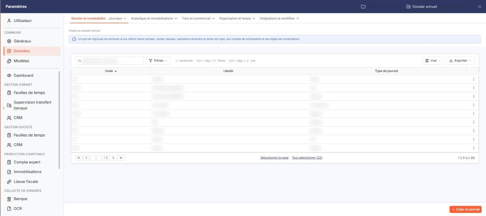
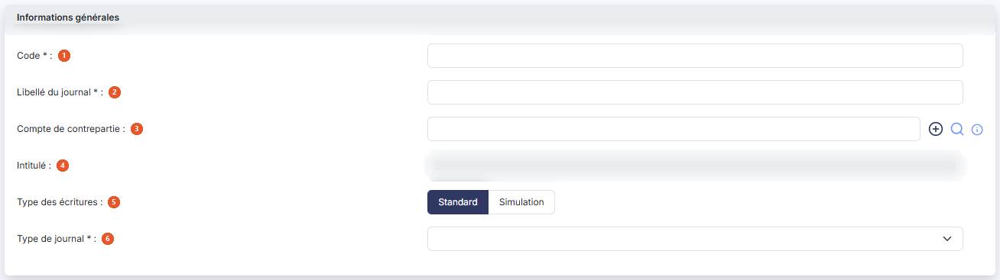
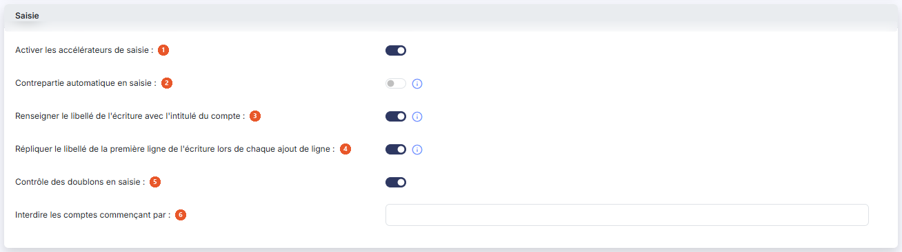
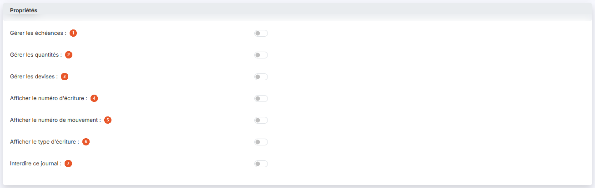

# Journaux — fichier des journaux


**Où le trouver :** Panneau **Paramètres**



**En bref** — Cet écran permet d'administrer les journaux utilisés pour la saisie comptable : liste du dossier annuel, création, duplication, suppression et réglage des options de chaque journal.

* Pour créer un journal : bouton \[Nouveau], renseignez le code et le libellé, puis bouton \[Enregistrer].
* Pour supprimer des journaux : cochez-les dans la liste, puis bouton \[Supprimer] (leurs écritures de l'exercice en cours sont supprimées avec eux).
* Pour restreindre la liste : pictogramme « Entonnoir », choisissez vos critères, puis bouton « Filtrer ».


Cette option vous permet d’administrer les journaux utilisés pour la saisie comptable. Vous pouvez créer autant de journaux que nécessaire.

<figure><figcaption>
Écran « Journaux » de la nouvelle interface
</figcaption></figure>

Le logiciel affiche la liste des journaux du dossier annuel sur lequel vous êtes positionné, avec les colonnes **Code**, **Libellé** et **Type de journal**. La liste est triée par défaut sur le code, par ordre croissant, et chaque colonne peut servir de critère de tri.

Dans l'en-tête de la première colonne, vous disposez d'une case à cocher qui sélectionne toutes les lignes de la page affichée, d'une seconde case qui étend la sélection à toutes les pages, du pictogramme « Roue crantée » qui personnalise les colonnes affichées, du pictogramme « Entonnoir » qui ouvre la fenêtre « Filtres » et du pictogramme « Imprimante » qui imprime la grille.

Sur chaque ligne, vous disposez d'une case à cocher de sélection, du pictogramme « Crayon » qui ouvre la fiche du journal, du pictogramme « Croix » qui le supprime et du pictogramme « Ajout », dont l'infobulle indique « Dupliquer », qui le duplique.


Remarque : il est possible de supprimer un journal, mais cette opération entraîne la suppression de toutes les écritures qui y auront été saisies pour l’exercice en cours.


La création d'un journal entraîne la création d'une subdivision de ce journal pour chaque mois du dossier annuel sur lequel vous êtes positionné.

bouton **\[Nouveau]**

Vous ouvrez la fiche de création d'un journal.

bouton **\[Supprimer]**

Vous supprimez les journaux que vous avez cochés dans la liste.

La fenêtre « Filtres », ouverte par le pictogramme « Entonnoir », vous permet de restreindre la liste sur les colonnes affichées comme sur des paramètres du journal qui ne sont pas présentés en colonne : contrepartie, type d'écriture, saisie en folio, mode de saisie, accélérateurs de saisie, modèles d'écriture, gestion des échéances, gestion des quantités, nombre de champs QTE, gestion des devises, affichage du numéro d'écriture, affichage du type d'écriture, journal interdit, renseigner le libellé et comptes interdits. Les boutons « Filtrer », « Mémoriser les paramètres », « Charger les paramètres », « Vider les filtres » et « Fermer » y sont proposés.

La fiche d'un journal comporte trois rubriques.

## Rubrique « Informations générales »

<figure><figcaption>
Rubrique « Rubrique « Informations générales » »
</figcaption></figure>

| Champ                                                              | Ce qu'il faut savoir                                                                                                                                                                                                                                                                                                                                                                                                                                                                                                                                                                                                                                                                                    |
| ------------------------------------------------------------------ | ------------------------------------------------------------------------------------------------------------------------------------------------------------------------------------------------------------------------------------------------------------------------------------------------------------------------------------------------------------------------------------------------------------------------------------------------------------------------------------------------------------------------------------------------------------------------------------------------------------------------------------------------------------------------------------------------------- |
| 1. **Code**                                                        | Chaque journal doit avoir un code unique. Vous le saisissez à la création, où il est marqué obligatoire ; une fois le journal créé, le logiciel l'affiche grisé et son code n’est plus modifiable.                                                                                                                                                                                                                                                                                                                                                                                                                                                                                                      |
| 2. **Libellé du journal**                                          | Le libellé du journal. Il est marqué obligatoire à la création.                                                                                                                                                                                                                                                                                                                                                                                                                                                                                                                                                                                                                                         |
| 3. **Compte de contrepartie**                                      | 
Le compte de contrepartie permet de définir le compte qui sera utilisé automatiquement pour solder une écriture dans ce journal. Le compte de contrepartie est facultatif. Par exemple, pour un journal de banque, vous pouvez définir le compte de racine 512000 pour saisir rapidement les contreparties des lignes de votre relevé bancaire. En saisie, l’icône « Solde » présente sur la ligne active appellera ce compte si le numéro de compte n’est pas encore renseigné. Le pictogramme d'information rappelle : « Compte utilisé pour solder l'écriture en saisie ». Le bouton vert et la loupe placés à côté du champ vous permettent de créer un compte ou de le rechercher.
 |
| 4. **Intitulé**                                                    | Le logiciel affiche l'intitulé du compte de contrepartie. Ce champ est en lecture seule.                                                                                                                                                                                                                                                                                                                                                                                                                                                                                                                                                                                                                |
| 5. **Type des écritures**                                          | Cette option permet de définir quel type d’écritures sera saisi dans le journal. Vous choisissez entre deux boutons-bascule :                                                                                                                                                                                                                                                                                                                                                                                                                                                                                                                                                                           |
| 
6. <strong>Type de journal</strong> <em>Obligatoire</em>
 | Le type d’un journal permet d’indiquer le type d’opérations qui y sera saisi. Vous le choisissez dans une liste déroulante qui propose : « Achat », « Vente », « OD », « Banque », « Caisse », « Reprise de balance », « Divers » et « A-nouveaux ». En création, la liste est présentée vide : le logiciel ne propose aucun type par défaut.                                                                                                                                                                                                                                                                                                                                                           |
| **Standard**                                                       | Les écritures de type Standard sont modifiables et supprimables tant qu'elles n'ont pas été validées. Par défaut, c’est ce type d’écritures qui est proposé pour tout nouveau journal.                                                                                                                                                                                                                                                                                                                                                                                                                                                                                                                  |
| **Simulation**                                                     | Les écritures de type Simulation sont modifiables et supprimables. Elles vous permettent de distinguer dans votre saisie des opérations qui n’ont pas d’incidence sur les états financiers de votre société : tests de scénarios fiscaux, situations intermédiaires en cours d’exercice, etc.                                                                                                                                                                                                                                                                                                                                                                                                           |

## Rubrique « Saisie »

<figure><figcaption>
Rubrique « Rubrique « Saisie » »
</figcaption></figure>

Cette rubrique permet de définir les options applicables lors de la saisie. Chaque option se règle par un interrupteur Oui/Non, sauf la dernière.

| Champ                                                                                        | Ce qu'il faut savoir                                                                                                                                                                                                                                                                                                                                                                                                                                          |
| -------------------------------------------------------------------------------------------- | ------------------------------------------------------------------------------------------------------------------------------------------------------------------------------------------------------------------------------------------------------------------------------------------------------------------------------------------------------------------------------------------------------------------------------------------------------------- |
| 1. **Activer les accélérateurs de saisie**                                                   | 
Vous avez la possibilité d’activer les accélérateurs ou les masques de saisie pour votre journal. Pour plus d’informations sur les utilitaires de saisie, veuillez vous reporter au menu "Fichiers", sous-menu "Plan comptable" de l’aide en ligne. Selon la configuration du journal, le logiciel affiche cet interrupteur grisé : vous ne pouvez alors pas le modifier.
                                                                           |
| 2. **Contrepartie automatique en saisie**                                                    | Si cette option est activée, dès qu'une première ligne d'écriture sera saisie dans ce journal, sa ligne de contrepartie sera générée automatiquement pour le compte de contrepartie défini pour le journal considéré. L'activation de la contrepartie automatique désactive les accélérateurs de saisie. Le pictogramme d'information rappelle : « Si vous activez cette option, lors de la saisie, une ligne de contrepartie sera automatiquement générée. » |
| 3. **Renseigner le libellé de l'écriture avec l'intitulé du compte**                         | Si cette option est activée, lors de la saisie du champ « Libellé » d’une ligne d’écriture, il sera prérempli avec l'intitulé du compte (compte général standard ou compte auxiliaire) renseigné pour cette écriture. Le libellé pré renseigné restera modifiable. Le pictogramme d'information rappelle : « Permet de pré-renseigner le libellé de l'écriture lors de la saisie du compte. »                                                                 |
| 4. **Répliquer le libellé de la première ligne de l'écriture lors de chaque ajout de ligne** | Si cette option est activée, chaque nouvelle ligne d'écriture reprend le libellé de la première ligne. Le pictogramme d'information précise : « Cette option sera prioritaire sur l'option de remplissage avec l'intitulé du compte. »                                                                                                                                                                                                                        |
| 5. **Contrôle des doublons en saisie**                                                       | Si cette option est activée, le logiciel contrôle les doublons lors de la saisie dans ce journal.                                                                                                                                                                                                                                                                                                                                                             |
| 6. **Interdire les comptes commençant par**                                                  | Si vous renseignez des racines de comptes, il ne sera pas possible de saisir de comptes généraux commençant par les racines définies ici. Par exemple, vous pouvez interdire la saisie d’un compte collectif client pour un journal d’achats, ou la saisie d’un compte de banque dans un journal d’opérations diverses.                                                                                                                                       |

Les différentes racines doivent être séparées par des points-virgules.

## Rubrique « Propriétés »

<figure><figcaption>
Rubrique « Rubrique « Propriétés » »
</figcaption></figure>

Chaque option se règle par un interrupteur Oui/Non.

| Champ                                  | Ce qu'il faut savoir                                                                                                                                                                                                                                                                                                                                                                                                            |
| -------------------------------------- | ------------------------------------------------------------------------------------------------------------------------------------------------------------------------------------------------------------------------------------------------------------------------------------------------------------------------------------------------------------------------------------------------------------------------------- |
| 1. **Gérer les échéances**             | Si cette option est activée, une colonne « Echéance » sera ajoutée à la grille de saisie, et une échéance pourra être saisie pour les comptes pour lesquels cette option est activée.                                                                                                                                                                                                                                           |
| 2. **Gérer les quantités**             | Si vous activez les quantités pour le journal, le logiciel affiche juste en dessous le champ **Nombre de champs de saisie :**, où vous précisez par deux boutons-bascule s'il y aura « 1 champ » ou « 2 champs » de quantité ; le logiciel propose « 1 champ ». La saisie des quantités se fera dans la fenêtre subsidiaire à la fenêtre de saisie des écritures. Si vous remettez l'option à Non, le logiciel masque ce champ. |
| 3. **Gérer les devises**               | 
Si cette option est activée, vous pourrez saisir, dans ce journal, des écritures dans d'autres devises que la devise locale indiquée dans le menu "Paramètres généraux", sous-option "Multimodules". Pour saisir des écritures en devises, il faut que cette même option soit activée dans les comptes concernés.
                                                                                                     |
| 4. **Afficher le numéro d'écriture**   | Si cette option est activée, une colonne affichant le numéro d'écriture (numérotation automatique) est ajoutée à la grille de saisie.                                                                                                                                                                                                                                                                                           |
| 5. **Afficher le numéro de mouvement** | Si cette option est activée, une colonne affichant le numéro de mouvement (numérotation automatique) est ajoutée à la grille de saisie.                                                                                                                                                                                                                                                                                         |
| 6. **Afficher le type d'écriture**     | Si cette option est activée, une colonne affichant le type d’écriture (champ non modifiable) est ajoutée à la grille de saisie et contiendra soit "St" pour les écritures de type "Standard", soit "V" pour "Validation", soit "Si" pour "Simulation".                                                                                                                                                                          |
| 7. **Interdire ce journal**            | Si cette option est activée, aucune écriture ne peut être saisie dans le journal. Seule la consultation des saisies préalablement effectuées est possible.                                                                                                                                                                                                                                                                      |

bouton **\[Enregistrer]**

Vous enregistrez le journal et le logiciel vous ramène à la liste.

bouton **\[Retour]**

Vous quittez la fiche sans enregistrer vos modifications.

## Autres vues de l'écran

<figure><figcaption>
Bouton [Nouveau]
</figcaption></figure>
