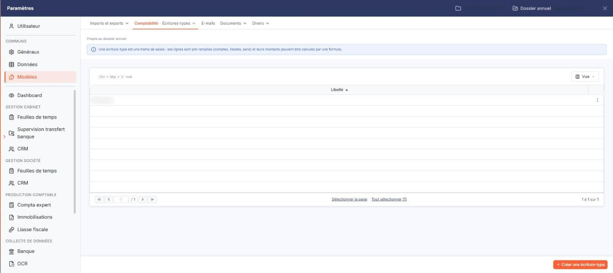
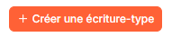
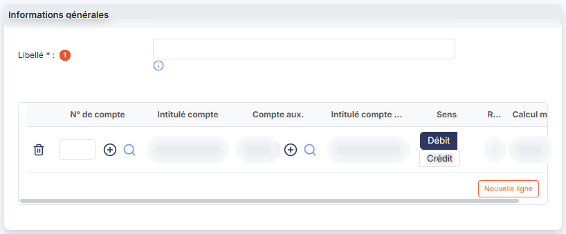
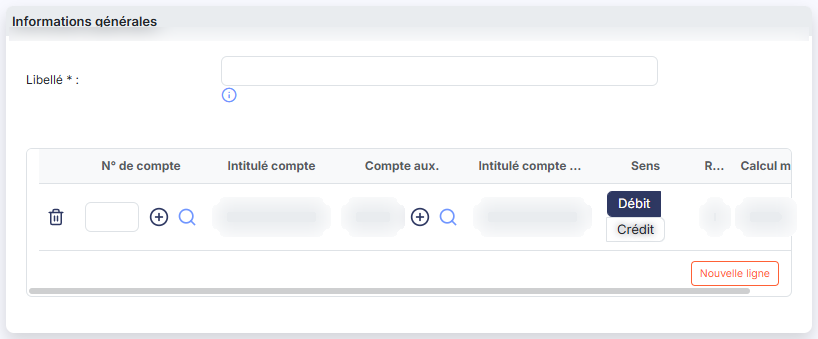

# Modèles d'écritures


**Où le trouver :** Panneau **Paramètres**



**En bref** — Cet écran permet de définir des modèles d'écriture (comptes, position du montant, formules de calcul) utilisés dans la saisie sur trame pour accélérer les écritures similaires.

* Pour créer un modèle : bouton \[Nouveau], saisissez le libellé, ajoutez les lignes avec le bouton \[Nouvelle ligne], puis bouton \[Enregistrer].
* Pour supprimer des modèles : cochez-les, puis bouton \[Supprimer].


Les modèles d'écriture définissent les comptes d'une écriture type, la position du montant et l'éventuelle formule de calcul, pour une utilisation dans la saisie sur trame.

<figure><figcaption>
Écran « Modèles d'écritures » de la nouvelle interface
</figcaption></figure>

Ils permettent de faciliter la saisie d'écritures similaires en calculant automatiquement certains montants à partir d'un montant saisi et de formules de calcul.

Cet écran s'ouvre dans le panneau Paramètres (entrée « Paramètres » de la barre latérale) : ouvrez la rubrique « Modèles », puis, dans la barre d'onglets du haut, le menu « Comptabilité » > « Écritures-types ». Le panneau emploie le mot « écriture-type » pour ce que cette page appelle « modèle d'écriture ». Sous l'onglet, la mention « Propre au dossier annuel » et un encadré bleu rappellent qu'une écriture-type est une trame de saisie : ses lignes sont pré-remplies (comptes, libellés, sens) et leurs montants peuvent être calculés par une formule.

## La liste des modèles

<figure><figcaption>
Bouton [Nouveau]
</figcaption></figure>

La liste ne comporte qu'une seule colonne de données, **Libellé**, triée par ordre croissant à l'ouverture. Pour savoir ce que contient un modèle, vous devez l'ouvrir : ni le nombre de lignes, ni la date de modification ne sont affichés dans la liste.

Sur chaque ligne, vous disposez d'une case à cocher de sélection et, à droite, de trois pictogrammes toujours visibles :

* le pictogramme « Modifier » (un crayon) ouvre le modèle en modification ;
* le pictogramme « Supprimer » (une corbeille) supprime le modèle ;
* le pictogramme « Dupliquer » (deux feuilles).

L'en-tête de la colonne de gauche propose la case « tout sélectionner » de la page en cours et la case de sélection sur toutes les pages. Au-dessus de la grille, à gauche, la « roue dentée » permet de choisir les colonnes affichées. Cet écran ne comporte ni fenêtre de filtres, ni impression.

bouton **\[Nouveau]**

Ouvre un modèle vierge, comportant déjà une première ligne. Ce bouton est dans le pied du panneau, en bas à droite, à côté de \[Supprimer], qui reste inactif tant qu'aucune ligne n'est cochée.

bouton **\[Supprimer]**

Supprime les modèles que vous avez cochés dans la liste.

## Rubrique « Informations générales »

<figure><figcaption>
Rubrique « Rubrique « Informations générales » »
</figcaption></figure>

**Libellé** : obligatoire.

## Les lignes du modèle

<figure><figcaption>
Rubrique « c) Les lignes du modèle »
</figcaption></figure>

Les lignes qui composeront l'écriture se renseignent une à une, dans le tableau situé sous le libellé. Le pictogramme en forme de corbeille placé en tête de ligne supprime celle-ci.

| Champ                    | Ce qu'il faut savoir                                                                                                                                                                                                                                                                                                                                                                      |
| ------------------------ | ----------------------------------------------------------------------------------------------------------------------------------------------------------------------------------------------------------------------------------------------------------------------------------------------------------------------------------------------------------------------------------------- |
| **N° de compte**         | En tapant quelques caractères, le logiciel vous propose la liste des comptes généraux dont le numéro ou l'intitulé contient ces caractères ; vous pouvez alors choisir le compte dans la liste. Vous pouvez également utiliser le pictogramme « Loupe » (raccourci Ctrl + Alt + R) pour rechercher un compte, et le pictogramme « Créer » (un « + » cerclé) pour créer un compte général. |
| **Intitulé compte**      | Renseigné par le logiciel d'après le compte choisi ; vous ne pouvez pas le modifier.                                                                                                                                                                                                                                                                                                      |
| **Compte aux.**          | Cette zone dispose des mêmes aides de saisie que le numéro de compte : le pictogramme « Loupe » pour rechercher un compte auxiliaire et le pictogramme « Créer » (un « + » cerclé) pour en créer un.                                                                                                                                                                                      |
| **Intitulé compte aux.** | Renseigné par le logiciel d'après le compte auxiliaire choisi ; vous ne pouvez pas le modifier.                                                                                                                                                                                                                                                                                           |
| **Sens**                 | Indiquez si, pour cette ligne, le montant sera inscrit au **Débit** ou au **Crédit**. Le sens **Débit** est proposé par défaut sur chaque nouvelle ligne.                                                                                                                                                                                                                                 |
| **Réf**                  | Le logiciel affecte automatiquement une lettre à chaque ligne, dans l'ordre du tableau — A pour la première, B pour la deuxième, et ainsi de suite. Vous ne pouvez pas la choisir.                                                                                                                                                                                                        |
| **Calcul montant**       | La zone n'est pas saisissable sur la première ligne, celle dont la référence est A.                                                                                                                                                                                                                                                                                                       |

bouton **\[Nouvelle ligne]**

Ajoute une ligne en bas du tableau.

bouton **\[Enregistrer]**

Enregistre le modèle. C'est le seul bouton du pied de la fiche, en bas à droite du panneau.

**Flèche « < » de retour**

Le bouton \[Retour] n'est plus affiché dans la fiche. La flèche « < », placée à gauche de la barre d'onglets du panneau, referme le modèle et vous ramène à la liste sans rien enregistrer.
