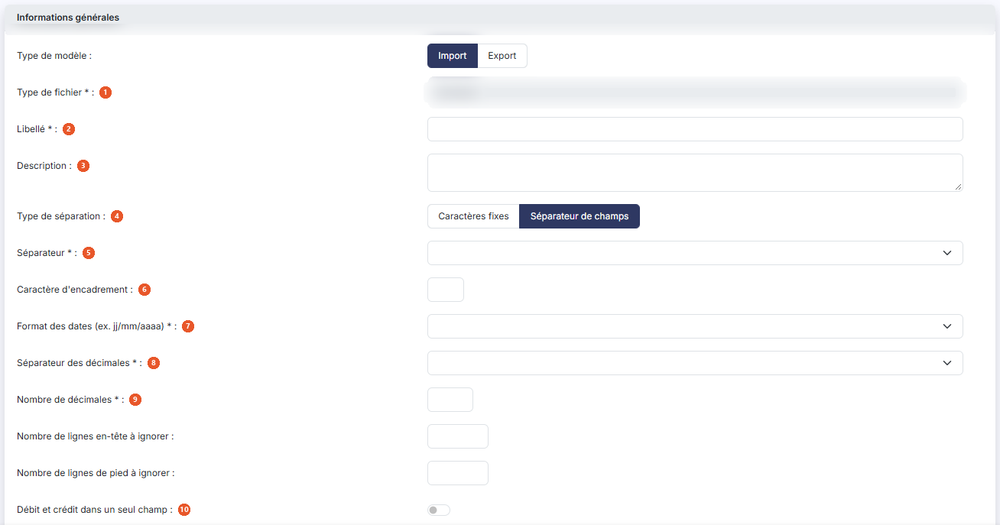
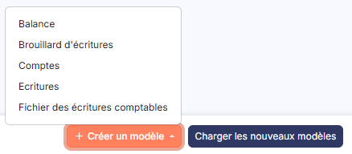

# Modèles d'export


**Où le trouver :** Panneau **Paramètres**



**En bref** — Cet écran permet de gérer les modèles d'export de données livrés par l'éditeur et de créer les vôtres, en décrivant le format du fichier à produire.

* Pour récupérer les modèles de l'éditeur : bouton \[Charger les nouveaux modèles].
* Pour créer votre modèle : bouton \[Nouveau], renseignez les rubriques de la fiche, puis enregistrez.
* Pour copier vos modèles dans d'autres sociétés : bouton \[Exporter].


Cette option vous permet de gérer les modèles d'export de données livrés par l'éditeur, et de créer les vôtres. Un modèle décrit le format du fichier à produire : la nature des données exportées, la façon dont les champs sont séparés, et la place de chaque donnée dans la ligne.

<figure><figcaption>
Écran « Modèles d'export » de la nouvelle interface
</figcaption></figure>

Le paramétrage se fait ici, mais l'export lui-même se lance depuis l'écran des données concernées : les exports d'écritures depuis le menu « Editions », option « Journaux », les exports de plans comptables depuis le menu « Fichiers », option « Plan comptable », et les exports de balances depuis le menu « Editions », option « Balance générale ».

La liste présente quatre colonnes, classées par défaut par ordre croissant de libellé : **Libellé**, **Fichier** qui restitue la nature des données exportées, **Description** et **Modifiable**. Chacune peut servir de critère de tri : cliquez sur son en-tête. La colonne **Modifiable** est tronquée par le bord droit du cadre, mais ses valeurs « Oui » et « Non » restent lisibles.

En haut de la colonne de gauche, vous disposez d'une case à cocher qui sélectionne toutes les lignes de la page affichée, d'une seconde case qui étend la sélection à toutes les pages, du pictogramme « Engrenage » qui ouvre la personnalisation des colonnes, du pictogramme « Entonnoir » qui ouvre la fenêtre « Filtres », et du pictogramme « Imprimante » qui lance l'impression de la liste.

Sur chaque ligne, vous disposez d'une case à cocher « Sélectionner » et du pictogramme « Croix » qui supprime le modèle. Le pictogramme « Ajout », qui duplique le modèle, vous est proposé sur toutes les lignes sauf celles dont la colonne **Modifiable** indique « Non ».

Le pictogramme « Crayon », qui ouvre la fiche du modèle, n'est en revanche proposé que sur **vos propres modèles** : les modèles livrés par l'éditeur ne s'ouvrent pas, et vous ne pouvez donc pas consulter leur paramétrage. Certains, compte tenu de leur complexité, ont fait l'objet d'un développement spécifique.

⚠ Ne vous fiez pas à la colonne **Modifiable** pour savoir si vous pourrez ouvrir une ligne : elle indique « Oui » sur des modèles qui n'offrent pourtant pas le pictogramme « Crayon ». C'est la présence du pictogramme qui fait foi. Pour partir d'un modèle livré, dupliquez-le : la copie, elle, vous appartient et s'ouvre normalement.

bouton **\[Nouveau]**

Ouvre la fiche de création d'un modèle d'export.

bouton **\[Charger les nouveaux modèles]**

Charge dans le dossier les éventuels nouveaux modèles mis à disposition par l'éditeur. Le logiciel ouvre la fenêtre « Nouveaux modèles », qui vous invite à choisir les modèles à charger et à valider. Sélectionnez-les à l'aide des cases à cocher, puis cliquez sur bouton **\[Valider]** pour les reprendre ou sur bouton **\[Annuler]** pour renoncer.

bouton **\[Exporter]**

Si vous gérez plusieurs sociétés, ce bouton vous permet de recopier dans les autres les modèles d'export que vous avez créés dans celle-ci. Il ne produit pas de fichier de données comptables.

Sélectionnez les modèles à recopier dans la liste à l'aide des cases à cocher, puis cliquez sur bouton **\[Exporter]**. Le logiciel ouvre la fenêtre « Exporter », qui vous rappelle le nombre d'enregistrements sélectionnés.

Trois choix vous sont proposés pour désigner les sociétés destinataires : **Toutes les sociétés** recopie les données vers toutes les sociétés auxquelles vous avez accès, **Liées à ce modèle** vers toutes les sociétés créées sur la base de ce modèle, et **Autres** vers les seules sociétés que vous désignez.

Dans ce dernier cas, choisissez-les dans le tableau qui vous est présenté, dont les colonnes sont **Code client**, **Raison sociale** et **Accès autorisé** ; c'est cette dernière colonne que vous positionnez à « Oui » pour chaque société retenue. Si le nombre de sociétés est important, saisissez un mot dans la zone **Société** et cliquez sur bouton **\[Afficher]** pour restreindre la liste.

La question **Souhaitez-vous remplacer les enregistrements ayant le même libellé ?**, en bas de la fenêtre, commande l'écrasement des modèles de même libellé déjà présents dans les sociétés destinataires. Le logiciel positionne « Non ».

Une fois votre sélection terminée, cliquez sur bouton **\[Valider]**, ou sur bouton **\[Fermer]** pour renoncer. La copie n'est pas immédiate : l'écran vous prévient qu'elle se fera lors de la prochaine utilisation de chaque société gérée concernée.

bouton **\[Supprimer]**

Supprime les modèles que vous avez cochés dans la liste.

La fiche d'un modèle présente trois rubriques dans cet ordre : « Informations générales », « Gestion des comptes auxiliaires et collectifs » et « Données du modèle ». La deuxième ne vous est pas proposée pour le type **Comptes**, où la fiche n'en compte donc que deux. La fiche est longue : vous la parcourez avec la barre de défilement. Elle se termine par les boutons bouton **\[Enregistrer]**, qui enregistre le modèle, et bouton **\[Retour]**, qui vous ramène à la liste sans rien enregistrer.

## Rubrique « Informations générales »

<figure><figcaption>
Rubrique « Rubrique « Informations générales » »
</figcaption></figure>

<figure><figcaption>
Rubrique « Rubrique « Informations générales » »
</figcaption></figure>

Le premier champ commande tous les autres : selon la nature des données que vous exportez, le logiciel ne vous demande que les paramètres qui ont un sens. Les champs décrits ci-dessous ne vous sont donc pas tous proposés à la fois, et le passage d'un type de fichier à l'autre en fait apparaître et disparaître.

| Champ                                                                                | Ce qu'il faut savoir                                                                                                                                                                                                                                                                                                                            |
| ------------------------------------------------------------------------------------ | ----------------------------------------------------------------------------------------------------------------------------------------------------------------------------------------------------------------------------------------------------------------------------------------------------------------------------------------------- |
| 
1. <strong>Type de fichier</strong> <em>Obligatoire</em>
                   | Il décrit la nature des données exportées, et donc les champs que le fichier sera susceptible de contenir. Trois valeurs vous sont proposées : **Ecritures**, **Comptes** — c'est-à-dire un plan comptable — et **Balance**.                                                                                                                    |
| 
2. <strong>Libellé</strong> <em>Obligatoire</em>
                           | C'est sous ce libellé que le modèle est présenté dans la liste et proposé au moment de l'export.                                                                                                                                                                                                                                                |
| 3. **Description**                                                                   | Zone de texte libre, sur plusieurs lignes, où vous pouvez préciser l'usage du modèle.                                                                                                                                                                                                                                                           |
| 4. **Type de séparation**                                                            | Ne vous est proposé que sur la fiche de **création**, et là quel que soit le type de fichier. Il disparaît de la fiche dès que le modèle est enregistré. Les enregistrements du fichier exporté peuvent être construits de deux manières, selon ce qu'attend le logiciel destinataire.                                                          |
| 
5. <strong>Séparateur</strong> <em>Obligatoire</em>
                        | Choisissez dans la liste le caractère qui sépare les champs : **Point**, **Virgule**, **Point-virgule**, **Tabulation**, **Tiret**, **Sous-tiret**, ou **Autre** pour en indiquer un différent — une zone de saisie vous est alors proposée.                                                                                                    |
| 6. **Caractère d'encadrement**                                                       | Il permet, en plus du caractère séparateur, de marquer le début et la fin de chaque champ — des guillemets, par exemple.                                                                                                                                                                                                                        |
| 
7. <strong>Format des dates (ex. jj/mm/aaaa)</strong> <em>Obligatoire</em>
 | Proposé pour le seul type **Ecritures**. Choisissez dans la liste le format sous lequel les dates seront écrites dans le fichier. Vingt formats vous sont proposés, combinant l'ordre du jour, du mois et de l'année, l'année sur deux ou quatre chiffres, et le séparateur — barre oblique, point, tiret, ou aucun séparateur.                 |
| 
8. <strong>Séparateur des décimales</strong> <em>Obligatoire</em>
          | Proposé pour les types **Ecritures** et **Balance**. Choisissez **Virgule**, **Point**, ou **Rien** si le fichier ne doit comporter aucun séparateur décimal.                                                                                                                                                                                   |
| 
9. <strong>Nombre de décimales</strong> <em>Obligatoire</em>
               | Proposé dans les mêmes conditions. Indiquez le nombre de décimales des montants exportés.                                                                                                                                                                                                                                                       |
| 10. **Débit et crédit dans un seul champ**                                           | Proposé pour les types **Ecritures** et **Balance**. Certains logiciels attendent un fichier où les montants au débit et au crédit sont écrits dans le même champ : répondez « Oui » dans ce cas. Il vous faut alors indiquer comment le fichier distingue un débit d'un crédit — voir le champ suivant.                                        |
| 11. **Identification du montant**                                                    | Dit comment le sens du montant est marqué dans le fichier. Choisissez **Signe "-" devant débit**, **Signe "-" devant crédit**, ou **Autres** pour indiquer vous-même le ou les caractères à écrire en tête du champ — par exemple « C » ou « CR ». Deux zones de saisie vous sont alors proposées, l'une pour le débit, l'autre pour le crédit. |
| 12. **Débit et crédit analytique dans un seul champ**                                | Proposé pour les types **Ecritures** et **Balance**. Même principe que ci-dessus, pour les montants analytiques.                                                                                                                                                                                                                                |
| 13. **Débit et crédit en devises dans un seul champ**                                | Proposé pour le seul type **Ecritures**. Même principe, pour les montants en devises.                                                                                                                                                                                                                                                           |
| **Caractères fixes**                                                                 | Chaque champ occupe sur chaque ligne la même position, quelle que soit la taille effective de son contenu, les caractères inutilisés étant remplis par des espaces. Par exemple la date du caractère 1 à 10, le numéro de compte du caractère 11 à 18, le libellé d'écriture du caractère 19 à 53.                                              |
| **Séparateur de champs**                                                             | Les champs n'ont plus de longueur imposée — il n'y a plus d'espaces inutilisés — mais ils doivent tous être séparés par un caractère facilement identifiable.                                                                                                                                                                                   |
| 
<strong>Format du fichier d'export</strong> <em>Obligatoire</em>
           | Choisissez **.txt** ou **.csv**, ce dernier étant directement exploitable dans un tableur.                                                                                                                                                                                                                                                      |
| **Afficher un en-tête**                                                              | Répondez « Oui » pour que le fichier généré comporte une première ligne d'en-tête contenant, dans le même ordre, les libellés de tous les champs présents dans le fichier.                                                                                                                                                                      |
| **Fichier FEC**                                                                      | Proposé pour le seul type **Ecritures**. Répondez « Oui » si le fichier produit doit respecter la norme du fichier des écritures comptables. Certains champs devront alors obligatoirement faire partie de l'export : dans la rubrique « Données du modèle », ils sont marqués d'un astérisque à droite de leur nom.                            |
| **Supprimer les caractères '0' terminaux des comptes auxiliaires**                   | Proposé pour le seul type **Ecritures**. Répondez « Oui » si le logiciel destinataire attend les comptes auxiliaires sans leurs zéros de fin.                                                                                                                                                                                                   |

## Rubrique « Gestion des comptes auxiliaires et collectifs »

Le logiciel gère les comptes auxiliaires dans un fichier distinct des comptes généraux : dans une écriture concernant un tiers, il gère le numéro de compte général — le compte collectif — et le numéro de compte auxiliaire. La rubrique rappelle ce principe à l'écran, puis vous pose une seule question.

| Champ                                                              | Ce qu'il faut savoir                                                                                                              |
| ------------------------------------------------------------------ | --------------------------------------------------------------------------------------------------------------------------------- |
| **Les écritures exportées sont-elles gérées de la même manière ?** | Pour le type **Ecritures**. Répondez « Oui » si le fichier attendu distingue lui aussi les deux comptes.                          |
| **Les comptes exportés sont-ils gérés de la même manière ?**       | Même question, posée sous cette forme pour le type **Balance**. Pour le type **Comptes**, la rubrique entière n'est pas proposée. |

## Rubrique « Données du modèle »

<figure><figcaption>
Rubrique « Rubrique « Données du modèle » »
</figcaption></figure>

C'est ici que vous finalisez le modèle, en indiquant la place de chaque donnée dans le fichier. Le tableau présente une ligne par donnée exportable et cinq colonnes.

La liste des données dépend du type de fichier : elle est longue pour le type **Ecritures**, qui va du **Code journal** à l'**Etablissement** en passant par les comptes, les libellés, les montants, les devises, les échéances, le lettrage, les quantités et l'analytique ; elle est courte pour le type **Balance** — numéro de compte, compte auxiliaire, libellé, totaux et soldes au débit et au crédit — et pour le type **Comptes** — numéro de compte, compte auxiliaire et les trois intitulés.

| Champ                     | Ce qu'il faut savoir                                                                                                                                                                                                                                                                                                                                                              |
| ------------------------- | --------------------------------------------------------------------------------------------------------------------------------------------------------------------------------------------------------------------------------------------------------------------------------------------------------------------------------------------------------------------------------- |
| **Champ Teogest**         | Le nom de la donnée. Cette colonne ne se saisit pas. Un astérisque à droite du nom signale une donnée obligatoire.                                                                                                                                                                                                                                                                |
| **Numéro de colonne**     | L'ordre de la donnée dans la ligne du fichier. Le logiciel la retrouvera grâce aux séparateurs.                                                                                                                                                                                                                                                                                   |
| **Pos. du 1er caractère** | **Taille du champ :** la position du premier caractère de la donnée et sa longueur, en nombre de caractères. Ces deux colonnes ne se saisissent que si le type de séparation vaut **Caractères fixes** ; elles restent affichées mais grisées dans tous les autres cas, et notamment sur la fiche d'un modèle déjà enregistré, où le type de séparation ne vous est plus proposé. |
| **Longueur maximale**     | La taille maximale gérée par le logiciel pour cette donnée. Cette colonne ne se saisit pas : elle vous sert de référence. Si vous indiquez une taille supérieure, vous ne pourrez pas enregistrer le modèle ; si la donnée est plus longue que la taille que vous avez indiquée, elle sera tronquée.                                                                              |

La donnée **Référence des pièces jointes**, du type **Ecritures**, est particulière : si vous l'utilisez, vous pourrez exporter non seulement les écritures mais aussi les pièces jointes à ces écritures. L'export se fera alors en deux temps, depuis le menu « Editions », option « Journaux » : d'une part les écritures, d'autre part les pièces jointes dans un fichier compressé.

Le pictogramme « Entonnoir » ouvre la fenêtre « Filtres », qui vous permet de restreindre la liste. Vous y retrouvez d'abord les quatre colonnes affichées — **Libellé**, **Fichier**, **Description** et **Modifiable** — puis deux colonnes masquées par défaut, que vous pouvez également utiliser comme critères : **Modèle éditeur**, qui vous permet justement d'isoler les modèles livrés par l'éditeur, et **Dernière modification**, que vous choisissez au calendrier.

Chaque critère se compose d'un opérateur et d'une valeur, que vous pouvez combiner par « Et » ou « Ou » avec un second couple. La fenêtre offre cinq boutons : bouton **\[Filtrer]** applique les critères à la liste, bouton **\[Mémoriser les paramètres]** conserve la sélection de critères, bouton **\[Charger les paramètres]** la rappelle, bouton **\[Vider les filtres]** efface les critères saisis et bouton **\[Fermer]** referme la fenêtre.

## Autres vues de l'écran

<figure><figcaption>
Bouton [Nouveau]
</figcaption></figure>

<figure><figcaption>
Bouton [Nouveau]
</figcaption></figure>

<figure><figcaption>
Rubrique « Changement des numéros de compte »
</figcaption></figure>
