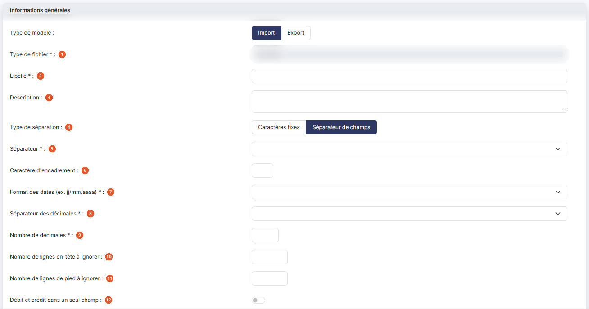
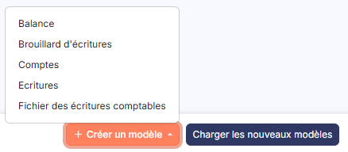

# Modèles d'import


**Où le trouver :** Panneau **Paramètres**



**En bref** — Cet écran permet de gérer les modèles d'import de données livrés par l'éditeur et de créer les vôtres, en décrivant le format du fichier reçu et les transformations à appliquer.

* Pour récupérer les modèles de l'éditeur : bouton \[Charger les nouveaux modèles].
* Pour créer votre modèle : bouton \[Nouveau], renseignez les rubriques de la fiche, puis bouton \[Enregistrer].
* Pour copier vos modèles dans d'autres sociétés : bouton \[Exporter].


Cette option vous permet de gérer les modèles d'import de données livrés par l'éditeur, et de créer les vôtres. Un modèle décrit le format du fichier que vous recevez : la nature des données qu'il contient, la façon dont ses champs sont séparés, la place de chaque donnée dans la ligne, et les transformations à appliquer au passage — changement de racines de comptes, changement de codes journaux, rattachement des comptes auxiliaires à leurs comptes collectifs.

<figure><figcaption>
Écran « Modèles d'import » de la nouvelle interface
</figcaption></figure>

La liste présente quatre colonnes, classées par défaut par ordre croissant de libellé : **Libellé**, **Fichier** qui restitue la nature des données importées, **Description** et **Modifiable**. Chacune peut servir de critère de tri : cliquez sur son en-tête.

En haut de la colonne de gauche, vous disposez d'une case à cocher qui sélectionne toutes les lignes de la page affichée, d'une seconde case qui étend la sélection à toutes les pages, du pictogramme « Engrenage » qui ouvre la personnalisation des colonnes, du pictogramme « Entonnoir » qui ouvre la fenêtre « Filtres », et du pictogramme « Imprimante » qui lance l'impression de la liste.

Sur chaque ligne, vous disposez d'une case à cocher « Sélectionner » et du pictogramme « Croix » qui supprime le modèle. Le pictogramme « Ajout », qui duplique le modèle, vous est proposé sur toutes les lignes sauf celles dont la colonne **Modifiable** indique « Non ».

Le pictogramme « Crayon », qui ouvre la fiche du modèle, n'est en revanche proposé que sur **vos propres modèles** : les modèles livrés par l'éditeur ne s'ouvrent pas, et vous ne pouvez donc pas consulter leur paramétrage. Certains, compte tenu de leur complexité, ont fait l'objet d'un développement spécifique.

⚠ Ne vous fiez pas à la colonne **Modifiable** pour savoir si vous pourrez ouvrir une ligne : elle indique « Oui » sur des modèles qui n'offrent pourtant pas le pictogramme « Crayon ». C'est la présence du pictogramme qui fait foi. Pour partir d'un modèle livré, dupliquez-le : la copie, elle, vous appartient et s'ouvre normalement.

bouton **\[Nouveau]**

Ouvre la fiche de création d'un modèle d'import.

bouton **\[Charger les nouveaux modèles]**

Charge dans le dossier les éventuels nouveaux modèles mis à disposition par l'éditeur. Le logiciel ouvre la fenêtre « Nouveaux modèles », qui vous invite à choisir les modèles à charger et à valider. Sélectionnez-les à l'aide des cases à cocher, puis cliquez sur bouton **\[Valider]** pour les reprendre ou sur bouton **\[Annuler]** pour renoncer.

bouton **\[Exporter]**

Si vous gérez plusieurs sociétés, ce bouton vous permet de recopier dans les autres les modèles d'import que vous avez créés dans celle-ci. Il ne produit pas de fichier de données comptables.

Sélectionnez les modèles à recopier dans la liste à l'aide des cases à cocher, puis cliquez sur bouton **\[Exporter]**. Le logiciel ouvre la fenêtre « Exporter », qui vous rappelle le nombre d'enregistrements sélectionnés.

Trois choix vous sont proposés pour désigner les sociétés destinataires : **Toutes les sociétés** recopie les données vers toutes les sociétés auxquelles vous avez accès, **Liées à ce modèle** vers toutes les sociétés créées sur la base de ce modèle, et **Autres** vers les seules sociétés que vous désignez.

Dans ce dernier cas, choisissez-les dans le tableau qui vous est présenté, dont les colonnes sont **Code client**, **Raison sociale** et **Accès autorisé** ; c'est cette dernière colonne que vous positionnez à « Oui » pour chaque société retenue. Si le nombre de sociétés est important, saisissez un mot dans la zone **Société** et cliquez sur bouton **\[Afficher]** pour restreindre la liste.

La question **Souhaitez-vous remplacer les enregistrements ayant le même libellé ?**, en bas de la fenêtre, commande l'écrasement des modèles de même libellé déjà présents dans les sociétés destinataires. Le logiciel positionne « Non ».

Une fois votre sélection terminée, cliquez sur bouton **\[Valider]**, ou sur bouton **\[Fermer]** pour renoncer. La copie n'est pas immédiate : l'écran vous prévient qu'elle se fera lors de la prochaine utilisation de chaque société gérée concernée.

bouton **\[Supprimer]**

Supprime les modèles que vous avez cochés dans la liste.

La fiche d'un modèle présente cinq rubriques dans cet ordre : « Informations générales », « Changement des numéros de compte », « Gestion des comptes auxiliaires et collectifs », « Changement des journaux » et « Données du modèle ». La quatrième ne vous est proposée que pour un import d'écritures. La fiche est longue : vous la parcourez avec la barre de défilement. Elle se termine par les boutons bouton **\[Enregistrer]**, qui enregistre le modèle, et bouton **\[Retour]**, qui vous ramène à la liste sans rien enregistrer.

## Rubrique « Informations générales »

<figure><figcaption>
Rubrique « Rubrique « Informations générales » »
</figcaption></figure>

<figure><figcaption>
Rubrique « Rubrique « Informations générales » »
</figcaption></figure>

Le premier champ commande tous les autres : selon la nature des données que vous importez, le logiciel ne vous demande que les paramètres qui ont un sens. Les champs décrits ci-dessous ne vous sont donc pas tous proposés à la fois, et le passage d'un type de fichier à l'autre en fait apparaître et disparaître.

| Champ                                                                                | Ce qu'il faut savoir                                                                                                                                                                                                                                                                                                                                                                                                                                                                                                                                                                            |
| ------------------------------------------------------------------------------------ | ----------------------------------------------------------------------------------------------------------------------------------------------------------------------------------------------------------------------------------------------------------------------------------------------------------------------------------------------------------------------------------------------------------------------------------------------------------------------------------------------------------------------------------------------------------------------------------------------- |
| 
1. <strong>Type de fichier</strong> <em>Obligatoire</em>
                   | Il décrit la nature des données contenues dans le fichier, et donc les champs que le logiciel saura y reconnaître. Trois valeurs vous sont proposées : **Ecritures**, **Comptes** — c'est-à-dire un plan comptable — et **Balance**.                                                                                                                                                                                                                                                                                                                                                            |
| 
2. <strong>Libellé</strong> <em>Obligatoire</em>
                           | C'est sous ce libellé que le modèle est présenté dans la liste et proposé au moment de l'import.                                                                                                                                                                                                                                                                                                                                                                                                                                                                                                |
| 3. **Description**                                                                   | Zone de texte libre, sur plusieurs lignes, où vous pouvez préciser l'usage du modèle.                                                                                                                                                                                                                                                                                                                                                                                                                                                                                                           |
| 4. **Type de séparation**                                                            | Les enregistrements du fichier que vous recevez peuvent avoir été construits de deux manières.                                                                                                                                                                                                                                                                                                                                                                                                                                                                                                  |
| 
5. <strong>Séparateur</strong> <em>Obligatoire</em>
                        | Proposé uniquement si le type de séparation vaut **Séparateur de champs**. Choisissez dans la liste le caractère qui sépare les champs du fichier : **Point**, **Virgule**, **Point-virgule**, **Tabulation**, **Tiret**, **Sous-tiret**, ou **Autre** pour en indiquer un différent — une zone de saisie vous est alors proposée.                                                                                                                                                                                                                                                              |
| 6. **Caractère d'encadrement**                                                       | Proposé dans les mêmes conditions. Certains fichiers marquent, en plus du caractère séparateur, le début et la fin de chaque champ — par des guillemets, par exemple. Indiquez ici ce caractère.                                                                                                                                                                                                                                                                                                                                                                                                |
| 
7. <strong>Format des dates (ex. jj/mm/aaaa)</strong> <em>Obligatoire</em>
 | Proposé pour le seul type **Ecritures**. Choisissez dans la liste le format sous lequel les dates sont écrites dans le fichier que vous recevez. Vingt formats vous sont proposés, combinant l'ordre du jour, du mois et de l'année, l'année sur deux ou quatre chiffres, et le séparateur — barre oblique, point, tiret, ou aucun séparateur. Les dates seront converties au format JJ/MM/AAAA à l'import.                                                                                                                                                                                     |
| 
8. <strong>Séparateur des décimales</strong> <em>Obligatoire</em>
          | Proposé pour les types **Ecritures** et **Balance**. Choisissez **Virgule**, **Point**, ou **Rien** si le fichier ne comporte aucun séparateur décimal. Dans ce dernier cas, le logiciel considère que tous les montants du fichier comportent le même nombre de décimales, celui que vous indiquez au champ suivant.                                                                                                                                                                                                                                                                           |
| 
9. <strong>Nombre de décimales</strong> <em>Obligatoire</em>
               | Proposé dans les mêmes conditions.                                                                                                                                                                                                                                                                                                                                                                                                                                                                                                                                                              |
| 10. **Nombre de lignes en-tête à ignorer**                                           | Certains fichiers commencent par des lignes d'en-tête — les noms des colonnes, par exemple — qui ne sont pas des données à importer. Indiquez ici leur nombre pour que le logiciel ne les interprète pas.                                                                                                                                                                                                                                                                                                                                                                                       |
| 11. **Nombre de lignes de pied à ignorer**                                           | Même principe pour les lignes de fin de fichier, qui portent souvent des totaux.                                                                                                                                                                                                                                                                                                                                                                                                                                                                                                                |
| 12. **Débit et crédit dans un seul champ**                                           | Proposé pour les types **Ecritures** et **Balance**. Certains fichiers portent les montants au débit et au crédit dans le même champ : répondez « Oui » dans ce cas. Il vous faut alors indiquer comment le fichier distingue un débit d'un crédit — voir le champ suivant.                                                                                                                                                                                                                                                                                                                     |
| 13. **Identification du montant**                                                    | Dit comment le sens du montant est marqué dans le fichier. Choisissez **Signe "-" devant débit**, **Signe "-" devant crédit**, ou **Autres** pour indiquer vous-même le ou les caractères qui accompagnent les montants — par exemple « C » ou « CR ». Deux zones de saisie vous sont alors proposées, l'une pour le débit, l'autre pour le crédit.                                                                                                                                                                                                                                             |
| 14. **Débit et crédit analytique dans un seul champ**                                | Proposé pour les types **Ecritures** et **Balance**. Même principe que ci-dessus, pour les montants analytiques. Aucun paramètre d'identification distinct ne vous est demandé pour ces montants.                                                                                                                                                                                                                                                                                                                                                                                               |
| 15. **Débit et crédit en devises dans un seul champ**                                | Proposé pour le seul type **Ecritures**. Même principe, pour les montants en devises. Si vous répondez « Oui », le logiciel vous propose un champ **Identification du montant en devises**, qui offre les mêmes choix que l'identification du montant.                                                                                                                                                                                                                                                                                                                                          |
| **Caractères fixes**                                                                 | Chaque champ occupe sur chaque ligne la même position, quelle que soit la taille effective de son contenu, les caractères inutilisés étant remplis par des espaces. Par exemple la date du caractère 1 à 10, le numéro de compte du caractère 11 à 18, le libellé d'écriture du caractère 19 à 53.                                                                                                                                                                                                                                                                                              |
| **Séparateur de champs**                                                             | Les champs n'ont plus de longueur imposée — il n'y a plus d'espaces inutilisés — mais ils sont tous séparés par un caractère facilement identifiable.                                                                                                                                                                                                                                                                                                                                                                                                                                           |
| **Fichier FEC**                                                                      | Proposé pour le seul type **Ecritures**. Répondez « Oui » si le fichier respecte la norme du fichier des écritures comptables. Dans cette norme, une écriture ne peut pas contenir de lignes à des dates différentes. Si le fichier en contient — cas des comptabilités antérieures à l'établissement de la norme — chaque écriture concernée doit être éclatée en plusieurs écritures dont toutes les lignes portent la même date : pour cela, le logiciel génère des lignes de contrepartie sur un compte de transit, toujours soldé, dont le numéro vous sera demandé au moment de l'import. |

En indiquant qu'il s'agit d'un fichier FEC, vous rendez en outre obligatoires certains champs supplémentaires. Dans la rubrique « Données du modèle », ils sont marqués d'un astérisque à droite de leur nom.

## Rubrique « Changement des numéros de compte »

<figure><figcaption>
Bouton [Nouveau]
</figcaption></figure>

<figure><figcaption>
Bouton [Nouveau]
</figcaption></figure>

<figure><figcaption>
Rubrique « Rubrique « Changement des numéros de compte » »
</figcaption></figure>

Cette rubrique vous permet de changer, au passage, les numéros de comptes du fichier importé. Le tableau qu'elle contient est titré « Remplacement de racines de comptes » et comporte trois colonnes.

| Champ                   | Ce qu'il faut savoir                                                                                                             |
| ----------------------- | -------------------------------------------------------------------------------------------------------------------------------- |
| **Fichier import**      | La racine de compte telle qu'elle figure dans le fichier que vous recevez.                                                       |
| **Saisie Teogest**      | La racine par laquelle elle doit être remplacée à l'import.                                                                      |
| **Champ d'application** | Précise sur quels comptes le remplacement porte. Trois choix vous sont proposés : **Les deux**, **Généraux** ou **Auxiliaires**. |

Le bouton **\[Nouveau]**, sous le tableau, ajoute une ligne de remplacement.

## Rubrique « Gestion des comptes auxiliaires et collectifs »

<figure><figcaption>
Rubrique « Rubrique « Gestion des comptes auxiliaires et collectifs » »
</figcaption></figure>

Le logiciel gère les comptes auxiliaires dans un fichier distinct des comptes généraux : dans une écriture concernant un tiers, il gère le numéro de compte général — le compte collectif — et le numéro de compte auxiliaire. La rubrique rappelle ce principe à l'écran, puis vous pose une seule question.

| Champ                                                                 | Ce qu'il faut savoir                                                                                                                                                                                                                                                                                                                                                                                                                                                            |
| --------------------------------------------------------------------- | ------------------------------------------------------------------------------------------------------------------------------------------------------------------------------------------------------------------------------------------------------------------------------------------------------------------------------------------------------------------------------------------------------------------------------------------------------------------------------- |
| 1. **Les écritures importées sont-elles gérées de la même manière ?** | Pour le type **Ecritures**. Répondez « Oui » si le fichier que vous recevez distingue lui aussi les deux comptes.                                                                                                                                                                                                                                                                                                                                                               |
| **Les comptes importés sont-ils gérés de la même manière ?**          | 
Même question, posée sous cette forme pour les types <strong>Comptes</strong> et <strong>Balance</strong>. Si vous répondez <strong>« Non »</strong>, le fichier ne porte qu'un seul numéro de compte pour les tiers, et les écritures concernées doivent être retraitées. Quatre blocs de saisie apparaissent alors dans la rubrique, un par type de compte auxiliaire géré par le logiciel — fournisseurs, clients, salariés et divers — chacun sur le même modèle.
 |
| **Racine fournisseurs dans l'import**                                 | La racine de compte qui, dans le fichier, permet de reconnaître un compte de ce type.                                                                                                                                                                                                                                                                                                                                                                                           |
| **à rattacher au compte collectif**                                   | Le compte général auquel ces comptes seront rattachés. Deux pictogrammes sont placés à droite de la zone : « Plus », qui vous permet de créer le compte s'il n'existe pas encore, et « Loupe », qui ouvre la recherche d'un compte existant.                                                                                                                                                                                                                                    |
| **Intitulé**                                                          | L'intitulé du compte collectif.                                                                                                                                                                                                                                                                                                                                                                                                                                                 |

Les trois autres blocs posent les mêmes questions pour les clients, les salariés et les divers.

Si, pour un type de compte, plusieurs racines sont possibles dans le fichier d'import, séparez-les par un point-virgule. L'écran vous le rappelle en bas de la rubrique.

Les écritures concernées seront alors créées avec, pour compte général, le compte collectif que vous avez indiqué, et pour compte auxiliaire, le numéro de compte qui figurait dans le fichier. Les données **N° de compte auxiliaire** et **Intitulé du compte auxiliaire** disparaissent en conséquence de la rubrique « Données du modèle » : elles n'ont plus à être repérées dans le fichier.

## Rubrique « Changement des journaux »

<figure><figcaption>
Rubrique « Rubrique « Changement des journaux » »
</figcaption></figure>

Cette rubrique ne vous est proposée que pour un import d'**écritures**. Elle vous permet de changer, au passage, les codes journaux du fichier importé. Le tableau qu'elle contient est titré « Remplacement du code journal » et comporte deux colonnes.

| Champ              | Ce qu'il faut savoir                                                                                                                                                                                                                                             |
| ------------------ | ---------------------------------------------------------------------------------------------------------------------------------------------------------------------------------------------------------------------------------------------------------------- |
| **Fichier import** | Le code journal tel qu'il figure dans le fichier que vous recevez.                                                                                                                                                                                               |
| **Saisie Teogest** | Le journal du dossier par lequel il doit être remplacé. Choisissez-le dans la liste, qui présente vos journaux sous la forme « code - libellé ». Le pictogramme « Plus » placé à droite de la liste vous permet de créer un journal qui n'existerait pas encore. |

Le bouton **\[Nouveau]**, sous le tableau, ajoute une ligne de remplacement.

## Rubrique « Données du modèle »

<figure><figcaption>
Rubrique « Rubrique « Données du modèle » »
</figcaption></figure>

C'est ici que vous finalisez le modèle, en indiquant où le logiciel doit aller chercher chaque donnée dans le fichier. Le tableau présente une ligne par donnée reconnue et cinq colonnes.

La liste des données dépend du type de fichier : elle est longue pour le type **Ecritures**, qui va du **Code journal** à l'**Etablissement** en passant par les comptes, les libellés, les montants, les devises, les échéances, le lettrage, les quantités et l'analytique ; elle est courte pour le type **Balance** — numéro de compte, compte auxiliaire, libellé, devise, débit et crédit — et pour le type **Comptes** — numéro de compte, compte auxiliaire, les trois intitulés et le type de compte.

| Champ                     | Ce qu'il faut savoir                                                                                                                                                                                                                                                                                            |
| ------------------------- | --------------------------------------------------------------------------------------------------------------------------------------------------------------------------------------------------------------------------------------------------------------------------------------------------------------- |
| **Champ Teogest**         | Le nom de la donnée. Cette colonne ne se saisit pas. Un **astérisque** à droite du nom signale une donnée obligatoire, c'est-à-dire indispensable à la constitution d'une écriture valide ; les autres sont facultatives.                                                                                       |
| **Numéro de colonne**     | L'ordre de la donnée dans la ligne du fichier. Le logiciel la retrouvera grâce aux séparateurs. Cette colonne ne se saisit que si le type de séparation vaut **Séparateur de champs** ; elle est grisée dans l'autre mode.                                                                                      |
| **Pos. du 1er caractère** | **Taille du champ :** la position du premier caractère de la donnée et sa longueur, en nombre de caractères. Ces deux colonnes ne se saisissent que si le type de séparation vaut **Caractères fixes** ; elles sont grisées dans l'autre mode.                                                                  |
| **Longueur maximale**     | La taille maximale gérée par le logiciel pour cette donnée. Cette colonne ne se saisit pas : elle vous sert de référence. Si vous indiquez une taille supérieure, vous ne pourrez pas enregistrer le modèle ; si la donnée du fichier est plus longue que la taille que vous avez indiquée, elle sera tronquée. |

La liste des données et leur ordre ne changent pas d'un mode de séparation à l'autre : seules les colonnes saisissables changent.

Le pictogramme « Entonnoir » ouvre la fenêtre « Filtres », qui vous permet de restreindre la liste. Chaque critère se compose d'un opérateur et d'une valeur, que vous pouvez combiner par « Et » ou « Ou » avec un second couple. La fenêtre offre cinq boutons : bouton **\[Filtrer]** applique les critères à la liste, bouton **\[Mémoriser les paramètres]** conserve la sélection de critères, bouton **\[Charger les paramètres]** la rappelle, bouton **\[Vider les filtres]** efface les critères saisis et bouton **\[Fermer]** referme la fenêtre.
