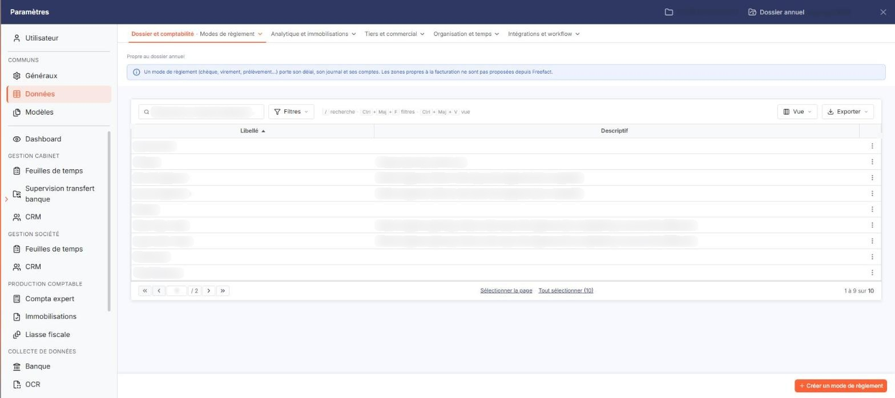
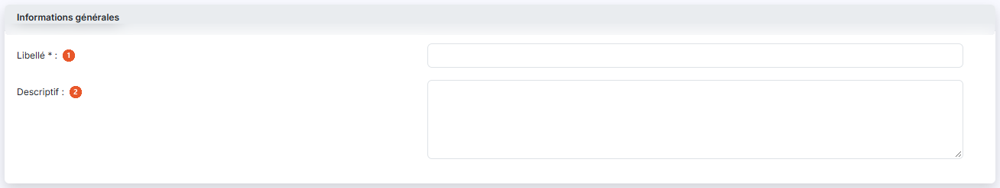
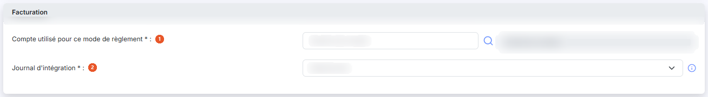
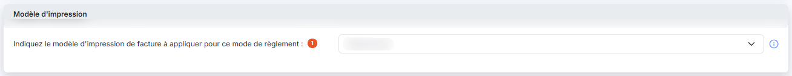
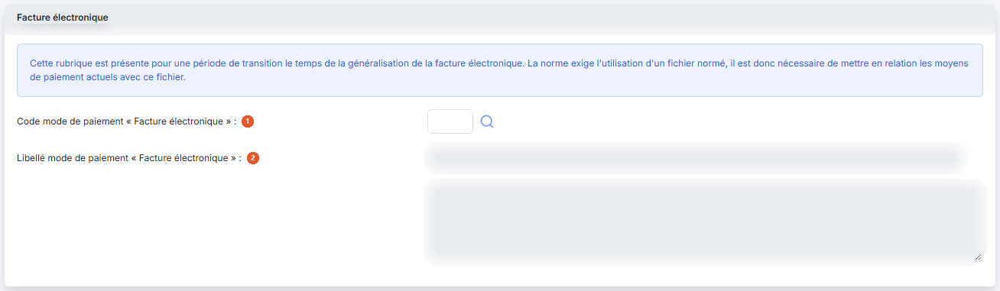
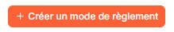

# Modes de règlement


**Où le trouver :** Panneau **Paramètres** › **Données** › **Dossier et comptabilité** › **Modes de règlement**



**En bref** — Cet écran permet de définir les modes de règlement (espèces, chèques, etc.) associés aux pièces comptables et commerciales.

* Pour créer un mode de règlement : bouton \[Nouveau], renseignez le libellé, puis bouton \[Enregistrer].
* Pour sortir la liste : bouton \[Exporter].
* Pour supprimer un mode inutilisé : cochez-le, puis bouton \[Supprimer].


Cette option permet de définir les modes de règlement (espèces, chèques, etc.), qui pourront être associés aux pièces comptables et commerciales.

<figure><figcaption>
Écran « Modes de règlement » de la nouvelle interface
</figcaption></figure>

Le logiciel affiche la liste des modes de règlement, avec les colonnes **Libellé** et **Descriptif**. La liste est triée par défaut sur le libellé, par ordre croissant, et les deux colonnes peuvent servir de critère de tri. Les descriptifs longs sont tronqués dans la grille : ouvrez la fiche pour les lire en entier.

Dans l'en-tête de la première colonne, vous disposez d'une case à cocher qui sélectionne toutes les lignes de la page affichée, d'une seconde case qui étend la sélection à toutes les pages, du pictogramme « Roue crantée » qui personnalise les colonnes affichées, du pictogramme « Entonnoir » qui ouvre la fenêtre « Filtres » et du pictogramme « Imprimante » qui imprime la grille.

Sur chaque ligne, vous disposez d'une case à cocher de sélection, du pictogramme « Crayon » qui ouvre la fiche du mode de règlement, et du pictogramme « Croix » qui le supprime.

Un mode de règlement ne peut pas être supprimé s'il est utilisé dans au moins une fiche client, une pièce commerciale ou un compte général ou auxiliaire. Le mode de règlement "Espèces" est indispensable à la gestion de la caisse ; il n'est donc pas supprimable.

Outre les modes de règlement que vous créez, la liste présente des modes créés par le logiciel pour l'intégration des règlements de la comptabilité, dont le descriptif signale l'usage ; ne les modifiez pas.

bouton **\[Nouveau]**

Vous ouvrez la fiche de création d'un mode de règlement.

bouton **\[Exporter]**

Vous exportez le contenu de la liste dans un fichier.

bouton **\[Supprimer]**

Vous supprimez les modes de règlement que vous avez cochés dans la liste.

La fenêtre « Filtres », ouverte par le pictogramme « Entonnoir », vous permet de restreindre la liste sur le libellé et le descriptif, mais aussi sur des données qui ne sont pas présentées en colonne : compte de règlement, journal d'intégration, modèle d'impression et les trois données de la facture électronique. Les boutons « Filtrer », « Mémoriser les paramètres », « Charger les paramètres », « Vider les filtres » et « Fermer » y sont proposés.

La fiche d'un mode de règlement comporte quatre rubriques, présentées les unes sous les autres. La création et la modification affichent les mêmes champs.

## Rubrique « Informations générales »

<figure><figcaption>
Rubrique « Rubrique « Informations générales » »
</figcaption></figure>

| Champ                                                      | Ce qu'il faut savoir                                                                              |
| ---------------------------------------------------------- | ------------------------------------------------------------------------------------------------- |
| 
1. <strong>Libellé</strong> <em>Obligatoire</em>
 | —                                                                                                 |
| 2. **Descriptif**                                          | Champ facultatif, sur plusieurs lignes. Il est repris dans la colonne « Descriptif » de la liste. |

## Rubrique « Facturation »

<figure><figcaption>
Rubrique « Rubrique « Facturation » »
</figcaption></figure>

Ces informations ne sont utiles que si vous utilisez le module "Facturation" et que vous gérez les règlements dans ce module.

| Champ                                                                                       | Ce qu'il faut savoir                                                                                                                                                                                                                                                                                                                                                            |
| ------------------------------------------------------------------------------------------- | ------------------------------------------------------------------------------------------------------------------------------------------------------------------------------------------------------------------------------------------------------------------------------------------------------------------------------------------------------------------------------- |
| 
1. <strong>Compte utilisé pour ce mode de règlement</strong> <em>Obligatoire</em>
 | C'est le compte dans lequel les écritures de règlement seront générées à partir du module facturation pour ce mode de règlement. Vous saisissez le numéro de compte, ou vous le cherchez par le pictogramme « Loupe » ; le logiciel affiche l'intitulé du compte à côté, en lecture seule.                                                                                      |
| 
2. <strong>Journal d'intégration</strong> <em>Obligatoire</em>
                    | C'est le journal dans lequel les écritures de règlement seront générées à partir du module Facturation pour ce mode de règlement. Vous le choisissez dans une liste déroulante qui reprend les journaux de la société, sous la forme « code - libellé ». Le pictogramme d'information rappelle : « Journal utilisé pour comptabiliser les règlements issus de la facturation. » |

## Rubrique « Modèle d'impression »

<figure><figcaption>
Rubrique « Rubrique « Modèle d'impression » »
</figcaption></figure>

**Indiquez le modèle d'impression de facture à appliquer pour ce mode de règlement** : facultatif. Cette fonctionnalité permet d'associer un modèle d'impression au mode de règlement. Ainsi lors de la création d'une facture, l'attribution du mode de règlement permettra de proposer ce modèle d'impression par défaut.

Pour les clients en prélèvement automatique, par exemple, vous pourrez affecter un modèle qui contient toutes les informations nécessaires et spécifiques à ce type de paiement.

Si vous avez aussi indiqué un modèle d'impression de facture par défaut, c'est le modèle d'impression du mode de règlement qui s'appliquera en priorité.

Vous choisissez le modèle dans une liste déroulante qui reprend les modèles d'impression de facture de la société. Tant que vous n'avez rien choisi, la liste reste sur l'invite « Sélectionnez ».

## Rubrique « Facture électronique »

<figure><figcaption>
Rubrique « Rubrique « Facture électronique » »
</figcaption></figure>

Le logiciel affiche en tête de cette rubrique le texte suivant : « Cette rubrique est présente pour une période de transition le temps de la généralisation de la facture électronique. La norme exige l'utilisation d'un fichier normé, il est donc nécessaire de mettre en relation les moyens de paiement actuels avec ce fichier. »

| Champ                                                    | Ce qu'il faut savoir                                                                                                                      |
| -------------------------------------------------------- | ----------------------------------------------------------------------------------------------------------------------------------------- |
| 1. **Code mode de paiement « Facture électronique »**    | Vous saisissez le code du moyen de paiement normé correspondant à ce mode de règlement, ou vous le cherchez par le pictogramme « Loupe ». |
| 2. **Libellé mode de paiement « Facture électronique »** | Le logiciel affiche le libellé du moyen de paiement normé, en lecture seule ; vous ne le saisissez pas.                                   |

Une troisième zone, sur plusieurs lignes et elle aussi en lecture seule, complète le libellé du moyen de paiement. Elle n'a pas de libellé affiché à l'écran ; la fenêtre « Filtres » la nomme « Suite libellé «Facture élec. » ».

bouton **\[Enregistrer]**

Vous enregistrez le mode de règlement et le logiciel vous ramène à la liste.

bouton **\[Retour]**

Vous quittez la fiche sans enregistrer vos modifications.

## Autres vues de l'écran

<figure><figcaption>
Bouton [Nouveau]
</figcaption></figure>
