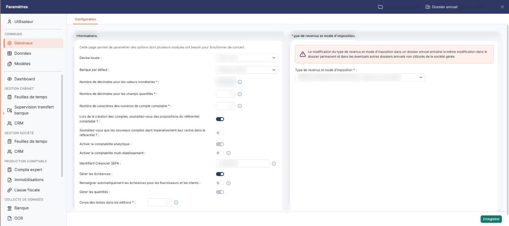
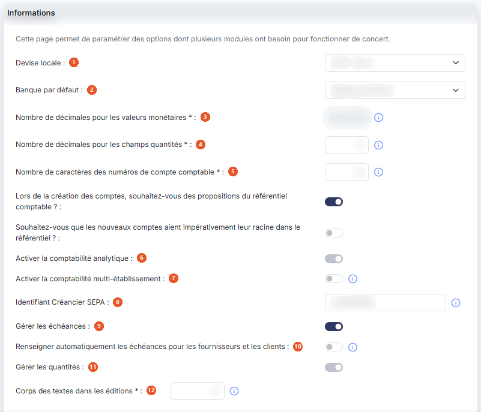
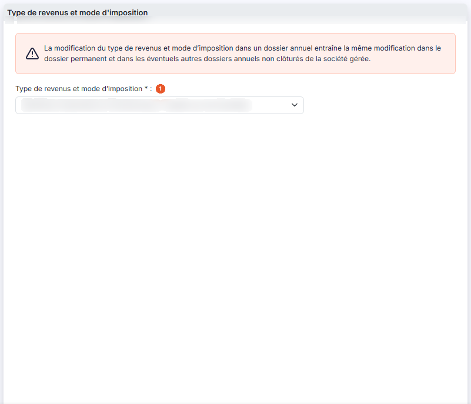

# Multimodules


**Où le trouver :** Panneau **Paramètres** › **Généraux** › **Configuration**



**En bref** — Cet écran regroupe les paramètres utilisés par plusieurs modules (comptabilité, facturation, feuilles de temps), dont le nombre de décimales et le type de revenus et mode d'imposition.

* Pour modifier un paramètre commun : changez-le dans la rubrique concernée, puis bouton \[Enregistrer], seul bouton de l'écran.


Cette option est ainsi nommée parce qu'elle regroupe des paramètres utilisés par plusieurs modules du logiciel : si vous modifiez ici un paramètre, la modification est prise en compte immédiatement dans les autres modules, la comptabilité comme la facturation ou les feuilles de temps.

<figure><figcaption>
Écran « Multimodules » de la nouvelle interface
</figcaption></figure>

Le logiciel affiche en tête de page la phrase « Cette page permet de paramétrer des options dont plusieurs modules ont besoin pour fonctionner de concert. »

## Rubrique « Paramètres - Informations relevant de plusieurs modules »

<figure><figcaption>
Rubrique « Rubrique « Paramètres - Informations relevant de plusieurs modules » »
</figcaption></figure>

| Champ                                                                                 | Ce qu'il faut savoir                                                                                                                                                                                                                                                                                                                                                                                                                                                                                                                                                                                                                                                                                                                                                                                                                                                                                                                                                                                                                                                                                                                                                                                                                                                  |
| ------------------------------------------------------------------------------------- | --------------------------------------------------------------------------------------------------------------------------------------------------------------------------------------------------------------------------------------------------------------------------------------------------------------------------------------------------------------------------------------------------------------------------------------------------------------------------------------------------------------------------------------------------------------------------------------------------------------------------------------------------------------------------------------------------------------------------------------------------------------------------------------------------------------------------------------------------------------------------------------------------------------------------------------------------------------------------------------------------------------------------------------------------------------------------------------------------------------------------------------------------------------------------------------------------------------------------------------------------------------------- |
| 1. **Devise locale**                                                                  | Cette information est déterminante si vous souhaitez saisir des écritures dans différentes devises, puisqu'elle sert à établir les taux de conversion.                                                                                                                                                                                                                                                                                                                                                                                                                                                                                                                                                                                                                                                                                                                                                                                                                                                                                                                                                                                                                                                                                                                |
| 2. **Banque par défaut**                                                              | Indiquez, parmi les banques que vous avez enregistrées dans le menu « Fichiers », option « Banques », celle que le logiciel proposera par défaut chaque fois que nécessaire dans le logiciel.                                                                                                                                                                                                                                                                                                                                                                                                                                                                                                                                                                                                                                                                                                                                                                                                                                                                                                                                                                                                                                                                         |
| 3. **Nombre de décimales pour les valeurs monétaires**                                | Ce paramètre détermine avec combien de décimales sont saisies et affichées toutes les valeurs monétaires dans l'ensemble de vos modules Ingeneo Compta. Il peut prendre les valeurs 0, 1, 2, 3 et 4, mais **vous ne pouvez pas le modifier vous-même** : la zone est en lecture seule. Pour le faire changer, prenez contact avec le service technique.                                                                                                                                                                                                                                                                                                                                                                                                                                                                                                                                                                                                                                                                                                                                                                                                                                                                                                               |
| 4. **Nombre de décimales pour les champs quantités**                                  | Ce paramètre détermine avec combien de décimales sont saisis et affichés les champs de quantité, dans les pièces commerciales comme dans les écritures comptables. Il peut prendre les valeurs 0 à 4.                                                                                                                                                                                                                                                                                                                                                                                                                                                                                                                                                                                                                                                                                                                                                                                                                                                                                                                                                                                                                                                                 |
| 5. **Nombre de caractères des numéros de compte comptable**                           | 
Il s'agit du nombre de caractères que comportent tous les comptes de votre plan comptable, et donc également ceux utilisés en facturation pour le lien avec la comptabilité. La valeur doit être comprise entre 6 et 12 caractères. Afin de conserver les possibilités de comparaison, la modification est effectuée sur le dossier annuel en cours et sur les deux dossiers annuels précédents. <strong>Lors de la création des comptes, souhaitez-vous des propositions du référentiel comptable ? :</strong> si vous répondez <strong>Oui</strong>, le logiciel vous fait, lors de la création d'un compte dans le plan comptable général, des propositions fondées sur le référentiel comptable de l'ANC, en fonction des premiers caractères que vous saisissez. Vous pouvez consulter et administrer ce référentiel dans le module « Administration », menu « Divers », option « Référentiel comptable ». <strong>Souhaitez-vous que les nouveaux comptes aient impérativement leur racine dans le référentiel ? :</strong> cette question n'est affichée que si vous avez répondu <strong>Oui</strong> à la précédente. À <strong>Oui</strong>, elle interdit la création d'un compte dont la racine ne figure pas dans le référentiel comptable.
 |
| 6. **Activer la comptabilité analytique**                                             | À **Oui**, vous accédez aux options du menu « Analytique » et vous pouvez définir les propriétés analytiques de vos comptes généraux et auxiliaires.                                                                                                                                                                                                                                                                                                                                                                                                                                                                                                                                                                                                                                                                                                                                                                                                                                                                                                                                                                                                                                                                                                                  |
| 7. **Activer la comptabilité multi-établissement**                                    | En activant cette option, vous devrez affecter les écritures à un établissement. Les établissements doivent être créés dans le module « Dossier permanent », menu « Social », option « Etablissements ».                                                                                                                                                                                                                                                                                                                                                                                                                                                                                                                                                                                                                                                                                                                                                                                                                                                                                                                                                                                                                                                              |
| 8. **Identifiant Créancier SEPA**                                                     | L'Identifiant Créancier SEPA (ICS) est obligatoire si vous souhaitez générer des ordres de prélèvements SEPA. Cette information est à récupérer auprès de votre banque. Elle est unique pour chaque entreprise réalisant des prélèvements.                                                                                                                                                                                                                                                                                                                                                                                                                                                                                                                                                                                                                                                                                                                                                                                                                                                                                                                                                                                                                            |
| 9. **Gérer les échéances**                                                            | À **Oui**, vous pouvez saisir des échéances sur vos écritures et les exploiter dans vos éditions. Vous définissez ensuite, dans les paramètres des journaux, ceux pour lesquels la saisie des échéances est admise.                                                                                                                                                                                                                                                                                                                                                                                                                                                                                                                                                                                                                                                                                                                                                                                                                                                                                                                                                                                                                                                   |
| 10. **Renseigner automatiquement les échéances pour les fournisseurs et les clients** | Cette question n'est affichée que si **Gérer les échéances** est à **Oui**. À **Oui**, l'échéance est renseignée automatiquement pour les comptes dont les échéances sont gérées ; la date ainsi calculée reste modifiable dans la saisie. Le logiciel affiche alors la phrase « Pour les comptes dont les paramètres d'échéances ne sont pas définis, les paramètres ci-dessous s'appliquent. », puis deux listes supplémentaires.                                                                                                                                                                                                                                                                                                                                                                                                                                                                                                                                                                                                                                                                                                                                                                                                                                   |
| 11. **Gérer les quantités**                                                           | 
À <strong>Oui</strong>, vous pouvez saisir des quantités dans vos écritures comptables, ce qui enrichit la saisie d'éléments quantitatifs en rapport avec vos pièces. Vous définissez ensuite, dans les paramètres des journaux, ceux pour lesquels la saisie des quantités est admise. Ces deux options — <strong>Activer la comptabilité analytique</strong> et <strong>Gérer les quantités</strong> — se verrouillent dès lors que la fonction est déjà utilisée dans le dossier : l'interrupteur affiche alors sa valeur mais ne se manipule plus, et le logiciel n'affiche aucun message pour l'expliquer. <strong>Activer la comptabilité analytique</strong> se verrouille lorsque l'option est à <strong>Oui</strong> et qu'au moins un axe analytique est utilisé ; <strong>Gérer les quantités</strong> se verrouille lorsque l'option est à <strong>Oui</strong> et qu'au moins un journal admet la saisie des quantités.
                                                                                                                                                                                                                                                                                                                        |
| 12. **Corps des textes dans les éditions**                                            | Ce paramètre détermine la taille d'affichage des textes standards dans les éditions ; sa valeur doit être comprise entre 8 et 18.                                                                                                                                                                                                                                                                                                                                                                                                                                                                                                                                                                                                                                                                                                                                                                                                                                                                                                                                                                                                                                                                                                                                     |
| **Délai de règlement par défaut des fournisseurs**                                    | **Délai de règlement par défaut des clients :** si aucun délai de règlement n'a été défini sur un fournisseur ou sur un client, c'est celui que vous indiquez ici qui s'applique. Ces deux listes sont alimentées par les délais que vous avez enregistrés dans le menu « Fichiers », option « Délais de règlement » : leur contenu dépend donc de votre dossier, et il faut avoir défini ces délais au préalable.                                                                                                                                                                                                                                                                                                                                                                                                                                                                                                                                                                                                                                                                                                                                                                                                                                                    |

## Rubrique « Type de revenus et mode d'imposition »

<figure><figcaption>
Rubrique « Rubrique « Type de revenus et mode d'imposition » »
</figcaption></figure>

Le logiciel affiche en tête de rubrique cet avertissement : « La modification du type de revenus et mode d'imposition dans un dossier annuel entraîne la même modification dans le dossier permanent et dans les éventuels autres dossiers annuels non clôturés de la société gérée. »

**Type de revenus et mode d'imposition** : obligatoire. Cette liste indique à quel régime est soumise la société gérée — bénéfices agricoles, bénéfices industriels et commerciaux à l'impôt sur le revenu ou à l'impôt sur les sociétés, bénéfices non commerciaux, non imposable, Nouvelle-Calédonie, revenus fonciers, revenus fonciers professionnels, revenus fonciers professionnels et non professionnels. L'information est déterminante dans plusieurs modules : sa modification peut avoir de nombreuses conséquences sur les paramétrages de numéros de comptes, notamment pour la déclaration de TVA.

bouton **\[Enregistrer]**

Enregistre vos paramètres. C'est le seul bouton de l'écran.
