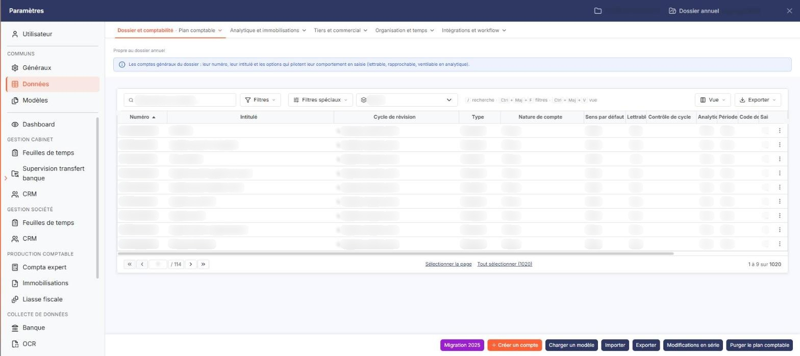
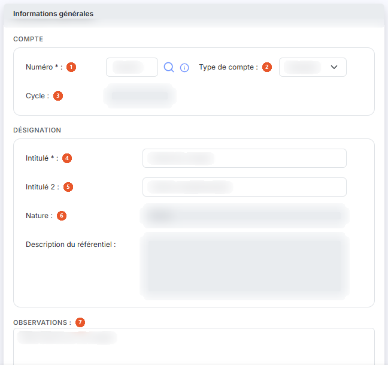
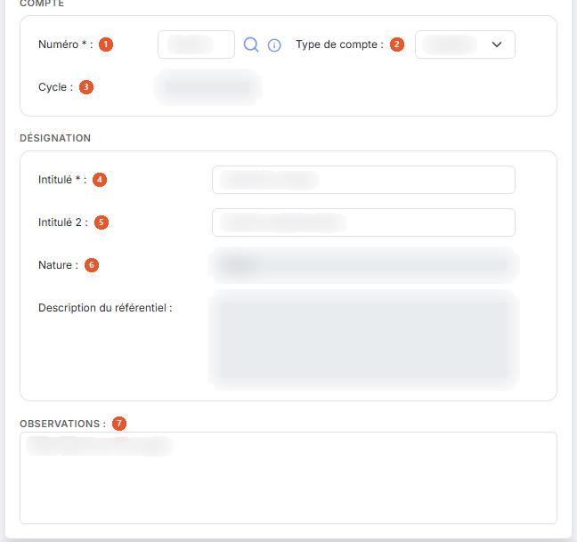
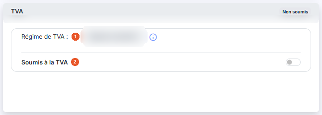
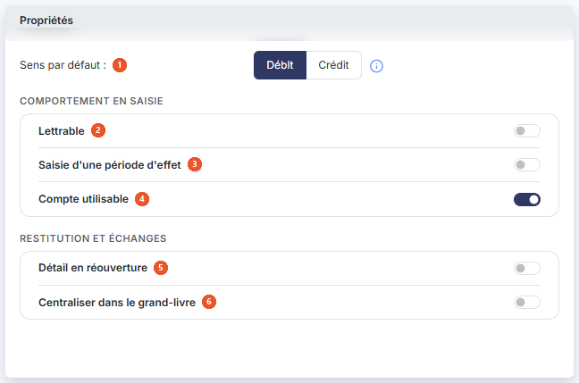
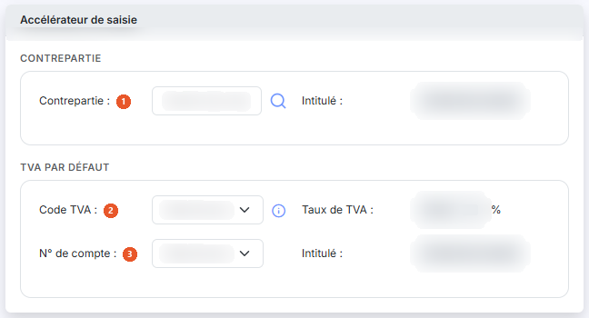
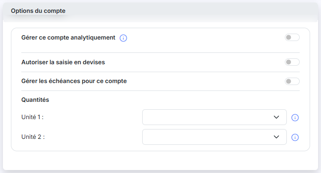

# Plan comptable


**Où le trouver :** Panneau **Paramètres** › **Données** › **Dossier et comptabilité** › **Plan comptable**



**En bref** — Cet écran permet d'administrer les comptes généraux du plan comptable : création, chargement d'un modèle, import, export, modifications en série, réaffectation d'écritures et purge.

* Pour partir d'un plan existant : bouton \[Charger un modèle], puis choisissez le modèle parmi ceux proposés.
* Pour créer un compte : bouton \[Nouveau], renseignez la fiche, puis bouton \[Enregistrer].
* Pour modifier plusieurs comptes d'un coup : cochez-les, puis bouton \[Modifications en série].


Cette option permet d'administrer les comptes généraux du plan comptable.

<figure><figcaption>
Écran « Plan comptable » de la nouvelle interface
</figcaption></figure>


Notez que vous avez la possibilité de charger un modèle de plan comptable parmi les modèles fournis par Ingeneo Compta ou ceux éventuellement créés par vous-même dans le module « Administration », menu « Divers », sous-menu « Modèles de plans comptables ». Si vous avez déjà créé des comptes, ils seront conservés lors du chargement du modèle.


Au-dessus de la liste, une barre de filtre vous permet de restreindre l'affichage : vous saisissez tout ou partie d'un numéro dans **N° de compte :**, vous choisissez un cycle de révision dans la liste **Cycle :**, et vous choisissez par trois boutons-bascule d'afficher « Tous les comptes », les « Comptes mouvementés » ou les « Comptes non mouvementés » ; « Tous les comptes » est proposé par défaut. Cliquez ensuite sur « Filtrer ».

La liste présente les colonnes **Numéro**, **Intitulé**, **Cycle de révision**, **Type**, **Nature de compte**, **Sens par défaut**, **Lettrable**, **Contrôle de cycle**, **Analytique**, **Période d'effet**, **Code devise**, **Saisie en devise**, **Solde n-1**, **Solde n-2** et **Ecart n-1 vs n-2**. Elle est triée par défaut sur le numéro, par ordre croissant, et toutes les colonnes peuvent servir de critère de tri sauf « Ecart n-1 vs n-2 », qui est calculée. Comme les colonnes sont nombreuses, la liste défile horizontalement : servez-vous du pictogramme « Roue crantée » pour n'afficher que celles qui vous intéressent.

Dans l'en-tête de la première colonne, vous disposez d'une case à cocher qui sélectionne toutes les lignes de la page affichée, d'une seconde case qui étend la sélection à toutes les pages, du pictogramme « Roue crantée » qui personnalise les colonnes affichées, du pictogramme « Entonnoir » qui ouvre la fenêtre « Filtres » et du pictogramme « Imprimante » qui imprime la grille.

Sur chaque ligne, vous disposez d'une case à cocher de sélection, du pictogramme « Crayon » qui ouvre la fiche du compte, du pictogramme « Croix » qui le supprime et du pictogramme « Ajout » qui le duplique.

La fenêtre « Filtres », ouverte par le pictogramme « Entonnoir », reprend les colonnes affichées et ajoute de nombreux critères qui ne sont pas présentés en colonne : les dates et auteurs de création et de modification, l'intitulé 2, les paramètres de TVA, la contrepartie de l'accélérateur de saisie, la gestion des échéances et des quantités, le compte utilisable, les observations. Les boutons « Filtrer », « Mémoriser les paramètres », « Charger les paramètres », « Vider les filtres » et « Fermer » y sont proposés.

La suppression d’un compte n'est possible qu'à la condition qu’aucune écriture n’ait été passée sur l’exercice pour le compte concerné.

A chaque modification d'un compte, le nom de l'utilisateur ainsi que la date de la modification sont mémorisés dans le fichier plan comptable. Ces informations sont visualisables en sélectionnant ces champs dans la personnalisation de la grille.

La fiche d'un compte comporte neuf rubriques, présentées les unes sous les autres. En création, la rubrique « Soldes » n'est pas présentée.

## Rubrique « Informations générales »

<figure><figcaption>
Rubrique « Rubrique « Informations générales » »
</figcaption></figure>

<figure><figcaption>
Rubrique « Rubrique « Informations générales » »
</figcaption></figure>

| Champ                                                       | Ce qu'il faut savoir                                                                                                                                                                                                                                                                                                                                                                                                                                                                                                                                                                                                                                                                                                                                                                                                                                                                                                                                                                                                                                                                                                                                                                                                                                                                                                                                                                       |
| ----------------------------------------------------------- | ------------------------------------------------------------------------------------------------------------------------------------------------------------------------------------------------------------------------------------------------------------------------------------------------------------------------------------------------------------------------------------------------------------------------------------------------------------------------------------------------------------------------------------------------------------------------------------------------------------------------------------------------------------------------------------------------------------------------------------------------------------------------------------------------------------------------------------------------------------------------------------------------------------------------------------------------------------------------------------------------------------------------------------------------------------------------------------------------------------------------------------------------------------------------------------------------------------------------------------------------------------------------------------------------------------------------------------------------------------------------------------------ |
| 1. **Numéro**                                               | 
Le numéro de compte doit être unique. Vous le saisissez à la création, où il est marqué obligatoire ; une fois le compte créé, le logiciel l'affiche grisé et il n’est plus modifiable. Le pictogramme d'information rappelle : « Les caractères autorisés sont les lettres majuscules et les chiffres. Le numéro doit commencer par 3 chiffres. » Si dans le menu "Paramètres", sous-menu "Multimodules" vous avez indiqué que vous souhaitiez des propositions du référentiel comptable, deux options d'aide s'offrent à vous : soit vous tapez les premières lettres du numéro de compte ou d'un intitulé que vous recherchez et le logiciel vous fera des propositions en fonction de ce qu'il aura trouvé dans le référentiel, soit vous cliquez sur le pictogramme "Loupe" à droite du compte pour visualiser tout le référentiel comptable et y effectuer des recherches. Si, toujours dans le menu "Paramètres", sous-menu "Multimodules", vous avez indiqué que les nouveaux comptes devaient avoir leur racine dans le référentiel comptable, la vérification sera effectuée au moment de l'enregistrement de la fiche. En création, le logiciel affiche sous les intitulés une zone <strong>Description du référentiel :</strong>, en lecture seule, qui reprend le libellé du compte au référentiel comptable. Cette zone n'est pas présentée en modification.
 |
| 2. **Type de compte**                                       | Un compte peut être collectif ou standard. Vous choisissez le type à la création ; en modification, le logiciel affiche la liste désactivée et le type n'est plus modifiable.                                                                                                                                                                                                                                                                                                                                                                                                                                                                                                                                                                                                                                                                                                                                                                                                                                                                                                                                                                                                                                                                                                                                                                                                              |
| 3. **Cycle**                                                | Si les cycles de révision ont bien été paramétrés pour votre comptabilité (menu "Paramétrages", option "Cycles de révision"), le compte que vous avez créé est automatiquement associé à un cycle. Le logiciel l'affiche en lecture seule.                                                                                                                                                                                                                                                                                                                                                                                                                                                                                                                                                                                                                                                                                                                                                                                                                                                                                                                                                                                                                                                                                                                                                 |
| 
4. <strong>Intitulé</strong> <em>Obligatoire</em>
 | Ce champ pourra être automatiquement repris dans les libellés d'écritures et est modifiable à tout moment.                                                                                                                                                                                                                                                                                                                                                                                                                                                                                                                                                                                                                                                                                                                                                                                                                                                                                                                                                                                                                                                                                                                                                                                                                                                                                 |
| 5. **Intitulé 2**                                           | Ce champ est facultatif et permet, par exemple, de faire figurer l'intitulé du compte dans une autre langue.                                                                                                                                                                                                                                                                                                                                                                                                                                                                                                                                                                                                                                                                                                                                                                                                                                                                                                                                                                                                                                                                                                                                                                                                                                                                               |
| 6. **Nature**                                               | La nature du compte est automatiquement attribuée en fonction des racines qui ont été définies dans les paramètres généraux pour les catégories de comptes suivantes : Clients, Fournisseurs, Salariés, Banques, Caisses, Immobilisations, Charges, Produits, TVA déductible, TVA collectée, Comptes d'attente et Autres. Le logiciel l'affiche en lecture seule.                                                                                                                                                                                                                                                                                                                                                                                                                                                                                                                                                                                                                                                                                                                                                                                                                                                                                                                                                                                                                          |
| 7. **Observations**                                         | Vous y saisissez un texte libre sur plusieurs lignes.                                                                                                                                                                                                                                                                                                                                                                                                                                                                                                                                                                                                                                                                                                                                                                                                                                                                                                                                                                                                                                                                                                                                                                                                                                                                                                                                      |
| **Compte collectif**                                        | Un compte collectif regroupe des comptes auxiliaires qui lui sont rattachés et doivent obligatoirement être renseignés lors de la saisie.                                                                                                                                                                                                                                                                                                                                                                                                                                                                                                                                                                                                                                                                                                                                                                                                                                                                                                                                                                                                                                                                                                                                                                                                                                                  |
| **Compte standard**                                         | Un compte standard admet la saisie sans compte auxiliaire.                                                                                                                                                                                                                                                                                                                                                                                                                                                                                                                                                                                                                                                                                                                                                                                                                                                                                                                                                                                                                                                                                                                                                                                                                                                                                                                                 |
| **Créé le**                                                 | **Par :** le logiciel affiche, en lecture seule, la date de la dernière opération sur la fiche et son auteur. Le libellé devient **Modifié le :** dès que le compte a été modifié. Ces deux champs ne sont pas présentés en création.                                                                                                                                                                                                                                                                                                                                                                                                                                                                                                                                                                                                                                                                                                                                                                                                                                                                                                                                                                                                                                                                                                                                                      |

## Rubrique « TVA »

<figure><figcaption>
Rubrique « Rubrique « TVA » »
</figcaption></figure>

Les informations à saisir ici varient en fonction du régime de TVA du dossier et de la nature du compte, et elles sont déterminantes pour une bonne automatisation de la déclaration de TVA.

| Champ                                                        | Ce qu'il faut savoir                                                                                                                                                                                                                                                                  |
| ------------------------------------------------------------ | ------------------------------------------------------------------------------------------------------------------------------------------------------------------------------------------------------------------------------------------------------------------------------------- |
| 1. **Régime de TVA**                                         | Le logiciel affiche le régime de TVA en cours sur le dossier, en lecture seule. Le pictogramme d'information rappelle : « Si vous souhaitez modifier le régime de TVA, veuillez vous rendre dans le menu "Paramètres", sous-option "Paramètres généraux", rubrique "Régime de TVA". » |
| 2. **Soumis à la TVA**                                       | Indiquez par cet interrupteur si le compte est soumis à la TVA. Si vous répondez Non, il n'y a rien d'autre à renseigner dans cette rubrique. Si vous répondez Oui, le logiciel affiche quatre champs supplémentaires :                                                               |
| 
<strong>Code TVA</strong> <em>Obligatoire</em>
     | Choisissez dans la liste le code de TVA à appliquer aux écritures de ce compte. Les codes proposés sont ceux paramétrés pour la société.                                                                                                                                              |
| **Taux de TVA**                                              | Le logiciel affiche le taux du code choisi, en lecture seule.                                                                                                                                                                                                                         |
| 
<strong>N° de compte</strong> <em>Obligatoire</em>
 | Choisissez dans la liste le compte de TVA qui devra être repris dans l'écriture. Les comptes proposés dépendent de la nature du compte que vous êtes en train de paramétrer : sur un compte dont la nature ne relève pas de la TVA, la liste peut ne rien proposer.                   |
| **Intitulé**                                                 | Le logiciel affiche l'intitulé du compte de TVA choisi, en lecture seule.                                                                                                                                                                                                             |

## Rubrique « Propriétés »

<figure><figcaption>
Rubrique « Rubrique « Propriétés » »
</figcaption></figure>

| Champ                                         | Ce qu'il faut savoir                                                                                                                                                                                                                                                                                                                                                                                                                                                                                                                                                                                                                    |
| --------------------------------------------- | --------------------------------------------------------------------------------------------------------------------------------------------------------------------------------------------------------------------------------------------------------------------------------------------------------------------------------------------------------------------------------------------------------------------------------------------------------------------------------------------------------------------------------------------------------------------------------------------------------------------------------------- |
| 1. **Sens par défaut**                        | Indique si lors de la saisie le curseur sera positionné par défaut sur un montant au débit ou un montant au crédit. Vous choisissez entre les deux boutons-bascule « Débit » et « Crédit ». Le pictogramme d'information rappelle : « Permettra, lors de la saisie d'écritures, de positionner directement le curseur sur la cellule définie. »                                                                                                                                                                                                                                                                                         |
| 2. **Lettrable**                              | Le compte peut faire l’objet d’un traitement de lettrage. Une fois un traitement de lettrage effectué, cette option n’est plus modifiable.                                                                                                                                                                                                                                                                                                                                                                                                                                                                                              |
| 3. **Saisie d'une période d'effet**           | Si cette option est activée, vous pourrez (sans que cela soit obligatoire) saisir une date de début et une date de fin pour chaque ligne d'écriture imputée à ce compte. C'est particulièrement utile pour générer automatiquement les cut-off et les écritures de régularisation (dans le module Comptabilité expert uniquement). Le fait de désactiver cette option sur un compte n'entraîne pas de modifications des écritures où des périodes auraient été saisies.                                                                                                                                                                 |
| 4. **Compte utilisable**                      | Cette option vous permet de rendre inutilisable un compte au cours de l'exercice alors même que vous ne pouvez le détruire si des écritures lui ont été imputées. Le pictogramme d'information rappelle : « Si vous indiquez "Non", plus aucune écriture ne pourra être enregistrée avec ce numéro de compte. »                                                                                                                                                                                                                                                                                                                         |
| 5. **Détail en réouverture**                  | 
Pour les comptes de bilan, cette option définit si lors de la génération des à-nouveaux, toutes les lignes d’écritures composant le solde de clôture sont reprises ou uniquement le solde à la clôture. Un compte lettrable est obligatoirement détaillé en réouverture, c'est pourquoi cette option n'est plus affichée dès que « Lettrable » passe à Oui. Pour les comptes de type "Banque" le détail en réouverture est automatiquement appliqué et l'option n'est pas modifiable. Le pictogramme d'information rappelle : « Si cette case est cochée, les à-nouveaux seront repris en détail lors de la réouverture. »
 |
| 6. **Centraliser dans le grand-livre**        | Si cette option est activée, lors de l’édition du grand-livre, c'est le solde des écritures passées dans chaque journal qui s’affiche au lieu du détail de toutes les lignes.                                                                                                                                                                                                                                                                                                                                                                                                                                                           |
| **Envoi systématique en demande info client** | Le pictogramme d'information rappelle : « Si vous activez cette option, toutes les écritures de ce compte seront systématiquement envoyé dans la fenêtre « Demandes infos client » du tableau de bord. » Si vous répondez Oui, le logiciel affiche juste en dessous la zone **Commentaire par défaut :**, où vous saisissez sur plusieurs lignes le commentaire qui accompagnera ces demandes. Ce paramètre n'est pas présenté en création.                                                                                                                                                                                             |

## Rubrique « Accélérateur de saisie »

<figure><figcaption>
Rubrique « Rubrique « Accélérateur de saisie » »
</figcaption></figure>

Cette fonctionnalité est disponible dans la saisie en journal si elle a été activée pour le journal considéré. Elle est particulièrement utile pour les écritures récurrentes.

Vous avez la possibilité de définir un accélérateur de saisie qui générera automatiquement une écriture lorsque le compte de votre formulaire sera saisi sur la première ligne d’un mouvement.

| Champ               | Ce qu'il faut savoir                                                                                                                                                                                                                                                                                                                    |
| ------------------- | --------------------------------------------------------------------------------------------------------------------------------------------------------------------------------------------------------------------------------------------------------------------------------------------------------------------------------------- |
| 1. **Contrepartie** | Définit le compte utilisé pour générer l’écriture. Le logiciel affiche son intitulé à côté, dans le champ **Intitulé :**, en lecture seule.                                                                                                                                                                                             |
| 2. **Code TVA**     | Si un code et un taux sont renseignés, l’écriture générée comprend une ligne de TVA dont le montant est calculé automatiquement. Le pictogramme d'information rappelle : « Indiquez un code TVA si vous souhaitez générer automatiquement une ligne de TVA. » Le logiciel affiche le **Taux de TVA :** correspondant, en lecture seule. |
| 3. **N° de compte** | Choisissez parmi les comptes de TVA celui qui devra être repris dans l'écriture. Le logiciel affiche son intitulé à côté, dans le champ **Intitulé :**, en lecture seule.                                                                                                                                                               |


Attention : ces champs de TVA portent les mêmes libellés que ceux de la rubrique « TVA » ci-dessus, mais ils n'ont pas la même fonction — ceux-ci ne servent qu'à l'écriture générée par l'accélérateur de saisie.


## Rubrique « Gestion analytique »

Cette rubrique n'apparaît que si vous avez activé l'analytique dans le menu "Paramétrages", sous-menu "Paramètres généraux".

**Gérer ce compte analytiquement** : si vous répondez Oui, le logiciel affiche une ligne par axe analytique paramétré pour la société. Vous devez également indiquer quels axes sont concernés (au moins 1) en cochant la case de la ligne, et pour chacun des axes, s'il y a une ventilation type à appliquer lors de l'enregistrement d'une ligne d'écriture sur ce compte. La ventilation type est facultative et la répartition analytique reste modifiable lors de la saisie de l'écriture.

Si vous désactivez l'analytique sur un compte et que vous enregistrez la modification, le logiciel demandera une confirmation avec mot de passe car la désactivation entraîne la suppression de toutes les ventilations de toutes les écritures avec le numéro de compte concerné.

## Rubrique « Échéances »

Cette option n'est accessible que si vous avez activé la gestion des échéances dans le menu "Paramétrages", sous-menu "Paramètres généraux".

| Champ                                     | Ce qu'il faut savoir                                                                                                                                                                                                         |
| ----------------------------------------- | ---------------------------------------------------------------------------------------------------------------------------------------------------------------------------------------------------------------------------- |
| **Gérer les échéances pour ce compte**    | Si vous indiquez vouloir gérer les échéances pour le compte, vous pourrez saisir une date d'échéance sur les lignes d'écritures liées à ce compte. Le logiciel affiche alors le champ suivant.                               |
| **Renseigner automatiquement l'échéance** | Indiquez si vous souhaitez que le logiciel renseigne automatiquement la date d'échéance. Le pictogramme d'information précise : « Celle-ci restera modifiable. » Si vous répondez Oui, le logiciel affiche le champ suivant. |
| **Délai de règlement**                    | Choisissez dans la liste le délai de règlement qui devra s'appliquer pour calculer la date.                                                                                                                                  |

La gestion de cette option nécessite d’avoir défini au préalable des délais de règlement dans le menu "Fichiers", sous-menu "Délais de règlement".

## Rubrique « Quantités »

Si dans les paramètres généraux, vous avez indiqué que vous souhaitiez gérer des quantités dans les lignes d'écritures, vous avez la possibilité, pour chaque compte, de définir les unités correspondant à ces quantités.

| Champ                                  | Ce qu'il faut savoir                                                                                                                                                                                                                                                                                                                                                                                            |
| -------------------------------------- | --------------------------------------------------------------------------------------------------------------------------------------------------------------------------------------------------------------------------------------------------------------------------------------------------------------------------------------------------------------------------------------------------------------- |
| **Gérer les quantités pour ce compte** | Indiquez par cet interrupteur si le compte gère les quantités. Ce paramètre n'est pas présenté en création.                                                                                                                                                                                                                                                                                                     |
| **Unité 1**                            | **Unité 2 :** choisissez pour les deux quantités saisissables par ligne d'écriture, l'unité que vous souhaitez y associer. Le pictogramme d'information de ces deux listes rappelle : « Cette fonctionnalité vous permet de renseigner des unités dans vos lignes d'écritures (exemple : kilos, mètres, nombre de couverts) ». Ces deux listes restent proposées même quand la gestion des quantités est à Non. |

Les différents types d'unités sont paramétrables dans le menu "Paramètres", sous-option "Unités".

## Rubrique « Devises »

| Champ                                | Ce qu'il faut savoir                                                                                                                                                                                                                                                                                                        |
| ------------------------------------ | --------------------------------------------------------------------------------------------------------------------------------------------------------------------------------------------------------------------------------------------------------------------------------------------------------------------------- |
| **Autoriser la saisie en devises**   | 
Si cette option est activée, vous pourrez saisir, dans ce compte, des écritures dans d'autres devises que la devise locale indiquée dans le menu "Paramètres généraux", sous-option "Multimodules". Pour saisir des écritures en devises, il faut que cette même option soit activée dans les journaux concernés.
 |
| **Devise par défaut pour ce compte** | Cette option n'est affichée que si vous avez autorisé la saisie en devises. Choisissez dans le sélecteur la devise qui sera proposée par défaut lors de la saisie d'une écriture sur ce compte. La devise pourra être modifiée lors de la saisie de chaque écriture.                                                        |

Reportez-vous au menu "Fichiers", sous-menus "Devises" pour en savoir plus sur le paramétrage des devises utilisables dans un dossier annuel.

## Rubrique « Soldes »

<figure><figcaption>
Bouton [Nouveau]
</figcaption></figure>

Cette rubrique n'est présentée qu'en modification, et tous ses champs sont en lecture seule : **Solde à date :**, **Solde n-1 :**, **Mouvementé en n-1 :**, **Ecart n vs n-1 :**, **Solde n-2 :** et **Ecart n-1 vs n-2 :**. Ces valeurs sont calculées et mises à jour par le logiciel au moment où vous entrez dans la fiche du compte.

bouton **\[Enregistrer]**

Vous enregistrez le compte et le logiciel vous ramène à la liste.

bouton **\[Retour]**

Vous quittez la fiche sans enregistrer vos modifications.

bouton **\[Nouveau]**

Vous ouvrez la fiche de création d'un compte.

bouton **\[Charger un modèle]**

Ce bouton permet de charger un modèle de plan comptable parmi ceux qui figurent dans le module "Administration". Sélectionnez-en un dans la liste et cliquez sur « Valider ». Si le plan comptable dans lequel vous chargez un modèle contient déjà des comptes, seuls les comptes n'existant pas encore dans le plan comptable seront créés.

Si les numéros de comptes du modèle sont plus courts que ceux de votre plan comptable, ils seront automatiquement comblés avec des 0.


Notez que le logiciel vous propose uniquement les modèles de plans comptables dont le nombre de caractères du numéro de compte est inférieur ou égal à celui paramétré pour le plan comptable de la société gérée dans laquelle vous vous trouvez.


bouton **\[Importer]**

Ce bouton permet d'importer un plan comptable à partir d'un fichier issu d'un autre logiciel ou depuis l'exercice n-1 s'il existe un dossier annuel n-1 pour le dossier annuel en cours.

**Import depuis un fichier**

Sélectionnez le modèle d'import parmi ceux proposés par défaut par Ingeneo Compta ou que vous avez créé dans le menu "Paramétrages", sous-menu "Modèles d'import" et indiquez où se trouve le fichier que vous souhaitez importer.

Si vous obtenez un message d'erreur, c'est que la structure du fichier que vous tentez d'importer ne correspond pas à celle qui a été définie dans le modèle. Vous devez donc revoir tous les paramètres.

**Import depuis n-1**

Si le dossier annuel est relié avec un dossier annuel correspondant à n-1, vous avez la possibilité d'importer les comptes de cet exercice.

Le logiciel importera tous les comptes présents dans n-1 et absents de l'exercice en cours avec les mêmes caractéristiques que celles qu'ils avaient en n-1.

bouton **\[Exporter]**

Ce bouton permet d'exporter votre plan comptable dans un fichier. Sélectionnez le modèle d'export parmi ceux proposés par défaut par Ingeneo Compta ou que vous avez créé dans le menu "Paramétrages", sous-menu "Modèles d'export". Le fichier généré peut ensuite être enregistré à votre convenance.

bouton **\[Modifications en série]**

Ce bouton permet d'opérer simultanément les mêmes modifications à une sélection de comptes.

### Rubrique « Comptes à modifier »

Vous devez tout d'abord indiquer à quelle sélection de comptes vont devoir s'appliquer les modifications envisagées.

Pour ce faire, vous pouvez indiquer un cycle de révision (si vous les avez paramétrés), une fourchette de comptes ou une série de comptes et de racines de comptes.

Les modifications seront appliquées à la liste la plus restrictive (en d'autres termes, pour être concerné, le compte devra respecter chacune des conditions).

**Rubrique « Paramètres à modifier dans les comptes »**

Vous disposez d'une série de paramètres, présents dans la fiche de chaque compte, pour lesquels vous pouvez indiquer de ne pas les modifier, de les positionner sur "Oui" ou de les positionner sur "Non". Vos choix seront affectés à tous les comptes de la sélection. En fonction de vos choix, pour certains paramètres, des valeurs complémentaires peuvent être demandées.

Reportez-vous à l'aide ci-dessus pour plus d'informations sur le fonctionnement de tous les paramètres.

bouton **\[Réaffectation]**

Ce bouton permet de réaffecter toutes les écritures d'un compte général à un autre compte général ou à un compte auxiliaire.

bouton **\[Auxiliariser]**

Ce bouton permet de transformer une sélection de comptes généraux en comptes auxiliaires rattachés à un compte collectif.

bouton **\[Purger le plan comptable]**

Cette option permet de supprimer tous les comptes pour, par exemple, charger un autre modèle de plan comptable.

Seuls les comptes non mouvementés dans l'exercice en cours et non utilisés dans les paramétrages sont supprimés.

bouton **\[Supprimer]**

Vous supprimez les comptes que vous avez cochés dans la liste.

## Autres vues de l'écran

<figure><figcaption>
Rubrique « Options du compte »
</figcaption></figure>
