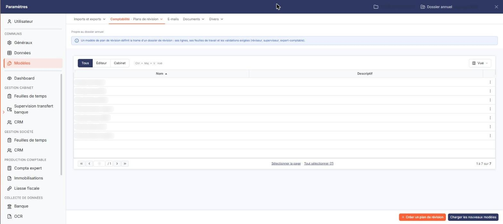
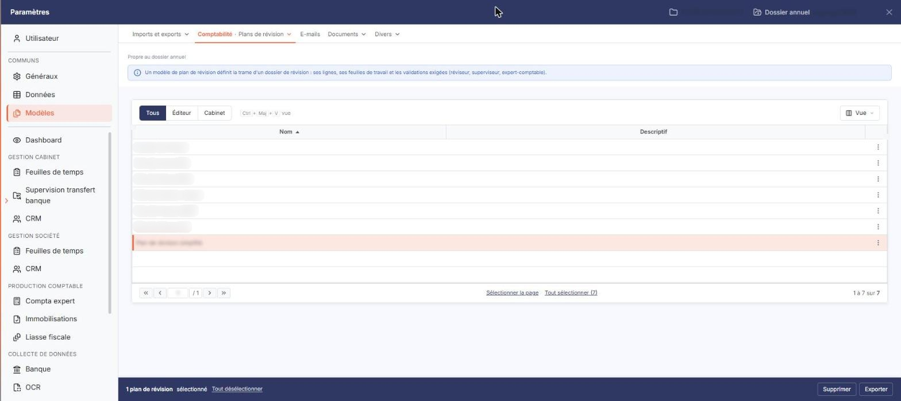

# Plans de revision


**Où le trouver :** Panneau **Paramètres** › **Modèles** › **Comptabilité** › **Plans de revision**



**En bref** — Cet écran gère les modèles de plan de révision : listes de points de contrôle classés par chapitre, à partir desquelles vous créez vos dossiers de révision.

* Pour créer un modèle : bouton \[Nouveau], renseignez la fiche, puis enregistrez.
* Pour récupérer les modèles d'Ingeneo Compta : bouton \[Charger les nouveaux modèles].
* Pour copier vos modèles dans d'autres sociétés : bouton \[Exporter].


Un modèle de plan de révision décrit toutes les opérations à effectuer lors d'une révision et permet de paramétrer le suivi de son avancement. Il est essentiellement constitué d'une liste de points de contrôle, classés par chapitre et sous-chapitre. C'est à partir d'un modèle de plan que vous créez ensuite un dossier de révision.

<figure><figcaption>
Écran « Plans de revision » de la nouvelle interface
</figcaption></figure>

Cet écran ne se trouve plus dans la Révision : il est dans le panneau Paramètres. Ouvrez le panneau Paramètres, puis l'onglet de gauche « Modèles », puis, dans la barre du haut, le menu « Comptabilité » et l'entrée « Plans de révision » (l'entrée courante s'affiche après un « · » : « Comptabilité · Plans de révision »). Le libellé « Modèles de plans de révision » n'est plus que le titre de l'écran. Sous la barre, la mention « Propre au dossier annuel » et un encadré bleu rappellent qu'un modèle de plan de révision définit la trame d'un dossier de révision : ses lignes, ses feuilles de travail et les validations exigées (réviseur, superviseur, expert-comptable).

## La liste des modèles

<figure><figcaption>
Rubrique « a) La liste des modèles »
</figcaption></figure>

L'écran présente une liste unique, au-dessus de laquelle trois onglets, **Tous** (actif à l'ouverture), **Éditeur** et **Cabinet**, permettent de choisir les modèles affichés. Elle comporte deux colonnes de données, toutes deux triables :

* **Nom** : le libellé du modèle. La liste est triée par défaut sur cette colonne, par ordre croissant.
* **Descriptif** : le texte de description du modèle ; il est vide sur les modèles livrés avec le logiciel.

La première colonne, sans libellé, porte la boîte à cocher de sélection de la ligne ; les commandes de ligne sont à droite de chaque ligne. L'en-tête de la liste porte la case « Sélectionner », qui coche toutes les lignes, l'indication « Aucun élément sélectionné. », qui vous permet d'étendre la sélection à toutes les pages, et le pictogramme de choix des colonnes affichées. Le pied de la liste porte la pagination et le compteur du nombre d'éléments.

Chaque ligne expose les commandes suivantes, désignées par une infobulle :

* **Modifier**, **Supprimer** et **Dupliquer**.

La commande **Modifier** n'est pas exposée sur toutes les lignes : certains modèles n'affichent que **Supprimer** et **Dupliquer**.

## La fiche d'un modèle

La fiche s'ouvre par la commande **Modifier** d'une ligne. Elle comporte trois rubriques, dans l'ordre suivant, puis, en bas à droite, le bouton **\[Enregistrer]**. Pour revenir à la liste sans enregistrer, cliquez sur la flèche « < » située à gauche du menu du haut du panneau : le bouton \[Retour] n'est plus proposé.

**Rubrique « Informations générales »**

* **Libellé** : le nom du modèle. Ce champ est obligatoire.
* **Souhaitez-vous rendre obligatoire le nom du réviseur** : interrupteur désactivé par défaut, et une icône d'information « i » l'accompagne.
* **Souhaitez-vous rendre obligatoire le nom du superviseur** : même principe pour le nom du superviseur. Il est désactivé par défaut.
* **Souhaitez-vous rendre obligatoire le nom de l'expert-comptable** : même principe pour le nom de l'expert-comptable. Il est activé par défaut.
* **Descriptif** : une zone de saisie de plusieurs lignes, facultative.

**Rubrique « Eléments constitutifs du dossier de révision »**

Cette rubrique porte la liste hiérarchique des éléments du plan. Elle n'est pas paginée : toutes les lignes sont affichées. Elle comporte deux colonnes de données :

* **Type de ligne** : la nature de l'élément — « Chapitre obligatoire », « Elément obligatoire », « Chapitre », « Sous-chapitre », « Point de contrôle » ou « Synthèse de cycle ».
* **Libellé** : le libellé de l'élément.

Deux boutons accompagnent cette rubrique : le bouton **\[Nouvel élément]** et le bouton **\[Supprimer la sélection]**.

**Rubrique « Feuilles de travail standards »**

Cette rubrique s'ouvre sur la phrase « Indiquez parmi toutes les feuilles de calcul et feuilles rédactionnelles disponibles celles qui seront proposées dans le dossier de révision. »

Elle présente un interrupteur sans texte par feuille disponible, réparti en deux sous-rubriques : **Feuilles de calcul** puis **Feuilles rédactionnelles**, chacune accompagnée d'un compteur (« 18 / 30 activées » sur le modèle relevé). Activez les feuilles que vous voulez voir proposées dans les dossiers de révision créés à partir de ce plan.

Les boutons **\[Tout sélectionner]** et **\[Tout désélectionner]**, placés en tête de la rubrique, vous permettent de basculer d'un seul geste l'ensemble des feuilles.

## Autres vues de l'écran

<figure><figcaption>
d) Bouton [Nouveau]
</figcaption></figure>

<figure><figcaption>
g) Bouton [Supprimer]
</figcaption></figure>

<figure><figcaption>
f) Bouton [Exporter]
</figcaption></figure>
