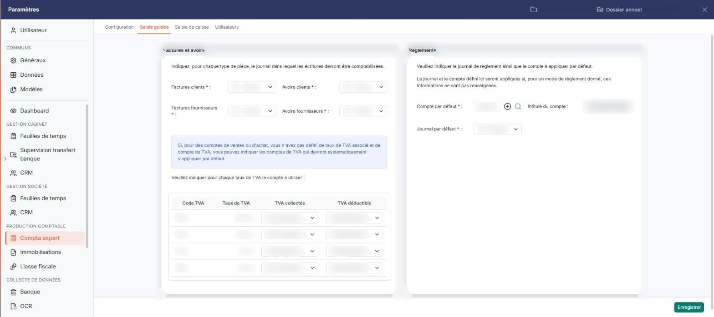
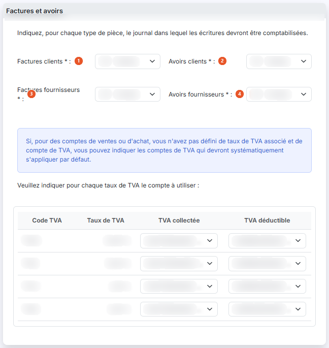
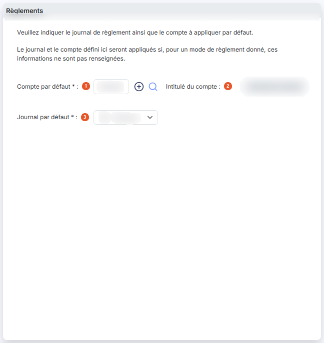

# Saisie guidée


**Où le trouver :** Panneau **Paramètres** › **Compta expert** › **Saisie guidée**



**En bref** — Cette option paramètre les éléments nécessaires à la génération des écritures de la saisie guidée : journaux des factures, avoirs et règlements.

* Pour paramétrer : renseignez les rubriques « Factures et avoirs » et « Règlements », puis bouton \[Enregistrer].


Cette option permet de paramétrer tous les éléments nécessaires à la génération des écritures lors de l'utilisation de la saisie guidée (l'écran « Saisie guidée » de la saisie des pièces, qui n'a plus d'entrée de menu dans la nouvelle interface).

<figure><figcaption>
Écran « Saisie guidée » de la nouvelle interface
</figcaption></figure>

La saisie guidée permet de saisir rapidement les factures et avoirs clients et fournisseurs, ainsi que leurs règlements.

Cet écran s'ouvre dans le panneau Paramètres : ouvrez la rubrique « Compta expert » (section « Production comptable » de la barre latérale), puis l'onglet « Saisie guidée ». Les autres onglets de la rubrique sont « Configuration », « Saisie de caisse » et « Utilisateurs ».

L'écran est un formulaire unique, propre au dossier en cours. Il se compose de deux rubriques que vous renseignez l'une après l'autre. Les libellés suivis d'un astérisque sont obligatoires.

## Rubrique « Factures et avoirs »

<figure><figcaption>
Rubrique « Rubrique « Factures et avoirs » »
</figcaption></figure>

**Les journaux**

Le logiciel vous invite à indiquer, pour chaque type de pièce, le journal dans lequel les écritures devront être comptabilisées. Vous disposez de quatre listes déroulantes :

| Champ                                                                    | Ce qu'il faut savoir                                                                                                                                                                                                                                                                                                                                                                                                                                                                                                                                                                                                                                                                                                                                                                                                                                                             |
| ------------------------------------------------------------------------ | -------------------------------------------------------------------------------------------------------------------------------------------------------------------------------------------------------------------------------------------------------------------------------------------------------------------------------------------------------------------------------------------------------------------------------------------------------------------------------------------------------------------------------------------------------------------------------------------------------------------------------------------------------------------------------------------------------------------------------------------------------------------------------------------------------------------------------------------------------------------------------- |
| 
1. <strong>Factures clients</strong> <em>Obligatoire</em>
      | Journal dans lequel le logiciel comptabilisera les factures adressées à vos clients.                                                                                                                                                                                                                                                                                                                                                                                                                                                                                                                                                                                                                                                                                                                                                                                             |
| 
2. <strong>Avoirs clients</strong> <em>Obligatoire</em>
        | Journal dans lequel le logiciel comptabilisera les avoirs adressés à vos clients.                                                                                                                                                                                                                                                                                                                                                                                                                                                                                                                                                                                                                                                                                                                                                                                                |
| 
3. <strong>Factures fournisseurs</strong> <em>Obligatoire</em>
 | Journal dans lequel le logiciel comptabilisera les factures reçues de vos fournisseurs.                                                                                                                                                                                                                                                                                                                                                                                                                                                                                                                                                                                                                                                                                                                                                                                          |
| 
4. <strong>Avoirs fournisseurs</strong> <em>Obligatoire</em>
   | 
Journal dans lequel le logiciel comptabilisera les avoirs reçus de vos fournisseurs. Les quatre listes proposent le même contenu : un premier choix « Sélectionnez », puis tous les journaux du dossier, quel que soit leur type. Les journaux se paramètrent dans le panneau Paramètres, rubrique « Données », catégorie « Dossier et comptabilité » > « Journaux » : si le journal que vous cherchez ne figure pas dans la liste, c'est là qu'il faut le créer. <strong>Les comptes de TVA par défaut</strong> Le tableau reprend une ligne par code TVA du dossier ; vous ne pouvez ni ajouter ni supprimer de ligne, vous ne faites qu'affecter des comptes aux codes existants. Les codes TVA se paramètrent dans le panneau Paramètres, rubrique « Données », catégorie « Dossier et comptabilité » > « Codes TVA ». Le tableau comporte quatre colonnes :
 |
| **Code TVA**                                                             | Code du taux, affiché par le logiciel ; il ne se saisit pas.                                                                                                                                                                                                                                                                                                                                                                                                                                                                                                                                                                                                                                                                                                                                                                                                                     |
| **Taux de TVA**                                                          | Taux correspondant, affiché par le logiciel ; il ne se saisit pas.                                                                                                                                                                                                                                                                                                                                                                                                                                                                                                                                                                                                                                                                                                                                                                                                               |
| **TVA collectée**                                                        | Choisissez dans la liste le compte de TVA collectée à utiliser pour ce taux. La liste propose les comptes du dossier.                                                                                                                                                                                                                                                                                                                                                                                                                                                                                                                                                                                                                                                                                                                                                            |
| **TVA déductible**                                                       | Choisissez dans la liste le compte de TVA déductible à utiliser pour ce taux. La liste propose les comptes du dossier.                                                                                                                                                                                                                                                                                                                                                                                                                                                                                                                                                                                                                                                                                                                                                           |

Ces deux listes ne comportent pas de choix « Sélectionnez » : leur premier choix est vide, sans libellé, et précède les comptes.

## Rubrique « Règlements »

<figure><figcaption>
Rubrique « Règlements »
</figcaption></figure>

Le logiciel vous invite à indiquer le journal de règlement ainsi que le compte à appliquer par défaut.

| Champ                                                                 | Ce qu'il faut savoir                                                                                                                                                                         |
| --------------------------------------------------------------------- | -------------------------------------------------------------------------------------------------------------------------------------------------------------------------------------------- |
| 
1. <strong>Compte par défaut</strong> <em>Obligatoire</em>
  | Saisissez le numéro du compte à utiliser. Le pictogramme « Créer » (un « + » cerclé) placé à droite du champ vous permet de créer un compte, et le pictogramme « Loupe » d'en rechercher un. |
| 2. **Intitulé du compte**                                             | Le logiciel affiche l'intitulé du compte saisi ; ce champ ne se saisit pas.                                                                                                                  |
| 
3. <strong>Journal par défaut</strong> <em>Obligatoire</em>
 | Choisissez dans la liste le journal dans lequel les écritures de règlement devront être enregistrées. La liste propose les mêmes journaux que ceux de la rubrique « Factures et avoirs ».    |

bouton **\[Enregistrer]**

Il enregistre le paramétrage saisi. C'est le seul bouton du pied de l'écran, en bas à droite : pour quitter l'écran sans enregistrer, fermez le panneau par la croix, en haut à droite.
