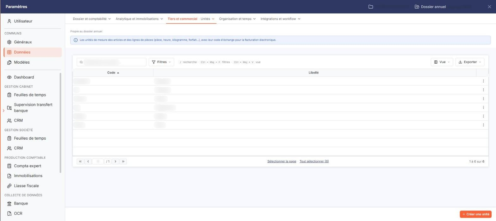
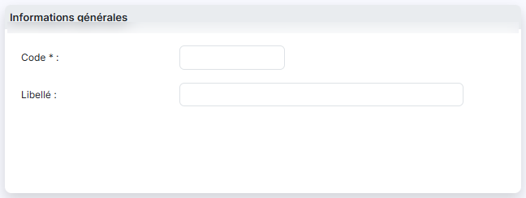
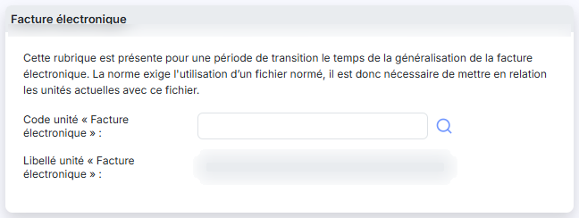

# Unités


**Où le trouver :** Panneau **Paramètres** › **Données** › **Tiers et commercial** › **Unités**



**En bref** — Cet écran permet de gérer les unités utilisées avec les quantités dans les écritures, lorsque la gestion des quantités est activée dans les paramètres généraux.

* Pour créer une unité : bouton \[Nouveau], renseignez le code, puis bouton \[Enregistrer].
* Pour supprimer des unités : cochez-les dans la liste, puis bouton \[Supprimer].


Cette option permet de gérer les unités qui seront utilisées conjointement avec les quantités dans les écritures, si le paramètre « Gestion des quantités » dans les écritures a été activé dans le menu « Paramètres », option « Paramètres généraux ».

<figure><figcaption>
Écran « Unités » de la nouvelle interface
</figcaption></figure>

Les unités sont propres au dossier : aucune n'est livrée d'office, vous créez celles dont vous avez besoin.

## La liste des unités

<figure><figcaption>
Rubrique « a) La liste des unités »
</figcaption></figure>

À l'ouverture de l'option, le logiciel affiche la liste des unités du dossier, triée sur la colonne « Code » par ordre croissant. Elle comporte deux colonnes, l'une et l'autre triables :

| Champ       | Ce qu'il faut savoir                                  |
| ----------- | ----------------------------------------------------- |
| **Code**    | Code de l'unité, celui que vous désignerez en saisie. |
| **Libellé** | Intitulé en clair de l'unité.                         |

Une case à cocher précède chaque ligne : elle sert à désigner les unités sur lesquelles portera le bouton \[Supprimer] de la barre de pied d'écran.

L'en-tête de la première colonne réunit les commandes de la liste : une case à cocher qui sélectionne toutes les lignes, un indicateur du nombre d'éléments sélectionnés, un pictogramme « Engrenage » qui personnalise les colonnes affichées, un pictogramme « Entonnoir » qui filtre la liste et un pictogramme « Imprimante » qui l'imprime.

Le pied de la liste porte la pagination habituelle et le compteur des lignes affichées.

**Les commandes d'une ligne**

Chaque ligne porte trois commandes, présentées dans cet ordre :

**Modifier** (pictogramme « Crayon ») : ouvre la fiche de l'unité.

**Supprimer** (pictogramme « Croix ») : supprime l'unité.

**Dupliquer** (pictogramme « Flèche sortant d'un cadre ») : reprend le contenu de l'unité pour en créer une autre. C'est le moyen de repartir d'une unité existante, le code d'une unité n'étant pas modifiable une fois celle-ci enregistrée.

bouton **\[Nouveau]**

Il ouvre une fiche vierge pour créer une unité.

bouton **\[Supprimer]**

Il supprime les unités dont vous avez coché la case en début de ligne.

## La fiche d'une unité

<figure><figcaption>
Rubrique « Rubrique « Informations générales » »
</figcaption></figure>

<figure><figcaption>
Rubrique « Rubrique « Facture électronique » »
</figcaption></figure>

La fiche est la même en création et en modification. Les libellés suivis d'un astérisque rouge sont obligatoires. Elle se compose de deux rubriques.

**Rubrique « Informations générales »**

| Champ                                                | Ce qu'il faut savoir                                                                                                                                                                                                                                                                                                                                                                                                  |
| ---------------------------------------------------- | --------------------------------------------------------------------------------------------------------------------------------------------------------------------------------------------------------------------------------------------------------------------------------------------------------------------------------------------------------------------------------------------------------------------- |
| 
<strong>Code</strong> <em>Obligatoire</em>
 | Code de l'unité. Vous le saisissez à la création ; en modification, il est grisé et ne peut plus être changé.                                                                                                                                                                                                                                                                                                         |
| **Libellé**                                          | 
Intitulé en clair de l'unité. <strong>Rubrique « Facture électronique »</strong> Le logiciel affiche en tête de rubrique le texte suivant : « Cette rubrique est présente pour une période de transition le temps de la généralisation de la facture électronique. La norme exige l'utilisation d'un fichier normé, il est donc nécessaire de mettre en relation les unités actuelles avec ce fichier. »
 |
| **Code unité « Facture électronique »**              | Code de l'unité correspondante dans le référentiel normé. Le pictogramme « Loupe » placé à droite du champ vous permet de le rechercher dans ce référentiel.                                                                                                                                                                                                                                                          |
| **Libellé unité « Facture électronique »**           | Le logiciel affiche le libellé du code normé retenu ; ce champ ne se saisit pas.                                                                                                                                                                                                                                                                                                                                      |

Ces deux champs peuvent rester vides : la mise en relation avec le référentiel normé n'est pas exigée pour enregistrer une unité.

bouton **\[Enregistrer]**

Il enregistre l'unité et vous ramène à la liste.

bouton **\[Retour]**

Il vous ramène à la liste sans enregistrer votre saisie.
