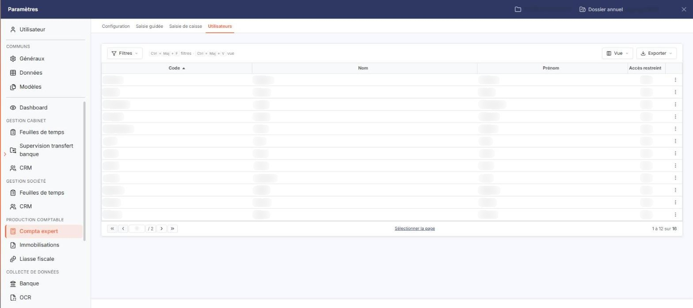
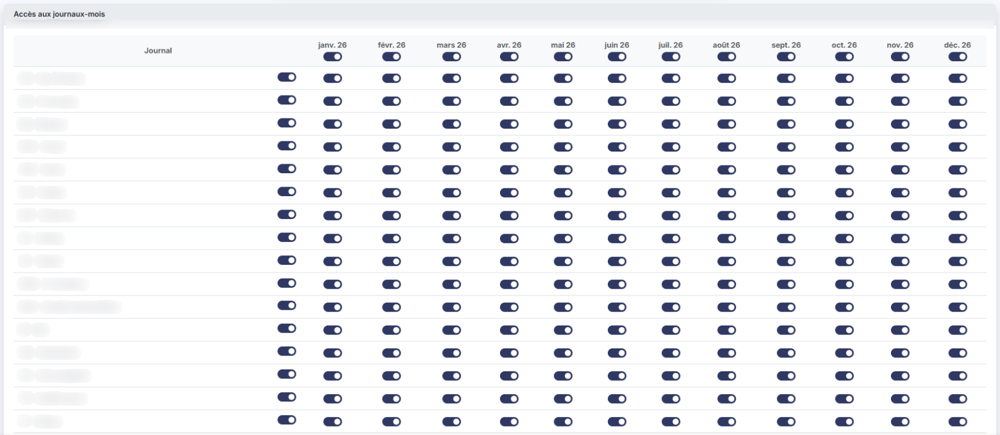
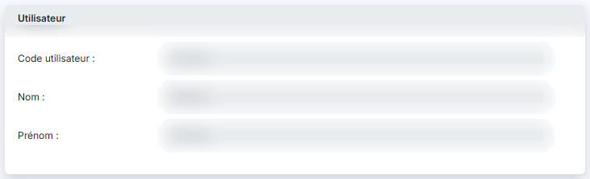

# Utilisateurs


**Où le trouver :** Panneau **Paramètres** › **Compta expert** › **Utilisateurs**



**En bref** — Cette option restreint l'accès des utilisateurs à certains journaux, mois par mois, pour le dossier annuel en cours ; elle ne crée ni ne modifie les utilisateurs.

* Pour régler plusieurs utilisateurs d'un coup : cochez-les, puis bouton \[Modification groupée].
* Pour régler un utilisateur : ouvrez sa fiche, cochez ses accès dans « Accès aux journaux-mois », puis bouton \[Enregistrer].


Cette option permet de restreindre l'accès des utilisateurs à certains journaux pour le dossier annuel en cours.

<figure><figcaption>
Écran « Utilisateurs » de la nouvelle interface
</figcaption></figure>

Elle ne sert ni à créer ni à supprimer un utilisateur, et elle ne permet pas non plus de modifier son identité : cela se gère dans l'administration du cabinet. Ici, vous ne réglez que les accès aux journaux, mois par mois.

## La liste des utilisateurs

<figure><figcaption>
Bouton [Modification groupée]
</figcaption></figure>

<figure><figcaption>
Rubrique « Rubrique « Accès aux journaux-mois » »
</figcaption></figure>

<figure><figcaption>
Rubrique « Rubrique « Accès aux journaux-mois » »
</figcaption></figure>

À l'ouverture de l'option, le logiciel affiche la liste des utilisateurs ayant accès à la société en cours, triée sur la colonne « Code » par ordre croissant. Elle comporte quatre colonnes :

| Champ               | Ce qu'il faut savoir                                                                                                          |
| ------------------- | ----------------------------------------------------------------------------------------------------------------------------- |
| **Code**            | Code de l'utilisateur.                                                                                                        |
| **Nom**             | Nom de l'utilisateur.                                                                                                         |
| **Prénom**          | Prénom de l'utilisateur.                                                                                                      |
| **Accès restreint** | « Oui » ou « Non ». Un utilisateur est considéré comme ayant un accès restreint dès qu'un seul journal-mois lui est interdit. |

Une case à cocher précède chaque ligne : elle sert à désigner les utilisateurs sur lesquels portera le bouton \[Modification groupée].

L'en-tête de la première colonne réunit les commandes de la liste : une case à cocher qui sélectionne toutes les lignes, un pictogramme « Engrenage » qui personnalise les colonnes affichées, un pictogramme « Entonnoir » qui filtre la liste et un pictogramme « Imprimante » qui l'imprime.

Le pictogramme « Crayon » en début de ligne ouvre la fiche de l'utilisateur. C'est la seule commande de ligne : cet écran ne supprime pas d'utilisateur.

bouton **\[Modification groupée]**

Il permet de régler d'un seul geste les accès de plusieurs utilisateurs. Cochez d'abord la case des utilisateurs concernés en début de ligne, puis cliquez sur le bouton.

La commande porte sur deux utilisateurs au minimum : si vous n'en avez coché qu'un seul, le logiciel ouvre une fenêtre « Modification groupée » portant le message « Veuillez sélectionner au moins deux utilisateurs. » que vous refermez par son bouton de validation. Si aucune ligne n'est cochée, le bouton reste sans effet et le logiciel n'affiche aucun message.

Lorsque deux utilisateurs au moins sont cochés, le logiciel ouvre la fenêtre « Modification groupée des droits utilisateurs », composée de deux rubriques.

La rubrique « Informations » affiche l'avertissement suivant : « La modification groupée propose une grille sans reprendre les paramétrages existant car ils peuvent être différents pour les utilisateur sélectionnées. Lors de sa validation, elle annulera et remplacera les paramétrages existant. » Autrement dit, la grille qui vous est proposée ne reflète pas les accès en place : ce que vous y réglez remplace intégralement le paramétrage de chacun des utilisateurs retenus.

La rubrique « Accès aux journaux-mois » est identique à celle de la fiche d'un utilisateur, décrite ci-dessous.

La fenêtre porte deux boutons : \[Enregistrer], qui applique la grille aux utilisateurs sélectionnés, et \[Retour], qui la referme sans rien appliquer.

## La fiche d'un utilisateur

<figure><figcaption>
Rubrique « Rubrique « Utilisateur » »
</figcaption></figure>

Elle se compose de deux rubriques.

**Rubrique « Utilisateur »**

Elle rappelle l'identité de l'utilisateur. Ses trois champs sont grisés : ils ne se saisissent pas ici.

| Champ                | Ce qu'il faut savoir     |
| -------------------- | ------------------------ |
| **Code utilisateur** | Code de l'utilisateur.   |
| **Nom**              | Nom de l'utilisateur.    |
| **Prénom**           | Prénom de l'utilisateur. |

**Rubrique « Accès aux journaux-mois »**

Le paramétrage se fait par journal et par mois. Le logiciel vous propose donc un tableau avec les mois en abscisse et les journaux en ordonnée : une ligne par journal du dossier, une colonne par mois de l'exercice en cours.

Chaque case du tableau est un interrupteur : à « Oui », l'utilisateur accède à ce journal pour ce mois ; à « Non », l'accès lui est interdit.

Pour modifier simultanément tous les mois d'un journal, utilisez l'interrupteur à droite du journal ; pour modifier simultanément tous les journaux d'un même mois, utilisez l'interrupteur situé sous le nom du mois.

bouton **\[Enregistrer]**

Le paramétrage est actif dès que vous avez cliqué sur ce bouton.

bouton **\[Retour]**

Il vous ramène à la liste sans enregistrer votre saisie.
