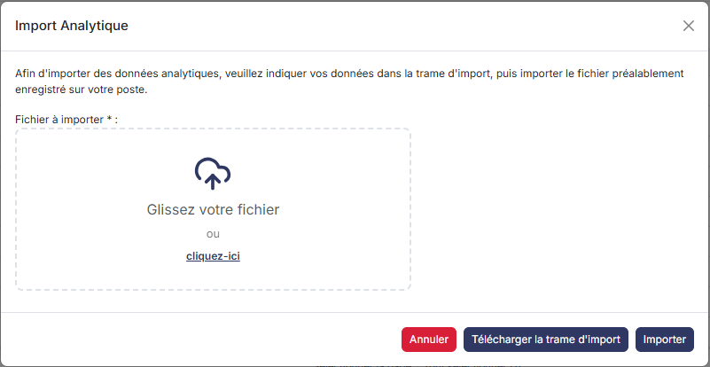
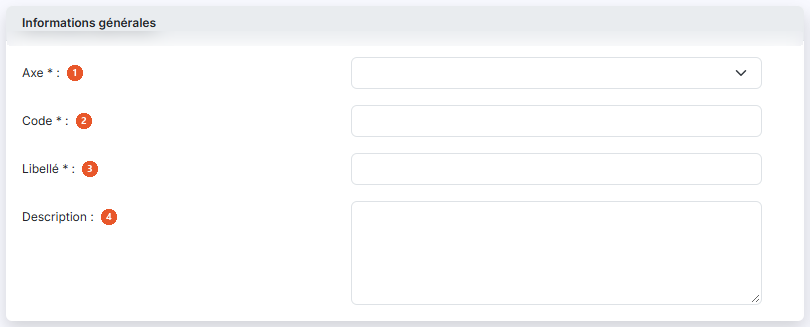
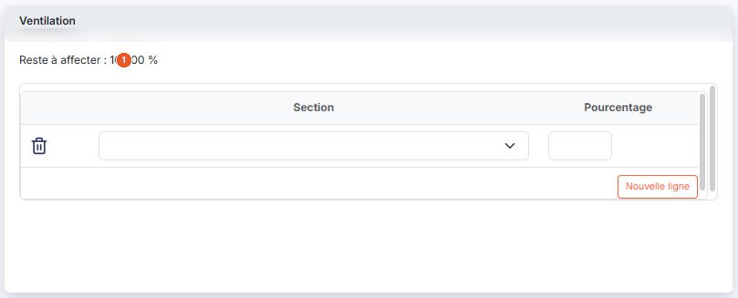

# Ventilations types


**Où le trouver :** Panneau **Paramètres** › **Données** › **Analytique et immobilisations** › **Ventilations types**



**En bref** — Cet écran permet de créer des clés de répartition entre sections analytiques, pour ne pas ressaisir des affectations toujours réparties de la même manière.

* Pour créer une ventilation type : bouton \[Nouveau], choisissez l'axe, définissez les lignes de la rubrique « Ventilation », puis bouton \[Enregistrer].
* Pour reprendre des ventilations d'un fichier : bouton \[Importer].


Les ventilations types permettent de créer des clés de répartition entre les sections, afin de ne pas avoir à ressaisir les affectations qui sont toujours réparties de la même manière : par exemple des frais de publicité répartis chaque fois selon le même pourcentage entre vos régions.

<figure><figcaption>
Écran « Ventilations types » de la nouvelle interface
</figcaption></figure>

Une ventilation type peut être affectée par défaut à un numéro de compte, de sorte qu'à chaque écriture passée sur ce compte les affectations analytiques sont automatiquement réalisées ; elles restent modifiables.

Cet écran s'ouvre dans le panneau Paramètres (entrée « Paramètres » de la barre latérale) : ouvrez la rubrique « Données », puis, dans la barre d'onglets du haut, le menu « Analytique et immobilisations » > « Ventilations types ». Sous l'onglet, la mention « Propre au dossier annuel » et un encadré bleu rappellent qu'une ventilation type est une clé de répartition prête à l'emploi : elle répartit un montant entre plusieurs sections analytiques selon des pourcentages fixés à l'avance.

## La liste des ventilations types

<figure><figcaption>
Bouton [Nouveau]
</figcaption></figure>

<figure><figcaption>
Bouton [Importer]
</figcaption></figure>

La grille présente les colonnes suivantes :

* **Code** : le code de la ventilation type.
* **Libellé** : le libellé de la ventilation type.
* **Descriptif** : le texte libre saisi dans le champ **Description** de la fiche.
* **Axe** : le code de l'axe auquel la ventilation type est rattachée.

Chaque colonne est triable en cliquant sur son en-tête. La première cellule d'en-tête regroupe deux cases à cocher : « tout sélectionner » et la sélection de toutes les pages. Au-dessus de la grille, à gauche, la « roue dentée » vous permet de choisir les colonnes affichées. Le pied de la grille indique la pagination et le nombre de ventilations types affichées. Les boutons \[Supprimer], \[Nouveau] et \[Importer] décrits au paragraphe 2 sont dans le pied du panneau, en bas à droite ; \[Supprimer] reste inactif tant qu'aucune ligne n'est cochée.

Sur chaque ligne, la case à cocher sert à sélectionner la ventilation type et le pictogramme « Modifier » (un crayon), à droite de la ligne, ouvre sa fiche en modification.

## Les boutons de la liste

bouton **\[Nouveau]**

Ouvre une fiche vierge pour créer une ventilation type (rubriques décrites au paragraphe 3).

bouton **\[Supprimer]**

Supprime les ventilations types cochées dans la liste.

bouton **\[Importer]**

Ouvre la fenêtre « Import Analytique », commune aux écrans « Axes », « Sections » et « Ventilations types », qui vous permet de reprendre vos données analytiques depuis un fichier.

## La fiche d'une ventilation type

## Rubrique « Informations générales »

<figure><figcaption>
Rubrique « Rubrique « Informations générales » »
</figcaption></figure>

| Champ              | Ce qu'il faut savoir                                                                                     |
| ------------------ | -------------------------------------------------------------------------------------------------------- |
| 1. **Axe**         | À la création.                                                                                           |
| 2. **Code**        | À la création. Il identifie la ventilation type.                                                         |
| 3. **Libellé**     | —                                                                                                        |
| 4. **Description** | Zone de saisie sur plusieurs lignes ; son contenu est repris dans la colonne **Descriptif** de la liste. |

## Rubrique « Ventilation »

<figure><figcaption>
Rubrique « Rubrique « Ventilation » »
</figcaption></figure>

C'est dans ce tableau que vous définissez les sections concernées par la ventilation, à raison d'une ligne par section. Le tableau comporte trois colonnes :

* un pictogramme « Effacer » (une corbeille), à gauche de chaque ligne, qui supprime la ligne de ventilation ;
* **Section** : liste déroulante des sections de l'axe choisi ;
* **Pourcentage** : la part affectée à cette section.

Une première ligne vide est proposée d'emblée dans une fiche vierge. Le bouton **\[Nouvelle ligne]** placé sous le tableau, à droite, ajoute une ligne de ventilation supplémentaire ; il ne crée pas de ventilation type, à la différence du bouton **\[Nouveau]** de la liste.

**Reste à affecter** : affiché au-dessus du tableau, ce pourcentage indique ce qu'il reste à répartir sur les 100 % initiaux. Il vaut 100,00 % dans une fiche vierge et 0,00 % lorsque la ventilation est complète.

bouton **\[Enregistrer]**

Enregistre la ventilation type. C'est le seul bouton du pied de la fiche, en bas à droite du panneau.

**Flèche « < » de retour**

Le bouton \[Retour] n'est plus affiché dans la fiche. La flèche « < », placée à gauche de la barre d'onglets du panneau, vous ramène à la liste des ventilations types sans rien enregistrer.

## Ce qui change lorsque vous rouvrez une ventilation type existante

La fiche présente les mêmes rubriques et les mêmes champs, avec deux différences :

* le champ **Code** est grisé : le code d'une ventilation type ne se modifie plus une fois celle-ci enregistrée ;
* les champs **Axe** et **Code** ne portent plus l'astérisque des champs obligatoires ; la liste déroulante **Axe** est elle aussi grisée, et elle est réellement désactivée : l'axe de rattachement d'une ventilation type ne se modifie plus une fois celle-ci enregistrée.

Le tableau de la rubrique « Ventilation » affiche les lignes déjà enregistrées, chacune avec son pictogramme « Effacer », sa liste **Section** et son **Pourcentage**.
