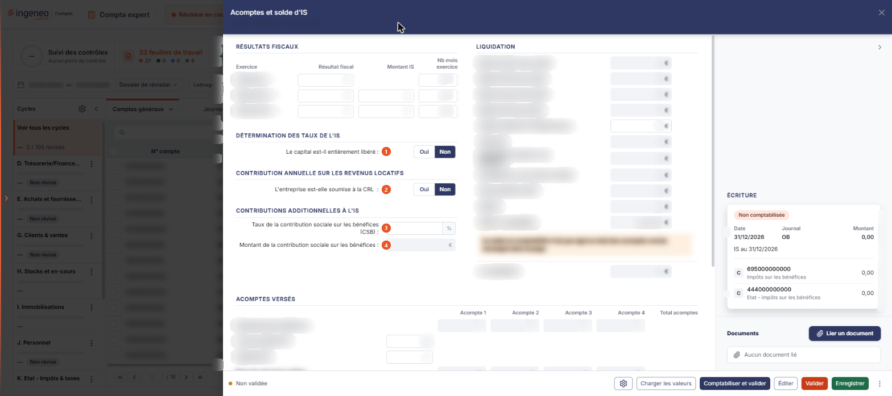
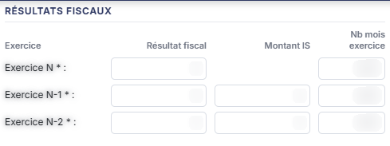
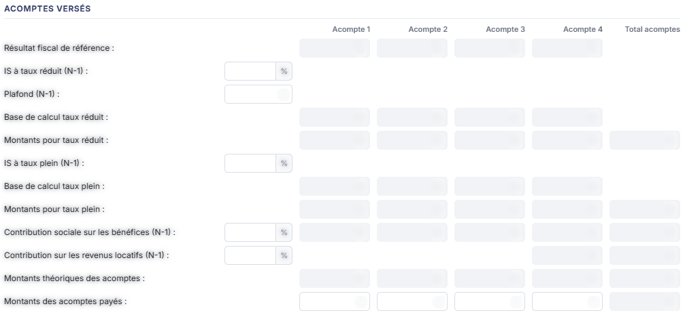
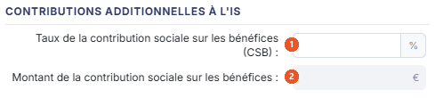
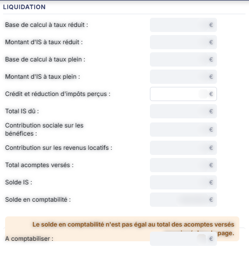
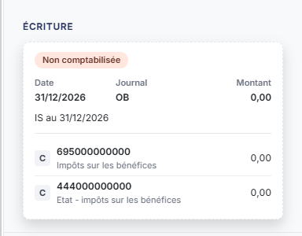

# Acomptes et solde d'IS


**Où le trouver :** Menu **Révision › Révision**



**En bref** — Cette feuille détermine l'impôt sur les sociétés dû pour l'exercice : taux, acomptes, contributions additionnelles et solde à payer ou à récupérer.

* Pour alimenter la feuille : bouton \[Charger les valeurs], complétez les rubriques, puis bouton \[Enregistrer].
* Pour passer l'écriture : bouton \[Comptabiliser et valider].


Cette fiche est la feuille de travail **Acomptes et solde d'IS**. Vous y déterminez l'impôt sur les sociétés dû au titre de l'exercice : les taux applicables, la contribution annuelle sur les revenus locatifs, les acomptes théoriques et payés, les contributions additionnelles, puis la liquidation — le solde à payer ou à récupérer, comparé au solde présent en comptabilité. La feuille peut ensuite générer l'écriture correspondante.

<figure><figcaption>
Écran « Révision » de la nouvelle interface
</figcaption></figure>

C'est une **feuille de calcul**. Elle se distingue des trois feuilles rédactionnelles du module — « Acceptation et maintien de la mission », « Lutte anti-blanchiment » et « Bordereau juridique annuel » — non par son fonctionnement, qui est le même, mais par son contenu : une feuille rédactionnelle recueille votre **jugement** sous forme de questions et de commentaires, alors qu'une feuille de calcul recompose des **chiffres**, en reprend une partie de la comptabilité par des formules, et peut aboutir à une **écriture**. Celle-ci fait partie des feuilles qui comptabilisent.

## Avant d'ouvrir la feuille

Une feuille de travail appartient à un **dossier de révision**, et non au dossier annuel.

L'écran ne rappelle nulle part à quel dossier de révision il travaille : si votre dossier annuel en comporte plusieurs, rien à l'écran ne vous dit lequel est servi.

Pour l'ouvrir, dans l'écran Révision, cliquez sur la carte « N feuilles de travail » du bandeau : la liste des feuilles s'ouvre dans un tiroir à droite. Repérez la ligne « Acomptes et solde d'IS » (le champ « Rechercher une feuille… » la retrouve) et cliquez sur le crayon de la ligne : la feuille s'ouvre dans un panneau, dont l'en-tête indique « Acomptes et solde d'IS », puis la société et l'exercice, avec une croix de fermeture. Il n'y a pas de bouton de création : la feuille figure déjà dans la liste, et elle arrive **immédiatement en saisie** : il n'y a ni bouton **\[Modifier]**, ni mode consultation.

## Comment se lit la feuille

Le rendu vous dit ce que vous avez à faire : une **zone blanche** est une valeur que vous saisissez, une **zone grisée** est une valeur que le logiciel calcule ou reprend de la comptabilité, et que vous ne pouvez pas modifier.

L'écran n'a aucun onglet. Le titre « Récapitulatif acomptes et solde d'IS » n'apparaît plus : le calcul est porté par six rubriques, réparties ainsi. À gauche, de haut en bas : **Résultats fiscaux**, **Détermination des taux de l'IS**, **Contribution annuelle sur les revenus locatifs** et **Contributions additionnelles à l'IS**. À côté, **Liquidation**. En dessous, sur toute la largeur du corps, **Acomptes versés**. Dans la colonne de droite se trouvent enfin **Écriture**, puis **Documents**.

Deux de ces rubriques sont **à géométrie variable** : elles n'affichent d'abord qu'une seule question, et se déplient à mesure que vous y répondez. Ne concluez pas d'un premier coup d'œil que la feuille est courte.

## Rubrique « Résultats fiscaux »

<figure><figcaption>
Rubrique « Rubrique « Résultats fiscaux » »
</figcaption></figure>

Un tableau de trois lignes — **Exercice N \* :**, **Exercice N-1 \* :** et **Exercice N-2 \* :** — aux colonnes : une première colonne sans titre qui porte le résultat fiscal, puis **Montant IS** et **Nb mois exercice**.

Ces trois lignes portent un **astérisque** (noir à l'écran) : ce sont les **seuls champs obligatoires** de l'écran. Toutes leurs cellules sont saisies.

La ligne **Exercice N** n'a pas de cellule **Montant IS** : l'impôt de l'exercice en cours est précisément ce que la feuille détermine, il ne se saisit pas.

Les exercices N-1 et N-2 servent, eux, à calculer les acomptes : c'est le résultat de référence sur lequel le logiciel les assoit.

## Rubrique « Détermination des taux de l'IS »

<figure><figcaption>
Rubrique « Rubrique « Détermination des taux de l'IS » »
</figcaption></figure>

Cette rubrique se déplie en deux temps, selon les conditions d'accès au taux réduit.

À l'ouverture, une seule ligne s'affiche :

| Champ                                       | Ce qu'il faut savoir                                                                                                                                                                                                                                                                                                                                                                                        |
| ------------------------------------------- | ----------------------------------------------------------------------------------------------------------------------------------------------------------------------------------------------------------------------------------------------------------------------------------------------------------------------------------------------------------------------------------------------------------- |
| 1. **Le capital est-il entièrement libéré** | 
Interrupteur Oui / Non, réglé sur <strong>Non</strong>. Répondez <strong>Oui</strong>, et le logiciel fait apparaître quatre éléments : <strong>Le capital est-il détenu de manière continue, pour 75% au moins, directement ou indirectement, par des personnes physiques</strong> — interrupteur Oui / Non, réglé sur <strong>Non</strong>.
                                                  |
| **Montant du chiffre d'affaires annuel**    | Montant saisi, accompagné à sa droite d'un **bouton à pictogramme « Crayon »** (infobulle « Modifier la formule ») qui doit ouvrir la fenêtre de formule de la cellule, décrite plus bas ; à l'écran du 26/10/2026, ce bouton n'a pas ouvert la fenêtre (voir la remarque en fin de page). C'est par cette formule que le logiciel peut aller chercher lui-même le chiffre d'affaires dans la comptabilité. |
| **Bénéfice imposable**                      | Montant calculé par le logiciel.                                                                                                                                                                                                                                                                                                                                                                            |
| **Taux plein de l'IS**                      | 
Taux saisi, exprimé en pourcentage, que le logiciel propose à sa valeur en vigueur. Répondez <strong>Oui</strong> en plus à la question sur la détention du capital, et le logiciel intercale trois lignes de plus :
                                                                                                                                                                              |
| **Plafond (pour 12 mois)**                  | Montant saisi, proposé au plafond en vigueur. C'est la limite de bénéfice à laquelle s'applique le taux réduit, à proratiser si l'exercice ne fait pas douze mois.                                                                                                                                                                                                                                          |
| **Bénéfice soumis au taux réduit**          | Montant calculé.                                                                                                                                                                                                                                                                                                                                                                                            |
| **Taux réduit de l'IS**                     | Taux affiché **en lecture seule**, contrairement au taux plein qui, lui, se saisit.                                                                                                                                                                                                                                                                                                                         |

Une fois les deux questions à **Oui**, la rubrique se lit dans cet ordre : capital libéré, capital détenu à 75 %, chiffre d'affaires annuel, bénéfice imposable, plafond, bénéfice soumis au taux réduit, taux réduit, taux plein.

## Rubrique « Contribution annuelle sur les revenus locatifs »

<figure><figcaption>
Rubrique « Rubrique « Contribution annuelle sur les revenus locatifs » »
</figcaption></figure>

Cette rubrique est également à géométrie variable. À l'ouverture, une seule ligne :

| Champ                                                          | Ce qu'il faut savoir                                                                                                                            |
| -------------------------------------------------------------- | ----------------------------------------------------------------------------------------------------------------------------------------------- |
| 1. **L'entreprise est-elle soumise à la CRL**                  | 
Interrupteur Oui / Non, réglé sur <strong>Non</strong>. Répondez <strong>Oui</strong>, et le logiciel fait apparaître quatre lignes :
 |
| **Taux de la contribution sur les revenus locatifs**           | Taux saisi, exprimé en pourcentage, proposé à sa valeur en vigueur.                                                                             |
| **Montant des loyers soumis encaissés au cours de l'exercice** | Montant saisi.                                                                                                                                  |
| **Montant plancher de l'imposition à la CRL**                  | Montant saisi, proposé à sa valeur en vigueur : en deçà, la contribution n'est pas due.                                                         |
| **Montant de la contribution sur les revenus locatifs**        | Montant calculé par le logiciel.                                                                                                                |

## Rubrique « Acomptes versés »

<figure><figcaption>
Rubrique « Rubrique « Acomptes versés » »
</figcaption></figure>

Un tableau aux colonnes **Acompte 1**, **Acompte 2**, **Acompte 3**, **Acompte 4** et **Total acomptes**.

Le principe de lecture est simple : les **taux de l'exercice précédent se saisissent une seule fois**, dans un champ placé à gauche du tableau, et les quatre colonnes d'acomptes qui en découlent sont **calculées**. La seule ligne que vous renseignez acompte par acompte est la dernière.

Vous saisissez : **IS à taux réduit (N-1) :**, **Plafond (N-1) :**, **IS à taux plein (N-1) :**, **Contribution sociale sur les bénéfices (N-1) :** et **Contribution sur les revenus locatifs (N-1) :** — les quatre taux et le plafond de référence —, puis, dans le tableau, la ligne **Montants des acomptes payés :**, colonne par colonne.

Le logiciel calcule : **Résultat fiscal de référence :**, **Base de calcul taux réduit :**, **Montants pour taux réduit :**, **Base de calcul taux plein :**, **Montants pour taux plein :**, les colonnes des deux lignes de contributions, **Montants théoriques des acomptes :** et le **Total acomptes** de chaque ligne qui en comporte un.

La comparaison qui vous intéresse est celle des deux dernières lignes : les **montants théoriques** que la réglementation appelle, et les **montants payés** que vous déclarez.

## Rubrique « Contributions additionnelles à l'IS »

<figure><figcaption>
Rubrique « Rubrique « Contributions additionnelles à l'IS » »
</figcaption></figure>

| Champ                                                          | Ce qu'il faut savoir                |
| -------------------------------------------------------------- | ----------------------------------- |
| 1. **Taux de la contribution sociale sur les bénéfices (CSB)** | Taux saisi, exprimé en pourcentage. |
| 2. **Montant de la contribution sociale sur les bénéfices**    | Montant calculé par le logiciel.    |

## Rubrique « Liquidation »

<figure><figcaption>
Rubrique « Rubrique « Liquidation » »
</figcaption></figure>

C'est la synthèse de la feuille. Sous le sous-titre **IS à taux réduit**, toutes les lignes sont calculées par le logiciel, à une exception près, dans cet ordre :

* **Base de calcul à taux réduit**
* **Montant d'IS à taux réduit**
* **Base de calcul à taux plein**
* **Montant d'IS à taux plein**
* **Crédit et réduction d'impôts perçus** : — **la seule ligne que vous saisissez**
* **Total IS dû**
* **Contribution sociale sur les bénéfices**
* **Contribution sur les revenus locatifs**
* **Total acomptes versés**
* **Solde IS**
* **Solde en comptabilité**
* **A comptabiliser**

Les trois dernières lignes se lisent ensemble : le **Solde IS** est ce que la feuille détermine, le **Solde en comptabilité** est ce que porte aujourd'hui votre comptabilité, et le montant **A comptabiliser** est l'écart entre les deux — c'est-à-dire exactement ce que portera l'écriture générée par la feuille.

## Rubrique « Écriture »

<figure><figcaption>
Rubrique « Rubrique « Écriture » »
</figcaption></figure>

Tant que la feuille n'a pas été comptabilisée, la rubrique, dans la colonne de droite, affiche la pastille **Non comptabilisée** au-dessus d'une carte qui présente l'écriture prévue : la date, le journal, le montant, le libellé, puis deux lignes de compte, chacune précédée d'une pastille « C » et suivie de son montant. Sur le dossier relevé le 26/10/2026, la carte portait la date 31/12/2026, le journal OB, le libellé « IS au 31/12/2026 » et les comptes 695000000000 « Impôts sur les bénéfices » et 444000000000 « Etat - impôts sur les bénéfices », tous montants à 0,00 : ces valeurs dépendent du dossier et de l'exercice. Ni liste, ni bouton.

C'est le bouton **\[Comptabiliser et valider]** du pied du panneau qui l'alimente.

## Rubrique « Documents »

<figure><figcaption>
Rubrique « Rubrique « Documents » »
</figcaption></figure>

Cette rubrique, en bas de la colonne de droite, reçoit les pièces que vous voulez joindre à la feuille — avis d'acompte, relevé de solde.

Tant qu'aucune pièce n'est jointe, la rubrique affiche la seule mention **Aucun document lié**, précédée d'un pictogramme « Trombone ».

Le bouton **\[Lier un document]**, à droite du titre de la rubrique, rattache une pièce à la feuille (le tiroir qu'il ouvre n'a pas été ouvert : ce qu'il propose n'est pas décrit ici).

## Alimenter une cellule depuis la comptabilité : la fenêtre de formule

C'est le mécanisme propre aux feuilles de calcul, et il n'existe sur aucune feuille rédactionnelle.

Le bouton à **pictogramme « Crayon »** placé à droite d'une cellule — sur cette feuille, le seul est celui du **Montant du chiffre d'affaires annuel :** — ouvre une fenêtre de détail de cette cellule, qui présente deux zones :

| Champ                  | Ce qu'il faut savoir                                                                                                                                      |
| ---------------------- | --------------------------------------------------------------------------------------------------------------------------------------------------------- |
| **Formule par défaut** | Zone en **lecture seule**, qui vous montre la formule livrée par le logiciel. Elle reste visible en permanence : vous savez donc toujours à quoi revenir. |
| **Formule actuelle**   | Zone de saisie sur plusieurs lignes, celle que le logiciel applique réellement. Vous pouvez la remplacer par la vôtre, feuille par feuille.               |

Sous la zone, le logiciel propose une palette de jetons à insérer dans la formule, dans cet ordre : **Défaut**, **Valeur**, **Solde**, **-Solde**, **SoldeC**, **-SoldeC**, **SoldeD**, **-SoldeD**, **MvtC**, **-MvtC**, **MvtD** et **-MvtD** — le solde d'un compte, son solde créditeur ou débiteur, ses mouvements au crédit ou au débit, et leur opposé. Vous les combinez avec le ou les comptes concernés.

À titre d'exemple, la cellule **Montant du chiffre d'affaires annuel :** est livrée avec une formule qui reprend l'opposé du solde des comptes de la racine 70 — les comptes de ventes (non revérifié à l'écran : la fenêtre ne s'est pas ouverte).

Le bouton **\[Enregistrer]** conserve la formule, le bouton **\[Annuler]** ferme la fenêtre sans rien changer.

## Les commandes du pied du panneau

Le pied du panneau présente, à gauche, la pastille orange « Non validée », puis, de gauche à droite : la roue « Paramétrage des comptes de révision », \[Charger les valeurs], \[Comptabiliser et valider], \[Éditer], \[Valider], \[Enregistrer] et le menu ⋮ « Autres actions » (qui ne contient que « Purger la feuille »). Il n'y a pas de bouton \[Fermer] : la croix de l'en-tête referme le panneau. Les commandes sont décrites ci-dessous, sans suivre l'ordre du pied.

bouton **\[Éditer]**

Ouvre la fenêtre « Edition » (son titre s'écrit parfois « Edition acomptes et solde IS »), qui rappelle en tête le nom de la feuille et sa pastille d'état, commune à toutes les feuilles de travail : vous y choisissez le **Format :** — **Html**, **Pdf** ou **Excel**, le logiciel proposant **Html** — et vous indiquez par un interrupteur sans texte si vous souhaitez **Tronquer les libellés trop longs :**, activé lorsqu'il s'affiche (il n'apparaît pas à toutes les ouvertures de la fenêtre). Le bouton **\[Edition]** lance le document, le bouton **\[Annuler]** ferme la fenêtre sans rien produire.

**Roue « Paramétrage des comptes de révision »**

Ouvre le tiroir commun **Paramétrage des comptes de révision**, dont le sous-titre rappelle la société, l'exercice et la rubrique (« BIC-IS »), et qui vous permet de désigner les comptes que l'écriture utilisera. Une liste de rubriques occupe la gauche du tiroir ; la rubrique **Impôt sur les sociétés** est celle de cette feuille, et elle porte quatre paramètres :

* **Impôts sur les sociétés** : — **obligatoire** (l'encadrement rouge d'une ligne vide n'a pas été revu : les quatre lignes arrivent renseignées)
* **Charge d'impôt sur les sociétés**
* **Dette de la CRL**
* **Charge de la CRL**

Chaque ligne se compose d'une zone de saisie du numéro de compte, d'un bouton **\[+]** (infobulle « Créer »), d'un pictogramme « Loupe » qui ouvre la recherche dans le plan comptable, puis du libellé du compte, affiché en lecture seule dès que le compte est reconnu.

Le bouton **\[Charger les valeurs par défaut]** renseigne les comptes que le logiciel propose. Il se trouve dans le pied du tiroir. Son infobulle indique : **Charge les valeurs prévues et vérifie que les comptes existent dans le plan comptable du dossier. Un compte absent est signalé sur sa ligne. Rien n'est enregistré avant de cliquer sur Enregistrer.** (relue sur le tiroir commun, ouvert depuis une autre feuille). Les quatre comptes arrivent déjà renseignés ; la mention d'un « filigrane rouge » qui figurait ici n'a pas été retrouvée.

Le bouton **\[Enregistrer]**, à droite du pied, conserve le paramétrage ; à gauche, le pied indique « Tout est enregistré ». Il n'y a plus de bouton **\[Annuler]** : la croix de l'en-tête referme le tiroir. Un bouton **\[Rétablir la rubrique]** figure en tête de la liste des paramètres (son effet n'a pas été essayé).
