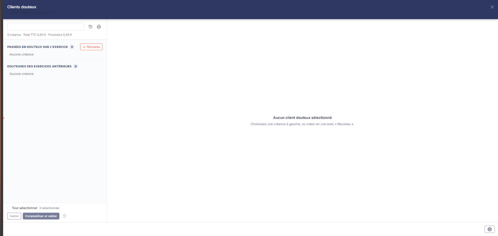
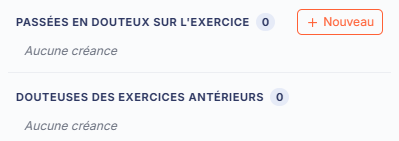
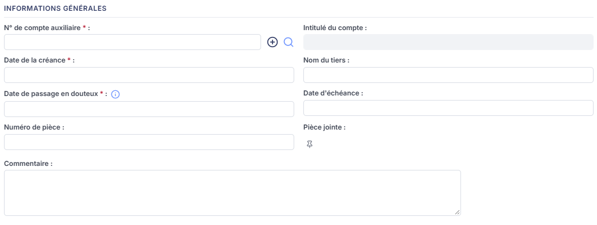
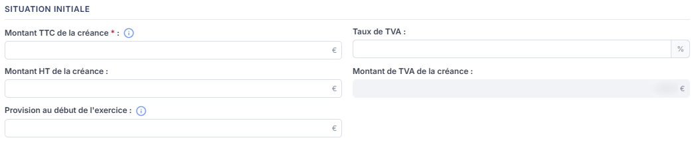
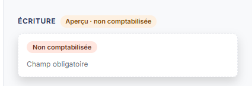

# Clients douteux


**Où le trouver :** Menu **Révision › Révision**



**En bref** — Cette feuille permet de suivre les créances douteuses, avec leur montant d'origine, la provision constituée et son évolution, et d'en déduire les écritures de passage en douteux.

* Pour reprendre les créances de l'an dernier : pictogramme « Charger les valeurs N-1 », en haut de la navigation.
* Pour ajouter une créance : bouton \[Nouveau], renseignez la fiche, puis bouton \[Enregistrer].
* Pour comptabiliser : cochez les créances, puis bouton \[Comptabiliser et valider].


Cet écran vous permet de suivre vos créances douteuses : vous en enregistrez une par créance, avec son montant d'origine, la provision déjà constituée et son évolution au cours de l'exercice. Le logiciel en déduit les écritures de passage en douteux, de dotation, de reprise ou de perte irrécouvrable.

<figure><figcaption>
Écran « Révision » de la nouvelle interface
</figcaption></figure>

Comme toutes les feuilles de travail, cet écran n'est accessible que si un dossier de révision existe sur le dossier annuel ; sinon le logiciel affiche à la place le message « Veuillez créer un dossier de révision afin de pouvoir utiliser cette fonctionnalité. ».

Il n'y a plus d'entrée de menu « Feuilles de calcul > Clients douteux ». Dans l'écran Révision, cliquez sur la carte **« 33 feuilles de travail »** du bandeau du haut (le nombre peut varier) : la **liste** des feuilles s'ouvre en tiroir (zone « Rechercher une feuille… », filtres de statut, colonnes **Intitulé**, **Descriptif** et **Statut**). Cliquez sur le **crayon** de la ligne « Clients douteux » (statut « Aucune » sur le dossier consulté) : un **panneau** s'ouvre à droite, dont l'en-tête porte « Clients douteux », puis « FLORE ET SENS SAS · Exercice 2026 » (votre société et votre exercice), avec une croix de fermeture.

L'écran se présente en trois zones : à gauche, une **navigation** qui liste les créances douteuses déjà enregistrées ; au centre, une **fiche** par créance, qui s'ouvre avec le Bouton \[Nouveau] ou en cliquant sur une créance de la navigation ; à droite de la fiche ouverte, un volet **Écriture**. Tant qu'aucune créance n'est choisie, la zone centrale affiche « Aucun client douteux sélectionné » et l'invite « Choisissez une créance à gauche, ou créez-en une avec « Nouveau ». ».

## La navigation (liste des créances douteuses)

<figure><figcaption>
Bouton [Nouveau]
</figcaption></figure>

En haut de la navigation, la zone « Rechercher un client, un compte ou une pièce » filtre les créances ; à sa droite, deux pictogrammes d'infobulles « Charger les valeurs N-1 » et « Édition des clients douteux » (le second est décrit plus bas). Dessous, une ligne de synthèse : « N créance · Total TTC … € · Provisions … € » (« 0 créance · Total TTC 0,00 € · Provisions 0,00 € » tant qu'aucune créance n'est enregistrée).

Les créances sont rangées en deux groupes, chacun avec son compteur : « Passées en douteux sur l'exercice » et « Douteuses des exercices antérieurs ». Un groupe sans créance affiche « Aucune créance ». La navigation n'a ni colonnes, ni tri, ni roue de choix des colonnes ; ce que chaque créance y affiche n'a pas été relevé, aucune créance n'étant enregistrée sur le dossier consulté.

Au bas de la navigation : la case « Tout sélectionner » et le compteur « N sélectionnée », puis \[Valider], \[Comptabiliser et valider] et un pictogramme corbeille d'infobulle « Supprimer la sélection » ; ces trois commandes sont grisées tant qu'aucune créance n'est sélectionnée.

bouton **\[Nouveau]**

Placé à droite de l'intitulé du groupe « Passées en douteux sur l'exercice » (infobulle « Nouveau client douteux »), il ouvre au centre du panneau, sous le titre « Nouveau client douteux », une fiche vierge pour enregistrer une nouvelle créance douteuse.

**Pictogramme « Édition des clients douteux »**

Il ouvre la fenêtre « Edition des clients douteux », qui vous permet d'imprimer la liste des créances douteuses. Elle rappelle la feuille (« Clients douteux ») et son statut (« Aucune » sur le dossier consulté) et comporte deux options :

* **Format** : boutons-bascule « Html », « Pdf » et « Excel ». « Html » est le choix proposé par défaut.
* **Tronquer les libellés trop longs** : le libellé est affiché mais, sur le dossier consulté, aucun interrupteur ne l'accompagne, quel que soit le format choisi : l'option n'est pas réglable depuis cette fenêtre.

**Pictogramme « Supprimer la sélection » (corbeille)**

Placé au bas de la navigation, à droite de \[Comptabiliser et valider], il vise les créances sélectionnées (son effet n'a pas été observé : aucune créance n'est enregistrée sur le dossier consulté). Le panneau ne porte pas de menu ⋮ « Autres actions ».

**Roue « Paramétrage des comptes de révision »**

La roue placée dans le pied du panneau (infobulle « Paramétrage des comptes de révision : Clients douteux ») ouvre à droite le tiroir « Paramétrage des comptes de révision », commun à toutes les feuilles. La rubrique « Clients douteux » y est sélectionnée d'office, avec « 6 paramètres » ; elle rassemble les comptes que les écritures utiliseront :

* **Clients douteux**
* **Dépréciation des clients douteux**
* **Dotations aux provisions**
* **Reprises de provisions**
* **Pertes irrécouvrables**
* **TVA sur pertes irrécouvrables**

Sur chaque ligne, vous saisissez directement le numéro de compte ; le Bouton \[+] vous permet de créer le compte et le pictogramme « Loupe » de le rechercher dans le plan comptable. L'intitulé du compte s'affiche à droite et n'est pas saisissable.

Le tiroir porte ses propres commandes : en pied, la mention « Tout est enregistré », le Bouton \[Enregistrer] et le Bouton \[Charger les valeurs par défaut] ; en haut à droite de la rubrique, le bouton \[Rétablir la rubrique] ; une croix de fermeture. Il n'y a plus de bouton \[Annuler]. Il s'enregistre séparément de vos créances. Le Bouton \[Charger les valeurs par défaut] reprend les comptes proposés par le logiciel, en vérifiant qu'ils existent bien dans le plan comptable ; un compte absent est signalé sur sa ligne, et rien n'est enregistré avant de cliquer sur \[Enregistrer] (précision donnée par son infobulle).

**Pied du panneau**

Le pied du panneau est permanent. Sans fiche ouverte, il ne porte que la roue « Paramétrage des comptes de révision », à droite. Avec une fiche ouverte, il porte à gauche la pastille « Non validée » (état de la fiche) et, à droite, de gauche à droite : la roue, le bouton **\[Comptabiliser et valider]**, le bouton **\[Valider]** et le bouton **\[Enregistrer]**. Le pied ne porte pas de bouton \[Fermer] : la croix de l'en-tête du panneau referme le panneau et vous ramène à la liste des feuilles de travail.

## La fiche d'une créance

La fiche comporte trois rubriques au centre du panneau, dans cet ordre : « Informations générales », « Situation initiale » et « Mouvements sur l'exercice », et, à droite, un volet « Écriture » (que le chevron « Masquer le volet de droite » replie). Les champs obligatoires sont signalés par un astérisque à la suite de leur libellé.

Le pied de la fiche est celui du panneau, décrit plus haut : pastille orange « Non validée », puis \[Comptabiliser et valider], \[Valider] et \[Enregistrer]. La croix de l'en-tête referme le panneau, fiche comprise, sans demander de confirmation (constaté le 05/11/2026 sur une fiche vierge).

## b.1) Rubrique « Informations générales »

<figure><figcaption>
Rubrique « Rubrique « Informations générales » »
</figcaption></figure>

Ce sont les informations qui décrivent la créance et qui n'évoluent pas dans le temps. Elles se présentent sur deux colonnes.

* **N° de compte auxiliaire** : champ obligatoire. Il s'agit du compte auxiliaire du client. Le Bouton \[+] vous permet de créer le compte et le pictogramme « Loupe » de le rechercher.
* **Date de la créance** : champ obligatoire ; le calendrier s'ouvre au clic dans le champ.
* **Date de passage en douteux** : champ obligatoire ; le calendrier s'ouvre au clic dans le champ. Son infobulle indique : « Ce champ permet de déterminer s'il faut passer ou non l'écriture de passage en client douteux. »
* **Numéro de pièce** : champ facultatif.
* **Commentaire** : champ facultatif, sur plusieurs lignes.
* **Intitulé du compte** : il n'est pas saisissable : le logiciel le reprend du compte auxiliaire que vous avez indiqué.
* **Nom du tiers** : champ facultatif, saisissable.
* **Date d'échéance** : champ facultatif ; le calendrier s'ouvre au clic dans le champ.
* **Pièce jointe** : il n'y a pas de zone de saisie, mais un pictogramme « Punaise » qui vous permet de joindre la pièce justificative à la créance.

## b.2) Rubrique « Situation initiale »

<figure><figcaption>
Rubrique « Rubrique « Situation initiale » »
</figcaption></figure>

Ces informations décrivent la créance telle qu'elle se présentait au début de l'exercice.

* **Montant TTC de la créance** : champ obligatoire. Son infobulle indique : « Une écriture de constatation de la créance douteuse (du compte auxiliaire client vers le compte de clients douteux) sera générée pour le montant TTC. »
* **Montant HT de la créance** : champ facultatif. Lorsque le taux de TVA vaut zéro, le logiciel y recopie le montant TTC.
* **Provision au début de l'exercice** : ce champ n'est saisissable que sous condition. Son infobulle indique : « Si la créance avait déjà fait l'objet d'une provision lors d'un précédent exercice, veuillez en indiquer le montant. Ce champ ne pourra être renseigné que si la date de la créance est antérieure à l'exercice en cours. »
* **Taux de TVA** : champ facultatif, exprimé en pourcentage. Il est vide sur une fiche neuve et passe à 0,00 dès que vous saisissez le montant TTC.
* **Montant de TVA de la créance** : il n'est pas saisissable, le logiciel le calcule. Il vaut 0,00 sur une fiche neuve.

## b.3) Rubrique « Mouvements sur l'exercice »

<figure><figcaption>
Rubrique « Rubrique « Mouvements sur l'exercice » »
</figcaption></figure>

Cette rubrique décrit l'évolution de la créance au cours de l'exercice. **Elle est vide tant que vous n'avez pas renseigné la date de passage en douteux** : son titre s'affiche, mais aucun champ. Les champs apparaissent dès que cette date est complète ; la saisie du montant TTC, à elle seule, ne les fait pas apparaître.

Le champ **Evolution de la créance** commande alors le reste de la rubrique : selon le choix que vous y faites, le logiciel n'affiche pas les mêmes champs et ne génère pas la même écriture. Son infobulle indique : « Si vous indiquez une évaluation de la provision, une écriture de dotation de provision sera générée en fonction du pourcentage de perte probable que vous aurez défini. Si vous indiquez une perte irrécouvrable, une écriture de perte sera générée pour le montant de la créance. »

**Cas d'un passage en douteux de l'exercice en cours**

Le champ **Evolution de la créance** offre deux choix : « Evaluation de la provision », proposé par défaut, et « Perte irrécouvrable ».

Avec le choix « Evaluation de la provision » :

* **% de perte probable** : champ obligatoire, exprimé en pourcentage, à 0,00 au départ.
* **Provision de fin d'exercice** : champ obligatoire, à 0,00 au départ.
* **Montant de la dotation** : il n'est pas saisissable, le logiciel le calcule.

Avec le choix « Perte irrécouvrable », ces trois champs disparaissent et sont remplacés par :

* **Perte irrécouvrable HT** : il n'est pas saisissable ; le logiciel y reprend le montant HT de la créance.
* **TVA sur perte irrécouvrable** : il n'est pas saisissable non plus.

## b.4) Volet « Écriture »

<figure><figcaption>
Rubrique « Volet « Écriture » »
</figcaption></figure>

Ce volet, à droite de la fiche, porte le titre « ÉCRITURE » suivi de la mention « Aperçu · non comptabilisée ». Il ne contient aucun champ tant que la créance n'a pas été comptabilisée : le logiciel y affiche seulement une pastille « Non comptabilisée » et, sur une fiche neuve, le message « Champ obligatoire ». Il présente ensuite l'écriture générée.
