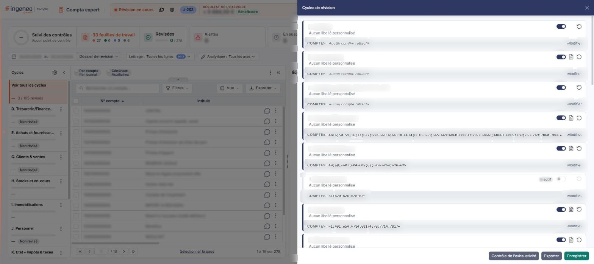
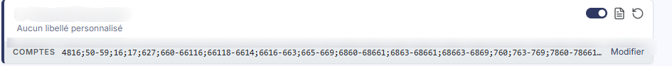
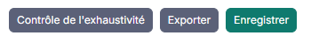

# Cycles de révision


**Où le trouver :** Menu **Révision › Cycles de révision**



**En bref** — Cet écran personnalise les cycles de révision préparamétrés : libellé, comptes qui les composent et comptes écartés. La liste est figée, sans création ni suppression.

* Pour contrôler que tous vos comptes sont affectés : bouton \[Contrôle de l'exhaustivité].
* Pour revenir au paramétrage d'origine d'un cycle : bouton \[Restaurer] sur sa ligne.
* Pour valider vos changements : bouton \[Enregistrer].


Cet écran vous permet de personnaliser les cycles de révision préparamétrés du dossier annuel : leur libellé, les comptes qui les composent, et ceux que vous souhaitez écarter.

<figure><figcaption>
Écran « Cycles de révision » de la nouvelle interface
</figcaption></figure>

La liste des cycles est figée : vous ne pouvez ni en créer, ni en supprimer.

Pour l'ouvrir, dans l'écran Révision, cliquez sur le bouton « Déplier les cycles » du rail de gauche : le panneau « Cycles » s'ouvre, avec la liste des cycles ; cliquez ensuite sur l'icône « Paramétrer les cycles de révision » (c'est son infobulle) en haut de ce panneau. Sur les pages de la Comptabilité restées pleines (Saisie sur trame, par exemple), la barre de menus garde aussi l'entrée « Révision > Cycles de révision ».

L'écran s'ouvre dans un panneau (tiroir) intitulé « Cycles de révision » : une liste unique de 25 cartes, une par cycle, suivie dans le pied du panneau de trois boutons.

## La liste des cycles

<figure><figcaption>
Rubrique « 1) La liste des cycles »
</figcaption></figure>

Il n'y a plus de tableau ni d'en-têtes de colonne : chaque cycle est une carte. Sur sa ligne de titre, elle porte le champ « Libellé personnalisé du cycle », un interrupteur actif / inactif et deux pictogrammes ; dessous figure la mention « Aucun libellé personnalisé » tant qu'aucun libellé n'est saisi ; puis un bandeau « COMPTES » énumère les comptes du cycle (« Aucun compte rattaché » s'il n'y en a pas) et porte le bouton **\[Modifier]**. Les informations qui suivent restent celles de l'ancien tableau, regroupées sous leur ancien intitulé.

| Champ                    | Ce qu'il faut savoir                                                                                                                                                                                                                                                                                                   |
| ------------------------ | ---------------------------------------------------------------------------------------------------------------------------------------------------------------------------------------------------------------------------------------------------------------------------------------------------------------------- |
| **Libellé par défaut**   | Le libellé standard du cycle, qui s'affiche en filigrane dans le champ « Libellé personnalisé du cycle » tant que vous n'en saisissez pas un autre. Il n'est pas modifiable.                                                                                                                                           |
| **Libellé personnalisé** | Il vous permet de remplacer le libellé du cycle partout où le logiciel l'affiche.                                                                                                                                                                                                                                      |
| **Actif**                | Interrupteur actif / inactif ; un cycle désactivé affiche une pastille « Inactif » à la place de l'interrupteur, et ses textes sont grisés. Il vous permet de désactiver les cycles non pertinents pour le dossier annuel en cours, ce qui allège les sélecteurs de cycles présents à différents endroits du logiciel. |
| **Comptes du cycle**     | Les comptes qui font partie du cycle sont listés dans le bandeau « COMPTES » de la carte ; le bouton **\[Modifier]** permet de les définir.                                                                                                                                                                            |

## Les cycles proposés

<figure><figcaption>
Rubrique « 2) Les cycles proposés »
</figcaption></figure>

Les cycles se présentent dans cet ordre :

* A. Synthèse
* B. Lutte antifraude
* C. Contrôles préalables / Régularité formelle
* D. Trésorerie/Financement
* E. Achats et fournisseurs
* F. Charges externes
* G. Clients & ventes
* H. Stocks et en-cours
* I. Immobilisations
* J. Personnel
* K. Etat - Impôts & taxes
* L. Capitaux propres, prov.
* M. Autres comptes de bilan
* N. Autres comptes de résultat
* O. Engagements hors-bilan
* P. Résultat fiscal et déclarations
* Q. Annexe
* R. à Y. Autre cycle 1 à Autre cycle 8

Les huit lignes « Autre cycle » sont à votre disposition pour définir des cycles propres à votre cabinet : vous leur donnez un **Libellé personnalisé**, vous leur affectez des comptes et vous les rendez actifs.

## Autres vues de l'écran

<figure><figcaption>
3) Les actions de chaque ligne
</figcaption></figure>

<figure><figcaption>
4) Les boutons du pied du panneau
</figcaption></figure>

<figure><figcaption>
Bouton [Enregistrer]
</figcaption></figure>

<figure><figcaption>
Bouton [Contrôle de l'exhaustivité]
</figcaption></figure>
