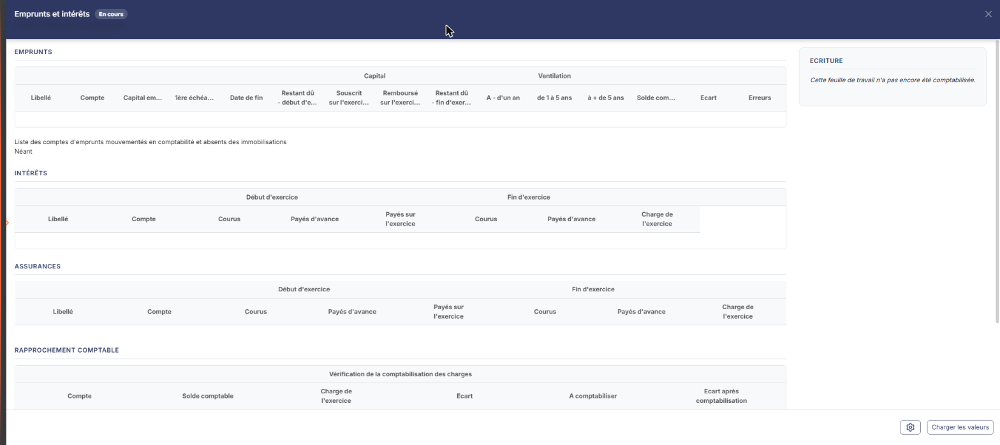
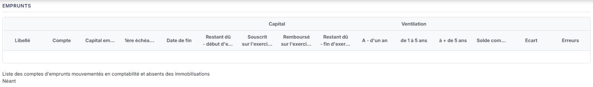
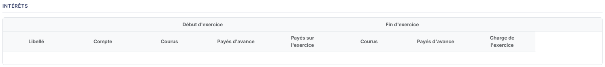
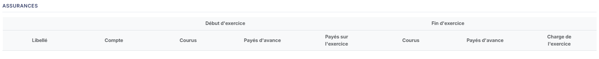
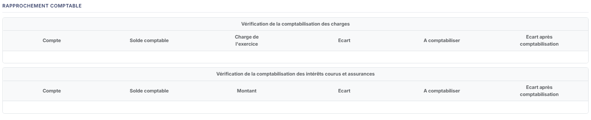

# Emprunts et intérêts


**Où le trouver :** Menu **Révision › Révision**



**En bref** — Cette feuille rapproche les fiches d'emprunt du module Immobilisations et les soldes comptables d'emprunts, d'intérêts et d'assurance, et fait apparaître les écarts.

* Pour alimenter les tableaux : bouton \[Charger les valeurs], puis bouton \[Enregistrer].


Cette feuille de travail rapproche vos emprunts de votre comptabilité : elle reprend d'un côté les fiches d'emprunt enregistrées dans le module Immobilisations, de l'autre les soldes des comptes d'emprunt, d'intérêts et d'assurance, et met en évidence les écarts ainsi que les régularisations à comptabiliser en fin d'exercice.

<figure><figcaption>
Écran « Révision » de la nouvelle interface
</figcaption></figure>

Cet écran est d'abord un écran de contrôle : les emprunts, leurs échéances et les soldes comptables y sont repris du module Immobilisations et de la comptabilité, et les colonnes de charge, d'écart et de régularisation à comptabiliser sont calculées par le logiciel.

Une fois la feuille alimentée, quelques colonnes restent à votre main : dans la rubrique « Emprunts », **Restant dû - début d'exercice**, **Souscrit sur l'exercice**, **Remboursé sur l'exercice** et les trois colonnes de **Ventilation** ; dans les rubriques « Intérêts » et « Assurances », les colonnes **Courus** et **Payés d'avance** du début d'exercice. Elles se saisissent tant que la feuille n'est ni validée ni comptabilisée, et à condition que vous disposiez du droit d'enregistrer cette feuille.

Comme toutes les feuilles de travail, cet écran n'est accessible que si un dossier de révision existe sur le dossier annuel ; sinon le logiciel affiche à la place le message « Veuillez créer un dossier de révision afin de pouvoir utiliser cette fonctionnalité. ».

Le corps de l'écran comporte quatre rubriques, dans cet ordre : « Emprunts », « Intérêts », « Assurances » et « Rapprochement comptable ». Dans la colonne de droite, à côté des tableaux, une carte « Ecriture » complète l'écran. Il n'y a ni onglet, ni volet Documents.

## Rubrique « Emprunts »

<figure><figcaption>
Rubrique « Rubrique « Emprunts » »
</figcaption></figure>

Un tableau présente vos emprunts, une ligne par emprunt. Son en-tête est sur deux niveaux : certaines colonnes sont regroupées sous un bandeau commun, « Capital » puis « Ventilation ». Ce sont des regroupements de colonnes, pas des onglets : tout s'affiche en même temps.

Les colonnes, dans l'ordre :

* **Libellé** : le libellé de l'emprunt tel qu'il est enregistré en Immobilisations.
* **Compte** : le compte sur lequel l'emprunt est suivi en comptabilité.
* **Capital emprunté**
* **1ère échéance** : la date de la première échéance.
* **Date de fin**

Les quatre colonnes regroupées sous **Capital** décrivent le mouvement du capital sur l'exercice :

* **Restant dû - début d'exercice**
* **Souscrit sur l'exercice**
* **Remboursé sur l'exercice**
* **Restant dû - fin d'exercice**

Les trois colonnes regroupées sous **Ventilation** répartissent le capital restant dû par échéance, ce qui vous permet de renseigner l'état des dettes de l'annexe :

* **A - d'un an**
* **de 1 à 5 ans**
* **à + de 5 ans**

Les trois dernières colonnes ne sont rattachées à aucun regroupement :

* **Solde comptable** : le solde du compte d'emprunt en comptabilité.
* **Ecart** : la différence entre le restant dû de fin d'exercice et le solde comptable. C'est cette colonne que vous surveillez : un écart non nul signale une échéance mal enregistrée ou un contrat incomplet.
* **Erreurs** : cette colonne ferme le tableau. Le tableau étant vide à la vérification, son contenu n'a pas pu être observé.

Sous le tableau, le logiciel affiche un contrôle de cohérence, intitulé « Liste des comptes d'emprunts mouvementés en comptabilité et absents des immobilisations ». Il signale les comptes d'emprunt mouvementés en comptabilité pour lesquels aucune fiche n'a été enregistrée côté Immobilisations. La mention « Néant » signifie qu'il n'y a aucun écart de ce type.

Si le tableau est vide, c'est que le dossier ne comporte aucune fiche d'emprunt en Immobilisations et aucun compte d'emprunt mouvementé en comptabilité.

## Rubrique « Intérêts »

<figure><figcaption>
Rubrique « Rubrique « Intérêts » »
</figcaption></figure>

Ce tableau isole la charge d'intérêts qui revient à l'exercice, en corrigeant les intérêts courus et les intérêts payés d'avance. Son en-tête est également sur deux niveaux, avec un bandeau « Début d'exercice » et un bandeau « Fin d'exercice ».

* **Libellé**
* **Compte**
* **Courus** et **Payés d'avance**, regroupées sous **Début d'exercice** : la situation reprise de l'exercice précédent.
* **Payés sur l'exercice** : les intérêts effectivement réglés.
* **Courus** et **Payés d'avance**, regroupées sous **Fin d'exercice** : les régularisations à constater à la clôture.
* **Charge de l'exercice** : la charge d'intérêts qui revient à l'exercice, une fois ces régularisations appliquées.

## Rubrique « Assurances »

<figure><figcaption>
Rubrique « Rubrique « Assurances » »
</figcaption></figure>

Ce tableau est construit exactement comme celui des intérêts, avec les mêmes colonnes et les mêmes regroupements « Début d'exercice » et « Fin d'exercice ». Il vous permet d'isoler de la même façon la charge d'assurance emprunteur qui revient à l'exercice.

## Rubrique « Rapprochement comptable »

<figure><figcaption>
Rubrique « Rubrique « Rapprochement comptable » »
</figcaption></figure>

Cette rubrique comporte deux tableaux, chacun introduit par son propre bandeau de titre.

**Vérification de la comptabilisation des charges**

Colonnes : **Compte**, **Solde comptable**, **Charge de l'exercice**, **Ecart**, **A comptabiliser**, **Ecart après comptabilisation**.

**Vérification de la comptabilisation des intérêts courus et assurances**

Mêmes colonnes, à une près : **Montant** remplace **Charge de l'exercice**.

Dans les deux tableaux, la colonne **Ecart** vous donne la différence entre le solde comptable et le montant attendu, la colonne **A comptabiliser** le montant de la régularisation, et la colonne **Ecart après comptabilisation** ce qui subsisterait une fois cette régularisation passée. Une feuille correctement justifiée se termine sur un écart après comptabilisation nul.

## Carte « Ecriture »

<figure><figcaption>
Rubrique « Carte « Ecriture » »
</figcaption></figure>

Cette carte, placée dans la colonne de droite, ne contient aucun champ tant que la feuille n'a pas été comptabilisée : le logiciel y affiche la seule phrase « Cette feuille de travail n'a pas encore été comptabilisée. ». Elle présente ensuite l'écriture générée.

**Pictogramme « Engrenage » (Paramétrage des comptes de révision)**

Placé à gauche du pied, il a pour infobulle « Paramétrage des comptes de révision : Comptes d'intérêts ». Il ouvre, par-dessus la feuille, un panneau « Paramétrage des comptes de révision », dont l'en-tête rappelle la société et l'exercice et qui s'enregistre séparément de la feuille. Ce panneau n'est pas propre à cette feuille : à gauche, la liste des rubriques de paramétrage de toutes les feuilles, chacune suivie du nombre de ses paramètres ; un champ « Rechercher un compte, un libellé… » en haut. À l'ouverture depuis cette feuille, la rubrique « Comptes d'intérêts » est sélectionnée (2 paramètres).

À droite, la rubrique affiche ses deux comptes :

* **Intérêts courus**
* **Intérêts payés d'avance**

Sur chaque ligne, vous saisissez directement le numéro de compte ; le Bouton \[+] vous permet de créer le compte et le pictogramme « Loupe » de le rechercher dans le plan comptable. L'intitulé du compte s'affiche à droite et n'est pas saisissable. Une ligne peut porter la pastille « Personnalisé », suivie d'un pictogramme circulaire dont l'effet n'a pas été essayé ; le Bouton \[Rétablir la rubrique] figure en haut à droite de la rubrique.

En bas du panneau, de gauche à droite : l'état d'enregistrement (« Tout est enregistré »), le Bouton \[Charger les valeurs par défaut] et le Bouton \[Enregistrer] ; la croix de l'en-tête ferme le panneau. Le Bouton \[Charger les valeurs par défaut] reprend les comptes proposés par le logiciel, en vérifiant qu'ils existent bien dans le plan comptable du dossier. Selon l'infobulle du bouton, un compte absent est signalé sur sa ligne et rien n'est enregistré avant que vous cliquiez sur \[Enregistrer].

Sur une feuille encore vide, le pied n'affiche que le pictogramme « Engrenage » et le Bouton \[Charger les valeurs] (il n'y a pas de bouton \[Fermer] : la croix de l'en-tête referme le panneau) ; les autres commandes de cette feuille dépendent de vos droits et de l'état de la feuille.
