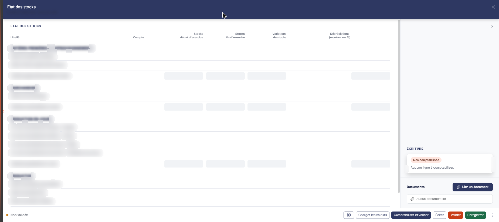
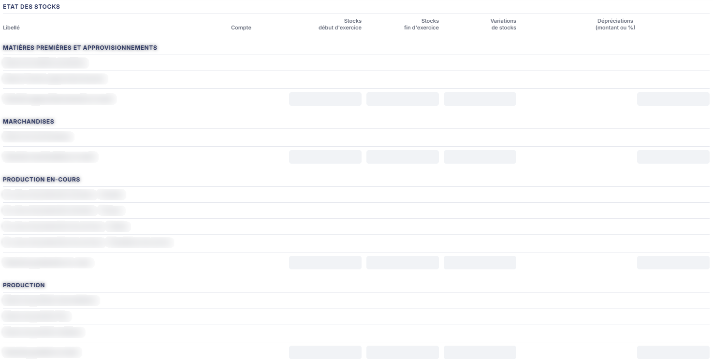
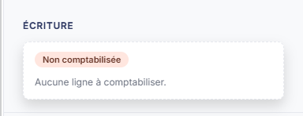
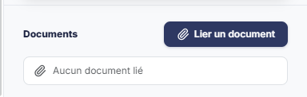

# État des stocks


**Où le trouver :** Menu **Révision › Révision**



**En bref** — Cette feuille justifie les stocks de fin d'exercice, en calcule la variation et l'éventuelle dépréciation, puis comptabilise les écritures correspondantes.

* Pour alimenter la feuille : bouton \[Charger les valeurs], saisissez les valeurs de stock, puis bouton \[Enregistrer].
* Pour comptabiliser : bouton \[Comptabiliser et valider].
* Pour imprimer l'état : bouton \[Éditer].


Cette feuille de travail vous permet de justifier vos stocks de fin d'exercice, d'en calculer la variation et d'en constater l'éventuelle dépréciation, puis de comptabiliser les écritures correspondantes.

<figure><figcaption>
Écran « Révision » de la nouvelle interface
</figcaption></figure>

Vous n'y saisissez que deux choses : la **valeur du stock à la fin de l'exercice**, compte par compte, et sa **dépréciation**. Tout le reste — le stock d'ouverture, la variation, les totaux par catégorie — est repris de la comptabilité ou calculé par le logiciel.

Comme toutes les feuilles de travail, cet écran n'est accessible que si un dossier de révision existe sur le dossier annuel ; sinon le logiciel affiche à la place le message « Veuillez créer un dossier de révision afin de pouvoir utiliser cette fonctionnalité. ».

Pour l'ouvrir, dans l'écran Révision, cliquez sur la carte « N feuilles de travail » du bandeau : la liste des feuilles s'ouvre dans un tiroir à droite. Repérez la ligne « Etat des stocks » (le champ « Rechercher une feuille… » la retrouve) et cliquez sur le crayon de la ligne : la feuille s'ouvre dans un panneau, dont l'en-tête indique « Etat des stocks », puis la société et l'exercice, avec une croix de fermeture.

Le panneau comporte trois rubriques : « Etat des stocks », puis, dans la colonne de droite, « Écriture » et « Documents ».

## Rubrique « Etat des stocks »

<figure><figcaption>
Rubrique « Rubrique « Etat des stocks » »
</figcaption></figure>

Un tableau unique, à six colonnes :

* **Libellé**
* **Compte**
* **Stocks début d'exercice**
* **Stocks fin d'exercice**
* **Variations de stocks**
* **Dépréciations (montant ou %)**

Le tableau est organisé en quatre catégories, chacune introduite par une ligne d'intitulé grisée et close par une ligne de total en gras :

* **Matières premières et approvisionnements** : « Stocks de matières premières », « Stocks d'autres approvisionnements », puis « Total des approvisionnements en stock ».
* **Marchandises** : « Stocks de marchandises », puis « Total des marchandises en stock ».
* **Production en-cours** : « En-cours de production de biens - Produits », « En-cours de production de biens - Travaux », « En-cours de production de services - Etudes », « En-cours de production de services - Prestations de service », puis « Total de la production en-cours ».
* **Production** : « Stocks de produits intermédiaires », « Stocks de produits finis », « Stocks de produits résiduels », puis « Total des produits en stock ».

À l'ouverture, la feuille est vide : aucun compte n'est affiché et aucune cellule n'est saisissable. C'est le Bouton \[Charger les valeurs] qui la met en état de travail.

## Rubrique « Écriture »

<figure><figcaption>
Rubrique « Rubrique « Écriture » »
</figcaption></figure>

Cette rubrique ne contient aucun champ tant que la feuille n'a pas été comptabilisée : le logiciel y affiche la pastille « Non comptabilisée » et la phrase « Aucune ligne à comptabiliser. ». Elle présente ensuite l'écriture générée.

## Rubrique « Documents »

<figure><figcaption>
Rubrique « Rubrique « Documents » »
</figcaption></figure>

Ce volet vous permet de joindre à la feuille les pièces qui justifient vos stocks — votre état d'inventaire, par exemple. Il est disponible dès l'ouverture de la feuille, sans attendre sa validation.

Tant qu'aucune pièce n'est jointe, la rubrique affiche « Aucun document lié ». Un bouton unique, le bouton **\[Lier un document]**, permet d'ajouter une pièce.

**Le pied du panneau**

Les boutons décrits ci-dessous se trouvent dans le pied du panneau, permanent. Il indique à gauche l'état de la feuille (pastille « Non validée ») et présente à droite, de gauche à droite : la roue « Paramétrage des comptes de révision », \[Charger les valeurs], \[Comptabiliser et valider], \[Éditer], \[Valider], \[Enregistrer] et ⋮ « Autres actions » (qui porte « Charger les valeurs n-1 » et « Purger la feuille »). Il n'y a pas de bouton \[Fermer] : la croix de l'en-tête referme le panneau.

bouton **\[Éditer]**

Il ouvre la fenêtre « Edition de l'état des stocks », qui comporte deux options :

* **Format** : boutons-bascule « Html », « Pdf » et « Excel ». « Html » est le choix proposé par défaut.
* **Tronquer les libellés trop longs** : interrupteur, activé par défaut.

Le Bouton \[Edition] de cette fenêtre lance l'édition ; le Bouton \[Annuler] la referme sans rien produire.

**Roue « Paramétrage des comptes de révision »**

Elle ouvre, à droite, le tiroir « Paramétrage des comptes de révision » (sous-titre : société, exercice et régime), commun à toutes les feuilles, qui remplace la fenêtre « Comptes de l'Etat des stocks » : à gauche la liste des rubriques, à droite la rubrique sélectionnée, avec un champ de recherche (« Rechercher un paramètre »). L'infobulle de la roue indique « Paramétrage des comptes de révision : Stocks - Variations et dépréciations », et le tiroir s'ouvre positionné sur cette rubrique. C'est ce paramétrage qui détermine quelles lignes de compte apparaîtront au chargement des valeurs, et sur quels comptes l'écriture sera passée.

La rubrique « Stocks - Variations et dépréciations » (30 paramètres) est organisée en quatre parties :

* **Stocks de matières, approvisionnements et marchandises**
* **Stocks d'en-cours de production**
* **Stocks de produits**
* **Dotations pour dépréciations**

Chaque poste de stock y occupe trois lignes : une **racine de comptes**, qui désigne la famille des comptes de stock à reprendre et se saisit directement, puis un **compte de variation** et un **compte de dépréciation** — à une exception près, le poste des produits résiduels, qui n'occupe que deux lignes, sa racine et son compte de variation, sans compte de dépréciation. Sur ces deux derniers, vous saisissez le numéro de compte ; le bouton « + » (infobulle « Créer ») vous permet de créer le compte et le pictogramme « Loupe » de le rechercher dans le plan comptable. L'intitulé du compte s'affiche à droite et n'est pas saisissable. Un badge « Personnalisé » marque certains paramètres, et le bouton \[Rétablir la rubrique], en haut de la rubrique, la remet à son état d'origine.

La dernière partie, « Dotations pour dépréciations », ne comporte qu'une ligne, « Dotations pour dépréciations des stocks ».

Le pied du tiroir indique à gauche « Tout est enregistré » et porte deux boutons : le bouton **\[Charger les valeurs par défaut]** et le bouton **\[Enregistrer]** ; il n'y a plus de bouton \[Annuler] : la croix de l'en-tête referme le tiroir. Le tiroir s'enregistre séparément de la feuille. L'infobulle du bouton \[Charger les valeurs par défaut] explique la règle appliquée : « Charge les valeurs prévues et vérifie que les comptes existent dans le plan comptable du dossier. Un compte absent est signalé sur sa ligne. Rien n'est enregistré avant de cliquer sur Enregistrer. »

Ne confondez pas les trois boutons de chargement, qui portent sur trois objets différents : **\[Charger les valeurs]** alimente la feuille depuis la comptabilité, **\[Charger les valeurs n-1]** reprend l'exercice précédent, et **\[Charger les valeurs par défaut]**, dans le tiroir de paramétrage, ne touche qu'aux numéros de compte.
