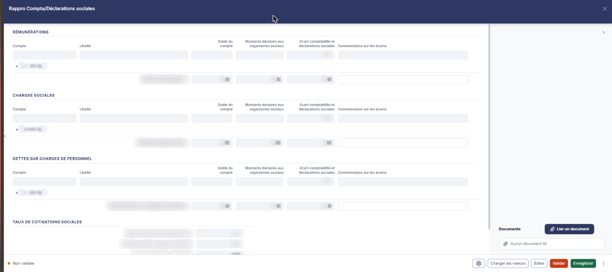
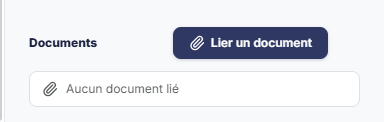

# Rapprochement compta / déclarations sociales


**Où le trouver :** Menu **Révision › Révision**



**En bref** — Cette feuille rapproche, poste par poste, la comptabilité et les déclarations sociales, et permet de justifier les écarts ; elle ne produit aucune écriture.

* Pour alimenter la feuille : bouton \[Charger les valeurs], saisissez les montants déclarés, puis bouton \[Enregistrer].
* Pour terminer : bouton \[Valider].


Cette feuille de travail vous permet de rapprocher, poste par poste, ce que porte votre comptabilité de ce qui a été déclaré aux organismes sociaux, et de justifier les écarts.

<figure><figcaption>
Écran « Révision » de la nouvelle interface
</figcaption></figure>

Le principe tient en une phrase : la comptabilité fournit le **solde du compte**, vous saisissez le **montant déclaré aux organismes sociaux**, le logiciel calcule l'**écart**, et vous l'expliquez dans un commentaire.

Comme toutes les feuilles de travail, cet écran n'est accessible que si un dossier de révision existe sur le dossier annuel ; sinon le logiciel affiche à la place le message « Veuillez créer un dossier de révision afin de pouvoir utiliser cette fonctionnalité. ».

**Cette feuille ne passe aucune écriture comptable.** À la différence de plusieurs des autres feuilles de travail, elle n'a ni carte « Ecriture » (dans la colonne de droite) ni Bouton \[Comptabiliser et valider] : c'est un état de justification, pas un écran de comptabilisation.

Le corps de l'écran se présente en quatre sous-rubriques, dans cet ordre : « Rémunérations », « Charges sociales », « Dettes sur charges de personnel » et « Taux de cotisations sociales ». La colonne de droite porte la zone « Documents ».

## Les trois tableaux de rapprochement

<figure><figcaption>
Rubrique « Les trois tableaux de rapprochement »
</figcaption></figure>

<figure><figcaption>
Rubrique « Les trois tableaux de rapprochement »
</figcaption></figure>

<figure><figcaption>
Rubrique « Les trois tableaux de rapprochement »
</figcaption></figure>

Les trois premières sous-rubriques — « Rémunérations », « Charges sociales » et « Dettes sur charges de personnel » — portent **exactement le même tableau**, aux mêmes colonnes. Seul change le libellé de leur ligne de total. Ce qui est dit ici vaut donc pour les trois.

Le tableau comporte six colonnes. À l'extrémité droite de chaque ligne, une commande sans titre de colonne n'apparaît qu'au survol de la ligne : un pictogramme « Corbeille », dont l'infobulle indique « Effacer ». Les six colonnes sont :

* **Compte** : le compte de la comptabilité que vous rapprochez. Vous le saisissez.
* **Libellé** : l'intitulé du compte, repris du plan comptable. Non modifiable.
* **Solde du compte** : repris de la comptabilité. Non modifiable.
* **Montants déclarés aux organismes sociaux :c'est la donnée que vous apportez**, celle qui ne se trouve pas dans la comptabilité.
* **Ecart comptabilité et déclarations sociales** : calculé par le logiciel, par différence entre le solde du compte et le montant déclaré. Non modifiable.
* **Commentaires sur les écarts** : texte libre, où vous justifiez l'écart constaté.

À l'ouverture d'une feuille vierge, chaque sous-rubrique n'affiche qu'une ligne, **entièrement en lecture seule** : aucune de ses cellules n'est saisissable, pas même le compte. La saisie ne s'ouvre que sur les lignes que vous ajoutez vous-même.

**Lien « + Nouvelle ligne »**

**Ce lien figure sous chacun des trois tableaux**.

**La ligne de total**

Chaque sous-rubrique se termine par une ligne de total, dont le libellé lui est propre : « Total des rémunérations : », « Total des charges sociales : » et « Total des dettes sur charges de personnel : ».

Sur cette ligne, les colonnes **Solde du compte**, **Montants déclarés aux organismes sociaux** et **Ecart comptabilité et déclarations sociales** sont calculées. En revanche, la cellule de la colonne **Commentaires sur les écarts** reste saisissable : elle vous permet de porter un commentaire de synthèse au niveau de la sous-rubrique entière, en plus des commentaires de chaque ligne.

## Sous-rubrique « Taux de cotisations sociales »

<figure><figcaption>
Rubrique « Sous-rubrique « Taux de cotisations sociales » »
</figcaption></figure>

Cette dernière sous-rubrique rapproche les deux premières et en déduit un taux moyen de cotisations, à comparer à celui de l'exercice précédent.

* **Montant total des rémunérations (N)** : reprend le total de la sous-rubrique « Rémunérations ». Non modifiable.
* **Montant total des charges sociales (N)** : reprend le total de la sous-rubrique « Charges sociales ». Non modifiable.
* **Taux de cotisations sociales (N)** : suivi du symbole %, ce libellé est affiché en gras. Le taux est calculé par le logiciel à partir des deux montants précédents. Non modifiable.
* **Taux de cotisations sociales (N-1)** : suivi du symbole %, **c'est le seul champ de cette rubrique que vous renseignez**. Le logiciel ne va pas le rechercher dans l'exercice précédent : vous l'indiquez vous-même, comme repère de comparaison.

## Zone « Documents »

<figure><figcaption>
Rubrique « Zone « Documents » »
</figcaption></figure>

Cette zone, dans la colonne de droite, vous permet de joindre à la feuille les pièces qui justifient votre rapprochement — vos bordereaux de déclaration, par exemple. Il est disponible dès l'ouverture de la feuille, sans attendre sa validation.

Un seul bouton, le bouton **\[Lier un document]**, permet d'ajouter une pièce. Tant qu'aucune pièce n'est jointe, la zone affiche « Aucun document lié ». La présentation des pièces une fois liées (colonnes, commandes) n'a pas pu être observée : aucune pièce n'était jointe.

## Le pied de la feuille

Les commandes de la feuille sont dans le pied du panneau. À gauche, la mention « Non validée » ; à droite, dans l'ordre : le pictogramme « Engrenage », le Bouton \[Charger les valeurs], le Bouton \[Éditer], le Bouton \[Valider], le Bouton \[Enregistrer] et le menu ⋮ « Autres actions ». Il n'y a pas de bouton \[Fermer] : la croix de l'en-tête referme le panneau.

bouton **\[Valider]**

Il valide la feuille. Aucune écriture n'est passée : cette feuille n'en produit pas.

bouton **\[Éditer]**

Il ouvre la fenêtre « Edition », qui rappelle le nom de la feuille et son état (« En cours »), avec la croix de fermeture, et comporte deux options : le **Format :** — boutons-bascule « Html », « Pdf » et « Excel », « Html » étant le choix proposé par défaut — et **Tronquer les libellés trop longs :**, interrupteur sans texte, activé par défaut. Le Bouton \[Edition] de cette fenêtre lance l'édition ; le Bouton \[Annuler] la referme sans rien produire.

**Pictogramme « Engrenage » (Paramétrage des comptes de révision)**

Placé à gauche du pied, il a pour infobulle « Paramétrage des comptes de révision : Charges de personnel ». Il ouvre, par-dessus la feuille, un panneau « Paramétrage des comptes de révision », qui règle les comptes de charges de personnel utilisés par la feuille. Ce panneau n'est pas propre à la feuille : à gauche, la liste des rubriques de paramétrage de toutes les feuilles, chacune suivie du nombre de ses paramètres ; un champ « Rechercher un compte, un libellé… » en haut. À l'ouverture depuis cette feuille, la rubrique « Charges de personnel » est sélectionnée : elle compte dix paramètres, soit dix lignes :

* **Racine des comptes de rémunération du personnel**
* **Congés payés**
* **Racine des comptes de charges sociales salariales**
* **Charges sociales sur congés payés**
* **Charges fiscales sur congés payés**
* **Racine des comptes de dettes auprès du personnel**
* **Dettes sur provisions congés payés**
* **Racine des comptes de dettes sur charges sociales**
* **Dettes sur charges sociales sur provisions congés payés**
* **Etat - Charges fiscales sur congés à payer**

Les lignes de **racine** désignent une famille de comptes et se saisissent directement. Sur les autres, vous saisissez un numéro de compte ; l'intitulé du compte s'affiche à droite et n'est pas modifiable.

Le panneau s'enregistre séparément de la feuille. Sur la rubrique, le Bouton \[Rétablir la rubrique] figure en haut à droite ; une ligne peut porter la pastille « Personnalisé », suivie d'un pictogramme circulaire dont l'effet n'a pas été essayé. En bas du panneau, de gauche à droite : l'état d'enregistrement (« Tout est enregistré »), le Bouton \[Charger les valeurs par défaut] et le Bouton \[Enregistrer] ; il n'y a plus de Bouton \[Annuler], et la croix de l'en-tête ferme le panneau. Le Bouton \[Charger les valeurs par défaut] porte lui-même une infobulle : « Charge les valeurs prévues et vérifie que les comptes existent dans le plan comptable du dossier. Un compte absent est signalé sur sa ligne. Rien n'est enregistré avant de cliquer sur Enregistrer. »

**Ce paramétrage est partagé avec la feuille « Provisions pour congés payés »** : les deux feuilles règlent les mêmes dix comptes de charges de personnel. Modifier un compte depuis l'une le modifie donc aussi pour l'autre — vous ne paramétrez pas deux choses distinctes.
