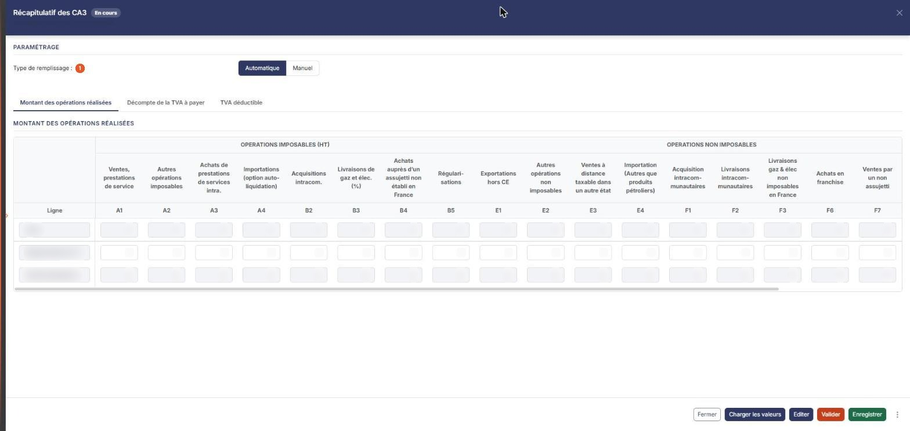

# Récapitulatif des CA3


**Où le trouver :** Menu **Révision › Révision**



**En bref** — Cette feuille récapitule, à la maille des lignes de la déclaration CA3, la TVA de l'exercice : opérations réalisées, TVA à payer et TVA déductible.

* Pour alimenter la feuille : bouton \[Charger les valeurs], puis bouton \[Enregistrer].
* Pour terminer : bouton \[Valider] (la feuille ne génère pas d'écriture).


Cette feuille de travail récapitule, sur un seul écran et à la maille des lignes de la déclaration CA3, l'ensemble de la TVA de l'exercice : le montant des opérations réalisées, le décompte de la TVA à payer et la TVA déductible.

<figure><figcaption>
Écran « Révision » de la nouvelle interface
</figcaption></figure>

Elle reprend par défaut les déclarations de TVA existantes dans le dossier annuel : vous n'y saisissez que les **régularisations de l'exercice précédent** et les **taux libres**. Tous les totaux sont calculés par le logiciel.

Comme toutes les feuilles de travail, cet écran n'est accessible que si un dossier de révision existe sur le dossier annuel ; sinon le logiciel affiche à la place le message « Veuillez créer un dossier de révision afin de pouvoir utiliser cette fonctionnalité. ».

L'écran comporte une rubrique « Paramétrage », au-dessus d'une barre de trois onglets : « Montant des opérations réalisées », « Décompte de la TVA à payer » et « TVA déductible ». Chaque onglet affiche un seul tableau, sous un titre de rubrique de même nom ; « Montant des opérations réalisées » est ouvert à l'arrivée sur la feuille. Le titre de la feuille est suivi d'une pastille d'état (« En cours » à l'ouverture). Il n'y a pas de volet Documents sur cette feuille.

## Rubrique « Paramétrage »

<figure><figcaption>
Rubrique « Rubrique « Paramétrage » »
</figcaption></figure>

Cette rubrique ne contient qu'un choix, mais c'est celui qui commande tout l'écran :

**Type de remplissage** : boutons-bascule à deux choix, « Automatique » et « Manuel ». « Automatique » est le choix actif à l'ouverture d'une feuille neuve.

**Ce qui décide qu'une cellule est saisissable**

Retenez cette règle, elle vaut pour les trois tableaux : **c'est la ligne qui décide, pas la colonne**. Au sein d'une même ligne, les colonnes suivent le même régime, à une exception près : les colonnes de totalisation restent calculées, même sur une ligne saisissable — ainsi, sur la ligne « Régularisations N-1 », les dix-huit colonnes A1 à F8 se saisissent, mais pas la colonne de total.

Sont saisissables les lignes de **régularisation de l'exercice précédent** — « Régularisations N-1 », « Régul. TVA N-1 » et « Dont TVA intra. ». Sont calculées ou reprises des déclarations de TVA du dossier annuel toutes les lignes « Total », « Total CA déclaré N », « Dont TVA N » et « Dont TVA / régul. N-1 », ainsi que l'intégralité de la rubrique « TVA déductible ».

La seule exception est la ligne **Taux** de la rubrique « Décompte de la TVA à payer », décrite plus bas.

## Onglet « Montant des opérations réalisées »

<figure><figcaption>
Rubrique « Onglet « Montant des opérations réalisées » »
</figcaption></figure>

Un tableau à double en-tête, large : il possède sa propre barre de défilement horizontal, sous le tableau.

Les colonnes sont regroupées sous trois sur-en-têtes : **OPERATIONS IMPOSABLES (HT)**, **OPERATIONS NON IMPOSABLES** et **TOTAL DES OPERATIONS IMPOSABLES 1+2+2A+2B+3+3A+3B+3C**. Une ligne d'en-tête « Ligne » rappelle, sous chaque colonne, le repère correspondant sur la déclaration CA3.

Les colonnes, dans l'ordre, avec leur repère de ligne : Ventes, prestations de service (A1) · Autres opérations imposables (A2) · Achats de prestations de services intra. (A3) · Importations (option auto-liquidation) (A4) · Acquisitions intracom. (B2) · Livraisons de gaz et élec.(%) (B3) · Achats auprès d'un assujetti non établi en France (B4) · Régularisations (B5) · Exportations hors CE (E1) · Autres opérations non imposables (E2) · Ventes à distance taxable dans un autre état (E3) · Importation (Autres que produits pétroliers) (E4) · Acquisition intracommunautaires (F1) · Livraisons intracommunautaires (F2) · Livraisons gaz & élec non imposables en France (F3) · Achats en franchise (F6) · Ventes par un non assujetti (F7) · Régularisations (F8) · MOIS · CUMUL.

Le tableau comporte trois lignes, séparées par un trait : **Total**, puis **Régularisations N-1** et **Total CA déclaré N**. Seule la ligne « Régularisations N-1 » est saisissable.

## Onglet « Décompte de la TVA à payer »

Un tableau organisé sous quatre sur-en-têtes : **Opérations réalisées en France métropolitaine**, **Opérations réalisées dans les DOM**, **Opérations imposables à un autre taux** et **Importations**. Trois lignes d'en-tête se superposent : le libellé de la colonne, la ligne **Taux** et la ligne **Ligne**, qui donne le repère CA3.

Les colonnes, dans l'ordre, avec leur repère : Taux normal 20% (8) · Taux réduit 5,5% (9) · Taux réduit 10% (9B) · Nouveau taux (9C) · Taux normal 8,5% (10) · Taux réduit 2,1% (11) · Nouveau taux (12) · Anciens taux (%) (13) · Opérations imposables à un taux particulier (14) · TVA antérieurement déduite à reverser (15) · Sommes à ajouter, y compris acompte congés (5B) · Taux normal 20,00% (I1) · Taux réduit 10,00% (I2) · Taux réduit 8,50% (I3) · Taux réduit 5,50% (I4) · Taux réduit 2,10% (I5) · Taux réduit 1,05% (I6) · Total de la TVA brute due (16) · Dont TVA sur acquisitions intracommunautaires (17) · Dont TVA sur opérations à destination de Monaco (18).

Les lignes, dans l'ordre : **Total**, puis, après un trait, **Dont TVA intra.**, **Régul. TVA N-1** et **Total CA déclaré N**, puis, après un second trait, **Dont TVA N** et **Dont TVA / régul. N-1**. Toutes ces lignes ne sont pas servies sur toute la largeur du tableau : selon la ligne, seules certaines colonnes portent une cellule.

**La ligne « Taux »**

C'est la seule ligne de l'écran où le caractère saisissable dépend de la colonne. Les colonnes à taux légal — 20 %, 10 %, 8,5 %, 5,5 %, 2,1 % et 1,05 % — affichent leur taux et ne se modifient pas.

Quatre colonnes seulement vous laissent saisir un taux : les deux colonnes **Nouveau taux**, celle de la métropole et celle des DOM, la colonne **Anciens taux (%)** et la colonne **Opérations imposables à un taux particulier**. Elles s'affichent à 100,00 % tant que vous n'avez rien indiqué.

## Onglet « TVA déductible »

Un tableau sous trois sur-en-têtes : **Déductions**, **Crédits** et **TVA à payer**.

Les colonnes, dans l'ordre, avec leur repère : Biens constituant des immobilisations (19) · Autres biens et services (20) · Autres TVA à déduire (21) · Reports du crédit de la précédente déclaration (22) · Sommes à imputer, y compris acomptes CP (2C) · Total des TVA déductibles (19 à 22) (23) · Dont TVA non-récupérable - DOM (24) · Crédits de TVA (25) · Remb. demandé (26) · Crédit de TVA transféré à la société tête de groupe sur la déclaration récapitulative 3310CA3G (AA) · Crédit à reporter (27) · TVA nette due (28) · Taxes assimilées an. 3310 A (29) · Total à payer acquitté par la société tête de groupe sur la déclaration récapitulative 3310CA3G (ligne 28 + 29) (AB) · Total à payer (32).

Trois lignes : **Total**, **Dont intra** et **Hors intra**. Aucune n'est saisissable : cette rubrique est entièrement calculée.

bouton **\[Editer]**

Il ouvre la fenêtre « Edition », qui rappelle en tête le nom de la feuille et sa pastille d'état, et comporte deux options : le **Format :** — boutons-bascule « Html », « Pdf » et « Excel », « Html » étant le choix proposé par défaut — et **Tronquer les libellés trop longs :**, interrupteur sans texte, activé par défaut. Le Bouton \[Edition] de cette fenêtre lance l'édition ; le Bouton \[Annuler] la referme sans rien produire.
