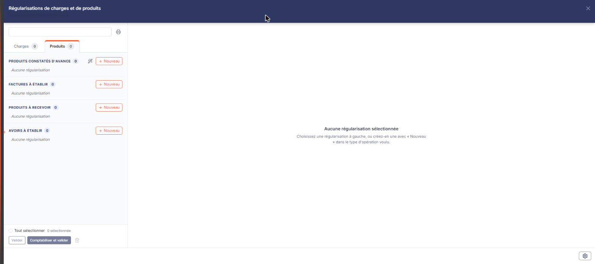
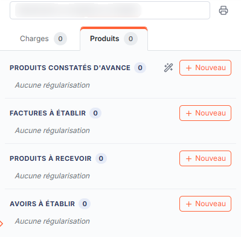
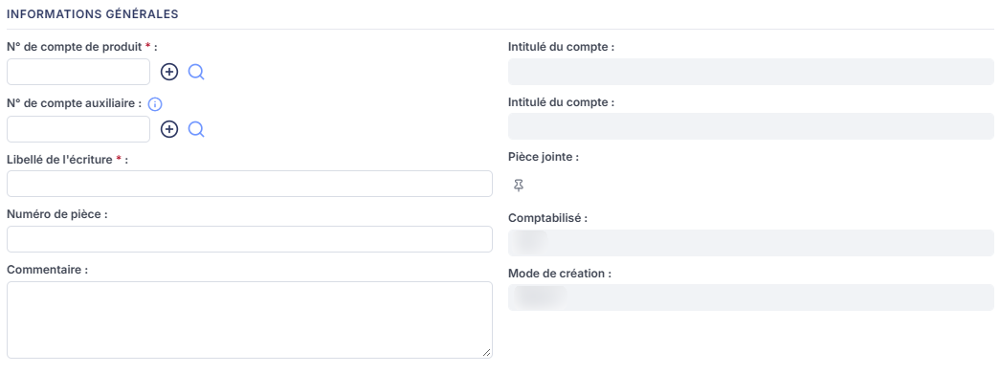
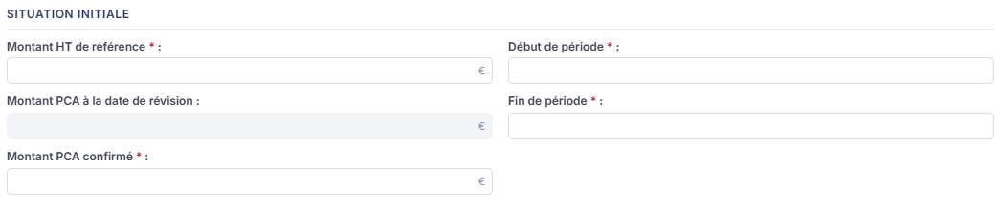
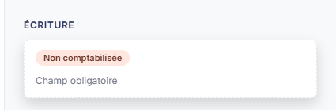

# Régularisations de produits


**Où le trouver :** Menu **Révision › Révision**



**En bref** — Cette feuille permet de saisir les factures à établir, avoirs à établir, produits à recevoir et produits constatés d'avance, avec calcul et comptabilisation des régularisations de fin d'exercice.

* Pour créer une régularisation : bouton \[+ Nouveau], renseignez la fiche, puis bouton \[Enregistrer].
* Pour comptabiliser plusieurs régularisations : sélectionnez-les dans la colonne de gauche, puis bouton \[Comptabiliser et valider].
* Pour valider sans écriture : bouton \[Valider].


Les régularisations de produits vous permettent de saisir les factures à établir (FAE), les avoirs à établir (AAE), les produits à recevoir (PAR) et les produits constatés d'avance (PCA). Vous saisissez une fiche par régularisation ; le logiciel calcule les montants de TVA et de TTC, et peut ensuite comptabiliser l'écriture correspondante.

<figure><figcaption>
Écran « Révision » de la nouvelle interface
</figcaption></figure>

Contrairement aux autres feuilles de calcul, cet écran n'est pas une feuille unique que vous remplissez : c'est un **panneau** qui regroupe, par type d'opération, les régularisations saisies, **chacune ayant sa propre fiche**. Ce panneau, « Régularisations de charges et de produits », est commun aux deux familles : il s'ouvre sur l'onglet **Produits** depuis la ligne « Régularisations de produits » de la liste des feuilles de travail.

## Comment ouvrir l'écran

<figure><figcaption>
Bouton [+ Nouveau]
</figcaption></figure>

<figure><figcaption>
Rubrique « Rubrique « Informations générales » »
</figcaption></figure>

<figure><figcaption>
Rubrique « Rubrique « Situation initiale » »
</figcaption></figure>

<figure><figcaption>
Rubrique « Rubrique « Ecriture » »
</figcaption></figure>

Il n'y a plus d'entrée de menu « Feuilles de calcul > Régularisations de produits ». Dans l'écran Révision, cliquez sur la carte **« 33 feuilles de travail »** du bandeau du haut (le nombre peut varier) : la **liste** des feuilles s'ouvre en tiroir, avec une zone « Rechercher une feuille… », des filtres de statut et les colonnes **Intitulé**, **Descriptif** et **Statut**. Cherchez la ligne « Régularisations de produits » (sur le dossier consulté, elle figure sur la seconde page de la liste ; son statut y est « Aucune ») et cliquez sur son **crayon** : un **panneau** s'ouvre à droite. Son en-tête porte « Régularisations de charges et de produits », puis « FLORE ET SENS SAS · Exercice 2026 » (votre société et votre exercice), avec une croix de fermeture. La ligne « Régularisations de charges » de la liste ouvre le même panneau sur l'onglet **Charges**.

**a) Les onglets et les blocs par type d'opération**

Dans la colonne de gauche du panneau, deux onglets, **Charges** et **Produits**, portent chacun un compteur de régularisations (« Charges 0 » et « Produits 0 » sur le dossier consulté). L'onglet **Produits** présente quatre blocs, dans cet ordre : « Produits constatés d'avance », « Factures à établir », « Produits à recevoir » et « Avoirs à établir ». Chaque bloc a son compteur et son bouton **\[+ Nouveau]** ; un bloc vide affiche « Aucune régularisation ».

Il n'y a pas de liste déroulante « Type d'opération » ni de bouton **\[Annuler le filtre]** : tous les types sont visibles en même temps, et le type d'opération se choisit en cliquant sur le \[+ Nouveau] du bloc voulu.

**b) La zone de liste, la recherche et la sélection**

Il n'y a pas de grille à colonnes : chaque bloc de la colonne de gauche liste ses régularisations.

En haut de la colonne de gauche, la zone « Rechercher un compte ou un libellé » sert à retrouver une régularisation. La zone de droite affiche « Aucune régularisation sélectionnée » : « Choisissez une régularisation à gauche, ou créez-en une avec « Nouveau » dans le type d'opération voulu. » Tant qu'aucune régularisation n'a été saisie, chaque bloc affiche « Aucune régularisation ».

Au bas de la colonne de gauche figurent une case « Tout sélectionner » suivie d'un compteur (« 0 sélectionnée »), les boutons \[Valider] et \[Comptabiliser et valider] et une corbeille (« Supprimer la sélection »). Ces commandes sont grisées tant qu'aucune régularisation n'est sélectionnée.

**c) Les commandes du panneau**

bouton **\[+ Nouveau]**

Il ouvre, dans la zone de droite, la fiche de création d'une régularisation du type du bloc. Le titre de la fiche est « Nouvelle régularisation de produit » pour les quatre types ; une pastille au-dessus du titre rappelle le type (par exemple « Produit · Factures à établir »).

**Icône imprimante (édition)**

À droite de la zone de recherche, l'imprimante (infobulle « Édition des régularisations de produits »). Elle ouvre la fenêtre « Edition des régularisations de produit », qui rappelle la feuille « Régularisations de produits » et son statut (« Aucune » sur le dossier consulté). Vous y choisissez le **Format :** — **Html**, **Pdf** ou **Excel**, le logiciel proposant **Html** — et indiquez par un interrupteur si vous souhaitez **Tronquer les libellés trop longs :** (activé par défaut) ; le bouton **\[Edition]** lance le document, le bouton **\[Annuler]** ferme la fenêtre. Elle édite les régularisations de produits.

bouton **\[Valider]**

Il valide les régularisations sélectionnées dans la colonne de gauche.

bouton **\[Comptabiliser et valider]**

Il génère l'écriture comptable des régularisations sélectionnées et les valide dans le même mouvement : la comptabilisation et la validation ne sont pas deux actions séparées.

**Baguette « Création automatique »**

Le bloc « Produits constatés d'avance » porte, à côté de son \[+ Nouveau], une baguette dont l'infobulle est « Création automatique : Produits constatés d'avance ». Elle est toujours présente, sur ce seul bloc, sans condition de filtre. Elle ouvre une fenêtre « Création automatique » qui explique : « Cette opération va créer automatiquement les feuilles de travail relatives aux produits constatés d'avances sur le fondement des écritures contenant un compte de charge et une période d'effet. Vous aurez ensuite la possibilité de modifier individuellement chaque feuille puis de procéder à la génération des écritures. » La fenêtre propose une zone **Date de calcul des PCA :** (31/12/2026 à l'ouverture, sur le dossier consulté) et les boutons \[Annuler] et \[Confirmer]. La création automatique génère les régularisations en série, sans les saisir une par une.

**Corbeille « Supprimer la sélection »**

Elle supprime les régularisations sélectionnées dans la colonne de gauche.

**Roue « Paramétrage des comptes de révision »**

La roue du pied du panneau (infobulle « Paramétrage des comptes de révision : Régularisations de produits »). Elle ouvre à droite le tiroir « Paramétrage des comptes de révision », commun à toutes les feuilles : à gauche la liste des rubriques (celle de la feuille, « Régularisations de produits », est sélectionnée d'office, avec « 5 paramètres »), à droite les cinq comptes que les écritures de régularisation utiliseront : **Factures à établir :**, **Avoirs à établir :**, **Produits constatés d'avance :**, **Produits à recevoir :** et **TVA sur FAE et AAE :**.

Chaque ligne dispose d'une zone de numéro de compte, d'un bouton \[+], d'une loupe de recherche dans le plan comptable et de l'intitulé du compte en lecture seule à sa droite ; une ligne dont le compte a été modifié porte la mention « Personnalisé ». Le bouton **\[Rétablir la rubrique]** figure en haut à droite de la rubrique.

Le pied du tiroir indique « Tout est enregistré » et porte deux boutons : le bouton **\[Enregistrer]** conserve le paramétrage, et le bouton **\[Charger les valeurs par défaut]** — dont l'infobulle précise « Charge les valeurs prévues et vérifie que les comptes existent dans le plan comptable du dossier. Un compte absent est signalé sur sa ligne. Rien n'est enregistré avant de cliquer sur Enregistrer. » — remplace votre saisie par les comptes préconisés. Il n'y a plus de bouton \[Annuler] : une croix en haut à droite referme le tiroir.

**d) La fiche d'une régularisation**

La fiche s'affiche dans la zone de droite du panneau. Elle comporte deux rubriques, dans cet ordre : « Informations générales », puis une rubrique de montants dont **le titre et les champs changent selon le type d'opération** (« Montants » ou « Situation initiale »). La rubrique « Ecriture » n'est plus un bloc du formulaire : c'est la carte « ÉCRITURE » placée en bas de la colonne de droite (voir g).

Les champs marqués d'un astérisque sont obligatoires.

**e) Rubrique « Informations générales »**

Les **deux champs de compte dépendent du type d'opération** :

* pour les **avoirs à établir**, les **produits constatés d'avance** et les **factures à établir** : **N° de compte de produit :** (obligatoire), puis **N° de compte auxiliaire :** (facultatif, avec l'infobulle « Le compte auxiliaire est facultatif. ») ;
* pour les **produits à recevoir** : **N° de compte concerné :** (obligatoire), puis **N° de compte de produits à recevoir :** (obligatoire). Le compte retenu par le paramétrage des comptes de révision (roue du pied du panneau) pour les produits à recevoir s'y affiche en filigrane, à titre de valeur par défaut ; il vaut 468700000000 dans le paramétrage standard.

Chaque champ de compte dispose d'un bouton \[+], d'une loupe de recherche dans le plan comptable, et d'un **Intitulé du compte :** en lecture seule en regard, à sa droite.

Les autres champs de la rubrique sont communs aux quatre types :

| Champ                     | Ce qu'il faut savoir                                                                                                                                                                                                                                    |
| ------------------------- | ------------------------------------------------------------------------------------------------------------------------------------------------------------------------------------------------------------------------------------------------------- |
| **Libellé de l'écriture** | C'est le libellé que portera l'écriture comptable. Sur une facture à établir, le choix du compte (essayé avec 706000000000) préremplit ce libellé (« FAE - Prestations de services 20% ») et positionne la liste **Taux de TVA :** sur « Taux normal ». |
| **Numéro de pièce**       | —                                                                                                                                                                                                                                                       |
| **Pièce jointe**          | Le pictogramme « Épingle » vous permet de rattacher un document à la régularisation. Ses commandes portent les infobulles « Lier un document », « Visualiser le document » et « Supprimer le document ».                                                |
| **Commentaire**           | Sur plusieurs lignes.                                                                                                                                                                                                                                   |
| **Comptabilisé**          | En lecture seule. Il indique « Non » tant que l'écriture n'a pas été générée.                                                                                                                                                                           |
| **Mode de création**      | En lecture seule. Il indique « Manuel » pour une régularisation que vous avez saisie vous-même.                                                                                                                                                         |

**f) La rubrique de montants, selon le type d'opération**

C'est ici que les quatre types diffèrent le plus : le **titre** de la rubrique lui-même change.

**Produits à recevoir** — rubrique « Situation initiale » : **Montant HT de référence :** (obligatoire), **Début de période :** (obligatoire ; le calendrier s'ouvre au clic dans le champ), **Fin de période :** (obligatoire ; le calendrier s'ouvre au clic dans le champ ; son infobulle précise « Il est attendu la période du fait générateur à l'origine du produit : livraison ou période de la prestation liée par exemple. »), **Montant PAR à la date de révision :** (en lecture seule, calculé), **Montant PAR confirmé :** (obligatoire) et **Taux de TVA :** (liste déroulante, suivie du signe %).

**Factures à établir** — rubrique « Montants » : **Montant HT de référence :** (obligatoire), **Début de période :** (obligatoire), **Fin de période :** (obligatoire, **préremplie avec la date de fin du dossier de révision**), **Montant FAE à la date de révision :** (en lecture seule), **Montant FAE confirmé :** (obligatoire) et **Taux de TVA :**.

**Produits constatés d'avance** — rubrique « Situation initiale » : **Montant HT de référence :** (obligatoire), **Début de période :** (obligatoire), **Fin de période :** (obligatoire, vide par défaut), **Montant PCA à la date de révision :** (en lecture seule) et **Montant PCA confirmé :** (obligatoire). **Ce type n'a pas de champ de taux de TVA.**

**Avoirs à établir** — rubrique « Situation initiale » : la rubrique se réduit à deux champs, **Montant HT de l'AAE :** (obligatoire) et **Taux de TVA :**. **Ce type ne comporte ni période ni montant confirmé.**

Là où un taux est proposé, la liste **Taux de TVA :** (choix : « Taux normal », « Tx réduit 10 », « Tx part. 2,1 », « TVA 5,5% ») apparaît grisée à l'ouverture de la fiche vide.

**g) La carte « ÉCRITURE »**

La carte « ÉCRITURE » se trouve en bas de la colonne de droite. Tant que la régularisation n'a pas été comptabilisée, elle porte une pastille « Non comptabilisée » et un message : « Champ obligatoire » à l'ouverture d'une fiche vide, puis « Aucune écriture n'a pu être générée. » une fois le compte de produit choisi sur une facture à établir. L'écriture générée par le bouton \[Comptabiliser et valider] s'y affiche ensuite.

**h) Le pied du panneau**

Le pied du panneau porte, à gauche, une pastille orange « Non validée » et, à droite, de gauche à droite : la roue « Paramétrage des comptes de révision », **\[Comptabiliser et valider]**, **\[Valider]** et **\[Enregistrer]**. Ce sont les mêmes pour les quatre types d'opération. Tant qu'aucune fiche n'est ouverte dans la zone de droite, le pied ne porte que la roue.

bouton **\[Enregistrer]**

Il enregistre la régularisation. Si un champ obligatoire est resté vide, le logiciel l'encadre en rouge et l'enregistrement n'a pas lieu ; aucun message général n'est affiché, c'est l'encadré rouge qui vous signale le champ à compléter.

bouton **\[Valider]**

Il valide la régularisation en cours de saisie.

bouton **\[Comptabiliser et valider]**

Il génère l'écriture comptable de la régularisation et la valide dans le même mouvement.

**Croix « Fermer » de l'en-tête**

Le pied n'a plus de bouton \[Fermer] : la croix de l'en-tête referme le panneau et vous ramène à la liste des feuilles de travail. Refermée sur une fiche vide, elle n'a demandé aucune confirmation ; le cas d'une fiche commencée n'a pas été revérifié. Le panneau n'a pas de bouton qui ramène à la seule liste des régularisations : pour passer à une autre régularisation, cliquez-la dans la colonne de gauche ou utilisez le \[+ Nouveau] du type voulu.

L'onglet « Charges » du même panneau est le symétrique de celui-ci, pour les charges (page « Feuilles de calcul > Régularisations de charges »).
