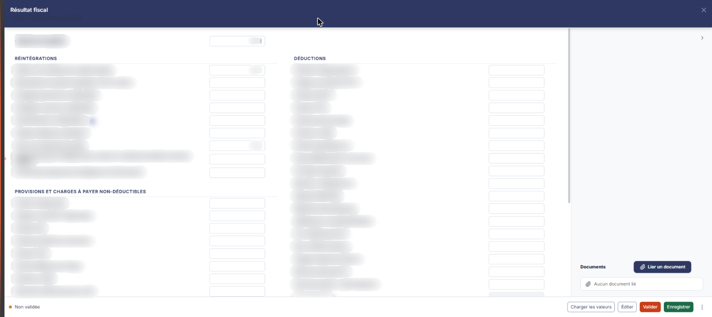
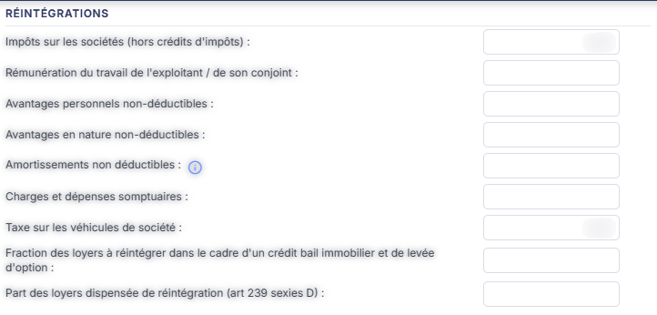
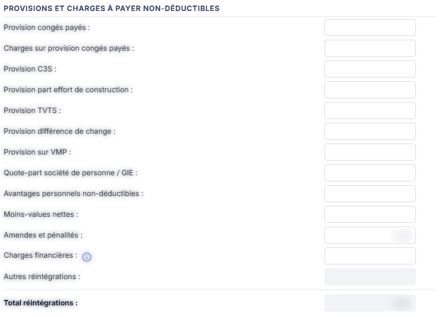
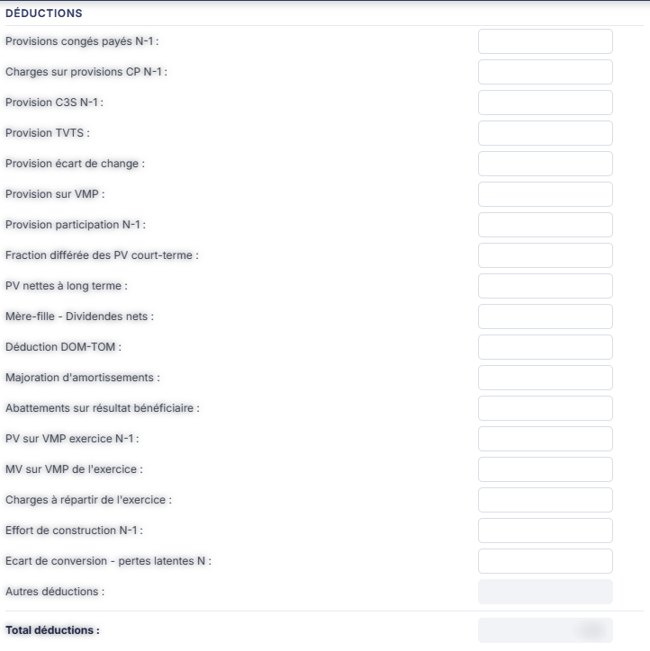
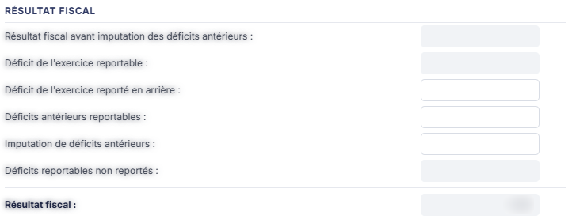

# Résultat fiscal


**Où le trouver :** Menu **Révision › Révision**



**En bref** — Cette feuille permet de passer du résultat net comptable au résultat fiscal, en recensant réintégrations et déductions puis en imputant les déficits.

* Pour alimenter la feuille : bouton \[Charger les valeurs], saisissez le résultat net comptable et vos retraitements, puis bouton \[Enregistrer].
* Pour terminer : bouton \[Valider].


Cette feuille de travail vous permet de passer du résultat net comptable au résultat fiscal, en recensant les réintégrations et les déductions de l'exercice, puis en imputant les déficits.

<figure><figcaption>
Écran « Révision » de la nouvelle interface
</figcaption></figure>

L'écran ne comporte aucun onglet. Le champ **Résultat net comptable :** ouvre le corps, seul, en tête ; viennent ensuite deux colonnes côte à côte : à gauche la rubrique « Réintégrations » suivie de la rubrique « Provisions et charges à payer non-déductibles », à droite la rubrique « Déductions » puis la rubrique « Résultat fiscal ». La rubrique « Documents » se trouve dans la colonne latérale de droite, en bas ; il n'y a pas de rubrique « Écriture ».

**a) Les trois natures de cellules — la clé de lecture de l'écran**

C'est ce qu'il faut comprendre en premier : **toutes les lignes ne se remplissent pas de la même façon**. Le pictogramme placé à droite d'une cellule vous dit à laquelle des trois natures elle appartient ; sur les cellules saisissables et composées, il n'apparaît qu'au survol de la ligne.

* **Cellule saisissable**, avec un pictogramme « Crayon » : vous pouvez saisir directement le montant, ou laisser le logiciel le reprendre de la comptabilité en modifiant la formule de la cellule. Le crayon ouvre la fenêtre de détail de la formule, décrite plus bas.
* **Cellule composée**, avec un pictogramme « Œil » : son montant ne se saisit pas dans la ligne. Il résulte des lignes de détail que vous saisissez dans la fenêtre qu'ouvre l'œil. Seules les lignes **Autres réintégrations :** et **Autres déductions :** sont de cette nature.
* **Cellule calculée**, **sans aucun pictogramme** : elle est en lecture seule et le logiciel la calcule à partir des autres. C'est le cas des totaux et des lignes du bloc « Résultat fiscal ».

**b) Champ de tête**

| Champ                                                        | Ce qu'il faut savoir                                                                                                                                                                                                                                                                                                                                                                                                                                                                                                                                                                                                                                                                                                                                                                                                                                                                                                                                                                                                                                                                                                                                                                                                                                                                                                                                                                                                                                                                                                                                                                                                                                                                                                                                                                                                                                                                                                                                                                                                                                                                                                                                                      |
| ------------------------------------------------------------ | ------------------------------------------------------------------------------------------------------------------------------------------------------------------------------------------------------------------------------------------------------------------------------------------------------------------------------------------------------------------------------------------------------------------------------------------------------------------------------------------------------------------------------------------------------------------------------------------------------------------------------------------------------------------------------------------------------------------------------------------------------------------------------------------------------------------------------------------------------------------------------------------------------------------------------------------------------------------------------------------------------------------------------------------------------------------------------------------------------------------------------------------------------------------------------------------------------------------------------------------------------------------------------------------------------------------------------------------------------------------------------------------------------------------------------------------------------------------------------------------------------------------------------------------------------------------------------------------------------------------------------------------------------------------------------------------------------------------------------------------------------------------------------------------------------------------------------------------------------------------------------------------------------------------------------------------------------------------------------------------------------------------------------------------------------------------------------------------------------------------------------------------------------------------------- |
| **Résultat net comptable**                                   | 
Saisissable. C'est le seul champ de l'écran qui ne porte <strong>aucun pictogramme de détail</strong> : il ne se paramètre donc pas par une formule. <strong>c) Rubrique « Réintégrations » (colonne de gauche)</strong> Toutes les lignes de ce bloc sont saisissables et portent un pictogramme « Crayon » : <strong>Impôts sur les sociétés (hors crédits d'impôts) :</strong>, <strong>Rémunération du travail de l'exploitant / de son conjoint :</strong>, <strong>Avantages personnels non-déductibles :</strong>, <strong>Avantages en nature non-déductibles :</strong>, <strong>Amortissements non déductibles :</strong>, <strong>Charges et dépenses somptuaires :</strong>, <strong>Taxe sur les véhicules de société :</strong>, <strong>Fraction des loyers à réintégrer dans le cadre d'un crédit bail immobilier et de levée d'option :</strong> et <strong>Part des loyers dispensée de réintégration (art 239 sexies D) :</strong>. La ligne <strong>Amortissements non déductibles :</strong> porte, à droite de son libellé, une icône d'information (ⓘ) dont l'infobulle indique : « Cette valeur est chargée depuis le module immobilisations. » ; sa zone de montant est blanche et saisissable, comme celles des lignes voisines — sa valeur ne vient donc pas de la comptabilité mais du module « Immobilisations ». <strong>d) Rubrique « Provisions et charges à payer non-déductibles »</strong> Elle prolonge la rubrique « Réintégrations », dans la colonne de gauche. Les lignes suivantes sont saisissables, avec pictogramme « Crayon » : <strong>Provision congés payés :</strong>, <strong>Charges sur provision congés payés :</strong>, <strong>Provision C3S :</strong>, <strong>Provision part effort de construction :</strong>, <strong>Provision TVTS :</strong>, <strong>Provision différence de change :</strong>, <strong>Provision sur VMP :</strong>, <strong>Quote-part société de personne / GIE :</strong>, <strong>Avantages personnels non-déductibles :</strong>, <strong>Moins-values nettes :</strong>, <strong>Amendes et pénalités :</strong> et <strong>Charges financières :</strong>.
 |
| **Autres réintégrations**                                    | Est une **cellule composée** : elle est en lecture seule et porte le pictogramme « Œil », qui ouvre sa grille de détail.                                                                                                                                                                                                                                                                                                                                                                                                                                                                                                                                                                                                                                                                                                                                                                                                                                                                                                                                                                                                                                                                                                                                                                                                                                                                                                                                                                                                                                                                                                                                                                                                                                                                                                                                                                                                                                                                                                                                                                                                                                                  |
| **Total réintégrations**                                     | 
Est <strong>calculé</strong> : en lecture seule, sans pictogramme. <strong>e) Rubrique « Déductions » (colonne de droite)</strong> Lignes saisissables, avec pictogramme « Crayon » : <strong>Provisions congés payés N-1 :</strong>, <strong>Charges sur provisions CP N-1 :</strong>, <strong>Provision C3S N-1 :</strong>, <strong>Provision TVTS :</strong>, <strong>Provision écart de change :</strong>, <strong>Provision sur VMP :</strong>, <strong>Provision participation N-1 :</strong>, <strong>Fraction différée des PV court-terme :</strong>, <strong>PV nettes à long terme :</strong>, <strong>Mère-fille - Dividendes nets :</strong>, <strong>Déduction DOM-TOM :</strong>, <strong>Majoration d'amortissements :</strong>, <strong>Abattements sur résultat bénéficiaire :</strong>, <strong>PV sur VMP exercice N-1 :</strong>, <strong>MV sur VMP de l'exercice :</strong>, <strong>Charges à répartir de l'exercice :</strong>, <strong>Effort de construction N-1 :</strong> et <strong>Ecart de conversion - pertes latentes N :</strong>.
                                                                                                                                                                                                                                                                                                                                                                                                                                                                                                                                                                                                                                                                                                                                                                                                                                                                                                                                                                                                                                                                                         |
| **Autres déductions**                                        | Est la seconde **cellule composée** de l'écran : en lecture seule, avec le pictogramme « Œil ».                                                                                                                                                                                                                                                                                                                                                                                                                                                                                                                                                                                                                                                                                                                                                                                                                                                                                                                                                                                                                                                                                                                                                                                                                                                                                                                                                                                                                                                                                                                                                                                                                                                                                                                                                                                                                                                                                                                                                                                                                                                                           |
| **Total déductions**                                         | 
Est <strong>calculé</strong> : en lecture seule, sans pictogramme. <strong>f) Rubrique « Résultat fiscal » (colonne de droite, sous les déductions)</strong>
                                                                                                                                                                                                                                                                                                                                                                                                                                                                                                                                                                                                                                                                                                                                                                                                                                                                                                                                                                                                                                                                                                                                                                                                                                                                                                                                                                                                                                                                                                                                                                                                                                                                                                                                                                                                                                                                                                                                                                                                    |
| **Résultat fiscal avant imputation des déficits antérieurs** | Calculé, en lecture seule.                                                                                                                                                                                                                                                                                                                                                                                                                                                                                                                                                                                                                                                                                                                                                                                                                                                                                                                                                                                                                                                                                                                                                                                                                                                                                                                                                                                                                                                                                                                                                                                                                                                                                                                                                                                                                                                                                                                                                                                                                                                                                                                                                |
| **Déficit de l'exercice reportable**                         | Calculé, en lecture seule.                                                                                                                                                                                                                                                                                                                                                                                                                                                                                                                                                                                                                                                                                                                                                                                                                                                                                                                                                                                                                                                                                                                                                                                                                                                                                                                                                                                                                                                                                                                                                                                                                                                                                                                                                                                                                                                                                                                                                                                                                                                                                                                                                |
| **Déficit de l'exercice reporté en arrière**                 | Saisissable, avec pictogramme « Crayon ».                                                                                                                                                                                                                                                                                                                                                                                                                                                                                                                                                                                                                                                                                                                                                                                                                                                                                                                                                                                                                                                                                                                                                                                                                                                                                                                                                                                                                                                                                                                                                                                                                                                                                                                                                                                                                                                                                                                                                                                                                                                                                                                                 |
| **Déficits antérieurs reportables**                          | Saisissable, avec pictogramme « Crayon ».                                                                                                                                                                                                                                                                                                                                                                                                                                                                                                                                                                                                                                                                                                                                                                                                                                                                                                                                                                                                                                                                                                                                                                                                                                                                                                                                                                                                                                                                                                                                                                                                                                                                                                                                                                                                                                                                                                                                                                                                                                                                                                                                 |
| **Imputation de déficits antérieurs**                        | Saisissable, avec pictogramme « Crayon ».                                                                                                                                                                                                                                                                                                                                                                                                                                                                                                                                                                                                                                                                                                                                                                                                                                                                                                                                                                                                                                                                                                                                                                                                                                                                                                                                                                                                                                                                                                                                                                                                                                                                                                                                                                                                                                                                                                                                                                                                                                                                                                                                 |
| **Déficits reportables non reportés**                        | Calculé, en lecture seule.                                                                                                                                                                                                                                                                                                                                                                                                                                                                                                                                                                                                                                                                                                                                                                                                                                                                                                                                                                                                                                                                                                                                                                                                                                                                                                                                                                                                                                                                                                                                                                                                                                                                                                                                                                                                                                                                                                                                                                                                                                                                                                                                                |
| **Résultat fiscal**                                          | 
Calculé, en lecture seule. C'est le résultat de la feuille. <strong>g) La fenêtre de détail d'une formule (pictogramme « Crayon »)</strong> Le crayon d'une cellule saisissable ouvre une fenêtre titrée du libellé de la ligne, par exemple « Cellule 'Amendes et pénalités' - Détail ». Elle vous présente deux zones : - <strong>Formule par défaut</strong> : grisée, en lecture seule. C'est la formule préparamétrée, que vous ne pouvez pas modifier mais qui reste toujours visible. - <strong>Formule actuelle</strong> : modifiable, sur plusieurs lignes. C'est elle que le logiciel applique. Tant que vous n'avez rien modifié, les deux formules sont identiques. Une série de boutons vous permet d'insérer les fonctions dans la formule, dans cet ordre : [Défaut], [Valeur], [Solde], [-Solde], [SoldeC], [-SoldeC], [SoldeD], [-SoldeD], [MvtC], [-MvtC], [MvtD] et [-MvtD]. Le bouton [Défaut] n'est pas une fonction : il restaure comme formule actuelle la formule préparamétrée. Chaque fonction attend une racine de comptes, une plage de comptes, ou une liste combinant les deux : les éléments d'une liste se séparent par des points-virgules, et les bornes d'une plage par un tiret. Ainsi la formule [Solde](6582) reprend le solde des comptes de racine 6582. Fermez la fenêtre par le bouton <strong>[Enregistrer]</strong> pour conserver la formule, ou par le bouton <strong>[Annuler]</strong> — ou par la croix de fermeture — pour la laisser inchangée. C'est la même fenêtre que sur les autres feuilles de calcul : ce mécanisme n'est pas propre au résultat fiscal. <strong>h) La fenêtre de détail d'une cellule composée (pictogramme « Œil »)</strong>
                                                                                                                                                                                                                                                                                                                                                                                                                                   |
| **Ne confondez pas les deux fenêtres**                       | 
Celle-ci ne contient aucune formule. L'œil des lignes <strong>Autres réintégrations :</strong> et <strong>Autres déductions :</strong> ouvre une fenêtre titrée du libellé de la ligne, par exemple « Cellule 'Autres réintégrations' - Détail », qui contient : • une grille de détail à trois colonnes : <strong>Libellé</strong> et <strong>Montant</strong>, suivies d'une dernière colonne sans titre, réservée aux commandes de ligne ; elle affiche « Liste vide » tant qu'aucune ligne n'a été saisie ; • un bouton <strong>[Nouvelle ligne]</strong>, qui ajoute une ligne de détail ; • un champ <strong>Montant total :</strong>, en lecture seule, grisé et non encadré en rouge à l'écran ; • les boutons [Annuler], à gauche du pied de la fenêtre, [Nouvelle ligne] et [Enregistrer], à droite, ainsi qu'une croix de fermeture dans l'en-tête.
                                                                                                                                                                                                                                                                                                                                                                                                                                                                                                                                                                                                                                                                                                                                                                                                                                                                                                                                                                                                                                                                                                                                                                                                                                                                                         |

**i) Rubrique « Documents »**

Elle vous permet de joindre à la feuille les pièces qui justifient vos retraitements. Tant qu'aucune pièce n'est jointe, la rubrique affiche la seule mention « Aucun document lié », précédée d'un pictogramme « Trombone ».

Le bouton **\[Lier un document]**, à droite du titre de la rubrique, rattache une pièce à la feuille (le tiroir qu'il ouvre n'a pas été ouvert : ce qu'il propose n'est pas décrit ici).

Cette rubrique est accessible dès l'ouverture de la feuille, sans attendre sa validation.

**j) Les commandes du pied du panneau (de gauche à droite : pastille « Non validée », \[Charger les valeurs], \[Éditer], \[Valider], \[Enregistrer], ⋮ « Autres actions » ; pas de bouton \[Fermer], la croix de l'en-tête referme le panneau)**

bouton **\[Éditer]**

Il ouvre la fenêtre d'édition de la feuille.

## Autres vues de l'écran

<figure><figcaption>
Rubrique « Réintégrations »
</figcaption></figure>

<figure><figcaption>
Rubrique « Provisions et charges à payer non-déductibles »
</figcaption></figure>

<figure><figcaption>
Rubrique « Déductions »
</figcaption></figure>

<figure><figcaption>
Rubrique « Résultat fiscal »
</figcaption></figure>

<figure><figcaption>
Rubrique « Documents »
</figcaption></figure>
