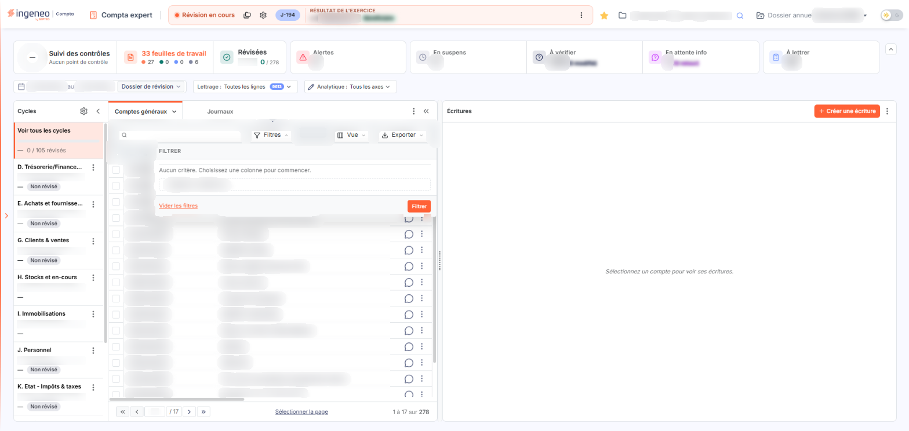
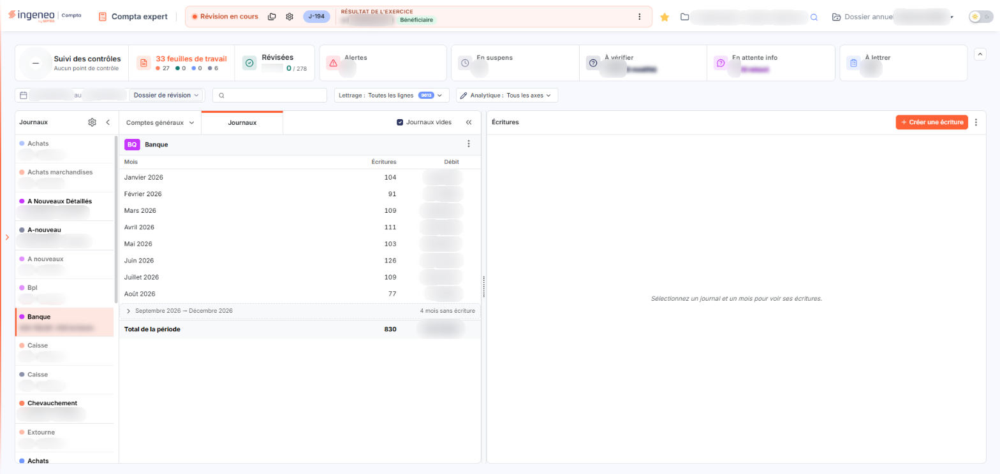
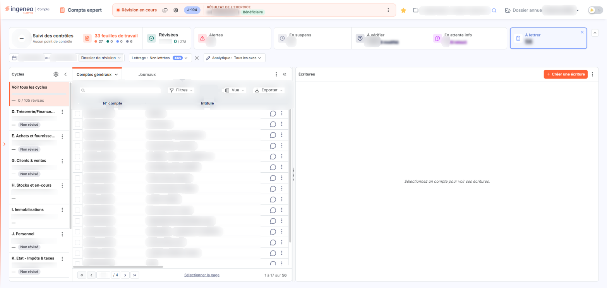
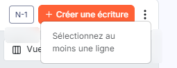

# Révision — écran de travail


**Où le trouver :** Menu **Révision › Révision**



**En bref** — C'est l'écran de travail du réviseur : à gauche les comptes, à droite les écritures du compte sélectionné, avec les commandes du module en haut de l'écran.

* Pour réviser un compte : sélectionnez-le dans la liste de gauche, puis travaillez ses écritures dans le volet de droite.
* Pour passer d'une présentation à l'autre : onglets « Comptes » et « Journaux », en haut de la liste de gauche.
* Pour lettrer : sélectionnez les lignes, puis bouton \[Lettrer].


La saisie de la révision s'effectue dans cette page. C'est l'écran de travail du réviseur : à gauche les comptes, à droite les écritures du compte que vous avez sélectionné, et, en haut de l'écran, les commandes du module.

<figure><figcaption>
Écran « Révision » de la nouvelle interface
</figcaption></figure>

**Accès et en-tête.** Quand vous ouvrez le module, vous arrivez directement sur cet écran : il n'y a plus de barre de menus. L'en-tête porte les icônes « Dossiers de révision » et « Paramétrage des comptes de révision », ainsi que le bouton ⋮ « Plus d'actions ». Le menu de ce bouton s'ouvre sur les entrées « Dossiers de révision », « Paramétrage des comptes de révision », « Rechercher », « Éditions », « Déclarations de TVA » et « Commentaires » (qui ouvre un sous-menu), puis il est rangé en rubriques : **Saisie** (Remises de chèques, Import d'écritures, Saisie de caisse, Budgets), **Abonnements** (Abonnements d'écritures), **Traitements** (Rapprochement bancaire, Lettrage automatique, Paiements, Révision groupée, Validation, Purge, Export FEC, À-nouveaux temporaires, Écritures supprimées) et **Outils** (Diagnostic, Statistiques des journaux, Raccourcis clavier). Les écrans ainsi appelés s'ouvrent dans un panneau (tiroir) à droite de l'écran, pas dans une page : cliquez sur ⋮ (Plus d'actions), puis sur l'entrée voulue, et fermez le panneau par sa croix.

Sous l'en-tête, un bandeau de cartes résume le dossier : « Suivi des contrôles » (qui indique « Aucun point de contrôle » tant qu'il n'y en a pas), « N feuilles de travail » (qui ouvre la liste des feuilles de travail en tiroir), puis « Révisées », « Alertes », « En suspens », « À vérifier », « En attente info » et « À lettrer », dont chacune restreint la liste des comptes quand vous cliquez dessus (voir a). Sous les cartes, une ligne de filtres réunit la période (deux zones de dates et un menu de périodes), le sélecteur « Lettrage : Toutes les lignes N », qui propose les choix « Toutes les lignes », « Lettrable », « Lettrées » et « Non lettrées », et le sélecteur « Analytique : Tous les axes », qui propose les axes analytiques du dossier. La flèche ^ à droite du bandeau (« Masquer les indicateurs et les filtres ») replie le bandeau et la ligne de filtres.

Dans le volet « Écritures », à droite, le bouton **\[Créer une écriture]** ouvre le panneau « Saisie d'écritures », sur toute la largeur de l'écran. Un sélecteur à trois segments y propose **\[Saisie libre]** (choisi à l'ouverture), **\[Sur trame]** et **\[Sur pièce]**. La saisie libre est un formulaire complet : choix du journal, cartes « Équilibre de l'écriture » et « Solde du compte en cours », ventilation analytique, grille (Jour, N° de compte, Compte aux., Libellé, Débit, Crédit, Devise, Référence, Actions) et bouton \[Insérer une ligne] ; le pied porte **\[Supprimer]**, **\[Enregistrer comme trame]** et **\[Enregistrer]**. \[Sur trame] et \[Sur pièce] ouvrent chacun un second panneau, « Choisir une trame » et « Choisir une pièce ». Il n'existe pas de mode « guidé » dans ce panneau.

L'écran se compose de :

* en haut, le bandeau de cartes et la ligne de filtres (période, lettrage, analytique), qui s'appliquent à la liste des comptes,
* à gauche, la liste des comptes correspondant aux filtres, précédée d'un rail de lettres (les cycles en comptes généraux, les catégories en comptes auxiliaires),
* à droite, la liste des lignes d'écritures du compte sélectionné à gauche — elle reste vide tant qu'aucun compte n'est sélectionné,
* dans l'en-tête du volet des écritures, le récapitulatif des lignes que vous avez sélectionnées (voir b),
* à la place des deux groupes de boutons d'action qui occupaient le bas de l'écran : l'en-tête, le bandeau de cartes et le bouton \[Créer une écriture] du volet des écritures, décrits plus haut.

Les deux listes sont séparées par un séparateur déplaçable : si vous cliquez sur le symbole à deux flèches situé entre les deux tableaux et que vous le déplacez latéralement, vous modulez leur largeur respective.

La flèche située en haut à droite du tableau des comptes permet de fermer totalement ce tableau, pour disposer de toute la largeur de l'écran pour les écritures. Pour revenir à l'état antérieur, cliquez sur la flèche qui s'est substituée au tableau des comptes, ou utilisez le symbole à deux flèches décrit ci-dessus.

## Les filtres de la liste des comptes

<figure><figcaption>
Rubrique « a) Les filtres de la liste des comptes »
</figcaption></figure>

<figure><figcaption>
Rubrique « a) Les filtres de la liste des comptes »
</figcaption></figure>

<figure><figcaption>
Rubrique « a) Les filtres de la liste des comptes »
</figcaption></figure>

* **Comptes / Journaux** : deux onglets, en haut de la liste, choisissent le mode de lecture. Le logiciel se positionne sur l'onglet **Comptes**, le mode décrit dans toute cette page. Sur l'onglet **Journaux**, le rail de gauche, intitulé « Journaux », liste les journaux avec, sous chacun, son total et son nombre d'écritures (en gras ceux qui portent des écritures), et la case « Journaux vides » affiche ou masque les journaux sans écriture ; le journal choisi apparaît avec son code et son intitulé, puis son tableau des mois, aux colonnes « Mois », « Écritures » et « Débit » (les mois sans écriture sont regroupés sur une ligne « N mois sans écriture », et les mois n'ont pas de jauge), terminé par une ligne « Total de la période » ; son menu ⋮ propose « Paramètres du journal » et « Éditer le journal ». Un clic sur un mois affiche à droite les écritures de ce journal pour ce mois, groupées par écriture. Dans ce mode, la liste de gauche n'a pas de barre \[Filtres] / \[Vue] / \[Exporter] et le champ « Rechercher un compte… » se trouve dans la ligne de filtres.
* **Comptes généraux / Comptes auxiliaires** : l'onglet Comptes porte un menu ⌄ qui vous fait choisir le type de comptes que vous souhaitez réviser, « Comptes généraux » ou « Comptes auxiliaires » ; le libellé de l'onglet dit le plan affiché. Le logiciel se positionne sur « Comptes généraux ».
* **Cycles** : en comptes généraux, un rail de lettres placé à gauche de la liste (**Tous**, puis D, E, G, H, I, J, K, L, M, N) restreint l'affichage aux comptes rattachés à un cycle de révision. Il ne propose que les cycles actifs auxquels des comptes du dossier sont rattachés (les cycles A, B et C, sans compte rattaché, et le cycle F, inactif, n'y figurent pas), et non l'ensemble des cycles paramétrables : c'est normal. La valeur par défaut est **Tous**.\
  \
  Le bouton « Déplier les cycles », en haut du rail, ouvre le panneau « Cycles » : « Voir tous les cycles » en tête (avec le nombre de comptes révisés sur le total, ici « 0 / 105 révisés »), puis une carte par cycle, qui porte le code et le libellé du cycle, une jauge d'avancement, le nombre de comptes révisés et le statut « Non révisé ». Le ⋮ de chaque carte propose « Réviser le cycle » et « Suivi des contrôles ». L'engrenage « Paramétrer les cycles de révision », en haut du panneau, ouvre le panneau « Cycles de révision », qui regroupe, pour chaque cycle, son interrupteur d'activation, les comptes ou racines de comptes qui lui sont rattachés et un bouton \[Modifier] ; son pied porte bouton **\[Contrôle de l'exhaustivité]**, bouton **\[Exporter]** et bouton **\[Enregistrer]**. « Replier les cycles » referme le panneau « Cycles ».
* **Catégorie** : en comptes auxiliaires, le rail de lettres propose, à la place des cycles, **Tous** puis D (**Divers**), C (**Clients**), F (**Fournisseurs**) et S (**Salariés**) ; chaque lettre porte une infobulle qui donne le nom de la catégorie, et « Déplier les catégories » ouvre le panneau correspondant (« Voir toutes les catégories », « Divers », « Clients », « Fournisseurs », « Salariés »). Tout compte auxiliaire appartient nécessairement à l'une de ces catégories, et il n'est pas possible d'en créer de nouvelles. La valeur par défaut est **Tous**.
* **Période** : deux zones de dates (« Date de début » et « Date de fin », affichées « 01/01/2026 au 31/12/2026 ») bornent la période prise en compte. Un seul pictogramme « Calendrier » les précède, et un clic dans une zone ouvre un calendrier pour choisir la date. La période proposée par défaut est variable : si un dossier de révision est activé et que vous êtes un collaborateur comptable, ce sont les dates du dossier de révision ; si un dossier de révision est activé et que vous êtes un utilisateur client du cabinet, ce sont les dates de la période de saisie du dossier annuel ; si aucun dossier de révision n'est activé, ce sont également les dates de la période de saisie du dossier annuel.\
  \
  Un menu de périodes vous évite de saisir ces dates : « Dates de l'exercice », « Dates de la période de saisie », « Dates du dossier de révision » (proposé uniquement si un dossier de révision est en cours) et « Personnalisé », pour saisir vous-même les deux bornes. Le menu s'ouvre depuis le libellé de la période en cours (ici « Dossier de révision »), et chaque choix rappelle ses dates.\
  \
  Lorsque vous sélectionnerez un compte à gauche, le logiciel affichera à droite les écritures de ce compte pour la période indiquée. La fourchette de dates agit également sur les soldes des comptes, qui ne prennent en considération que les écritures comprises dans la période.
* **Rechercher un compte…** : ce champ, en tête de la barre de la liste, s'ajoute aux filtres précédents et retient les comptes dont le numéro ou l'intitulé contient la valeur que vous saisissez ; la recherche s'applique quand vous validez par la touche Entrée. Le bouton **\[Filtres]** ouvre en outre un panneau « Filtrer » : « Ajouter un critère sur… » propose les colonnes N° compte, Intitulé, Solde, Solde n-1, Solde n-2 et Observations ; bouton **\[Filtrer]** applique les critères et bouton **\[Vider les filtres]** les supprime.
* **Filtre sur l'avancement** : les cartes du bandeau jouent ce rôle. Un clic sur une carte restreint la liste des comptes (la carte active est cernée et teintée de sa couleur, et porte une petite croix en haut à droite) ; un second clic lève le filtre. « Révisées » (**0 / 278** ici) ne fait apparaître que les comptes notés comme révisés : la liste est vide tant qu'aucun compte n'est révisé. « À vérifier » (278 ici, suivi de « (N modifié) ») affiche tous les comptes tant qu'aucun n'est révisé. « En attente info » compte des lignes d'écritures (3 ici) et réduit la liste aux comptes qui les portent (un seul ici). « À lettrer » place le sélecteur « Lettrage » sur « Non lettrées ». « Alertes » et « En suspens » restreignent de même la liste (ici 0, donc liste vide). Le panneau « Cycles » donne l'avancement cycle par cycle.
* **Lettrage** : le sélecteur « Lettrage : Toutes les lignes N » (N est le nombre de lignes de la période) ajoute un filtre relatif au lettrage. « Toutes les lignes », valeur par défaut, purge ce filtre. « Lettrable » ne fait apparaître que les comptes lettrables, hors comptes collectifs. « Lettrées » retient les lignes lettrées des comptes lettrables, et « Non lettrées » leurs lignes non lettrées, lettrage partiel inclus ; chaque choix indique son nombre de lignes et porte une infobulle. Avec « Non lettrées », la liste ne garde que les comptes concernés (56 ici). Le filtre actif s'affiche dans le sélecteur, accompagné d'une croix qui le réinitialise.\
  \
  En comptes auxiliaires, « Lettrable » n'est pas proposé : il ne reste que « Toutes les lignes », « Lettrées » et « Non lettrées ».
* **N-1** : ce bouton, non enfoncé par défaut, se trouve dans l'en-tête du volet « Écritures » (infobulle « Afficher les écritures de l'exercice précédent »). Enfoncé, il ajoute sous la liste des écritures un second tableau, « Écritures N-1 », qui reprend les écritures du même compte sur l'exercice précédent, avec son « Solde N-1 ».

## Le récapitulatif des lignes sélectionnées

Dès que vous sélectionnez au moins une ligne d'écriture, l'en-tête du volet « Écritures » affiche un récapitulatif : le nombre de lignes (« 2 ligne(s) »), puis leur **Débit**, leur **Crédit** et leur **Solde** (par exemple « Débit : 0,00 · Crédit : 2 400,00 · Solde : -2 400,00 »). Il se met à jour à chaque sélection ou désélection d'une ligne, y compris lorsque votre sélection s'étend sur plusieurs pages : « Tout sélectionner (1021) » donne les totaux des 1 021 lignes d'un compte. Il n'apparaît pas tant qu'aucune ligne n'est sélectionnée. Le tableau à deux lignes, **Compte** et **Sélection**, n'existe plus : le solde du compte est dans la liste des comptes, et le solde après chaque ligne dans la colonne Solde de la liste des écritures.

## La liste des comptes

Elle contient les comptes auxquels les différents filtres ont été appliqués. Ses colonnes sont les suivantes, et toutes peuvent servir de critère de tri : **N° compte**, **Intitulé**, **Solde**, **Solde n-1**, **Solde n-2**, **Ecart n-1 vs n-2**, **Ecart n vs n-1**, **Ecart n vs n-2**, **Ecart % n-1 vs n-2**, **Ecart % n vs n-1** et **Ecart % n vs n-2**. Le bouton \[Vue] propose en plus une douzième colonne, **Observations**, non affichée par défaut. La liste étant plus large que la fenêtre, une barre de défilement horizontale vous permet d'atteindre les dernières colonnes.

Cliquez sur le titre d'une colonne pour trier la liste ; un nouveau clic sur la même colonne inverse l'ordre du tri.

Dans cette liste, le solde est présenté avec son signe : un solde créditeur y apparaît en négatif, par exemple « -132 160,00 ». Seuls figurent dans la liste les comptes mouvementés durant l'exercice en cours, mais si vous avez choisi d'afficher les colonnes **Solde n-1** ou **Solde n-2**, les comptes mouvementés durant l'exercice ou les deux exercices précédents y figureront également.

Au-dessus de la liste, la barre porte le champ « Rechercher un compte… » et les boutons **\[Filtres]**, **\[Vue]** (choix des colonnes affichées, et « Enregistrer la vue actuelle » sous « Mes vues ») et **\[Exporter]** (aperçu, impression, export Excel ou PDF, envoi par e-mail) ; le bouton **\[Sélectionner la page]** coche toutes les lignes de la page. Le pied de la liste porte la pagination.

Chaque ligne de compte porte le bouton ⋮ « Autres actions », dont le menu propose, en tête, « Modifier le compte » (la ligne n'affiche plus de pictogramme « Crayon »), puis « Réviser le compte », « Éditer la balance », « Éditer le grand-livre » et « Réaffecter le compte » (et « Lettrage automatique » pour certains comptes).

Selon le contexte, une ligne de compte peut porter d'autres pictogrammes :

* **La boîte à cocher** : elle vous permet de sélectionner un ou plusieurs comptes en vue d'une action groupée sur cette sélection.
* **Le pictogramme « Bulle »** : il vous permet de saisir ou de modifier un commentaire concernant le compte. Il n'est présent que si un dossier de révision est actif.\
  Il ouvre le panneau « Commentaires » (onglet « Commentaire du compte ») : une zone « Contenu » pour saisir le commentaire, la rubrique « Documents » (bouton \[Lier un document]), les interrupteurs « Au niveau du compte » (activé par défaut), « Dans la synthèse du cycle », « Dans les points en suspens », « Dans la synthèse globale » et « Alerte », puis l'« Historique des commentaires » du compte (Date, Auteur, Contenu du commentaire, Origine) ; le pied porte \[Annuler] et \[Enregistrer]. Chaque commentaire est automatiquement affecté à son auteur.\
  Le commentaire sera imprimé lors de l'édition du dossier de révision, dans toutes les éditions de balance. En le précisant, vous pouvez le faire figurer également dans les points en suspens, dans la synthèse du cycle et dans la synthèse globale du dossier de révision.\
  Le pictogramme « Bulle » change de couleur selon l'état des commentaires du compte : une couleur lorsque le compte n'en porte aucun, une couleur de mise en avant dès qu'il en porte au moins un, et une troisième couleur lorsque l'un d'eux est en suspens. Ces trois couleurs viennent de votre thème.
* **Le pictogramme « W »** : il n'apparaît que sur les lignes dont le numéro de compte est utilisé dans une feuille de travail standard.

## Ce qui apparaît lorsque vous sélectionnez un compte

Tant qu'aucun compte n'est sélectionné à gauche, la liste de droite est vide et affiche « Sélectionnez un compte pour voir ses écritures. ». Un clic sur une ligne de compte (hors de ses commandes) fait apparaître ses lignes d'écritures, et l'en-tête du volet indique « Compte : » suivi du numéro et de l'intitulé. Les deux interrupteurs « A-nouveaux temporaires » et « Ecritures lettrées » ne se trouvent plus au-dessus de la liste :

* les lignes lettrées sont affichées, avec leur code dans la colonne L, dès que le sélecteur « Lettrage » est sur « Toutes les lignes » ; pour ne garder que les lignes lettrées ou non lettrées, utilisez le sélecteur « Lettrage » décrit en a) ;
* les à-nouveaux temporaires se gèrent dans le panneau « À-nouveaux temporaires » du menu ⋮ « Plus d'actions » (rubrique Traitements) : il rappelle qu'ils ne sont activables que dans un exercice disposant d'une période de saisie étendue par rapport aux dates de l'exercice, et propose de recalculer les à-nouveaux du dossier annuel (champ « Journal d'A-Nouveaux », bouton \[Valider] ; le panneau se ferme par la croix de son en-tête) ;
* les boutons bouton **\[Lettrer]** et bouton **\[Modification groupée]** apparaissent dans l'en-tête du volet dès que deux lignes au moins sont sélectionnées ; les autres actions sont dans les menus ⋮, décrits en g).

## La liste des écritures

<figure><figcaption>
Rubrique « e) La liste des écritures »
</figcaption></figure>

Elle contient les lignes d'écritures du compte sélectionné à gauche, bornées par la période choisie dans la ligne de filtres.

Contrairement à la liste des comptes, c'est ici que le sens du solde est indiqué à la suite du montant, entre parenthèses — par exemple « 132 160,00 (C) » pour un solde créditeur.

Ses colonnes de données sont, dans l'ordre : **L**, **Rapp.**, **Date**, **Jnal**, **Débit**, **Crédit**, **Solde**, **Libellé**, **Référence**, **Date d'effet**, **Date de fin**, **Compte collectif** et **Date d'échéance**. Elles sont précédées d'une colonne de sélection. Les pictogrammes de la ligne n'ont plus d'en-tête abrégé ( i ), B, F, S, C, im, V : le bouton \[Vue] les nomme « Pictogramme d'information », « Pictogramme Détail lignes de banque », « Pictogramme Feuille de travail », « Pop subsidiaire », « Pictogramme Commentaires », « Pictogramme Immobilisations », « Pictogramme Verrou » et « Pictogramme Documents », et ils s'affichent à droite de chaque ligne, avec le bouton ⋮ « Plus d'actions ». Sur les lignes relevées, on trouve la bulle d'infobulle « Commentaires », le cadenas d'infobulle « Verrouillée » et la punaise d'infobulle « Lier ». Le bouton \[Vue] propose 30 colonnes, dont 21 affichées par défaut ; celles qui ne le sont pas sont Débit en devises, Crédit en devises, Code devise, Taux de change, Quantité 1, Code quantité 1, Quantité 2, Code quantité 2 et Date d'origine. Une barre de défilement horizontale vous permet d'atteindre les dernières colonnes.

Une barre, que déplie la flèche située au milieu du bord supérieur du volet, porte le champ « Rechercher un libellé… » et les boutons **\[Filtres]** (mêmes colonnes que la liste), **\[Vue]** et **\[Exporter]**. Le pied porte la pagination et les liens « Sélectionner la page » et « Tout sélectionner (N) », où N est le nombre d'écritures du compte ; une fois la sélection faite, ils deviennent « Désélectionner la page » et « Tout désélectionner (N) ».

Pour modifier une écriture, double-cliquez sur sa ligne : le panneau « Saisie d'écritures » s'ouvre sur l'écriture (journal, équilibre, grille des lignes ; le pied porte \[Supprimer], \[Enregistrer comme trame] et \[Enregistrer]), où vous disposez des mêmes fonctionnalités qu'en saisie d'écritures. Pour visualiser une écriture sans la charger dans le panneau de modification, passez la souris sur le code journal : une fiche s'affiche, avec le numéro et le montant de l'écriture, ses lignes (compte, débit, crédit), son total et son historique (création, source) — cette possibilité est désactivée pour les écritures d'à-nouveaux trop volumineuses (la fiche indique alors « Aperçu indisponible »).

Compte tenu du grand nombre de pictogrammes pouvant être affichés sur une même ligne, leur affichage est personnalisable : utilisez le bouton \[Vue] de la liste pour choisir les colonnes et les pictogrammes affichés.

* **La colonne « ( i ) »** : en survolant le pictogramme avec la souris, vous affichez un tableau d'informations complémentaires sur la ligne d'écriture : la date de création et le nom de l'utilisateur qui l'a créée, la **source** — c'est-à-dire la provenance de l'écriture, celle qui sert à déterminer le taux de digitalisation du dossier — et la date de validation. Selon la ligne, cette infobulle peut également porter la date et l'auteur de la dernière modification, la date d'échéance, la date de l'écriture d'origine, la date et le code du rapprochement bancaire pour les écritures de banque, la date et le code de lettrage ainsi que le nom de l'utilisateur qui l'a effectué, la devise, le montant en devise et le taux de change, ou encore la quantité.
* **La colonne « B », pictogramme « Bulle »** : elle vous permet de saisir ou de modifier un commentaire concernant l'écriture. Elle n'est renseignée que si un dossier de révision est actif.\
  Le pictogramme ouvre une fenêtre reprenant tous les commentaires déjà saisis pour l'écriture. Chaque commentaire est automatiquement affecté à son auteur.\
  En le précisant, vous pouvez faire figurer le commentaire, lors de l'édition du dossier de révision, à la suite du compte dans les éditions de balance, dans les points en suspens, dans la synthèse du cycle et dans la synthèse globale. Le fait d'inclure le commentaire de l'écriture au compte le rend également accessible et modifiable par le pictogramme « Bulle » du compte.\
  Le pictogramme est affiché en bleu si aucun commentaire n'a été saisi sur l'écriture, et en vert s'il en existe au moins un.
* **La colonne « C », pictogramme de commentaire de révision** : ses deux pictogrammes portent les infobulles « Commentaire de révision » et « Commentaire de la ligne ». Une ligne d'écriture peut en effet porter deux commentaires de nature différente :\
  \- le **commentaire de saisie**, saisissable et visible dans la saisie en journal et dans la fenêtre de modification de l'écriture ;\
  \- le **commentaire de révision**, saisissable et visible dans la révision, et seulement lorsque vous travaillez sur le dossier de révision dans lequel il a été saisi.\
  Pour les distinguer, les pictogrammes des commentaires liés à la révision contiennent la lettre « R ». Vous pouvez récupérer dans le dossier de révision tout ou partie des commentaires de saisie des lignes d'écritures, à l'aide du bouton **\[Import commentaires]** du menu bouton **\[Commentaires]**.
* **La colonne « Document »** : elle concerne la pièce jointe à la ligne d'écriture et fonctionne comme dans la saisie sur pièce. Elle peut porter plusieurs pictogrammes différents.\
  \
  **Pictogramme « Punaise » :** son infobulle indique « Lier ». Tant qu'aucun document n'est lié à la ligne d'écriture, la colonne ne porte que ce pictogramme, qui vous permet de lier un document en le chargeant depuis votre poste, depuis la GED, depuis l'OCR ou depuis l'écriture. Une fois l'origine indiquée, cliquez sur le bouton **\[Lier le document]** pour choisir le document.\
  \
  Chargement « Depuis mon poste » : le logiciel ouvre le navigateur de fichiers pour que vous sélectionniez la pièce à joindre.\
  \
  Chargement « Depuis la GED » : le logiciel ouvre l'arborescence de la GED, dans laquelle vous choisissez votre document. Il faut que vous ayez accès au module « GED » pour utiliser cette fonction. L'option supplémentaire « Supprimer la pièce d'origine » vous permet de supprimer le document de la GED une fois qu'il aura été lié à l'écriture.\
  \
  Chargement « Depuis l'OCR » : le logiciel affiche la liste des documents présents dans le module « OCR » et qui n'ont pas encore été traités. Vous pouvez les filtrer en saisissant un mot-clé dans la cellule « Document » : seuls les documents contenant ce mot dans leur intitulé seront alors affichés. Ici aussi, l'option « Supprimer la pièce d'origine » vous permet de supprimer le document de l'OCR une fois qu'il aura été lié à l'écriture.\
  \
  Chargement « Depuis l'écriture » : il vous permet de joindre à la ligne un document déjà présent sur une autre ligne de la même écriture. Cela vous évite de nombreuses manipulations lorsque vous ajoutez une ligne à une écriture et que vous voulez y joindre le même document que sur les autres lignes. Si les autres lignes ne portent pas toutes le même document, le logiciel vous les propose dans un sélecteur.\
  \
  **Pictogramme « Œil » :** il n'apparaît que lorsqu'un document est attaché à la ligne d'écriture, et vous permet de prévisualiser le fichier joint. La prévisualisation n'est possible qu'avec certains types de fichiers.\
  \
  **Pictogramme « Flèche-bas » :** il n'apparaît que lorsqu'un document est attaché à la ligne, et vous permet de télécharger la pièce jointe.\
  \
  **Pictogramme « Feuilles avec croix » :** il n'apparaît que lorsqu'un document est attaché à la ligne, et vous permet de supprimer la pièce jointe.
* **La colonne « im »** : son pictogramme n'apparaît que si le compte de la ligne est un compte d'immobilisation, tel que sa racine a été paramétrée dans les paramètres généraux. Si aucune fiche d'immobilisation n'est encore liée à la ligne, le clic sur ce pictogramme affiche dans une fenêtre toutes les fiches d'immobilisations saisies dans le module « Immobilisations » dont le compte est identique à celui de la ligne. Vous pouvez alors visualiser les fiches à l'aide des pictogrammes « Œil », les sélectionner à l'aide des boîtes à cocher, puis enregistrer votre choix à l'aide du bouton **\[Valider]**.\
  Si une ou plusieurs fiches sont déjà liées, le clic sur le pictogramme affiche la fenêtre contenant la liste des immobilisations liées. Vous pouvez y visualiser les fiches à l'aide des pictogrammes « Œil », ou supprimer un lien de rattachement à l'aide du pictogramme « Croix ».
* **La colonne « V »** : son pictogramme porte l'infobulle « Verrouillée » et indique que l'écriture a été validée.

## La sélection et le déplacement des écritures

* **La sélection d'écritures** vous permet d'effectuer ensuite un traitement sur le groupe d'écritures retenu — lettrage, déplacement, modification groupée. Vous pouvez sélectionner des écritures de plusieurs manières :\
  \
  \- une par une, en cliquant sur la boîte à cocher de chaque ligne, ou à un autre endroit de la ligne qui ne soit pas un pictogramme,\
  \- toutes les lignes de la page, avec le lien « Sélectionner la page » du pied de la liste, ou toutes les lignes du compte, avec « Tout sélectionner (N) »,\
  \- au clavier : CTRL-Clic sur une ligne l'ajoute à la sélection ; SHIFT-Clic pour désigner la première ligne, qui s'affiche en rose ; de nouveau SHIFT-Clic pour désigner la dernière ligne, et toutes les lignes comprises entre les deux s'affichent en rouge.\
  \
  Le total débit, le total crédit et le solde des écritures sélectionnées se mettent à jour à chaque sélection ou désélection, dans le récapitulatif de l'en-tête du volet « Écritures » (voir b).\
  \
  Si le compte présente un grand nombre d'écritures réparties sur plusieurs pages, votre sélection peut porter sur plusieurs de ces pages : les valeurs débit, crédit et solde tiennent compte des écritures sélectionnées dans toutes les pages.\
  \
  Pour désélectionner des lignes, effectuez les opérations inverses : « Désélectionner la page » et « Tout désélectionner (N) » dans le pied de la liste, ou CTRL-Clic sur une ligne sélectionnée.
* **Le déplacement d'écriture(s) par glisser-déposer** vous permet de déplacer des écritures d'un compte général vers un autre compte général, ou d'un compte auxiliaire vers un autre compte auxiliaire. Cliquez sur le libellé de l'écriture et utilisez la fonction glisser-déposer de la souris : une petite fenêtre sur fond rose apparaît, positionnez-la sur un des comptes de la liste de gauche et relâchez le bouton de la souris pour y transférer l'écriture.\
  \
  Vous pouvez transférer plusieurs écritures simultanément, en les sélectionnant d'abord puis en utilisant la même fonction. Si elles se répartissent sur plusieurs pages, leur déplacement s'opérera pour toutes les lignes sélectionnées dans toutes les pages.\
  \
  Pour éviter toute manœuvre intempestive, au moment où vous relâchez la souris, le logiciel vous demande une confirmation en vous affichant le numéro de compte de destination.\
  \
  Le compte de destination peut se trouver sur une autre page de la liste des comptes : après sélection des lignes d'écritures, naviguez dans les pages jusqu'à trouver celle qui contient le compte de destination et, sans cliquer sur ce compte, effectuez le glisser-déposer.

## Les boutons d'action

<figure><figcaption>
Rubrique « g) Les boutons d'action »
</figcaption></figure>

<figure><figcaption>
Rubrique « Le menu ⋮ du volet « Écritures » »
</figcaption></figure>

Dans la nouvelle interface, ces commandes ne forment plus deux groupes de boutons en bas de l'écran : elles sont réparties entre le menu ⋮ « Plus d'actions » de l'en-tête, les menus ⋮ des deux listes et quelques boutons qui n'apparaissent que dans un contexte précis (plusieurs écritures sélectionnées, dossier de révision actif). Celles qui concernent les comptes sont dans la liste de gauche, celles qui concernent les lignes d'écritures dans le volet de droite.

* **Le menu ⋮ de la liste des comptes**, en haut à droite de la liste, agit sur le compte sélectionné : il affiche « Sélectionnez au moins un compte » tant qu'aucun n'est sélectionné, puis « Sur le compte » suivi du numéro, avec les entrées « Lettrage automatique », « Réviser le compte », « Réaffecter le compte », « Éditer la balance » et « Éditer le grand-livre ». Le ⋮ de chaque ligne de compte propose les mêmes entrées, sauf « Lettrage automatique », présent seulement pour certains comptes.
* **Le menu ⋮ du volet « Écritures »** agit sur la sélection : il affiche « Sélectionnez au moins une ligne » tant qu'aucune ligne n'est sélectionnée, puis « Sur la ligne sélectionnée » (« Sur la sélection : N lignes » pour plusieurs lignes), avec les entrées « Écriture d'ajustement », « Autres ajustements », « Modification d'échéance », « Copier », « Contrepasser », « Extourner », « Rechercher ce montant » (« Rechercher ces montants »), « Lier à un abonnement » et « Supprimer » ; « Lettrage partiel » (plusieurs lignes) ou « Délettrer » (ligne lettrée) s'y ajoute en tête. Le ⋮ de chaque ligne d'écriture propose « Ajouter une pièce », « Copier », « Contrepasser », « Extourner », « Déplacer », « Ajustement », « Créer une règle de traduction », « Enregistrer comme trame », « Rechercher », « Rechercher ce montant », « En attente info » et « Supprimer ». Les entrées « Modification d'échéance », « Lier à un abonnement », « Ajouter une pièce », « Déplacer », « Créer une règle de traduction », « Enregistrer comme trame », « Rechercher » et « En attente info » ne sont pas décrites dans cette page : aucune n'a été activée au relevé.
* **L'entrée « Raccourcis clavier » du menu ⋮ « Plus d'actions »** (rubrique Outils) ouvre la fenêtre « Raccourcis clavier de la révision », qui récapitule les raccourcis disponibles en quatre tableaux : **Liste de comptes**, **Toutes les fenêtres**, **Boutons d'actions** et **Lignes d'écritures**.
* **Éditer la balance (⋮ d'un compte)** : il lance l'impression de la balance générale ou auxiliaire, selon le type de comptes que vous avez choisi dans les filtres. Si vous avez sélectionné un compte, il sera prérenseigné dans les critères de l'édition.
* **Éditer le grand-livre (⋮ d'un compte)** : il lance l'édition du grand-livre général ou auxiliaire, selon le type de comptes que vous avez choisi dans les filtres. Si vous avez sélectionné un compte, il sera prérenseigné dans les critères de l'édition.
* **Rechercher** : l'entrée « Rechercher » du menu ⋮ « Plus d'actions » ouvre le panneau « Rechercher une écriture » (« Lancez une recherche · exercice 2026 »), dont la partie haute définit la recherche et la partie basse, intitulée « Résultats », affiche les lignes trouvées. Un champ unique, « Rechercher : libellé, compte, montant, date… », remplace les anciens critères : selon son infobulle, les mots cherchent dans le libellé ou dans le début d'un compte auxiliaire, les nombres dans le montant (débit ou crédit) ou dans le début d'un numéro de compte, les dates (jj/mm ou jj/mm/aaaa) dans la date d'écriture ; un texte entre guillemets est toujours cherché dans le libellé. La zone « ± Écart » fixe l'écart toléré sur les montants. Sans critère, la liste porte toutes les lignes de la période. Elle propose \[Filtres], \[Vue] et \[Exporter], et le bouton \[Déplacer vers un compte], inactif tant qu'aucune ligne n'est cochée. Le pied rappelle : cochez des lignes pour un déplacement groupé, ou cliquez sur une ligne pour la sélectionner. Il n'y a plus de boutons \[Rechercher] et \[Vider].\
  \
  **Résultats :** ils sont d'abord triés par date, mais vous pouvez changer cet ordre en utilisant le tri des colonnes, comme dans n'importe quelle liste du logiciel. Vous pouvez aussi personnaliser les champs affichés à l'aide du pictogramme de choix des colonnes. Si vous cliquez sur une des lignes de résultats, les listes en arrière-plan sont mises à jour : celle des comptes est filtrée sur le seul compte de la ligne, et celle de droite affiche les écritures de ce compte, la ligne concernée étant surlignée en rouge — elle n'est pas forcément visible d'emblée si le compte porte beaucoup d'écritures. Si vous fermez la fenêtre de recherche, la sélection en arrière-plan est conservée.
* **Rechercher ce montant (⋮ de la ligne ; « Rechercher ces montants » pour plusieurs lignes sélectionnées) :** cette fonction est également accessible par le raccourci clavier Ctrl-Alt-M. Elle fonctionne comme la recherche normale, à cette différence près que les critères sont renseignés automatiquement pour rechercher les lignes portant le même montant que celle sur laquelle vous étiez positionné lorsque vous avez cliqué sur le bouton ou utilisé le raccourci clavier.
* **Recherche - Info client** : cette entrée du menu **\[Recherche]** vous donne accès aux informations du client.
* **Créer une écriture** : le bouton \[Créer une écriture], placé dans le volet « Écritures », ouvre le panneau « Saisie d'écritures » décrit plus haut.
* **Lettrage partiel (⋮ du volet « Écritures », avec plusieurs lignes sélectionnées)** : il affecte un code de lettrage partiel à un groupe d'écritures dont le solde n'est pas égal à zéro. Contrairement aux écritures lettrées, le code affecté aux écritures lettrées partiellement est un chiffre entre parenthèses. Les écritures lettrées partiellement ne sont pas considérées comme lettrées et restent donc disponibles à la sélection pour le lettrage.
* **Lettrer (bouton \[Lettrer] de l'en-tête du volet « Écritures », proposé quand plusieurs lignes sont sélectionnées) :** cette action n'est possible que si le solde des écritures sélectionnées est égal à zéro ; dans ce cas, les lignes sélectionnées passent d'un affichage rouge à vert et se voient attribuer le même code lettrage.\
  Le code lettrage commence à la lettre A, puis, après Z, il prend la valeur AA jusqu'à AZ, et ainsi de suite jusqu'à cinq lettres. La série des codes lettrage est indépendante pour chaque compte.\
  Les écritures lettrées affichent leur code lettrage dans la colonne L ; elles restent visibles tant que le sélecteur « Lettrage » est sur « Toutes les lignes ».
* **Lettrage automatique (⋮ du compte)** : il lance le lettrage automatique des écritures du compte. L'entrée du même nom du menu ⋮ « Plus d'actions » (rubrique Traitements) n'a pas été ouverte au relevé.
* **Délettrer (⋮ du volet « Écritures », quand la ligne sélectionnée est lettrée)** : le délettrage fonctionne à l'inverse du lettrage. Si vous n'avez pas sélectionné toutes les lignes portant un même code lettrage, le logiciel le fera pour vous avant la demande de validation, en vous affichant le nombre de lignes sélectionnées. Si le compte présente un grand nombre d'écritures, des lignes peuvent avoir été sélectionnées dans plusieurs pages, entre lesquelles vous pouvez naviguer pour les visualiser. Une fois le code lettrage supprimé, les écritures sont de nouveau disponibles pour le lettrage.
* **Écriture d'ajustement (⋮ du volet « Écritures »)** : il vous permet de passer, lors du lettrage, une écriture qui soldera un groupe d'écritures sélectionnées, à condition que le montant du solde soit inférieur au seuil défini dans l'écran « Configuration » (ancien « Paramètres généraux ») de la rubrique « Compta expert » du panneau Paramètres, rubrique « Lettrage - Ecritures d'ajustement ».\
  \
  \
  \
  La fenêtre de saisie de l'écriture est prérenseignée avec les paramètres par défaut, qui restent modifiables pour chaque écriture d'ajustement.\
   
* **Supprimer (⋮ du volet ou de la ligne)** : il supprime les écritures sélectionnées.
* **Copier (⋮ du volet ou de la ligne)** : il crée une copie des écritures sélectionnées.
* **Contrepasser (⋮ du volet ou de la ligne)** : il génère, dans le même mois-journal, une écriture aux montants exactement inverses de ceux de l'écriture sélectionnée.
* **Extourner (⋮ du volet ou de la ligne)** : il génère, dans un autre mois-journal, une écriture aux montants exactement inverses de ceux de l'écriture sélectionnée. Si une des lignes de l'écriture porte un compte interdit dans le journal de destination, l'opération est refusée. Si le jour de l'écriture n'existe pas dans le mois de destination — un 31 janvier extourné vers le mois de février —, il est automatiquement remplacé par le dernier jour du mois de destination.
* **Autres ajustements (⋮ du volet « Écritures »)** : il donne accès aux autres ajustements possibles sur les écritures sélectionnées.
* **Modification groupée (bouton de l'en-tête du volet « Écritures »)** : ce bouton n'apparaît que si vous avez sélectionné plusieurs écritures. Il vous permet d'appliquer les mêmes modifications à toutes les écritures sélectionnées : le numéro de compte, le numéro de compte auxiliaire, le libellé et la référence. Si vous n'indiquez pas de nouvelle valeur pour un champ, la valeur d'origine est conservée. Si les écritures sélectionnées se répartissent sur plusieurs pages, la modification groupée s'opère sur chacune d'entre elles.
* **Tout désélectionner** : le lien « Tout désélectionner (N) » du pied de la liste désélectionne toutes les écritures du compte (« Désélectionner la page » : celles de la page) ; le bouton \[Annuler] n'existe plus.

## Les boutons liés au dossier de révision

Les actions qui suivent n'ont de sens que si un dossier de révision est actif : elles n'apparaissent donc pas lorsque le dossier annuel n'en comporte aucun.

Elles sont présentées ci-dessous par famille. Dans la nouvelle interface, il n'y a plus de menus « Révision », « Commentaires » et « Recherche », ni de boutons « Suivi des contrôles » et « Feuilles de travail » : on y accède par les cartes du bandeau, par le panneau « Cycles », par les menus ⋮ des comptes et par le menu ⋮ « Plus d'actions » de l'en-tête. L'entrée « Commentaires » de ce menu ouvre un sous-menu qui propose, dans cet ordre, **Validation de l'expert-comptable**, **Supervision terminée**, **Révision terminée**, **Synthèse globale**, **Points en suspens**, **Synthèse du cycle** et **Import commentaires**.

* **Suivi des contrôles** : l'entrée « Suivi des contrôles » du ⋮ d'un cycle, dans le panneau « Cycles », ouvre le panneau « Suivi des contrôles » (« Exercice 2026 · 0 / 0 points traités »), qui contient la liste de tous les points de contrôle du dossier de révision. La carte du même nom du bandeau indique l'avancement (« Aucun point de contrôle » ici) ; cliquée dans cet état, elle n'a rien ouvert. À gauche, la liste « Cycles » (16 cycles de contrôle, de « A. Synthèse » à « N. Autres comptes de résultat », avec un champ « Rechercher un cycle ») remplace la liste déroulante « Cycle de révision » : le cycle choisi affiche à droite ses points et le nombre de points traités. Le pied propose, pour le cycle choisi, « Tout à Oui », « Tout à Non », « Tout à Non applicable » et « Tout à Non significatif », puis bouton **\[Nouveau point de contrôle]**, bouton **\[Annuler]** et bouton **\[Enregistrer]**. Le panneau se referme par sa croix, par \[Enregistrer], qui conserve vos saisies, ou par \[Annuler], qui les abandonne. Tant que le dossier de révision ne repose sur aucun plan comportant des points de contrôle, le panneau affiche « Aucun point de contrôle dans ce cycle. ».\
  \
  Un point de contrôle peut avoir le statut « Non effectué », « Effectué », « Non applicable » ou « Non significatif ». Si un point de contrôle est effectué, l'utilisateur qui a effectué le contrôle et la date du contrôle sont mémorisés ; la mémorisation s'effectue lorsque vous cliquez sur le bouton d'enregistrement. Le fait de ramener le statut d'un point de contrôle de « Effectué » à « Non effectué » ou « Non applicable » purge les informations relatives au contrôle enregistré antérieurement.\
  \
  Vous pouvez filtrer les contrôles selon leur état, à l'aide de cinq onglets, qui indiquent chacun le nombre de points concernés : bouton **\[Tous]**, bouton **\[Non effectués]**, bouton **\[Effectués]**, bouton **\[Non applicables]** et bouton **\[Non significatifs]** ; c'est sur le premier que le panneau s'ouvre.\
  \
  Chaque ligne de point de contrôle peut porter des pictogrammes :\
  \- **Pictogramme « ( i ) » :** au survol de la souris, il affiche le descriptif complet du point de contrôle.\
  \- **Pictogramme « Bulle » :** il vous permet d'administrer tous les commentaires du point de contrôle, et leurs pièces jointes, qu'ils aient été créés à ce niveau ou par une autre fonction du logiciel.\
  \- **Pictogramme « W » :** il n'apparaît que si une feuille de travail standard a été jointe au point de contrôle, et l'ouvre.
* **Révision - Compte révisé** : l'entrée « Réviser le compte » (⋮ de la ligne du compte, ou ⋮ de la liste des comptes quand le compte est sélectionné) indique qu'un compte est révisé. Le numéro d'un compte révisé apparaît en vert dans la liste des comptes.\
  **Attention :** le fait qu'un compte soit révisé n'interdit pas le passage d'écritures sur ce compte.
* **Révision - Cycle révisé** : l'entrée « Réviser le cycle » du ⋮ de chaque cycle, dans le panneau « Cycles », ne concerne que les comptes généraux. Elle a la même action que « Réviser le compte », mais pour tous les comptes du cycle simultanément. Si des comptes du cycle avaient déjà été notés comme révisés, la date de cette opération est remplacée par la date de révision de tout le cycle.
* **Révision - Compte dérévisé** : ce bouton n'apparaît que si le compte sélectionné a été noté comme révisé. Il annule cette opération.
* **Révision - Révision groupée** : l'entrée « Révision groupée » du menu ⋮ « Plus d'actions » (rubrique Traitements) effectue la même opération que « Réviser le compte », mais pour tous les comptes sélectionnés à l'aide des boîtes à cocher. Le logiciel vous rappelle alors le nombre total de comptes sélectionnés, pour le cas où votre sélection porterait sur plusieurs pages. Il vous propose également, si vous activez l'option, de noter comme révisés tous les comptes dont le solde est à zéro.
* **Révision - Dérévision groupée** : il effectue la même opération que le bouton **\[Compte dérévisé]**, mais pour tous les comptes sélectionnés à l'aide des boîtes à cocher. Le logiciel vous rappelle le nombre total de comptes sélectionnés.
* **Révision - Contrôle** : il vérifie que les comptes notés comme révisés n'ont pas été modifiés depuis, par l'ajout, la modification ou la suppression d'une écriture. Le cas échéant, une fenêtre affiche la liste des comptes altérés.
* **Feuilles de travail** : il affiche la liste des feuilles de travail standards et personnalisées du dossier de révision. Dans la nouvelle interface, c'est la carte « N feuilles de travail » du bandeau qui ouvre cette liste en tiroir ; le crayon d'une ligne ouvre la feuille dans un panneau, sans avoir à passer par un menu.
* **Commentaires - Synthèse du cycle** : ce bouton n'apparaît que pour les comptes généraux. Il présente la liste des commentaires concernant le cycle choisi dans le rail des cycles.\
  \
  Pour qu'un commentaire figure dans la synthèse du cycle, il faut que l'option « Faire figurer dans la synthèse du cycle » ait été choisie lors de la saisie du commentaire sur le compte ou sur l'écriture. Un commentaire peut être :\
  \- d'ordre général ; il est alors saisi à l'aide de ce bouton,\
  \- relatif à un compte ; il est alors saisi comme un commentaire de compte dont vous demandez l'intégration à la synthèse du cycle,\
  \- relatif à une écriture ; il est alors saisi comme un commentaire d'écriture dont vous demandez l'intégration à la synthèse du cycle.\
  \
  Ce bouton vous permet donc de visualiser tous les commentaires du cycle et d'en créer de nouveaux. La colonne « Origine » indique où le commentaire a été créé.\
  \
  **Attention :** la suppression d'un commentaire dans ce tableau supprime également le commentaire d'origine saisi dans le compte ou dans l'écriture.\
  \
  **Supervision des synthèses de cycle :** les synthèses de cycle doivent faire l'objet d'un visa de supervision. Cliquez sur le bouton éponyme : le nom de l'utilisateur et la date de validation sont automatiquement affectés, sans possibilité de modification, pour garantir le suivi. Vous pouvez saisir un commentaire, puis vous devez cliquer sur le bouton **\[Enregistrer]**.\
  Si un utilisateur saisit de nouveaux commentaires après le visa de supervision du cycle, ils sont affichés en rouge. Même si un visa a déjà été apposé, vous pouvez l'enregistrer une nouvelle fois : ce sont les données de la dernière validation qui sont conservées.
* **Commentaires - Points en suspens** : la liste des points en suspens est un élément obligatoire de l'édition du dossier de révision.\
  \
  Un point en suspens est un commentaire qui peut être :\
  \- d'ordre général ; il est alors saisi à l'aide de ce bouton,\
  \- relatif à un compte ; il est alors saisi comme un commentaire de compte dont vous demandez l'intégration à la liste des points en suspens,\
  \- relatif à une écriture ; il est alors saisi comme un commentaire d'écriture dont vous demandez l'intégration à la liste des points en suspens.\
  \
  Ce bouton vous permet donc de visualiser tous les points en suspens et d'en créer de nouveaux. La colonne « Origine » indique où le commentaire a été créé.\
  \
  **Attention :** la suppression d'un point en suspens dans ce tableau supprime également le commentaire d'origine saisi dans le compte ou dans l'écriture.\
  \
  **Supervision des points en suspens :** les points en suspens doivent faire l'objet d'un visa de supervision. Dans la fenêtre de visualisation des points en suspens, cliquez sur le bouton éponyme : le nom de l'utilisateur et la date de validation sont automatiquement affectés, sans possibilité de modification. Vous pouvez saisir un commentaire, puis vous devez cliquer sur **\[Enregistrer]**.\
  Si un utilisateur saisit de nouveaux points en suspens après le visa de supervision, ils sont affichés en rouge. Même si un visa a déjà été apposé, vous pouvez l'enregistrer une nouvelle fois : ce sont les données de la dernière validation qui sont conservées.
* **Commentaires - Synthèse globale** : toujours placée en introduction du dossier de révision, la note de synthèse contient les informations importantes relatives au dossier. Ce bouton présente la liste des commentaires concernant la synthèse globale.\
  \
  Pour qu'un commentaire y figure, il faut que l'option « Faire figurer dans la synthèse globale » ait été choisie lors de la saisie du commentaire sur le compte ou sur l'écriture. Un commentaire peut être :\
  \- d'ordre général ; il est alors saisi à l'aide de ce bouton,\
  \- relatif à un compte ; il est alors saisi comme un commentaire de compte dont vous demandez l'intégration à la synthèse globale,\
  \- relatif à une écriture ; il est alors saisi comme un commentaire d'écriture dont vous demandez l'intégration à la synthèse globale.\
  \
  Ce bouton vous permet donc de visualiser tous les commentaires de la synthèse globale et d'en créer de nouveaux. La colonne « Origine » indique où le commentaire a été créé.\
  \
  **Attention :** la suppression d'un commentaire dans ce tableau supprime également le commentaire d'origine saisi dans le compte ou dans l'écriture.\
  \
  **Supervision de la synthèse globale :** la synthèse globale doit faire l'objet d'un visa de supervision. Dans la fenêtre de visualisation de la synthèse globale, cliquez sur le bouton éponyme : le nom de l'utilisateur et la date de validation sont automatiquement affectés, sans possibilité de modification. Vous pouvez saisir un commentaire, puis vous devez cliquer sur **\[Enregistrer]**.\
  Si un utilisateur saisit de nouveaux commentaires après le visa de supervision, ils sont affichés en rouge. Même si un visa a déjà été apposé, vous pouvez l'enregistrer une nouvelle fois : ce sont les données de la dernière validation qui sont conservées.
* **Commentaires - Import commentaires** : il vous permet de récupérer, dans le dossier de révision en cours, les commentaires rédigés dans les lignes d'écritures lors de leur saisie ou de leur modification.\
  \
  Une fenêtre vous propose la totalité des commentaires présents dans les lignes d'écritures : cochez ceux que vous souhaitez importer et cliquez sur **\[Valider]**. Vous définissez ensuite la portée des commentaires importés, c'est-à-dire les niveaux auxquels ils seront visibles : « Au niveau du compte », « Dans les points en suspens », « Dans la synthèse du cycle », « Dans la synthèse globale ».\
  \
  À la validation de ces options, la date d'import est mémorisée dans le dossier de révision : lors du prochain import, seuls figureront les commentaires créés ou modifiés postérieurement à cette date. Les commentaires importés s'ajoutent à ceux qui préexistaient dans le dossier de révision, ils ne remplacent jamais rien.\
  \
  Les données des commentaires importés sont renseignées ainsi : la **date** est celle du jour, l'**auteur** est le nom complet de l'utilisateur qui a réalisé l'import, et le **contenu du commentaire** reprend le contenu importé, suivi du texte « Commentaire importé de la saisie en journal », des dates de création et éventuellement de modification, et du nom des intervenants qui l'ont créé et le cas échéant modifié.
* **Commentaires - Révision terminée** : il permet à la personne qui effectue la révision d'indiquer que celle-ci est terminée. Le statut du dossier de révision passe de « Révision en cours » à « Supervision en cours », et un courriel est envoyé à l'utilisateur désigné comme superviseur du dossier de révision.
* **Commentaires - Supervision terminée** : il permet à la personne qui effectue la supervision d'indiquer que celle-ci est terminée. Le statut du dossier de révision passe de « Supervision en cours » à « Attente visa expert », et un courriel est envoyé à l'utilisateur désigné comme expert-comptable du dossier de révision.
* **Commentaires - Validation de l'expert-comptable** : la validation de l'expert-comptable intervient à la toute fin du traitement du dossier. Le nom de l'utilisateur et la date de validation sont automatiquement affectés, sans possibilité de modification, pour garantir le suivi. Vous pouvez saisir un commentaire, puis vous devez cliquer sur **\[Enregistrer]**. Même si une validation a déjà été enregistrée, vous pouvez l'enregistrer une nouvelle fois : ce sont les données de la dernière validation qui sont conservées. Les informations de validation par l'expert-comptable figureront dans la note de synthèse.

## Autres vues de l'écran

<figure><figcaption>
Accès et en-tête.
</figcaption></figure>
