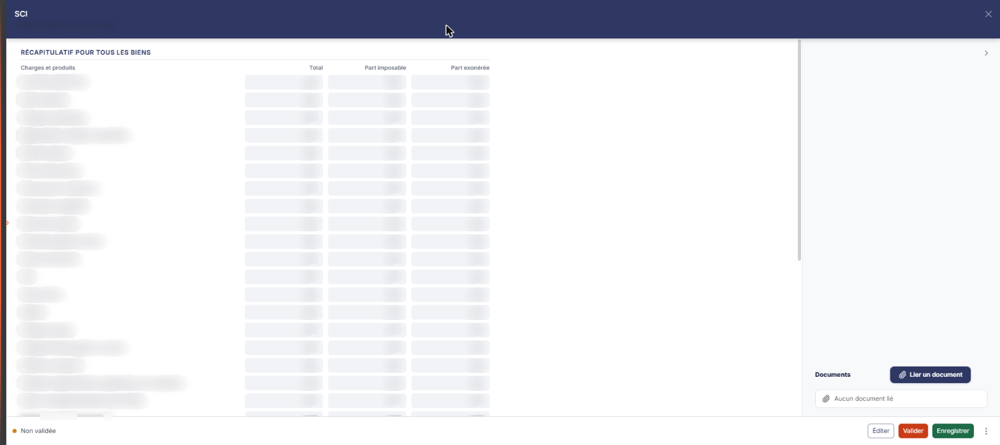
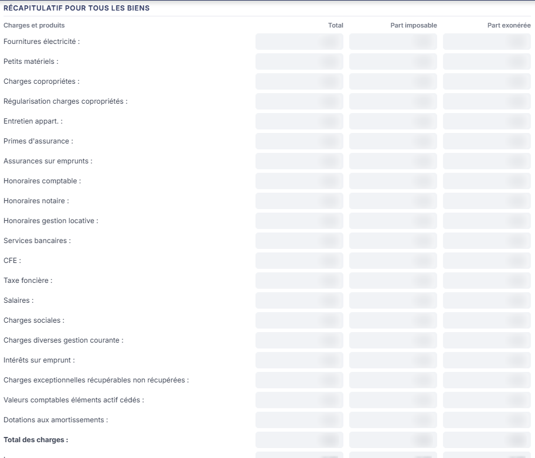
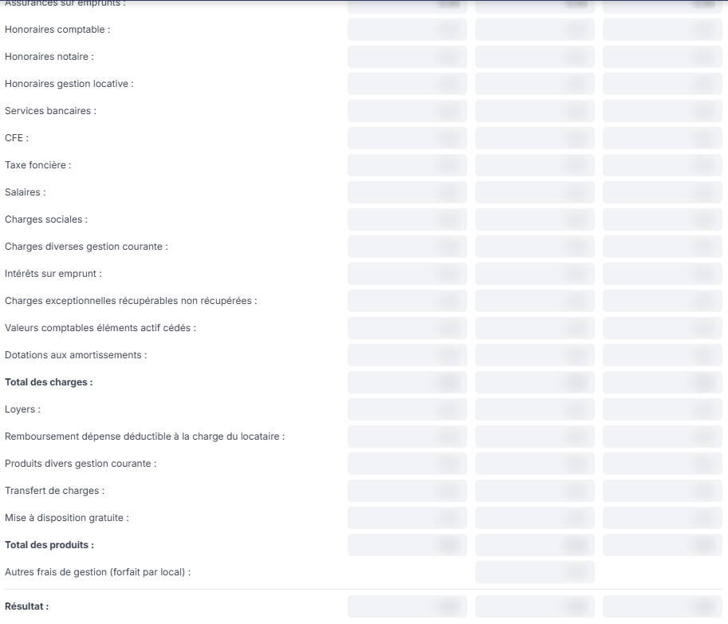
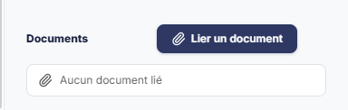

# SCI


**Où le trouver :** Menu **Révision › Révision**



**En bref** — Cette feuille permet, pour les SCI à l'impôt sur le revenu, de saisir les biens immobiliers un par un et d'en tirer le récapitulatif donnant le résultat imposable.

* Pour ajouter un bien : bouton \[Nouveau], renseignez sa fiche, puis bouton \[Enregistrer].
* Pour terminer : bouton \[Valider] ; pour imprimer, bouton \[Éditer].


Cette feuille permet, pour les SCI à l'Impôt sur le Revenu, de saisir toutes les informations relatives aux biens immobiliers afin de déterminer le résultat imposable.

<figure><figcaption>
Écran « Révision » de la nouvelle interface
</figcaption></figure>

Elle se lit de bas en haut : **vous saisissez un bien à la fois**, dans sa propre fiche, et le logiciel en tire le récapitulatif affiché en haut de l'écran. Pour l'ouvrir, dans l'écran Révision, cliquez sur la carte « N feuilles de travail » du bandeau : la liste des feuilles s'ouvre dans un tiroir à droite. Repérez la ligne « SCI » (le champ « Rechercher une feuille… » la retrouve) et cliquez sur le crayon de la ligne : la feuille s'ouvre dans un panneau, dont l'en-tête indique « SCI », puis la société et l'exercice, avec une croix de fermeture.

Le panneau ne comporte aucun onglet : il présente la rubrique « Récapitulatif pour tous les biens », puis la rubrique « Détails des biens » ; la rubrique « Documents » est dans une colonne à droite, en bas du panneau. Les commandes sont dans le pied. À gauche, la pastille « Non validée » ; à droite, dans l'ordre : le Bouton \[Éditer], le Bouton \[Valider], le Bouton \[Enregistrer] et le menu ⋮ « Autres actions » (entrées « Charger les valeurs n - 1 » et « Purger la feuille »). Il n'y a pas de bouton \[Fermer] : la croix de l'en-tête referme le panneau.

**a) Tableau « Récapitulatif pour tous les biens »**

**Aucune de ces données n'est modifiable directement** : toutes les cellules du récapitulatif sont en lecture seule. C'est la somme des biens saisis dans la grille « Détails des biens » ; le récapitulatif ne lit donc pas la comptabilité, il additionne les biens. Tant qu'aucun bien n'a été créé, toutes ses cellules affichent 0,00.

Ses colonnes sont, dans l'ordre : **Charges et produits**, **Total**, **Part imposable** et **Part exonérée**.

Les lignes de charges sont, dans l'ordre : **Fournitures électricité :**, **Petits matériels :**, **Charges copropriétes :**, **Régularisation charges copropriétés :**, **Entretien appart. :**, **Primes d'assurance :**, **Assurances sur emprunts :**, **Honoraires comptable :**, **Honoraires notaire :**, **Honoraires gestion locative :**, **Services bancaires :**, **CFE :**, **Taxe foncière :**, **Salaires :**, **Charges sociales :**, **Charges diverses gestion courante :**, **Intérêts sur emprunt :**, **Charges exceptionnelles récupérables non récupérées :**, **Valeurs comptables éléments actif cédés :** et **Dotations aux amortissements :**, suivies de la ligne **Total des charges :**.

Les lignes de produits suivent : **Loyers :**, **Remboursement dépense déductible à la charge du locataire :**, **Produits divers gestion courante :**, **Transfert de charges :** et **Mise à disposition gratuite :**, suivies de la ligne **Total des produits :**.

Vient ensuite la ligne **Autres frais de gestion (forfait par local) :**, qui **ne comporte de valeur que dans la colonne « Part imposable »** : les colonnes « Total » et « Part exonérée » sont vides sur cette ligne.

La dernière ligne est **Résultat :**. Le champ résultat de la colonne « Total » donne le résultat comptable, celui de la colonne « Part imposable » donne le résultat fiscal.

**b) Grille « Détails des biens »**

Vous devez créer une ligne par bien à l'aide du bouton **\[Nouveau]**, précédé d'un « + », situé sous la grille, et renseigner toutes les informations le concernant dans la fiche qui s'ouvre. Tant qu'aucun bien n'a été créé, la grille affiche « Liste vide ».

Ses colonnes sont, dans l'ordre : une colonne de commandes sans titre, à gauche, puis **Libellé du bien**, **Total des charges**, **Total des produits**, **Autres frais** et **Résultat**.

**c) Documents (colonne de droite)**

Vous pouvez charger ici tous les documents liés aux SCI. Tant qu'aucune pièce n'est rattachée, la rubrique affiche la seule mention « **Aucun document lié** ».

Le bouton **\[Lier un document]**, à droite du titre de la rubrique, rattache une pièce à la feuille.

**d) Bouton \[Éditer]**

Il déclenche l'édition du récapitulatif pour tous les biens et du détail des biens. Il ouvre une fenêtre « Edition », qui indique le nom de la feuille et son état, puis propose le **Format :** — Html (retenu par défaut), Pdf ou Excel — et un interrupteur **Tronquer les libellés trop longs :**, activé à l'ouverture. Le bouton **\[Annuler]** ferme la fenêtre, le bouton **\[Edition]** lance le document.

## Autres vues de l'écran

<figure><figcaption>
Tableau « Récapitulatif pour tous les biens »
</figcaption></figure>

<figure><figcaption>
Tableau « Récapitulatif pour tous les biens »
</figcaption></figure>

<figure><figcaption>
Grille « Détails des biens »
</figcaption></figure>

<figure><figcaption>
Documents (colonne de droite)
</figcaption></figure>
