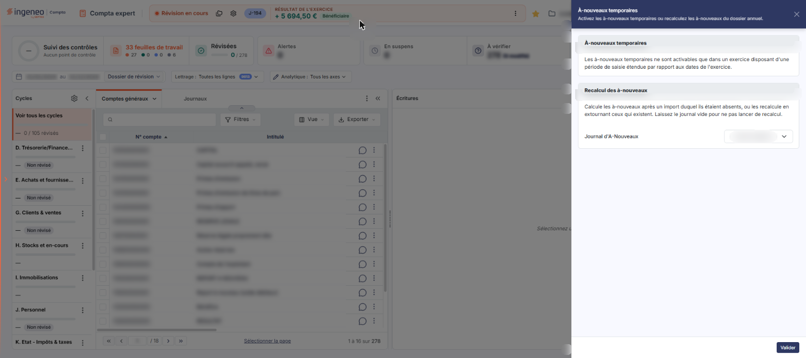
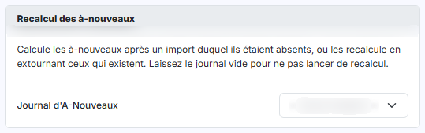

# A-nouveaux temporaires


**Où le trouver :** Menu **Traitements › A-nouveaux temporaires**



**En bref** — Cette option réunit deux traitements sur les à-nouveaux du dossier : l'activation des à-nouveaux temporaires et le recalcul des à-nouveaux.

* Pour générer ou recalculer les à-nouveaux temporaires : activez l'interrupteur, puis bouton \[Valider].
* Pour recalculer les à-nouveaux : désignez le journal d'à-nouveaux, puis bouton \[Valider].


Cette option réunit deux traitements qui portent l'un et l'autre sur les à-nouveaux du dossier : l'activation des **à-nouveaux temporaires**, et le **recalcul des à-nouveaux**.

<figure><figcaption>
Écran « A-nouveaux temporaires » de la nouvelle interface
</figcaption></figure>

Pour l'ouvrir, dans l'écran Révision, cliquez sur ⋮ (Plus d'actions), puis sur **À-nouveaux temporaires**. L'écran s'ouvre dans un panneau, à droite, titré « À-nouveaux temporaires », sous le message « Activez les à-nouveaux temporaires ou recalculez les à-nouveaux du dossier annuel. ». Le panneau est un formulaire, sans onglet et sans liste, en deux rubriques. Le pied du panneau, à droite, ne porte que le bouton \[Valider] ; la croix « Fermer » du bandeau de titre referme le panneau.

## Rubrique « À-nouveaux temporaires »

<figure><figcaption>
Rubrique « a) Rubrique « À-nouveaux temporaires » »
</figcaption></figure>

Cette rubrique n'est utilisable que sur certains dossiers annuels. Lorsque ce n'est pas le cas, elle ne présente aucun champ, mais le seul message suivant :

**Les à-nouveaux temporaires ne sont activables que dans un exercice disposant d'une période de saisie étendue par rapport aux dates de l'exercice.**

## Rubrique « Recalcul des à-nouveaux »

<figure><figcaption>
Rubrique « b) Rubrique « Recalcul des à-nouveaux » »
</figcaption></figure>

Le logiciel rappelle en tête de rubrique à quoi elle sert :

« Calcule les à-nouveaux après un import duquel ils étaient absents, ou les recalcule en extournant ceux qui existent. Laissez le journal vide pour ne pas lancer de recalcul. »

**Journal d'A-Nouveaux** : désignez le journal dans lequel les à-nouveaux seront écrits. Le sélecteur affiche **-- Aucun recalcul --** tant que vous n'avez rien retenu : laissé sur ce choix, il ne lance aucun recalcul. Il ne propose que les journaux de type à-nouveaux du dossier : il est donc souvent très court.

## Les boutons

bouton **\[Valider]**

Il lance le traitement à partir de ce que vous avez renseigné dans les deux rubriques.
