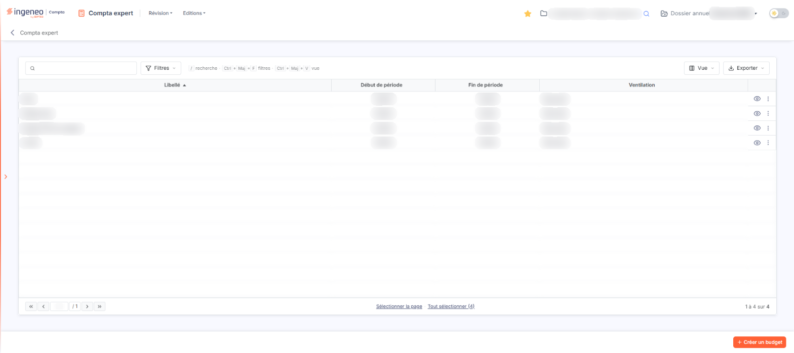
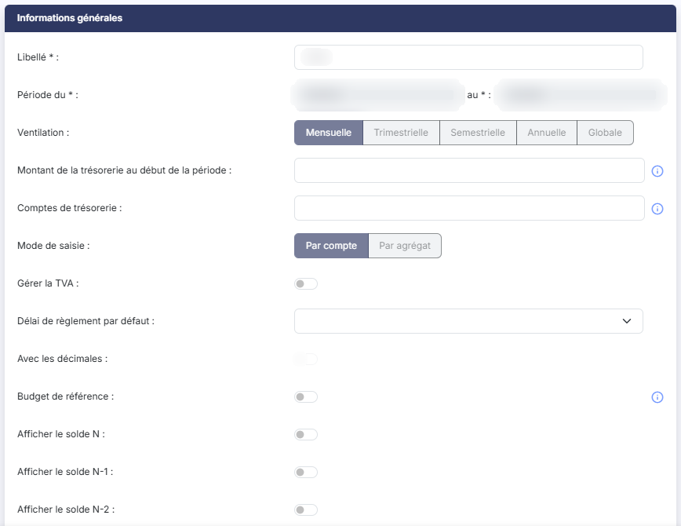
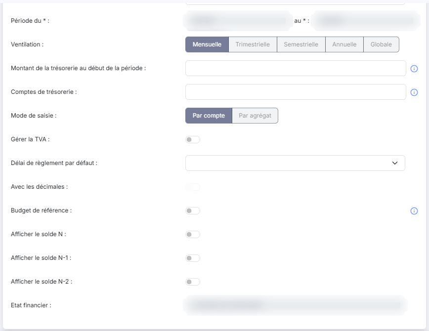
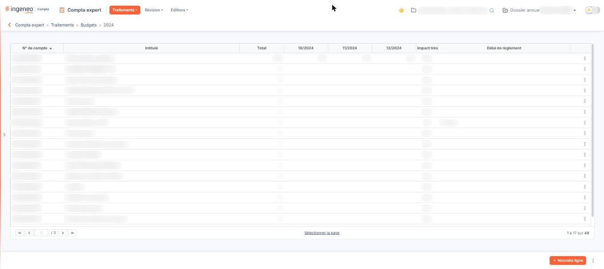
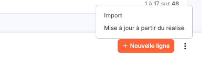

# Budgets


**Où le trouver :** Menu **Traitements › Budgets**



**En bref** — Cet écran permet de construire des budgets prévisionnels, par compte ou par agrégat de comptes, de saisir leurs valeurs et de suivre leur réalisation.

* Pour créer un budget : bouton \[Créer un budget], renseignez le libellé, puis bouton \[Enregistrer].
* Pour saisir les valeurs : icône « Afficher l'aperçu » de la ligne du budget, puis bouton \[Nouvelle ligne].
* Pour répartir une valeur sur les périodes : bouton \[Lisser la valeur] dans le détail de la ligne, puis bouton \[Enregistrer].


Cette option vous permet de construire des budgets prévisionnels et de suivre leur réalisation. Vous pouvez créer plusieurs budgets, sur des périodes et des périodicités différentes, selon deux méthodes : par compte ou par agrégat de comptes.

<figure><figcaption>
Écran « Budgets » de la nouvelle interface
</figcaption></figure>

Deux présentations existent. Pour ouvrir le panneau « Budgets », dans l'écran Révision, cliquez sur ⋮ (Plus d'actions), puis sur **Budgets** (rubrique Saisie) : un panneau s'ouvre à droite, qui affiche un budget et permet de le saisir sans quitter la Révision (rubrique e). La page « Budgets » plein écran, décrite aux rubriques a) à d), ne s'atteint plus par un menu : la barre de menus des écrans restés en page pleine ne propose plus que « Révision » et « Editions » (le menu Traitements n'existe plus), et l'en-tête de la page n'affiche plus que la flèche de retour et « Compta expert » (plus de fil d'Ariane « Compta expert > Traitements > Budgets »).

## La liste des budgets

<figure><figcaption>
Bouton [Créer un budget]
</figcaption></figure>

Le logiciel affiche la liste des budgets déjà créés dans le dossier annuel, avec les colonnes suivantes :

| Champ                 | Ce qu'il faut savoir                                                                                                                                                                                                                                                                                                                                                                                                                                                                                                                                                                                                                                                                                                                                                                     |
| --------------------- | ---------------------------------------------------------------------------------------------------------------------------------------------------------------------------------------------------------------------------------------------------------------------------------------------------------------------------------------------------------------------------------------------------------------------------------------------------------------------------------------------------------------------------------------------------------------------------------------------------------------------------------------------------------------------------------------------------------------------------------------------------------------------------------------- |
| **Libellé**           | Le nom que vous avez donné au budget.                                                                                                                                                                                                                                                                                                                                                                                                                                                                                                                                                                                                                                                                                                                                                    |
| **Début de période**  | Le premier mois couvert par le budget.                                                                                                                                                                                                                                                                                                                                                                                                                                                                                                                                                                                                                                                                                                                                                   |
| **Fin de période**    | Le dernier mois couvert par le budget.                                                                                                                                                                                                                                                                                                                                                                                                                                                                                                                                                                                                                                                                                                                                                   |
| **Ventilation**       | 
Le découpage retenu pour la saisie des valeurs. Au-dessus de la liste, la zone « Rechercher un budget… » et les boutons [Filtres], [Vue] et [Exporter] permettent de chercher, de filtrer, de choisir les colonnes et d'exporter la liste. Il n'y a plus de case à cocher : un clic sur une ligne la sélectionne, et le pied de la liste propose « Sélectionner la page » et « Tout sélectionner » suivi du nombre de budgets. Dès qu'une ligne est sélectionnée, un bandeau de sélection apparaît au bas de l'écran (« 1 budget sélectionnées », « Tout désélectionner ») avec le bouton [Supprimer]. Chaque ligne porte l'icône « Afficher l'aperçu » (un œil) puis le menu « Autres actions » (trois points), qui propose « Modifier », « Dupliquer » et « Supprimer » :
 |
| **Modifier**          | Ouvre la fiche de paramétrage du budget.                                                                                                                                                                                                                                                                                                                                                                                                                                                                                                                                                                                                                                                                                                                                                 |
| **Afficher l'aperçu** | Ouvre l'écran de saisie des valeurs du budget (voir le paragraphe c ci-dessous).                                                                                                                                                                                                                                                                                                                                                                                                                                                                                                                                                                                                                                                                                                         |
| **Supprimer**         | Supprime le budget.                                                                                                                                                                                                                                                                                                                                                                                                                                                                                                                                                                                                                                                                                                                                                                      |

bouton **\[Créer un budget]**

Placé en bas à droite de l'écran, il ouvre la fiche de paramétrage d'un nouveau budget.

bouton **\[Supprimer]**

Il figure dans le bandeau de sélection et supprime tous les budgets sélectionnés dans la liste.

## Le paramétrage d'un budget

<figure><figcaption>
Rubrique « Rubrique « Informations générales » »
</figcaption></figure>

<figure><figcaption>
Rubrique « Rubrique « Informations générales » »
</figcaption></figure>

Pour créer un budget, utilisez le **bouton \[Créer un budget]** ; pour modifier le paramétrage d'un budget existant, utilisez l'entrée « Modifier » du menu « Autres actions » de sa ligne.

La fiche comporte deux rubriques en création — « Informations générales » puis « Trame de saisie » — et une seule en modification : la rubrique « Trame de saisie » n'est proposée qu'à la création, car le modèle de trame ne sert qu'à générer les premières lignes du budget.

### Rubrique « Informations générales »

| Champ                                               | Ce qu'il faut savoir                                                                                                                                                                                                                                                                                                                                                                                  |
| --------------------------------------------------- | ----------------------------------------------------------------------------------------------------------------------------------------------------------------------------------------------------------------------------------------------------------------------------------------------------------------------------------------------------------------------------------------------------- |
| **Libellé**                                         | C'est l'identifiant du budget ; il doit être unique.                                                                                                                                                                                                                                                                                                                                                  |
| **Période du**                                      | Indiquez le mois et l'année de début du budget, en saisissant la date ou en la choisissant dans le calendrier.                                                                                                                                                                                                                                                                                        |
| **au**                                              | Indiquez le mois et l'année de fin du budget.                                                                                                                                                                                                                                                                                                                                                         |
| **Ventilation**                                     | Cinq boutons côte à côte donnent la période de découpage du budget : « Mensuelle » (proposée par défaut), « Trimestrielle », « Semestrielle », « Annuelle » ou « Globale ». Vous devrez renseigner autant de valeurs qu'il y a de périodes dans l'intervalle de temps de votre budget. Si vous choisissez la ventilation « Globale », vous n'aurez qu'une seule valeur à saisir par poste budgétaire. |
| **Montant de la trésorerie au début de la période** | Indiquez le solde de la trésorerie à la veille de l'ouverture de votre budget, afin de permettre le calcul de la trésorerie prévisionnelle tout au long du budget.                                                                                                                                                                                                                                    |
| **Comptes de trésorerie**                           | Indiquez les racines des comptes de trésorerie de la comptabilité afin de permettre la comparaison, dans les éditions, entre la prévision de trésorerie du budget et la trésorerie réelle. Pour indiquer plusieurs racines, séparez-les par des points-virgules — par exemple **512;519**. Tous les comptes commençant par ces racines seront retenus.                                                |
| **Mode de saisie**                                  | Deux boutons côte à côte, « Par compte » (proposé par défaut) et « Par agrégat ». Vous choisissez ainsi de construire votre budget sur des numéros de comptes ou sur des agrégats de comptes.                                                                                                                                                                                                         |
| **Gérer la TVA**                                    | Interrupteur, désactivé à la création. Activez-le si vous souhaitez gérer la TVA dans le budget. Ce champ n'est proposé qu'en mode de saisie « Par compte » : il disparaît de la fiche dès que vous choisissez le mode « Par agrégat », en même temps que le champ **Uniquement les comptes mouvementés** de la rubrique « Trame de saisie ».                                                         |
| **Délai de règlement par défaut**                   | Choisissez le délai à retenir pour les comptes qui ne portent pas eux-mêmes de délai de règlement : « Comptant », « Fin de mois », « 30 jours » ou « 45 Jours ». Ce délai reste modifiable et personnalisable pour chaque ligne du budget.                                                                                                                                                            |
| **Avec les décimales**                              | Interrupteur, désactivé à la création. S'il est désactivé, toutes les valeurs de votre budget devront être saisies sans décimales, et les éditions se feront également sans décimales.                                                                                                                                                                                                                |
| **Budget de référence**                             | Interrupteur. Il permet de désigner le budget de référence.                                                                                                                                                                                                                                                                                                                                           |
| **Afficher le solde N**                             | Interrupteur. S'il est activé, le solde de l'exercice en cours est affiché dans l'écran de saisie des valeurs.                                                                                                                                                                                                                                                                                        |
| **Afficher le solde N-1**                           | Interrupteur. S'il est activé, le solde de l'exercice précédent est affiché dans l'écran de saisie des valeurs.                                                                                                                                                                                                                                                                                       |
| **Afficher le solde N-2**                           | Interrupteur. S'il est activé, le solde de l'avant-dernier exercice est affiché dans l'écran de saisie des valeurs.                                                                                                                                                                                                                                                                                   |

### Rubrique « Trame de saisie »

Cette rubrique n'est proposée qu'à la création du budget. Elle sert à générer automatiquement les premières lignes budgétaires.

| Champ                                  | Ce qu'il faut savoir                                                                                                                                                                                                                                                                                                                                                                                                                                 |
| -------------------------------------- | ---------------------------------------------------------------------------------------------------------------------------------------------------------------------------------------------------------------------------------------------------------------------------------------------------------------------------------------------------------------------------------------------------------------------------------------------------- |
| **Type de modèle**                     | Quatre boutons côte à côte : « Aucun modèle », « Compte de résultat » (proposé par défaut), « SIG » ou « Indicateur ». Vous indiquez ainsi si vous souhaitez créer les postes budgétaires de toutes pièces, ou partir d'une base provenant d'un compte de résultat, des soldes intermédiaires de gestion ou d'un indicateur financier que vous auriez créé. Si vous choisissez « Aucun modèle », les deux champs suivants disparaissent de la fiche. |
| **Nom du modèle**                      | Ce sélecteur affiche la liste des modèles de comptes de résultat, de SIG ou d'indicateurs financiers paramétrés dans le panneau Paramètres, rubrique Modèles, groupe Documents, écran États financiers. Si votre mode de saisie est « Par compte », le logiciel crée autant de lignes qu'il y a de comptes utilisés dans le modèle choisi ; s'il est « Par agrégat », il crée autant de lignes qu'il y a d'agrégats dans le modèle.                  |
| **Uniquement les comptes mouvementés** | Interrupteur, proposé activé. Indiquez si vous souhaitez reprendre comme postes budgétaires tous les comptes figurant dans le modèle, ou seulement ceux qui ont été mouvementés dans l'exercice en cours.                                                                                                                                                                                                                                            |

En modification, cinq champs apparaissent grisés et ne sont plus modifiables : **Période du** et **au** — la période d'un budget se fixe à sa création —, ainsi que **Ventilation**, **Mode de saisie** et **Avec les décimales**, qui commandent la structure des lignes déjà créées. Les autres champs restent accessibles.

bouton **\[Enregistrer]**

Placé en bas à droite de l'écran, il enregistre la fiche du budget. À la création, le logiciel génère en même temps les lignes budgétaires issues de la trame de saisie choisie.

**Flèche « Revenir en arrière »**

Placée à gauche du fil d'Ariane, elle revient à la liste des budgets sans enregistrer la fiche.

## L'écran de saisie des valeurs du budget

<figure><figcaption>
Rubrique « c) L'écran de saisie des valeurs du budget »
</figcaption></figure>

<figure><figcaption>
Bouton [Nouvelle ligne]
</figcaption></figure>

Utilisez l'icône « Afficher l'aperçu » de la ligne du budget pour ouvrir l'écran de saisie de ses valeurs. Le libellé du budget vient s'ajouter au fil d'Ariane, en haut de l'écran (« Compta expert > Traitements > Budgets > » suivi du libellé).

Le logiciel affiche une ligne par poste budgétaire. Les premières colonnes dépendent du mode de saisie du budget.

Pour un budget **par compte** :

| Champ                             | Ce qu'il faut savoir                                                                                                                                                                                                                                                                        |
| --------------------------------- | ------------------------------------------------------------------------------------------------------------------------------------------------------------------------------------------------------------------------------------------------------------------------------------------- |
| **N° de compte**                  | Le compte du poste budgétaire. La colonne est triable.                                                                                                                                                                                                                                      |
| **Intitulé**                      | 
L'intitulé du compte. Les colonnes suivantes sont communes aux deux modes :
                                                                                                                                                                                                       |
| **Solde N, Solde N-1, Solde N-2** | Les soldes du compte sur les exercices correspondants, donnés à titre indicatif pour vous aider à construire votre budget. Chacune de ces colonnes n'est présente que si vous avez répondu « Oui » à l'option de même nom dans la fiche du budget.                                          |
| **Total**                         | Le total des valeurs saisies sur la ligne.                                                                                                                                                                                                                                                  |
| **Une colonne par période**       | Le logiciel crée autant de colonnes qu'il y a de périodes dans le budget, selon sa ventilation et sa période — par exemple douze colonnes de « 01/2024 » à « 12/2024 » pour un budget mensuel couvrant l'année 2024. La grille se parcourt latéralement à l'aide de sa barre de défilement. |
| **Impact trésorerie**             | « Oui » ou « Non » selon que la ligne entre ou non dans le calcul de la prévision de trésorerie.                                                                                                                                                                                            |
| **Délai de règlement**            | Le délai retenu pour la ligne. Cette colonne n'est renseignée que pour les lignes dont l'impact trésorerie vaut « Oui ».                                                                                                                                                                    |

Chaque ligne porte trois icônes, « Modifier » (un crayon), « Créer » (un « + ») et « Supprimer » (une corbeille), et une case à cocher vous permet de la sélectionner pour les actions groupées du bandeau bas.

bouton **\[Nouvelle ligne]**

Il ouvre, à droite, le panneau « Détail d'une ligne de budget » pour une nouvelle ligne budgétaire — tout comme l'icône « Modifier » d'une ligne existante ouvre ce même panneau sur la ligne choisie. Le contenu de ce panneau est décrit aux paragraphes d et e ci-dessous, selon le mode de saisie du budget.

**Entrée « Appliquer un coefficient » du menu « Autres actions »**

Elle multiplie par le coefficient que vous saisissez toutes les valeurs contenues dans les lignes sélectionnées.

bouton **\[Supprimer]**

Il supprime toutes les lignes du budget que vous avez cochées dans la page.

bouton **\[Retour]**

Il revient à la liste des budgets.

La barre basse de l'écran de saisie porte trois boutons, de gauche à droite : **\[Retour]**, **\[Supprimer]** et **\[Nouvelle ligne]**, suivis du menu « Autres actions » (trois points), qui propose « Import », « Mise à jour à partir du réalisé », « Appliquer un coefficient », « Modification groupée » et « Recalculer soldes N-1 ».

Les quatre entrées suivantes n'ont pas encore été décrites : « Import », « Mise à jour à partir du réalisé », « Modification groupée » et « Recalculer soldes N-1 ».

## Le détail d'une ligne pour un budget par compte

Si le budget a été créé sur la base d'un modèle d'état financier, il contient déjà une ligne par compte comptable présent dans les formules de ce modèle — ou une seule ligne par compte mouvementé si vous avez retenu l'option correspondante.

Le panneau « Détail d'une ligne de budget » s'ouvre à droite de la grille ; la croix de son bandeau de titre le referme. Il comporte les champs suivants :

| Champ                             | Ce qu'il faut savoir                                                                                                                                                                                                                                                                                                                                                                                                                                                                                                                                                                                                                                                                                         |
| --------------------------------- | ------------------------------------------------------------------------------------------------------------------------------------------------------------------------------------------------------------------------------------------------------------------------------------------------------------------------------------------------------------------------------------------------------------------------------------------------------------------------------------------------------------------------------------------------------------------------------------------------------------------------------------------------------------------------------------------------------------ |
| **N° de compte**                  | Pour que la ligne du budget soit valide. Le numéro de compte doit exister dans le plan comptable ; le pictogramme « + » (« Créer ») vous permet de le créer, et la loupe d'ouvrir la fenêtre de recherche dans le plan comptable.                                                                                                                                                                                                                                                                                                                                                                                                                                                                            |
| **Intitulé**                      | Il est repris automatiquement une fois le numéro de compte indiqué, et n'est pas modifiable.                                                                                                                                                                                                                                                                                                                                                                                                                                                                                                                                                                                                                 |
| **Solde comptable**               | Non modifiable. C'est le solde du compte à la date du solde. Il vous donne une indication pour la construction de votre budget.                                                                                                                                                                                                                                                                                                                                                                                                                                                                                                                                                                              |
| **Date du solde**                 | En modifiant cette date, vous affichez le solde du compte à la date indiquée.                                                                                                                                                                                                                                                                                                                                                                                                                                                                                                                                                                                                                                |
| **Impact trésorerie**             | Indiquez si la ligne entre dans le calcul de la prévision de trésorerie.                                                                                                                                                                                                                                                                                                                                                                                                                                                                                                                                                                                                                                     |
| **Délai de règlement**            | Ce champ n'est présent que si la ligne a un impact sur la trésorerie. Il s'ouvre sur « Par défaut », et vous propose également « Comptant », « Fin de mois », « 30 jours » et « 45 Jours ». Le champ **Par défaut**, qui l'accompagne à sa droite, vous rappelle en lecture seule le délai de règlement par défaut du budget. Le délai retenu sert à déterminer l'impact sur la trésorerie, et une troisième ligne « Date de règlement » vient préciser, pour chaque période, la date de règlement. Si, dans le plan comptable, vous avez indiqué pour ce compte que les échéances étaient gérées et renseigné un délai de règlement par défaut, celui-ci vous est proposé, avec possibilité de le modifier. |
| **Total**                         | Non modifiable. C'est le total des échéances de la ligne du budget ; il est mis à jour à chaque modification d'une valeur.                                                                                                                                                                                                                                                                                                                                                                                                                                                                                                                                                                                   |
| **Solde N, Solde N-1, Solde N-2** | Non modifiables. Ces champs reprennent, comme les colonnes de même nom de la grille, les soldes des exercices correspondants, et n'apparaissent que si vous avez retenu l'option de même nom dans la fiche du budget.                                                                                                                                                                                                                                                                                                                                                                                                                                                                                        |
| **Montant**                       | Ce sont toutes les échéances de la ligne du budget, présentées sous la ligne **Période** qui en porte les intitulés. Vous pouvez les saisir une par une, ou plus rapidement à l'aide des boutons placés au-dessus de la grille des périodes. Sous chaque montant, le pictogramme « A » ouvre la fenêtre de ventilation analytique de la période concernée.                                                                                                                                                                                                                                                                                                                                                   |

bouton **\[Vider]** : il vide toutes les valeurs budgétaires de la ligne en cours.

bouton **\[Copier la valeur]** : il recopie la valeur sur laquelle est positionné le curseur dans toutes les échéances non encore renseignées de la ligne.

bouton **\[Lisser la valeur]** : il répartit la valeur sur laquelle est positionné le curseur dans toutes les échéances non encore renseignées de la ligne.

bouton **\[Appliquer un coefficient]** : il multiplie toutes les valeurs budgétaires de la ligne par le coefficient que vous saisissez.

Ces quatre boutons sont placés au-dessus de la grille des périodes. Dans le pied du panneau :

bouton **\[Enregistrer]** : il enregistre les modifications.

bouton **\[Annuler]** : il quitte le panneau sans enregistrer les modifications.

## Le panneau « Budgets » du menu ⋮ de la Révision

Dans l'écran Révision, ⋮ (Plus d'actions), rubrique Saisie, entrée Budgets : le panneau « Budgets · » suivi du libellé du budget affiché s'ouvre à droite, avec des pastilles (période du budget, « Montants sans décimales »), le rappel de l'exercice et une ligne de synthèse (nombre de lignes, produits, charges, résultat prévisionnel). La croix « Fermer » le referme.

La colonne de gauche liste les budgets du dossier : une zone de recherche (« Libellé du budget… »), une liste déroulante, à côté de la zone de recherche, qui propose « Tous (n) », « Par compte (n) » et « Par agrégat (n) » avec le nombre de budgets de chaque type, une carte par budget (libellé, période, mode de saisie, total) et, en bas, le bouton « Nouveau budget ».

Au centre, quatre totaux (« Produits budgétés », « Charges budgétées », « Résultat prévisionnel », « Marge sur produits »), puis le bloc « Détail de la ligne » : compte, intitulé, délai de règlement (« Comptant », « Fin de mois », « 30 jours » ou « 45 Jours »), solde au 31/12 de l'exercice, interrupteur « Impact sur la trésorerie », zone « Répartir » (« Montant total à répartir », « Lisser sur » le nombre de périodes, « Copier la 1re période », « Coefficient » suivi de « Appliquer », « Vider la ligne ») et un graphique « Budget par période ». Dessous, le tableau « Lignes du budget » : comptes regroupés en « Produits d'exploitation » et « Charges d'exploitation », une colonne par période, une colonne Total, et les lignes « Total des produits », « Total des charges » et « Résultat prévisionnel ». Un clic sur un montant le modifie, un clic sur un compte ouvre son détail, un clic sur l'intitulé sélectionne la ligne ; « Ajouter un compte » figure sous le tableau.

Le pied porte le message « Tout est enregistré », bouton **\[Annuler les modifications]**, bouton **\[Enregistrer]** et le menu « Autres actions » (trois points), qui propose « Importer des montants », « Mettre à jour à partir du réalisé », « Paramètres du budget », « Dupliquer le budget », « Éditer le budget », « Supprimer la ligne » et « Supprimer le budget ».
