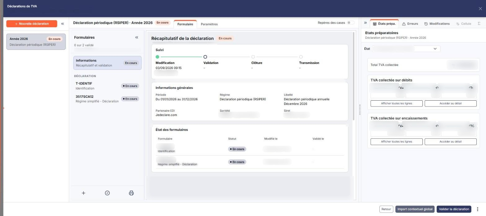
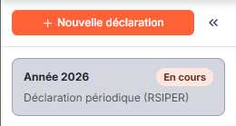
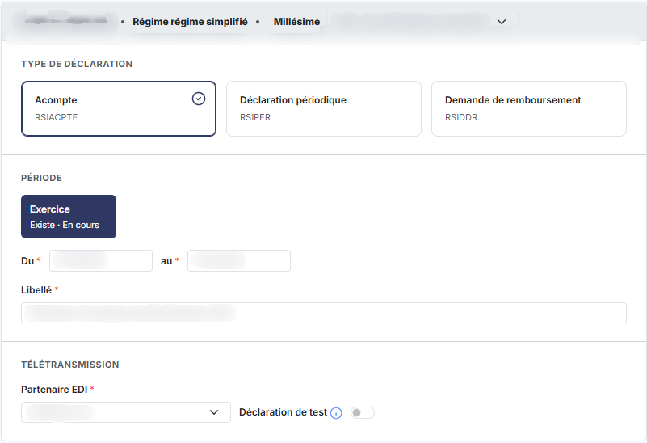
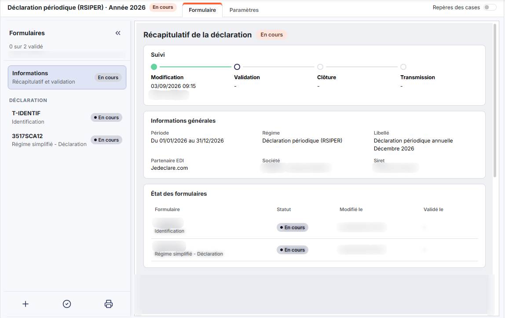
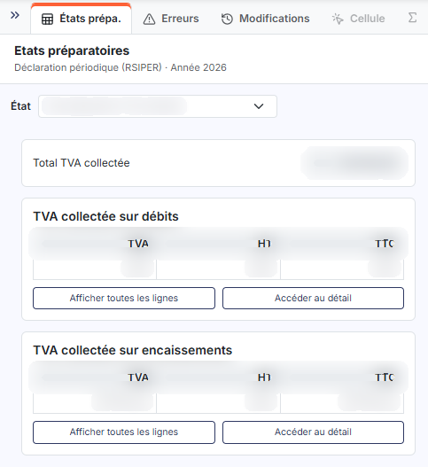
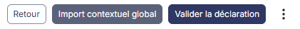
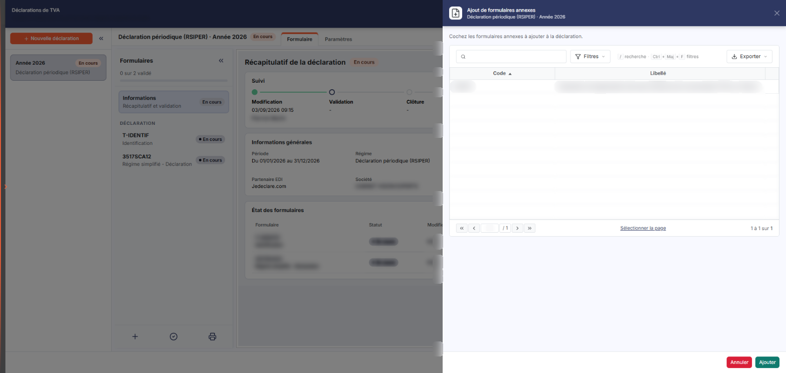

# Déclaration de TVA


**Où le trouver :** Menu **Traitements › Déclaration de TVA**



**En bref** — Cette option permet de créer les déclarations de TVA du dossier annuel, de les valider, de les clôturer puis de les télédéclarer auprès de l'administration fiscale.

* Pour créer une déclaration : bouton \[Nouvelle déclaration], renseignez les données d'en-tête, puis bouton \[Enregistrer].
* Pour remplir le formulaire : bouton \[Etats préparatoires], puis bouton \[Charger un état préparatoire].
* Pour terminer : bouton \[Valider la déclaration], puis bouton \[Clôturer], puis bouton \[Transmettre].


Cette option permet de créer les déclarations de TVA du dossier annuel en cours et de les télédéclarer auprès de l'administration fiscale.

<figure><figcaption>
Écran « Déclaration de TVA » de la nouvelle interface
</figcaption></figure>

Pour l'ouvrir, dans l'écran Révision, cliquez sur ⋮ (Plus d'actions), puis sur « Déclarations de TVA » : l'écran s'ouvre dans un panneau, à droite, intitulé « Déclarations de TVA », dont le sous-titre rappelle la société, l'exercice, le régime et la périodicité (par exemple « Régime simplifié, annuelle »). La croix « Fermer » de l'en-tête le referme.

Le panneau se compose de trois zones : à gauche, la liste des déclarations déjà créées ; au centre, la déclaration ouverte ; à droite, un espace d'outils repliable. Vous y créez une nouvelle déclaration, vous ouvrez une déclaration existante pour la compléter, la valider, la clôturer, puis la transmettre à votre partenaire EDI.

## Paramétrage préalable

Avant de créer votre première déclaration de TVA, assurez-vous d'avoir effectué tous les paramétrages nécessaires.

**1) Paramètres généraux**

Le régime, la périodicité ainsi que le mode d'exigibilité doivent être indiqués dans le panneau Paramètres, rubrique « Compta expert », onglet « Configuration » (anciennement « Paramètres généraux »), rubrique « TVA ».

**2) Codes TVA**

Pour chaque code TVA, vous devez paramétrer les différents comptes de TVA déductible et de TVA collectée.

**3) Plan comptable**

Pour chaque compte de vente soumis à TVA, vous devez indiquer le code TVA, le compte de TVA collectée, la nature des opérations imposables et où ventiler la base hors taxe.

Pour chaque compte de vente non soumis à TVA et enregistrant des opérations non imposables, vous devez indiquer la nature des opérations.

Pour chaque compte d'achat soumis à TVA, vous devez indiquer le code TVA et le compte de TVA déductible.

Pour chaque compte de TVA déductible, vous devez indiquer le type de TVA (débit, décaissement, immobilisation, autoliquidée) et son éventuelle ventilation.

Pour les comptes de TVA collectée, si vous êtes dans un régime sur les débits ou sur les encaissements, le type de TVA est renseigné automatiquement ; a contrario, si vous avez choisi un régime mixte, vous devrez préciser la nature de la TVA (débit ou encaissement) pour chaque compte.

## La liste des déclarations de TVA

<figure><figcaption>
Rubrique « b) La liste des déclarations de TVA »
</figcaption></figure>

<figure><figcaption>
Bouton [Nouvelle déclaration]
</figcaption></figure>

La zone de gauche du panneau liste les déclarations sous forme de cartes, sans zone de filtre. En tête de la zone figurent le bouton « Nouvelle déclaration » et l'icône « Replier la liste ». Chaque carte porte un titre (par exemple « Année 2026 »), un badge d'état (par exemple « En cours ») et le type de déclaration (par exemple « Déclaration périodique (RSIPER) »), dont l'infobulle donne le libellé complet (par exemple « Déclaration périodique annuelle Décembre 2026 »).

Le libellé que vous avez donné à la déclaration, ainsi que les bornes de la période qu'elle couvre, figurent dans le récapitulatif de la déclaration, décrit plus bas.

Chaque carte est un bouton : cliquez dessus pour ouvrir la déclaration correspondante, au centre du panneau.

bouton **\[Nouvelle déclaration]**

Ce bouton ouvre l'écran de création, où vous saisissez les données d'en-tête de la déclaration.

## Créer une déclaration : les données d'en-tête

<figure><figcaption>
Rubrique « c) Créer une déclaration : les données d'en-tête »
</figcaption></figure>

Une déclaration de TVA se déroule selon plusieurs étapes :

* création des données d'en-tête,
* génération des états préparatoires,
* import des états préparatoires dans la déclaration,
* validation de la déclaration,
* clôture de la déclaration,
* télédéclaration.

bouton **\[Enregistrer]**

Ce bouton enregistre les données d'en-tête et vous donne accès aux formulaires de la déclaration, décrits ci-dessous.

bouton **\[Retour]**

Ce bouton vous ramène à la liste des déclarations de TVA.

## Les formulaires de la déclaration

<figure><figcaption>
Rubrique « d) Les formulaires de la déclaration »
</figcaption></figure>

La déclaration ouverte porte deux onglets, « Formulaire », actif à l'ouverture, et « Paramètres ».

Le volet « Formulaires », à gauche de la déclaration, rappelle l'avancement de la validation (par exemple « 0 sur 2 validé ») et contient l'entrée « Informations » (sous-titre « Récapitulatif et validation »), ou sommaire, suivie de la liste des formulaires disponibles sous la rubrique « DÉCLARATION », chacun avec son statut (par exemple « En cours »).

Par défaut, le logiciel se positionne sur la zone d'information. Au centre du panneau, vous visualisez alors le « Récapitulatif de la déclaration » :

i) les données relatives à la déclaration :

* rappel du régime,
* la période, le libellé, le partenaire EDI, la société et son numéro Siret (bloc « Informations générales »),
* la date de dernière modification et le nom de l'utilisateur l'ayant opérée,
* la date de validation,
* la date de clôture,
* la date de transmission au partenaire EDI (ces quatre éléments forment le bloc « Suivi », en quatre étapes : Modification, Validation, Clôture, Transmission).

ii) les données relatives à chaque formulaire, dans le bloc « État des formulaires » :

* le code ou le n° CERFA et le libellé (colonne « Formulaire »),
* son statut (colonne « Statut »),
* la date de dernière modification (colonne « Modifié le »),
* la date de validation (colonne « Validé le »).

Pour visualiser un formulaire, vous pouvez cliquer soit sur son entrée dans le volet « Formulaires », soit sur la flèche « Ouvrir » de sa ligne dans le bloc « État des formulaires ».

## Les boutons d'action de la déclaration

<figure><figcaption>
Bouton [Etats préparatoires]
</figcaption></figure>

<figure><figcaption>
Bouton [Valider la déclaration]
</figcaption></figure>

<figure><figcaption>
Bouton [Ajout de formulaires annexes]
</figcaption></figure>

Les boutons d'action se répartissent entre le pied du panneau, à droite, qui porte les boutons \[Retour], \[Import contextuel global] et \[Valider la déclaration], ainsi qu'un menu ⋮ « Plus d'actions », et la page de synthèse elle-même, qui porte les boutons « Etats préparatoires », « Contrôle Cohérence », « Valider la déclaration », « Contrôle global », « Ajout de formulaires annexes », « Lancer l'édition » et « Import contextuel global », ainsi qu'un menu ⋮ « Plus d'actions ». La liste varie selon l'endroit où vous vous trouvez — zone d'information ou formulaire — et selon l'état de la déclaration : validée ou non, clôturée ou non.

L'espace de droite du panneau porte cinq onglets : « États prépa. » (infobulle « États préparatoires »), « Erreurs » (infobulle « Liste des erreurs »), « Modifications » (infobulle « Liste des modifications »), « Cellule » et « Formules ». Les deux derniers sont désactivés tant que vous n'êtes pas placé dans une case calculée d'un formulaire (« Placez-vous dans une case calculée du formulaire pour afficher son détail ») ou qu'aucun formulaire n'est ouvert (« Ouvrez un formulaire pour afficher ses formules »).

L'onglet « États prépa. » affiche l'état préparatoire choisi dans la liste « Etat » : « Etat préparatoire TVA collectée » (retenu par défaut), « Etat préparatoire TVA déductible » ou « Etat préparatoire Opérations non-imposables ». Pour la TVA collectée, il donne le « Total TVA collectée », puis deux blocs, « TVA collectée sur débits » et « TVA collectée sur encaissements », avec les colonnes TVA, HT et TTC et les boutons « Afficher toutes les lignes » et « Accéder au détail ».

bouton **\[Recalculer]**

Lorsque vous modifiez une valeur dans un formulaire, toutes les données de ce formulaire sont recalculées dès la sortie de la cellule modifiée. Ce bouton étend le recalcul à tous les autres formulaires de la déclaration.

bouton **\[Etats préparatoires]**

Ce bouton n'ouvre pas un état : il déroule un menu de quatre entrées, décrites ci-dessous. Les quatre boutons decrits ci-dessous s’atteignent donc par lui.

* **Etat préparatoire TVA collectée**
* **Etat préparatoire TVA déductible**
* **Etat préparatoire Opérations non-imposables**
* **Charger un état préparatoire**

bouton **\[Etat préparatoire TVA collectée]**

Ce bouton affiche la fenêtre de synthèse de la TVA collectée, avec la répartition éventuelle entre la TVA sur les débits et la TVA sur les encaissements.

Le bouton **\[Accéder au détail]** vous donne accès à toutes les lignes d'écritures de TVA que le logiciel a retenues pour son calcul. Les lignes présentes correspondent aux écritures comprises dans la période indiquée dans les données d'en-tête.

Les lignes de TVA collectée sur encaissement ne sont retenues que si la ligne d'écriture du compte de tiers a été lettrée avec un règlement compris dans la période de déclaration ; les écritures enregistrées postérieurement à la précédente déclaration de TVA mais à une date antérieure à la date de début de période de la déclaration en cours sont également retenues.

En passant la souris au-dessus du numéro de compte, vous visualisez l'écriture complète dont la ligne de TVA est issue.

C'est à cet endroit que vous pouvez intervenir pour exclure une écriture de la déclaration. Cette possibilité est utile si vous commencez à utiliser la déclaration de TVA du logiciel en cours d'année et que vous devez exclure les lignes correspondant à des déclarations antérieures. Les totaux en haut de la fenêtre sont mis à jour à chaque exclusion ou réinclusion d'une ligne. Une ligne exclue dans une déclaration le reste sur les déclarations suivantes, mais vous pouvez toujours modifier son statut.

Ce sont les totaux figurant dans les états préparatoires qui sont utilisés pour le calcul de la déclaration.

bouton **\[Etat préparatoire TVA déductible]**

L'état préparatoire de la TVA déductible fonctionne selon le même principe que celui de la TVA collectée.

bouton **\[Etat préparatoire Opérations non-imposables]**

L'état préparatoire des opérations non imposables fonctionne selon le même principe que celui de la TVA collectée.

bouton **\[Ajout de formulaires annexes]**

Ce bouton (icône « + » en bas du volet « Formulaires », à gauche) ouvre un panneau latéral « Ajout de formulaires annexes », dont le sous-titre rappelle la déclaration en cours, et qui invite à cocher les formulaires annexes à ajouter. Il affiche la liste de tous les formulaires annexes disponibles pour le type de déclaration en cours, dans une grille **Code** / **Libellé** surmontée d'une zone « Rechercher un formulaire… », d'un bouton \[Filtres] et d'un bouton \[Exporter]. Il n'y a pas de case à cocher : un clic sur une ligne la sélectionne. Pour les adjoindre, sélectionnez-les puis cliquez sur le bouton \[Ajouter] dans le pied du panneau (le bouton \[Annuler] y renonce) : ils sont alors ajoutés à la liste des formulaires de la partie gauche de l'écran et deviennent accessibles comme un formulaire principal.

Il existe deux types de formulaires annexes : les annexes uniques, qui ne peuvent être jointes qu'une fois à une déclaration, et les annexes multiples, qui peuvent l'être plusieurs fois. La liste est dynamique : une annexe unique déjà choisie n'apparaît plus dans le panneau de sélection, tandis qu'une annexe multiple y reste disponible pour un nouvel exemplaire.

bouton **\[Supprimer le formulaire]**

Ce bouton n'est présent que si vous êtes positionné sur un formulaire annexe. Après confirmation, il supprime le seul formulaire sur lequel vous êtes positionné. Supprimer une annexe unique la rend de nouveau disponible dans la liste des annexes.

bouton **\[Lancer l'édition]**

Ce bouton n'est présent que si vous êtes positionné sur le sommaire de la déclaration. Il imprime la déclaration au format Html ou Pdf, pour une impression papier ou une sauvegarde sur votre ordinateur.

bouton **\[Editer le formulaire]**

Ce bouton n'est présent que si vous n'êtes pas positionné sur le sommaire. Il imprime le seul formulaire sur lequel vous êtes positionné, au format Html ou Pdf.

**Onglet « Modifications » (infobulle « Liste des modifications »)**

Cet onglet vous permet de visualiser et d'imprimer toutes les modifications saisies manuellement dans les formulaires. Positionné sur un formulaire, il affiche les modifications de ce formulaire ; positionné sur la zone d'information, celles de tous les formulaires.

bouton **\[Charger un état préparatoire]**

Ce bouton, quatrième entrée du menu, remplit le formulaire avec les totaux calculés par les états préparatoires. Il est proposé aussi bien depuis la zone d'information que depuis un formulaire ; il ne reporte de valeurs que dans les formulaires que ces états sont susceptibles de renseigner.

bouton **\[Valider la déclaration]**

Ce libellé est celui de la zone d'information, où la validation porte sur l'ensemble de la déclaration. Dès qu'un formulaire est ouvert, le bouton devient bouton **\[Valider le formulaire]** et ne valide que le formulaire ouvert.

La validation fige les formulaires et les états préparatoires.

Après la validation, une pastille de couleur est affichée devant le code de chaque formulaire : verte si le formulaire ne contient aucune erreur, orange s'il contient au moins une erreur non bloquante, rouge s'il contient au moins une erreur bloquante.

Ces erreurs ne vous empêchent ni de clôturer, ni de transmettre la déclaration au partenaire EDI. Une erreur non bloquante est ce que le partenaire EDI considère comme une anomalie, mais elle n'empêche pas la transmission à l'administration fiscale ; une erreur bloquante, elle, l'empêche.

Lorsque la déclaration de TVA est validée, les lignes d'écritures qui y ont été retenues sont verrouillées : sur une écriture qui contient une de ces lignes, vous pouvez encore modifier le compte de charge ou de produit, ainsi que le compte client ou fournisseur si la ligne de tiers n'est pas lettrée, mais vous ne pouvez plus modifier la ligne qui porte le compte de TVA collectée ou déductible.

**Onglet « Erreurs » (infobulle « Liste des erreurs »)**

Positionné sur un formulaire, cet onglet affiche les erreurs de ce formulaire ; positionné sur la zone d'information, celles de tous les formulaires.

bouton **\[Dévalider la déclaration]**

Ce bouton n'est présent que si vous êtes positionné sur la zone d'information, en tête de la liste des formulaires, et que la déclaration a été validée. Il dévalide tous les formulaires en une seule fois pour vous permettre d'y effectuer des modifications ; la pastille de couleur devant chaque formulaire repasse alors en blanc.

bouton **\[Dévalider le formulaire]**

Ce bouton n'est présent que si vous êtes positionné sur un formulaire et qu'il a été validé. Il dévalide ce seul formulaire ; sa pastille de couleur repasse en blanc.

bouton **\[Clôturer]**

Ce bouton n'est présent que si tous les formulaires de la déclaration ont été validés. Il génère le fichier EDI destiné à la télétransmission.

bouton **\[Déclôturer]**

Ce bouton n'est présent que si la déclaration a été clôturée. Il la déclôture et la dévalide simultanément. Vous pouvez alors modifier tous les formulaires, puis valider et clôturer à nouveau.

bouton **\[Editer les états préparatoires]**

Ce bouton n'est présent que si la déclaration a été validée. Il édite au format Pdf les états préparatoires associés à la déclaration.

bouton **\[Télécharger EDI]**

Ce bouton n'est présent que si la déclaration a été clôturée. Il vous permet de sauvegarder une copie du message EDI généré pour la télédéclaration.

bouton **\[Transmettre]**

Ce bouton n'est présent que si la déclaration a été clôturée. Il envoie votre déclaration au partenaire EDI. Pour cela, vous devez disposer d'un compte auprès de l'organisme et indiquer votre identifiant et votre mot de passe.

bouton **\[Fin]**

Ce bouton quitte la déclaration et vous ramène à la liste des déclarations de TVA. Il n'est proposé que depuis la zone d'information.

bouton **\[Retour liste des formulaires]**

Ce bouton remplace le précédent dès qu'un formulaire est ouvert. Il quitte le formulaire et revient à la zone d'information, sans quitter la déclaration.
