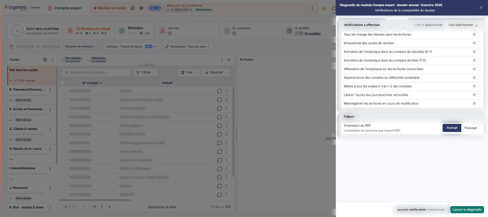
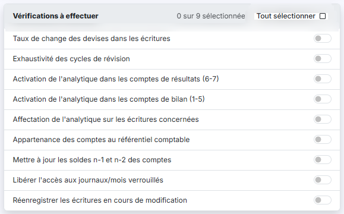
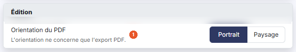

# Diagnostic


**Où le trouver :** Menu **Traitements › Diagnostic**



**En bref** — Cette option lance un diagnostic du dossier annuel en cours : vous choisissez les vérifications à effectuer, et le logiciel en restitue le résultat sous forme d'une édition.

* Pour tout vérifier : bouton \[Tout sélectionner], puis bouton \[Lancer le diagnostic].
* Pour ne vérifier que certains points : cochez les vérifications voulues, puis bouton \[Lancer le diagnostic].


Cette option permet de lancer un diagnostic du dossier annuel en cours : le logiciel effectue une série de vérifications que vous choisissez une par une.

<figure><figcaption>
Écran « Diagnostic » de la nouvelle interface
</figcaption></figure>

Pour l'ouvrir, dans l'écran Révision, cliquez sur ⋮ (Plus d'actions), puis, dans la rubrique Outils, sur **Diagnostic**. L'écran s'ouvre dans un panneau, à droite, titré « Diagnostic », dont l'en-tête rappelle le module, le dossier annuel et la société (« du module Compta expert · dossier annuel : Exercice 2026 »). Le panneau s'ouvre sur « Vérifications de la comptabilité du dossier ». Il ne comporte ni onglet, ni liste : vous y désignez les vérifications à effectuer, vous choisissez l'orientation du PDF, puis vous lancez le traitement. Deux blocs se présentent l'un sous l'autre, dans l'ordre décrit ci-dessous, et le bouton de lancement est dans le pied du panneau, à droite. La croix « Fermer » du bandeau de titre referme le panneau.

## Bloc « Vérifications à effectuer »

<figure><figcaption>
Rubrique « a) Bloc « Vérifications à effectuer » »
</figcaption></figure>

Le bloc affiche un compteur, « 0 sur 9 sélectionnée » à l'ouverture, et un bouton \[Tout sélectionner].

Viennent ensuite neuf vérifications, chacune commandée par une case à cocher. **Aucune n'est cochée à l'ouverture de l'écran** : le pied du panneau indique alors « Aucune vérification sélectionnée », et aucune vérification n'est donc effectuée tant que vous n'en avez pas coché au moins une. Aucune n'est obligatoire.

Trois d'entre elles s'accompagnent d'une infobulle, citée plus bas.

**1) Taux de change des devises dans les écritures**

**2) Exhaustivité des cycles de révision**

Les comptes qui n'ont été affectés à aucun cycle de révision, et ceux qui ont été affectés à plusieurs cycles, sont signalés.

**3) Activation de l'analytique dans les comptes de résultats (6-7)**

Signale les comptes de charges et de produits pour lesquels la gestion analytique n'est pas activée.

**4) Activation de l'analytique dans les comptes de bilan (1-5)**

Signale les comptes de bilan pour lesquels la gestion analytique n'est pas activée.

**5) Affectation de l'analytique sur les écritures concernées**

Signale les écritures portant un compte pour lequel la gestion analytique a été activée, mais dont la ventilation analytique n'a pas été renseignée, ou ne l'a pas été complètement.

**6) Appartenance des comptes au référentiel comptable**

Confronte les comptes du plan comptable du dossier au référentiel comptable, et signale ceux qui ne s'y rattachent pas.

**7) Mettre à jour les soldes n-1 et n-2 des comptes**

**8) Libérer l'accès aux journaux/mois verrouillés**

**9) Réenregistrer les écritures en cours de modification**

**Cette vérification est la seule de la liste qui modifie vos données** : elle réenregistre les écritures restées en cours de modification. Activez-la en connaissance de cause.

## Bloc « Édition »

<figure><figcaption>
Rubrique « Bloc « Édition » »
</figcaption></figure>

**Orientation du PDF** : vous choisissez entre **Portrait**, retenu à l'ouverture, et **Paysage**. Le panneau précise : « L'orientation ne concerne que l'export PDF. » Ce bloc ne comporte pas d'autre champ.

bouton **\[Lancer le diagnostic]**

Situé dans le pied du panneau, à droite, ce bouton lance le diagnostic sur les vérifications cochées.
