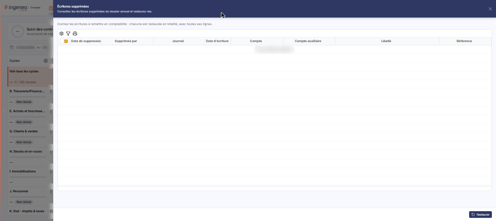
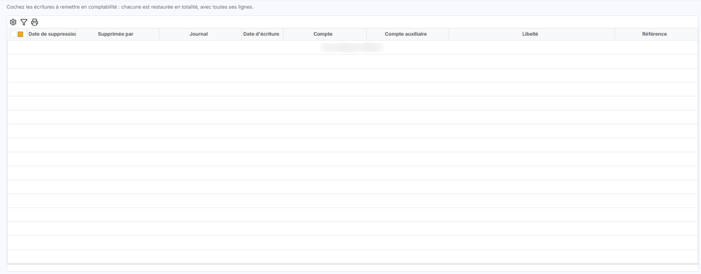
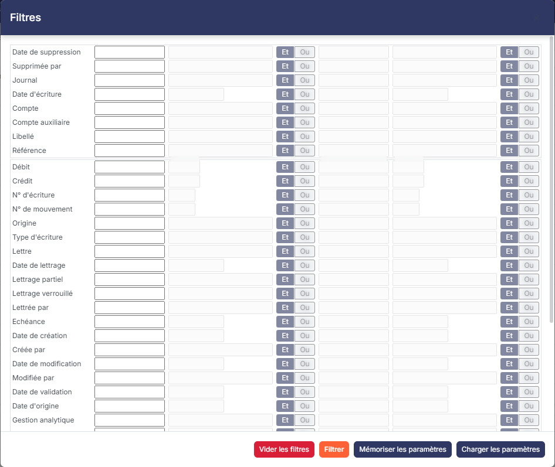

# Ecritures supprimées


**Où le trouver :** Menu **Traitements › Ecritures supprimées**



**En bref** — Cette option conserve la trace des écritures supprimées du dossier annuel, avec l'auteur et le moment de la suppression, et permet de les remettre en comptabilité.

* Pour retrouver une écriture : ouvrez la fenêtre de filtres, saisissez vos conditions, puis bouton \[Filtrer].
* Pour remettre une écriture en comptabilité : sélectionnez-la, puis bouton \[Restaurer].


Cette option conserve la trace des écritures supprimées du dossier annuel en cours, et vous permet de les remettre en comptabilité.

<figure><figcaption>
Écran « Ecritures supprimées » de la nouvelle interface
</figcaption></figure>

Une écriture supprimée n'est pas perdue : le logiciel en garde la ligne ici, avec le nom de la personne qui l'a supprimée et le moment où elle l'a fait. C'est donc l'écran vers lequel vous vous tournez lorsqu'une écriture a disparu de la comptabilité et que vous cherchez à savoir ce qu'elle est devenue, ou à la récupérer.

Dans l'écran Révision, cliquez sur ⋮ (Plus d'actions), puis, dans la rubrique Traitements, sur Écritures supprimées : l'option s'ouvre dans un panneau à droite de l'écran, titré « Écritures supprimées ». Ce panneau ne comporte ni rubrique, ni onglet. Sous le titre, une phrase d'introduction (« Consultez les écritures supprimées du dossier annuel et restaurez-les. ») et une consigne (« Cochez les écritures à remettre en comptabilité : chacune est restaurée en totalité, avec toutes ses lignes. ») précèdent une seule liste. En pied de panneau, à droite, se trouve le Bouton \[Restaurer] ; la croix « Fermer » du bandeau de titre referme le panneau.

## La liste des écritures supprimées

<figure><figcaption>
Rubrique « a) La liste des écritures supprimées »
</figcaption></figure>

Chaque ligne de la liste correspond à une ligne d'écriture supprimée. Les lignes d'une même écriture sont présentées groupées. Huit colonnes sont affichées d'origine, dans cet ordre.

| Champ                   | Ce qu'il faut savoir                                                                                                                                                        |
| ----------------------- | --------------------------------------------------------------------------------------------------------------------------------------------------------------------------- |
| **Date de suppression** | La date et l'heure de la suppression. La liste est **triée sur cette colonne, de la plus récente à la plus ancienne** : ce que vous venez de perdre se trouve donc en tête. |
| **Supprimée par**       | Le nom de l'utilisateur qui a effectué la suppression.                                                                                                                      |
| **Journal**             | Le journal dans lequel l'écriture était enregistrée.                                                                                                                        |
| **Date d'écriture**     | La date comptable de l'écriture, à ne pas confondre avec la date de sa suppression.                                                                                         |
| **Compte**              | Le compte général porté par la ligne.                                                                                                                                       |
| **Compte auxiliaire**   | Le compte auxiliaire porté par la ligne, s'il y en a un.                                                                                                                    |
| **Libellé**             | Le libellé de la ligne d'écriture.                                                                                                                                          |
| **Référence**           | La référence portée par la ligne.                                                                                                                                           |

Cinq commandes sont proposées en tête de liste, de gauche à droite.

* la **case à cocher**, qui sélectionne ou désélectionne toutes les lignes de la page affichée ;
* la **case à cocher multipage**, qui sélectionne toutes les lignes de toutes les pages ;
* le pictogramme « Engrenage », qui ouvre la personnalisation des colonnes affichées ;
* le pictogramme « Entonnoir », qui ouvre la fenêtre **« Filtres »** décrite ci-dessous ;
* le pictogramme « Imprimante ».

## La fenêtre « Filtres »

<figure><figcaption>
Rubrique « b) La fenêtre « Filtres » »
</figcaption></figure>

Le pictogramme « Entonnoir » ouvre la fenêtre **« Filtres »**.

La fenêtre propose une ligne par champ filtrable. Chaque ligne offre **deux conditions combinables** : un premier opérateur et sa valeur, puis la conjonction **Et** ou **Ou**, puis un second opérateur et sa valeur. Aucun champ n'est obligatoire et tous sont vides à l'ouverture.

La fenêtre présente d'abord les huit colonnes affichées dans la liste, puis, séparées par un trait, les autres colonnes disponibles : vous pouvez donc filtrer sur des informations que la liste n'affiche pas.

**Champs filtrables**

Date de suppression, Supprimée par, Journal, Date d'écriture, Compte, Compte auxiliaire, Libellé, Référence — puis Débit, Crédit, N° d'écriture, N° de mouvement, Origine, Type d'écriture, Lettre, Date de lettrage, Lettrage partiel, Lettrage verrouillé, Lettrée par, Echéance, Date de création, Créée par, Date de modification, Modifiée par, Date de validation, Date d'origine, Gestion analytique, Devise, Taux de devise, Débit devise, Crédit devise, Quantité 1, Unité quantité 1, Quantité 2, Unité quantité 2, Rapprochement validé et Date de rapprochement.

**Boutons de la fenêtre « Filtres »**

bouton **\[Filtrer]**, bouton **\[Mémoriser les paramètres]**, bouton **\[Charger les paramètres]** et bouton **\[Vider les filtres]**.

La croix « Fermer » du bandeau de titre referme la fenêtre.

bouton **\[Restaurer]**

C'est le bouton d'action de l'écran : il se trouve en pied de panneau, à droite, et il est présent dès l'ouverture, même quand la liste est vide. Il remet en comptabilité les écritures que vous avez sélectionnées dans la liste.
