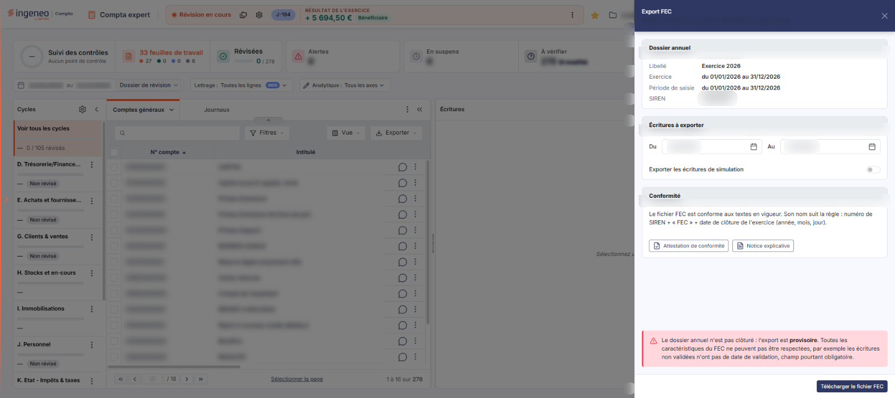
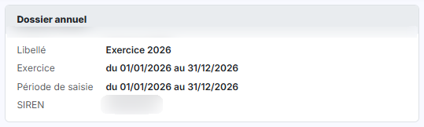
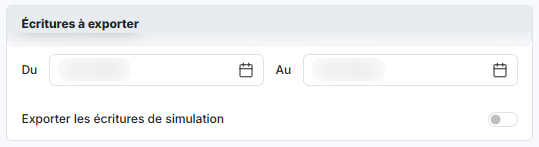
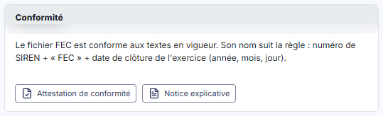

# Export FEC


**Où le trouver :** Menu **Traitements › Export FEC**



**En bref** — Cette option produit le fichier des écritures comptables (FEC) du dossier annuel en cours, fichier normé exigé par l'administration fiscale.

* Pour produire le fichier : confirmez les dates « Du » et « Au », puis bouton \[Télécharger le fichier FEC].
* Pour consulter les pièces de conformité : bouton \[Attestation de conformité] ou bouton \[Notice explicative].


Cette option permet de produire le fichier des écritures comptables, dit fichier FEC, du dossier annuel en cours.

<figure><figcaption>
Écran « Export FEC » de la nouvelle interface
</figcaption></figure>

Pour l'ouvrir, dans l'écran Révision, cliquez sur ⋮ (Plus d'actions), puis sur **Export FEC**. L'écran s'ouvre dans un panneau, à droite, intitulé « Export FEC », sous le message « Générez le fichier des écritures comptables du dossier annuel. ». Le panneau ne comporte ni onglet ni liste. Il rappelle d'abord le dossier annuel, vous laisse ensuite confirmer la période à retenir, puis présente la conformité du fichier ; les boutons sont dans le pied du panneau, à droite.

## Bloc « Dossier annuel »

<figure><figcaption>
Rubrique « a) Bloc « Dossier annuel » »
</figcaption></figure>

Le logiciel rappelle, en affichage seul, les caractéristiques du dossier annuel en cours. Aucune de ces valeurs n'est modifiable ici : elles proviennent du dossier annuel.

| Champ                           | Ce qu'il faut savoir                                                                                               |
| ------------------------------- | ------------------------------------------------------------------------------------------------------------------ |
| **Libellé**                     | Le nom du dossier annuel exporté (« Exercice 2026 » sur le dossier relevé).                                        |
| **Exercice du … au …**          | Les bornes de l'exercice.                                                                                          |
| **Période de saisie du … au …** | Les bornes de la période de saisie autorisée sur l'exercice, qui peuvent être plus larges que l'exercice lui-même. |
| **SIREN**                       | Le numéro SIREN de la société.                                                                                     |

## Bloc « Écritures à exporter »

<figure><figcaption>
Rubrique « b) Bloc « Écritures » à exporter »
</figcaption></figure>

**Du** et **Au** : confirmez la fourchette de dates des écritures à prendre en compte. Ces deux zones de date délimitent les écritures retenues dans le fichier. Le logiciel les préremplit avec la date de début et la date de fin de l'exercice rappelées dans le bloc précédent ; vous pouvez les restreindre avant de lancer l'export.

**Exporter les écritures de simulation** : cette case, désactivée à l'ouverture.

## Bloc « Conformité »

<figure><figcaption>
Bouton [Attestation de conformité]
</figcaption></figure>

<figure><figcaption>
Bouton [Notice explicative]
</figcaption></figure>

Le logiciel y affiche d'abord le texte suivant : « Le fichier FEC est conforme aux textes en vigueur. Son nom suit la règle : numéro de SIREN + « FEC » + date de clôture de l'exercice (année, mois, jour). », suivi des boutons \[Attestation de conformité] et \[Notice explicative].

Sur un dossier annuel non clôturé, le logiciel affiche en outre le message suivant : « Le dossier annuel n'est pas clôturé : l'export est provisoire. Toutes les caractéristiques du FEC ne peuvent pas être respectées, par exemple les écritures non validées n'ont pas de date de validation, champ pourtant obligatoire. »

bouton **\[Attestation de conformité]**

Situé dans le bloc « Conformité », c'est le premier des deux boutons.

bouton **\[Notice explicative]**

Situé dans le bloc « Conformité », à la suite du précédent.

bouton **\[Télécharger le fichier FEC]**

Situé dans le pied du panneau, à droite, c'est le seul bouton du pied et le bouton d'export ; le panneau se referme par la croix « Fermer » de l'en-tête.
