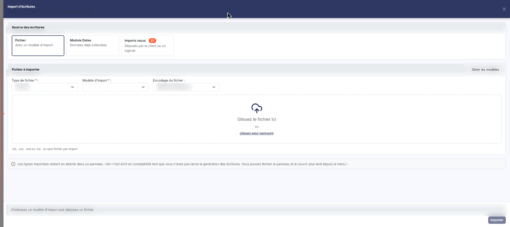
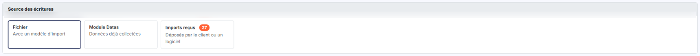
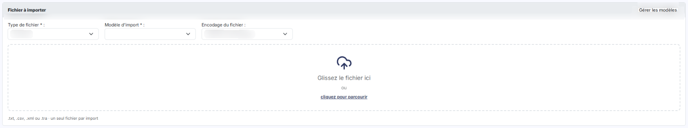

# Import de données


**Où le trouver :** Menu **Traitements › Import de données**



**En bref** — Cette option permet d'intégrer des fichiers d'écritures ou des balances issus d'autres logiciels, de corriger les lignes chargées dans une grille, puis de générer les écritures.

* Pour corriger les éléments inconnus d'un coup : bouton \[Gérer les éléments inconnus].
* Pour ajouter une ligne à la main : bouton \[Nouvelle ligne], puis renseignez-la.
* Pour terminer l'import : bouton \[Générer les écritures].


L'import de données permet d'intégrer des fichiers d'écritures ou des balances issus d'autres logiciels.

<figure><figcaption>
Écran « Import de données » de la nouvelle interface
</figcaption></figure>

Pour l'ouvrir, dans l'écran Révision, cliquez sur ⋮ (Plus d'actions), puis, dans la rubrique Saisie, sur Import d'écritures (une pastille indique le nombre d'imports reçus) : l'écran s'ouvre dans un panneau, à droite, intitulé « Import d'écritures », dont le sous-titre rappelle la société et les dates de l'exercice. La croix « Fermer » de l'en-tête le referme.

L'import se fait selon des modèles d'import, gérés dans le panneau Paramètres, rubrique « Modèles », groupe « Imports et exports », écran « Écritures » (liste unique des modèles d'import et d'export). Les plus courants ont été élaborés par Ingeneo Compta, mais vous avez la possibilité d'en créer de nouveaux pour vos besoins propres.

L'écran fonctionne en deux temps. Vous chargez d'abord les lignes du fichier dans une grille de travail : à ce stade, rien n'est encore comptabilisé, et vous pouvez modifier les lignes, les supprimer, en créer de nouvelles. Vous ne générez les écritures qu'ensuite, une fois toutes les lignes valides. Les lignes chargées restent dans la grille tant que vous ne les avez pas supprimées ou générées en écritures : vous pouvez donc fermer le panneau, le rouvrir plus tard depuis le menu ⋮ et aller faire un contrôle ou un paramétrage ailleurs dans le logiciel, sans rien perdre. Le panneau le rappelle : « Les lignes importées restent en attente dans ce panneau : rien n'est écrit en comptabilité tant que vous n'avez pas lancé la génération des écritures. Vous pouvez fermer le panneau et le rouvrir plus tard depuis le menu ⋮. »

À l'ouverture, le panneau présente de haut en bas la rubrique « Source des écritures », la rubrique « Fichier à importer », un encadré d'information et, en pied, une ligne d'aide (« Choisissez un modèle d'import puis déposez un fichier. ») et le bouton \[Importer] (ni bouton \[Fermer] ni bouton \[Annuler] : la croix de l'en-tête referme le panneau).

**Source « Imports reçus »**

Certains fichiers vous parviennent sans que vous ayez à les chercher sur votre poste : la carte « Imports reçus » (« Déposés par le client ou un logiciel »), dans la rubrique « Source des écritures », donne accès à ceux qui attendent d'être chargés. Une pastille de comptage, sur la carte elle-même, vous indique combien il en reste en attente.

Elle donne accès au bloc « Imports reçus à traiter », qui affiche l'instruction « Sélectionnez le fichier à charger et cliquez sur \[Valider]. » et présente la liste de ces fichiers, triée par défaut sur la date de réception, de la plus récente à la plus ancienne. Une case en début de ligne permet de retenir le fichier à charger.

Cette fenêtre porte elle aussi les pictogrammes de choix des colonnes, de filtre et d'impression. Deux boutons la referment. bouton **\[Valider]** : il charge le fichier que vous avez retenu. bouton **\[Fermer]** : il referme la fenêtre sans rien charger, tout comme la croix du bandeau de titre.

**Source « Fichier » et rubrique « Fichier à importer »**

La source « Fichier — Avec un modèle d'import », retenue à l'ouverture, charge dans la grille les lignes d'un fichier qui se trouve sur votre poste. La rubrique « Fichier à importer » vous demande alors plusieurs informations ; elle porte en tête le bouton \[Gérer les modèles].

| Champ                                                                            | Ce qu'il faut savoir                                                                                                                                                                                                                                                                                                                                                                                                                                                                                                                                                                                                                                                                                                                                                                                                                               |
| -------------------------------------------------------------------------------- | -------------------------------------------------------------------------------------------------------------------------------------------------------------------------------------------------------------------------------------------------------------------------------------------------------------------------------------------------------------------------------------------------------------------------------------------------------------------------------------------------------------------------------------------------------------------------------------------------------------------------------------------------------------------------------------------------------------------------------------------------------------------------------------------------------------------------------------------------- |
| 
<strong>Type de fichier</strong> <em>Obligatoire</em>
                  | Vous pouvez importer des écritures, choix retenu à l'ouverture, ou une balance, qui sera convertie en écritures. Ce choix commande les champs demandés ensuite.                                                                                                                                                                                                                                                                                                                                                                                                                                                                                                                                                                                                                                                                                    |
| 
<strong>Modèle d'import</strong> <em>Obligatoire</em>
                  | Vide à l'ouverture. Le logiciel propose tous les modèles créés par Ingeneo Compta ou ajoutés par vous qui correspondent au type de fichier retenu.                                                                                                                                                                                                                                                                                                                                                                                                                                                                                                                                                                                                                                                                                                 |
| 
<strong>Date d'intégration de la balance</strong> <em>Obligatoire</em>
 | Ce champ n'est demandé que pour le type **Balance**. Indiquez la date à laquelle la balance doit être intégrée ; vous pouvez la saisir ou la choisir dans le calendrier.                                                                                                                                                                                                                                                                                                                                                                                                                                                                                                                                                                                                                                                                           |
| 
<strong>Journal d'intégration</strong> <em>Obligatoire</em>
            | Ce champ n'est demandé que pour le type **Balance**. Retenez le journal dans lequel les écritures issues de la balance seront enregistrées.                                                                                                                                                                                                                                                                                                                                                                                                                                                                                                                                                                                                                                                                                                        |
| **Encodage du fichier**                                                          | Ce champ n'est demandé que pour le type **Ecritures**. Les fichiers peuvent être produits selon différents modes d'encodage, selon le logiciel qui les a générés. Le logiciel propose « Détection automatique », retenu à l'ouverture, puis « UTF-8 - Unicode », « ISO-8859-15 - Latin 9 (ISO) », « Windows 1252 - Europe de l'Ouest (Windows) », « IBM/OEM 850 - Europe de l'Ouest (DOS) », « ISO-8859-1 - Europe de l'Ouest (ISO) » et « Ascii ». Normalement la détection se fait automatiquement, mais ce n'est pas toujours le cas. Si vous constatez, après l'import, que les caractères accentués ont été remplacés par des pictogrammes ou par des caractères inattendus, c'est probablement que l'encodage n'a pas été correctement détecté : recommencez l'import en choisissant un autre encodage, jusqu'à obtenir le résultat attendu. |
| **Ecritures centralisées**                                                       | Case à cocher. Il n'est demandé que si le modèle d'import retenu est de type FEC. Le logiciel en rappelle la raison dans une infobulle : « Une écriture de centralisation est une écriture contenant des lignes à des dates différentes. Ce type d'écriture n'étant pas conforme à la norme FEC, le fichier devra être retraité pour être importé. » Dans la norme FEC, une même écriture ne peut pas contenir de lignes à des dates différentes : les écritures centralisées doivent donc être séparées en autant d'écritures que de dates.                                                                                                                                                                                                                                                                                                       |
| 
<strong>Compte de contrepartie</strong> <em>Obligatoire</em>
           | Ce champ n'apparaît que si vous avez coché **Ecritures centralisées**. Indiquez un compte de virements internes, qui enregistrera les contreparties de ces nouvelles écritures. Ce compte n'a aucune incidence sur les comptes, puisque son solde sera nul une fois toutes les écritures importées. Vous pouvez saisir le numéro de compte, le rechercher à l'aide du pictogramme « Loupe » ou en créer un à l'aide du pictogramme « Plus ». Si vous ne le renseignez pas, vous ne pourrez pas générer les écritures, le logiciel les interprétant comme déséquilibrées.                                                                                                                                                                                                                                                                           |
| **Fichier à importer**                                                           | Déposez le fichier dans le cadre en pointillés, à icône de nuage, qui porte les mentions « Glissez le fichier ici », « ou », puis le lien « cliquez pour parcourir » ; la mention « .txt, .csv, .xml ou .tra · un seul fichier par import » précise les formats acceptés. Le bouton **\[Importer]**, en bas du panneau, à droite, est désactivé tant que vous n'avez pas choisi un modèle d'import et déposé un fichier ; il lance ensuite le chargement.                                                                                                                                                                                                                                                                                                                                                                                          |

Si la structure du fichier n'est pas conforme à ce que définit le modèle, l'import est refusé. Dans le cas contraire, toutes les lignes sont chargées dans la grille, puis le logiciel les confronte aux caractéristiques du dossier annuel de destination. Toute ligne qui n'est pas cohérente avec elles est mise en erreur. Les contrôles sont les suivants :

* la **date d'écriture** doit être comprise dans la période de saisie ;
* le **journal** doit exister ;
* le **numéro de compte** doit exister dans le plan comptable ;
* le **libellé** de l'écriture doit être renseigné ;
* le **débit** ou le **crédit** doit porter un montant supérieur à 0.

Deux transformations sont opérées au chargement, et il est utile de les connaître pour ne pas s'étonner de l'écart entre le fichier et la grille : les lignes dont le montant est nul au débit comme au crédit ne sont pas chargées du tout, et les lignes qui portent à la fois un montant au débit et un montant au crédit sont séparées en deux lignes.

Vous pouvez enchaîner plusieurs imports dans la même grille, même si elle n'est pas vide : les nouvelles lignes se placent à la suite de celles déjà présentes.

Pour l'analytique, une ligne d'écriture imputée sur un ou plusieurs axes et une ou plusieurs sections doit être suivie d'autant de lignes d'imputation que de sections. Ces lignes se placent immédiatement à la suite de la ligne d'écriture et ne doivent comporter que les trois champs analytiques, à savoir « Axe », « Section » et « Montant ». Si vous importez une ligne d'écriture sur un compte géré analytiquement sans en importer la ventilation, et qu'une ventilation type est renseignée dans le compte, elle sera appliquée automatiquement lors de la génération des écritures.

**Source « Module Datas »**

Si vous avez déjà importé des écritures dans le module « Datas », la carte « Module Datas » (« Données déjà collectées »), dans la rubrique « Source des écritures », vous permet de les reprendre en comptabilité sans repasser par le fichier d'origine. Le module « Datas » n'étant utilisé que pour les indicateurs graphiques du tableau de bord, les contrôles qu'il applique à ses imports sont moins stricts que ceux de la comptabilité : attendez-vous donc, après cette reprise, à devoir procéder à des ajustements à l'aide du bouton **\[Gérer les éléments inconnus]**.

Si le module « Datas » ne contient aucune écriture, le logiciel ouvre à la place une fenêtre « Erreur » portant le message « Le module Datas ne contient aucune ligne d'écriture. », que vous refermez par le bouton **\[OK]**.

bouton **\[Nouvelle ligne]**

Il ajoute en fin de grille une ligne d'écriture vierge, que vous renseignez pour la rendre valide.

## Modifier une ligne de la grille

Pour modifier une ligne, utilisez le pictogramme d'édition en début de ligne. Si la ligne comporte des erreurs, elles s'affichent en rouge dans la fenêtre de modification, jusqu'à ce que vous les ayez corrigées.

Contrairement à la saisie d'écritures, vous pouvez enregistrer ici une ligne qui contient encore des erreurs : tant qu'elle est dans la grille d'import, elle n'a aucune incidence sur la comptabilité. C'est ce qui vous permet d'aller vérifier quelque chose ailleurs dans le logiciel, de modifier un paramétrage ou de créer un compte, puis de revenir terminer votre grille.

Si la ligne importée comportait une ventilation analytique, vous disposez d'un tableau supplémentaire, à raison d'une ligne par imputation. Vous pouvez y supprimer ou y créer des lignes d'imputation si vous souhaitez modifier la répartition dès ce stade. Vous pourrez également le faire en « Saisie en journal » une fois l'import réalisé.

## Les traitements sur une grille alimentée

Les boutons suivants portent sur les lignes déjà chargées.

bouton **\[Gérer les éléments inconnus]**

C'est le bouton qui vous évite de reprendre les lignes une par une : il applique des traitements groupés à l'ensemble de la grille. Activez les traitements que vous souhaitez lancer, et renseignez le cas échéant les champs qu'ils réclament.

| Champ                                                                          | Ce qu'il faut savoir                                                                                                                                                                                                                                                                                                                                                                                                                                                                                                                                                                                                                                                                                                                                                                                                                                                                                                                                            |
| ------------------------------------------------------------------------------ | --------------------------------------------------------------------------------------------------------------------------------------------------------------------------------------------------------------------------------------------------------------------------------------------------------------------------------------------------------------------------------------------------------------------------------------------------------------------------------------------------------------------------------------------------------------------------------------------------------------------------------------------------------------------------------------------------------------------------------------------------------------------------------------------------------------------------------------------------------------------------------------------------------------------------------------------------------------- |
| **Créer automatiquement les comptes généraux inconnus**                        | Crée tous les comptes généraux figurant dans les lignes de la grille et absents du plan comptable. Si vous avez indiqué un intitulé de compte dans la ligne, il est repris ; sinon, c'est le numéro de compte qui est recopié dans l'intitulé. Si le numéro de compte de la ligne comporte moins de caractères que ne le prévoit le plan comptable du dossier annuel, il est complété par des 0. Si la ligne comporte un numéro de compte auxiliaire, le compte créé est de type « Collectif » avec la nature correspondante ; sinon, il est de type « Standard » et de nature « Divers ». Les caractéristiques du compte restent ensuite modifiables.                                                                                                                                                                                                                                                                                                          |
| **Créer automatiquement les comptes auxiliaires inconnus**                     | Crée tous les comptes auxiliaires figurant dans les lignes de la grille et absents de la liste des comptes auxiliaires. Le compte auxiliaire est créé avec la catégorie du compte collectif présent sur la ligne : il ne peut donc pas être créé si le compte collectif n'est pas renseigné sur cette même ligne. La création d'un compte auxiliaire client entraîne aussi la création de la fiche client dans le module « Facturation », et celle d'un compte auxiliaire fournisseur la création de la fiche fournisseur dans le module « Gestion commerciale ». Si un même compte auxiliaire est rattaché à plusieurs comptes collectifs de natures différentes — client et fournisseur, par exemple — le logiciel crée autant de comptes auxiliaires que de natures utilisées, en faisant précéder le numéro du préfixe F pour fournisseur, C pour client, S pour salarié ou D pour divers, ou du préfixe que vous avez défini dans les paramètres généraux. |
| **Créer automatiquement les journaux inconnus**                                | Crée tous les journaux figurant dans les lignes de la grille et absents de la liste des journaux. Chaque journal est créé avec le type « Divers » et son libellé reprend son code. Toutes ses caractéristiques restent ensuite modifiables.                                                                                                                                                                                                                                                                                                                                                                                                                                                                                                                                                                                                                                                                                                                     |
| **Libellés non renseignés à remplacer par l'intitulé du compte**               | Renseigne tous les libellés de lignes vides avec l'intitulé du compte, lorsqu'il est présent dans la ligne.                                                                                                                                                                                                                                                                                                                                                                                                                                                                                                                                                                                                                                                                                                                                                                                                                                                     |
| **Libellés non renseignés**                                                    | Ce champ n'apparaît que si vous n'avez pas activé le remplissage automatique par l'intitulé du compte. Indiquez le libellé à affecter à toutes les lignes de la grille dont le libellé est vide.                                                                                                                                                                                                                                                                                                                                                                                                                                                                                                                                                                                                                                                                                                                                                                |
| **Date des écritures à indiquer pour les dates hors période de saisie**        | Si des lignes portent une date qui n'est pas comprise dans la période de saisie de l'exercice, vous pouvez indiquer ici une date de remplacement. La date d'origine n'est pas perdue : elle est conservée dans le champ « Date d'origine » de l'écriture générée.                                                                                                                                                                                                                                                                                                                                                                                                                                                                                                                                                                                                                                                                                               |
| **Gestion des lettrages déséquilibrés**                                        | Avec l'option « Manuelle », vous devrez reprendre ligne par ligne tous les lettrages pour les équilibrer avant de pouvoir générer les écritures. Avec l'option « Conserver », les lettrages déséquilibrés ne sont plus considérés comme des erreurs et vous pouvez générer vos écritures en l'état ; générez-les alors immédiatement, car si vous rouvrez ensuite une ligne portant un lettrage déséquilibré, elle sera remise en erreur à l'enregistrement et l'opération sera à refaire. Avec l'option « Supprimer », les lettrages déséquilibrés sont supprimés et la génération se fait sans contrainte.                                                                                                                                                                                                                                                                                                                                                    |
| **Définir comme lettrables tous les comptes ayant au moins une ligne lettrée** | Met à jour le plan comptable en activant le paramètre « Compte lettrable » sur chaque compte concerné.                                                                                                                                                                                                                                                                                                                                                                                                                                                                                                                                                                                                                                                                                                                                                                                                                                                          |
| **Changer automatiquement le type de compte**                                  | Le logiciel gère deux types de comptes généraux, « Standard » et « Collectif », et une ligne d'écriture portant un compte collectif doit obligatoirement comporter un compte auxiliaire. Cette option fait basculer le type du compte général dans un sens ou dans l'autre selon ce que contient la ligne : de « Standard » à « Collectif » si la ligne porte un compte auxiliaire alors que le compte est paramétré en standard, et de « Collectif » à « Standard » si la ligne n'en porte pas alors que le compte est paramétré en collectif. La bascule vers « Collectif » suppose qu'aucune écriture n'existait dans le compte avant l'import ; la bascule vers « Standard » suppose en plus qu'aucun compte auxiliaire n'est rattaché au compte collectif.                                                                                                                                                                                                 |
| **Inverser le sens pour les montants négatifs**                                | Le logiciel ne gère pas les montants négatifs dans les écritures. Si vous répondez « Oui », le signe négatif est supprimé et le sens de l'écriture est inversé. Si vous répondez « Non », rien n'est fait, mais vous ne pourrez pas mener votre import à son terme tant qu'il restera une seule écriture portant un montant négatif.                                                                                                                                                                                                                                                                                                                                                                                                                                                                                                                                                                                                                            |
| **Créer les paramétrages analytiques**                                         | Crée automatiquement les axes et les sections analytiques détectés dans les écritures importées et qui n'existent pas dans le dossier annuel de destination.                                                                                                                                                                                                                                                                                                                                                                                                                                                                                                                                                                                                                                                                                                                                                                                                    |

**Définir comme gérés analytiquement tous les comptes ayant au moins une ligne avec une ventilation analytique :** met à jour le plan comptable en activant le paramètre « Gérer ce compte analytiquement » sur chaque compte concerné. La ventilation analytique sera dès lors demandée lors de la saisie de nouvelles écritures sur ces comptes.

bouton **\[Importer les pièces jointes]**

Si votre modèle d'import prévoit l'import de pièces jointes, c'est-à-dire si son champ « Référence des pièces jointes » est renseigné, ce bouton vous permet de les charger. Indiquez où se trouve, sur votre poste, le fichier ZIP qui les contient : elles seront rattachées à leurs lignes d'écritures. Faites-le **avant** de générer les écritures.

bouton **\[Supprimer]**

Il supprime de la grille les lignes que vous avez cochées. Les numéros de toutes les lignes sont recalculés après la suppression.

bouton **\[Vider]**

Il supprime l'intégralité des lignes présentes dans la grille d'import. La suppression est définitive.

bouton **\[Générer les écritures]**

C'est la dernière étape : elle transforme les lignes de la grille en écritures comptables. Ce bouton n'apparaît que lorsque toutes les lignes de la grille sont valides, c'est-à-dire qu'aucune ne comporte plus d'erreur et que le total des débits est égal au total des crédits. Tant qu'une seule ligne reste en erreur, la génération n'est pas possible.

## Autres vues de l'écran

<figure><figcaption>
Source « Imports reçus »
</figcaption></figure>

<figure><figcaption>
Source « Module Datas »
</figcaption></figure>

<figure><figcaption>
Source « Fichier » et rubrique « Fichier à importer »
</figcaption></figure>
