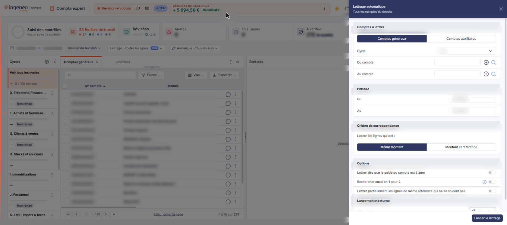
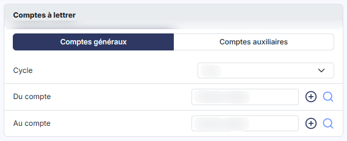
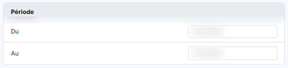
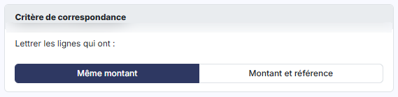
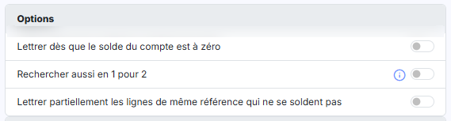
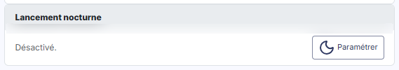

# Lettrage automatique


**Où le trouver :** Menu **Traitements › Lettrage automatique**



**En bref** — Cette option lance le lettrage automatique « 1 pour 1 » : le logiciel rapproche seul les écritures au débit et au crédit de même montant.

* Pour lettrer automatiquement : délimitez les comptes et les écritures dans les critères de sélection, choisissez le critère de correspondance, puis bouton \[Lancer le lettrage].


Cette option demande au logiciel de lettrer lui-même les écritures, sans que vous ayez à les rapprocher une à une. Le lettrage automatique standard est un lettrage « 1 pour 1 » : le logiciel ne lettre une écriture portant un montant au débit qu'avec une seule écriture portant le même montant au crédit.

<figure><figcaption>
Écran « Lettrage automatique » de la nouvelle interface
</figcaption></figure>

Pour l'ouvrir, dans l'écran Révision, cliquez sur ⋮ (Plus d'actions), puis, dans la rubrique Traitements, sur Lettrage automatique : l'écran s'ouvre dans un panneau, à droite, qui porte le titre « Lettrage automatique » et le sous-titre « Tous les comptes du dossier ». La croix « Fermer » de l'en-tête du panneau le referme.

Le panneau comporte cinq blocs : « Comptes à lettrer », « Période », « Critère de correspondance », « Options » et « Lancement nocturne ». Vous y renseignez d'abord les critères de sélection des écritures à lettrer, puis le critère de correspondance et les options de recherche. Aucun champ n'y est obligatoire.

## Les critères de sélection des écritures

<figure><figcaption>
Rubrique « a) Les critères de sélection des écritures »
</figcaption></figure>

<figure><figcaption>
Rubrique « a) Les critères de sélection des écritures »
</figcaption></figure>

Les champs s'affichent dans l'ordre suivant.

| Champ                                      | Ce qu'il faut savoir                                                                                                                                                                                                                                                                                                                                                                                                                                                                                                                                 |
| ------------------------------------------ | ---------------------------------------------------------------------------------------------------------------------------------------------------------------------------------------------------------------------------------------------------------------------------------------------------------------------------------------------------------------------------------------------------------------------------------------------------------------------------------------------------------------------------------------------------- |
| **Comptes généraux / Comptes auxiliaires** | Deux onglets, en tête du bloc « Comptes à lettrer ». **Comptes généraux** est retenu à l'ouverture du panneau. Ce choix commande la suite du bloc : si vous retenez **Comptes auxiliaires**, le champ **Cycle** est remplacé par un champ **Catégorie** et les deux zones de fourchette portent alors sur des comptes auxiliaires et non plus sur des comptes généraux.                                                                                                                                                                              |
| **Cycle**                                  | Ce sélecteur n'est présent que sous l'onglet **Comptes généraux** ; il s'ouvre sur « Tous ». Si vous ne souhaitez lancer le lettrage que sur les comptes d'un cycle de révision, choisissez-le ici. Les choix proposés sont, dans l'ordre : « Tous », « D. Trésorerie/Financement », « E. Achats et fournisseurs », « G. Clients & ventes », « H. Stocks et en-cours », « I. Immobilisations », « J. Personnel », « K. Etat - Impôts & taxes », « L. Capitaux propres, prov. », « M. Autres comptes de bilan » et « N. Autres comptes de résultat ». |
| **Catégorie**                              | Ce champ n'est présent que si vous avez retenu **Comptes auxiliaires**. Il prend la place du champ **Cycle** et s'ouvre sur « Toutes ». Les choix proposés sont « Toutes », « Divers », « Clients », « Fournisseurs » et « Salariés ».                                                                                                                                                                                                                                                                                                               |
| **Du compte**                              | Première borne de la fourchette de comptes. Vous pouvez saisir le numéro de compte directement ou le rechercher à l'aide du pictogramme « Loupe » placé à droite du champ, qu'accompagne un pictogramme « + ». Le champ attend un compte général ou un compte auxiliaire selon l'onglet retenu (**Comptes généraux** ou **Comptes auxiliaires**).                                                                                                                                                                                                    |
| **Au compte**                              | Seconde borne de la fourchette de comptes, même fonctionnement.                                                                                                                                                                                                                                                                                                                                                                                                                                                                                      |
| **Période, Du**                            | Dans le bloc « Période », le logiciel propose le premier jour du dossier annuel.                                                                                                                                                                                                                                                                                                                                                                                                                                                                     |
| **Au**                                     | Le logiciel propose le dernier jour du dossier annuel. Ces deux dates limitent les écritures que le logiciel analysera à l'intérieur de chaque compte ; vous pouvez les saisir ou les choisir dans le calendrier.                                                                                                                                                                                                                                                                                                                                    |

## Le critère de correspondance et les options

<figure><figcaption>
Rubrique « b) Le critère de correspondance et les options »
</figcaption></figure>

<figure><figcaption>
Rubrique « b) Le critère de correspondance et les options »
</figcaption></figure>

<figure><figcaption>
Rubrique « Bloc « Lancement nocturne » et bouton [Paramétrer] »
</figcaption></figure>

| Champ                                                                        | Ce qu'il faut savoir                                                                                                                                                                                                                                                                                                                                                                                                                                                                                            |
| ---------------------------------------------------------------------------- | --------------------------------------------------------------------------------------------------------------------------------------------------------------------------------------------------------------------------------------------------------------------------------------------------------------------------------------------------------------------------------------------------------------------------------------------------------------------------------------------------------------- |
| **Lettrer les lignes qui ont**                                               | 
Dans le bloc « Critère de correspondance », deux boutons au choix : <strong>Même montant</strong>, retenu à l'ouverture, et <strong>Montant et référence</strong>. Avec le premier, le logiciel lettre deux lignes dès lors qu'elles portent le même montant en sens inverse. Avec le second, il faut en plus que les deux lignes portent <strong>exactement</strong> le même contenu dans leur champ « Référence ». Le bloc « Options » regroupe trois interrupteurs, tous désactivés à l'ouverture.
 |
| **Lettrer dès que le solde du compte est à zéro**                            | Interrupteur, désactivé à l'ouverture. Si vous l'activez, toutes les écritures d'un compte sont lettrées avec la même lettre dès que le solde du compte passe à zéro.                                                                                                                                                                                                                                                                                                                                           |
| **Rechercher aussi en 1 pour 2**                                             | Interrupteur, désactivé à l'ouverture. L'icône d'information qui l'accompagne en donne la raison dans une infobulle : « Le lettrage automatique par montant se fait en 1 crédit pour 1 débit mais vous pouvez lancer une recherche supplémentaire avec 1 crédit pour 2 débits ou 1 débit pour 2 crédits. Cette recherche nécessite un temps de traitement supplémentaire c'est pourquoi elle est optionnelle. »                                                                                                 |
| **Lettrer partiellement les lignes de même référence qui ne se soldent pas** | Interrupteur, désactivé à l'ouverture.                                                                                                                                                                                                                                                                                                                                                                                                                                                                          |

bouton **\[Lancer le lettrage]**

Situé en bas du panneau, à droite, il lance le traitement sur les comptes et les écritures que vous avez délimités, avec les options retenues. Le pied ne porte pas de bouton \[Annuler] : pour abandonner sans lancer le lettrage, utilisez la croix « Fermer » de l'en-tête.

**Bloc « Lancement nocturne » et bouton \[Paramétrer]**

Ce bloc affiche l'état du lancement nocturne, « Désactivé. » à l'ouverture, et un bouton \[Paramétrer], précédé d'une icône en forme de lune.
