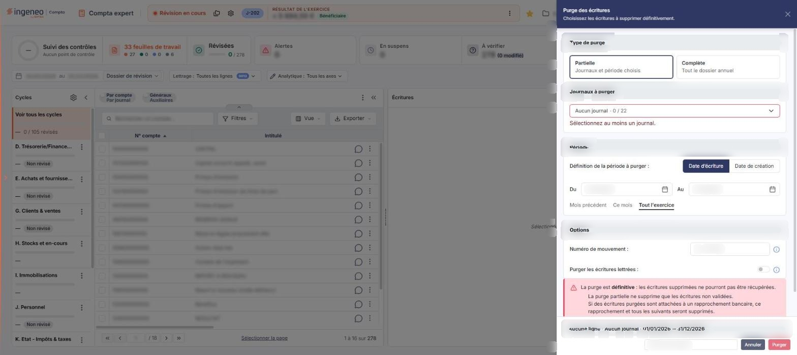
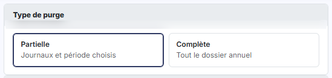
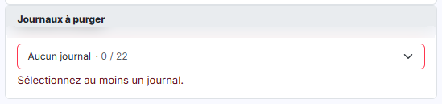
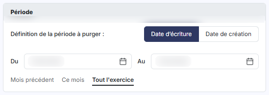
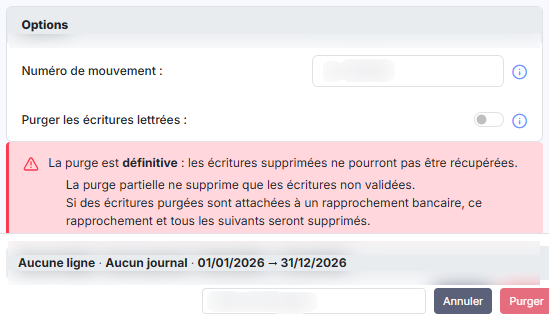

# Purge


**Où le trouver :** Menu **Traitements › Purge**



**En bref** — Cette option supprime définitivement des écritures du dossier annuel, sans retour en arrière possible : purge partielle sur critères ou purge complète.

* Pour purger : choisissez le type de purge, renseignez les critères, lisez l'avertissement, puis bouton \[Purger].
* Pour renoncer : croix « Fermer » du bandeau de titre (le pied n'a pas de bouton \[Annuler]).


Cette option supprime définitivement des écritures du dossier annuel.

<figure><figcaption>
Écran « Purge » de la nouvelle interface
</figcaption></figure>

Pour l'ouvrir, dans l'écran Révision, cliquez sur ⋮ (Plus d'actions), puis sur **Purge**. L'écran s'ouvre dans un panneau, à droite, intitulé « Purge des écritures », sous le message « Choisissez les écritures à supprimer définitivement. ». La croix « Fermer » du bandeau de titre referme le panneau.

Le panneau se compose de quatre blocs, l'un sous l'autre : « Type de purge », « Journaux à purger », « Période » et « Options ». Un encadré rouge d'avertissement vient ensuite, puis le pied du panneau, qui porte le champ Mot de passe et les boutons. C'est vous, et vous seul, qui délimitez ce qui sera supprimé : sous « Journaux à purger », le logiciel indique « Sélectionnez au moins un journal. », et le bouton \[Purger] est grisé à l'ouverture, aucun journal n'étant choisi. Les bornes de période et le numéro de mouvement, eux, ne font que restreindre la purge : prenez garde à ce que vous laissez ouvert.

## Le choix du type de purge

<figure><figcaption>
Rubrique « a) Le choix du type de purge »
</figcaption></figure>

Le premier bloc, « Type de purge », est un choix entre deux cartes : **Partielle** (« Journaux et période choisis ») et **Complète** (« Tout le dossier annuel »). À l'ouverture de l'écran, le logiciel retient **Partielle**.

Le type de purge retenu commande la liste des champs affichés en dessous : le logiciel n'affiche pas les mêmes critères dans les deux cas.

## Les critères de la purge partielle

<figure><figcaption>
Rubrique « b) Les critères de la purge partielle »
</figcaption></figure>

<figure><figcaption>
Rubrique « b) Les critères de la purge partielle »
</figcaption></figure>

<figure><figcaption>
Rubrique « b) Les critères de la purge partielle »
</figcaption></figure>

La purge partielle ne supprime que les écritures **non validées**. Les blocs et champs suivants s'affichent dans cet ordre : « Journaux à purger », « Période » (**Définition de la période à purger**, **Du**, **Au**), puis « Options » (**Numéro de mouvement**, **Purger les écritures lettrées**). À l'ouverture, aucun journal n'est retenu, **Définition de la période à purger** est positionné sur **Date d’écriture**, les bornes **Du** et **Au** affichent 01/01/2026 et 31/12/2026 sur le dossier relevé, **Numéro de mouvement** est vide et l'interrupteur **Purger les écritures lettrées** est désactivé.

| Champ                                 | Ce qu'il faut savoir                                                                                                                                                                                                                                                                                                                                                                                     |
| ------------------------------------- | -------------------------------------------------------------------------------------------------------------------------------------------------------------------------------------------------------------------------------------------------------------------------------------------------------------------------------------------------------------------------------------------------------- |
| **Journaux à purger**                 | Indiquez le ou les journaux dont les écritures doivent être supprimées. Le champ est un bouton déroulant, libellé **Aucun journal · 0 / 22** à l'ouverture sur le dossier relevé (22 journaux) ; il ouvre la liste des journaux du dossier annuel, présentés par code et libellé, que l'on retient un par un. Le message « Sélectionnez au moins un journal. » reste affiché tant qu'aucun n'est retenu. |
| **Numéro de mouvement**               | Ce champ restreint encore la purge ; il propose en exemple « Ex. 12;15;18 ».                                                                                                                                                                                                                                                                                                                             |
| **Définition de la période à purger** | Choix entre **Date d’écriture**, retenu à l'ouverture, et **Date de création**.                                                                                                                                                                                                                                                                                                                          |
| **Du**                                | Première borne de la période. **Au** : seconde borne de la période. Trois raccourcis placés sous les deux champs, **Mois précédent**, **Ce mois** et **Tout l'exercice**, servent à les renseigner.                                                                                                                                                                                                      |
| **Purger les écritures lettrées**     | Interrupteur, désactivé à l'ouverture.                                                                                                                                                                                                                                                                                                                                                                   |

## L'avertissement affiché par le logiciel

<figure><figcaption>
Rubrique « c) L'avertissement affiché par le logiciel »
</figcaption></figure>

Sous les champs, avant toute action de votre part, le logiciel affiche l'avertissement suivant, dans un encadré rouge.

La purge est définitive : les écritures supprimées ne pourront pas être récupérées.

La purge partielle ne supprime que les écritures non validées.

Si des écritures purgées sont attachées à un rapprochement bancaire, ce rapprochement et tous les suivants seront supprimés.

Si des écritures purgées sont attachées à une déclaration de TVA, cette déclaration et toutes les suivantes seront supprimées.

bouton **\[Purger]**

Il se trouve dans le pied du panneau, à droite ; il n'y a pas de bouton \[Annuler] dans le pied, et le panneau se referme par la croix « Fermer » du bandeau de titre. Le pied porte aussi un champ **Mot de passe** (« Votre mot de passe ») et un récapitulatif de votre sélection, de la forme « Aucune ligne · Aucun journal · 01/01/2026 → 31/12/2026 ». Le bouton \[Purger] lance la suppression selon les critères que vous avez renseignés. Il n'y a ni bouton de réinitialisation, ni mémorisation des paramètres dans ce panneau, contrairement à d'autres traitements du module.
