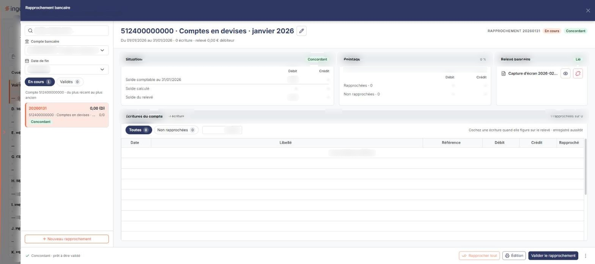
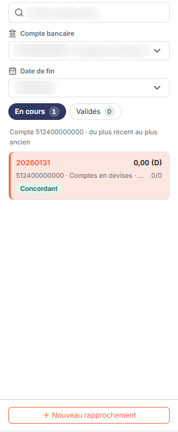
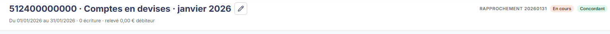
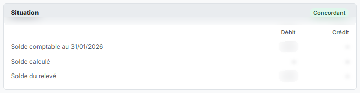
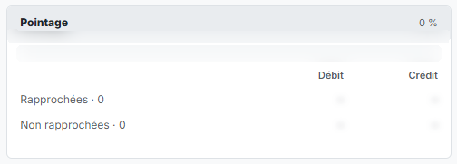
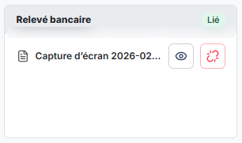
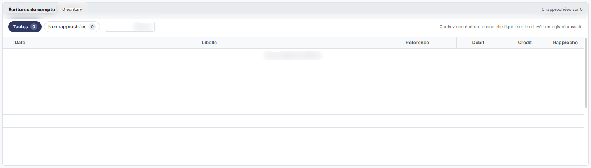

# Rapprochement bancaire


**Où le trouver :** Menu **Traitements › Rapprochement bancaire**



**En bref** — Cette option permet d'effectuer les rapprochements bancaires et de consulter ceux déjà réalisés, compte par compte, dans un panneau ouvert depuis l'écran Révision.

* Pour commencer : choisissez le compte bancaire dans le filtre, puis bouton \[Nouveau rapprochement].
* Pour pointer les écritures : cochez les lignes, ou bouton \[Rapprocher tout].
* Pour figer le rapprochement : bouton \[Valider le rapprochement] ; pour le rouvrir, bouton \[Dévalider].


Cette option permet d'effectuer les rapprochements bancaires et de consulter ceux qui ont déjà été réalisés.

<figure><figcaption>
Écran « Rapprochement bancaire » de la nouvelle interface
</figcaption></figure>

Pour l'ouvrir, dans l'écran Révision, cliquez sur ⋮ (Plus d'actions), puis, dans la rubrique Traitements, sur Rapprochement bancaire : l'écran s'ouvre dans un panneau, à droite, intitulé « Rapprochement bancaire », dont le sous-titre rappelle la société et les dates de l'exercice. La croix « Fermer » de l'en-tête le referme.

Le panneau présente la liste des rapprochements du dossier annuel en cours, avec deux boutons, « En cours » et « Validés », chacun suivi du nombre de rapprochements, et un bouton « Nouveau rapprochement ». Il présente ensuite le rapprochement retenu en quatre blocs : « Situation », « Pointage », « Relevé bancaire » et « Écritures du compte ». Les boutons d'action sont dans le pied du panneau.

Il ne peut y avoir qu'un rapprochement non validé par compte bancaire.

## Les filtres de la liste

<figure><figcaption>
Rubrique « a) Les filtres de la liste »
</figcaption></figure>

| Champ               | Ce qu'il faut savoir                                                                                                                                                                                                                                                               |
| ------------------- | ---------------------------------------------------------------------------------------------------------------------------------------------------------------------------------------------------------------------------------------------------------------------------------- |
| **Compte bancaire** | Cette liste déroulante reprend les comptes de banque du plan comptable de votre société ; elle n'est donc pas la même d'un dossier à l'autre. La valeur proposée par défaut est "Tous", qui affiche les rapprochements de l'ensemble des comptes.                                  |
| **Date de fin**     | Cette liste déroulante permet de n'afficher que les rapprochements se terminant à une date donnée, par exemple pour retrouver d'un coup d'œil ceux de toutes vos banques à une même date. Tant qu'aucun rapprochement n'existe sur le dossier annuel, elle ne propose aucun choix. |
| **Recherche**       | Une zone de recherche, dont le texte d'invite est « Code, compte, date… », figure aussi dans le panneau.                                                                                                                                                                           |

bouton **\[Annuler le filtre]**

Ce bouton n'apparaît que lorsqu'un compte précis est sélectionné dans le champ "Compte" ; il est absent tant que ce champ vaut "Tous". Lorsque vous le pressez, le logiciel ramène le filtre à "Tous" et le bouton disparaît.

## La liste des rapprochements

La liste présente les rapprochements du dossier annuel en cours sous forme de cartes. Chaque carte reprend les informations suivantes :

* **Code** : le code du rapprochement.
* **Solde du relevé** : le solde figurant sur le relevé bancaire, suivi de son sens, par exemple « 0,00 (D) ».
* **Compte** : le compte de banque sur lequel porte le rapprochement, suivi de son intitulé.
* **Période** : les dates de début et de fin de la période rapprochée, par exemple « 01/01 → 31/01 ».
* **Compteur de pointage** : par exemple « 0/0 ».
* **Etat** : l'état d'avancement du rapprochement, par exemple « Concordant ».

Lorsque le dossier annuel ne porte encore aucun rapprochement, le logiciel affiche la ligne "Aucun élément à afficher.".

## Créer un rapprochement

Le Bouton \[Nouveau rapprochement], placé dans la liste des rapprochements, ouvre la fiche « Nouveau rapprochement », intitulée « Choisissez le compte bancaire à rapprocher ».

La fiche ne comporte qu'un champ : la liste **Compte bancaire**, obligatoire, dont le premier choix est « Choisir un compte… » puis les comptes bancaires. La période, le code et le solde d'ouverture sont proposés à partir du rapprochement précédent du compte ; ils s'affichent sous la liste dès que vous choisissez un compte ; si la création n'est pas possible, c'est le motif du refus qui s'affiche à leur place.

Rien n'est enregistré à ce stade : la création se déclenche depuis le pied du panneau, par le bouton **\[Créer le rapprochement]**, et le bouton **\[Abandonner la création]** permet d'y renoncer. Une fois le rapprochement créé, ses informations générales s'ouvrent pour saisir la date de fin et le solde du relevé.

## Rubrique « Informations générales » du rapprochement

<figure><figcaption>
Rubrique « d) Rubrique « Informations générales » du rapprochement »
</figcaption></figure>

Pour accéder aux informations générales, vous devez utiliser le Bouton \[Modifier].

| Champ                  | Ce qu'il faut savoir                                                                                                                                                                                                                                                                                                                    |
| ---------------------- | --------------------------------------------------------------------------------------------------------------------------------------------------------------------------------------------------------------------------------------------------------------------------------------------------------------------------------------- |
| **Compte**             | C'est le numéro du compte que vous avez choisi dans le sélecteur ; il n'est pas modifiable.                                                                                                                                                                                                                                             |
| **Date de début**      | C'est la date de début du relevé, qui n'est modifiable que si c'est le premier rapprochement bancaire pour le compte considéré. Dans le cas contraire, la date de début correspond au lendemain de la date de fin du dernier rapprochement validé pour le compte.                                                                       |
| **Date de fin**        | Par défaut le logiciel propose le dernier jour du mois de la date de début, mais elle reste modifiable.                                                                                                                                                                                                                                 |
| **Code rapprochement** | C'est ce code qui sera mémorisé dans les lignes d'écritures rapprochées ; il doit donc être unique. Par défaut, le logiciel propose l'année de la date de début suivie du premier jour et du premier mois de l'exercice, mais cette valeur reste modifiable tant que le rapprochement n'est pas validé.                                 |
| **Solde du relevé**    | C'est le montant auquel le "Solde calculé", établi d'après les lignes rapprochées, sera en permanence comparé. Le rapprochement bancaire ne pourra être validé tant que la valeur du "Solde calculé" ne correspondra pas au solde du relevé. Le sens Débit ou Crédit est à prendre au sens du relevé bancaire et non au sens comptable. |

Vous avez la possibilité de joindre le relevé bancaire au rapprochement à l'aide du pictogramme « Punaise » positionné à côté du solde créditeur du relevé.

Le relevé bancaire lié au rapprochement apparaît dans le bloc « Relevé bancaire » : un badge « Lié », le nom du fichier et deux pictogrammes, « Œil » et « Dissocier ».

## Les blocs « Situation », « Pointage » et « Écritures du compte »

<figure><figcaption>
Rubrique « e) Les blocs « Situation », « Pointage » et « Écritures du compte » »
</figcaption></figure>

<figure><figcaption>
Rubrique « e) Les blocs « Situation », « Pointage » et « Écritures du compte » »
</figcaption></figure>

<figure><figcaption>
Rubrique « e) Les blocs « Situation », « Pointage » et « Écritures du compte » »
</figcaption></figure>

<figure><figcaption>
Rubrique « e) Les blocs « Situation », « Pointage » et « Écritures du compte » »
</figcaption></figure>

Quand vous créez un nouveau rapprochement, toutes les lignes non rapprochées sont affichées dans le tableau.

Pour signifier qu'une écriture est rapprochée, il suffit de cliquer dans la colonne "Rapproché" de la ligne correspondante. Si vous avez commis une erreur, cliquez-y de nouveau.

Toutes les modifications que vous opérez sont automatiquement enregistrées sans que vous n'ayez besoin de rien déclencher. Vous pouvez très bien effectuer d'autres tâches dans le logiciel puis reprendre votre rapprochement bancaire plus tard, vos travaux n'auront pas été altérés (sauf, évidemment, si vous êtes intervenu sur des lignes d'écritures relatives au rapprochement en cours).

| Champ                          | Ce qu'il faut savoir                                                                                                                                                                                                                                                                                                                                                                                                                |
| ------------------------------ | ----------------------------------------------------------------------------------------------------------------------------------------------------------------------------------------------------------------------------------------------------------------------------------------------------------------------------------------------------------------------------------------------------------------------------------- |
| **Solde comptable**            | Il est repris de la comptabilité à la date du relevé.                                                                                                                                                                                                                                                                                                                                                                               |
| **Solde calculé**              | Il correspond au solde comptable moins le solde des écritures non rapprochées. Il doit correspondre au solde du relevé pour que le rapprochement bancaire puisse être validé.                                                                                                                                                                                                                                                       |
| **Ecritures rapprochées**      | Donne les totaux débit et crédit des écritures cochées comme rapprochées pour le rapprochement en cours.                                                                                                                                                                                                                                                                                                                            |
| **Ecritures non rapprochées**  | 
Donne les totaux débit et crédit des écritures enregistrées dans le compte et non encore rapprochées. Le tableau du bloc « Écritures du compte » porte les colonnes Débit, Crédit, Date, Libellé, Référence et Rapproché ; un filtre « Montant » permet de n'y retenir que les écritures d'un montant donné. Deux onglets, « Toutes » et « Non rapprochées », chacun suivi du nombre d'écritures, commandent son contenu.
 |
| **Onglet « Toutes »**          | Si c'est cet onglet qui est choisi, le tableau contient toutes les écritures non encore rapprochées ainsi que celles qui ont été rapprochées dans le rapprochement en cours.                                                                                                                                                                                                                                                        |
| **Onglet « Non rapprochées »** | Si c'est cet onglet qui est choisi, le tableau ne contient que les écritures non encore rapprochées ; à chaque fois que vous cliquerez sur une écriture pour la noter comme rapprochée, elle disparaîtra donc instantanément du tableau.                                                                                                                                                                                            |

bouton **\[Valider le rapprochement]**

La validation du rapprochement bancaire évite les modifications intempestives des écritures et du rapprochement : une écriture rapprochée n'est plus modifiable.

La validation ne peut s'effectuer que si le solde du relevé que vous avez indiqué est égal au solde comptable calculé. Lorsque c'est le cas, le rapprochement porte le badge « Concordant » et le pied du panneau affiche « Concordant - prêt à être validé ».

bouton **\[Dévalider]**

Ce bouton n'est présent que si le rapprochement bancaire a été validé. Vous ne pouvez dévalider que le dernier rapprochement validé.

bouton **\[Édition]**

Il permet d'imprimer le rapprochement bancaire aux formats HTML et PDF, ou de l'exporter vers Excel, avec soit seulement les écritures en rapprochement, soit les écritures rapprochées.

bouton **\[Rapprocher tout]**

Il permet de cocher comme rapprochées toutes les lignes présentes, en un seul clic.

bouton **\[Dé-rapprocher tout]**

Il permet de décocher toutes les lignes qui avaient été rapprochées, en un seul clic.
