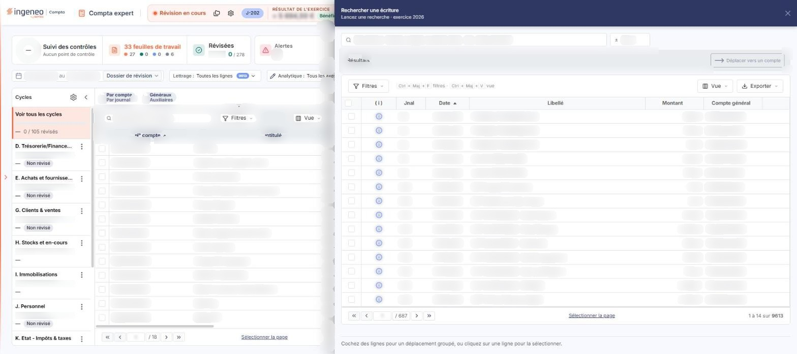
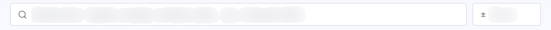
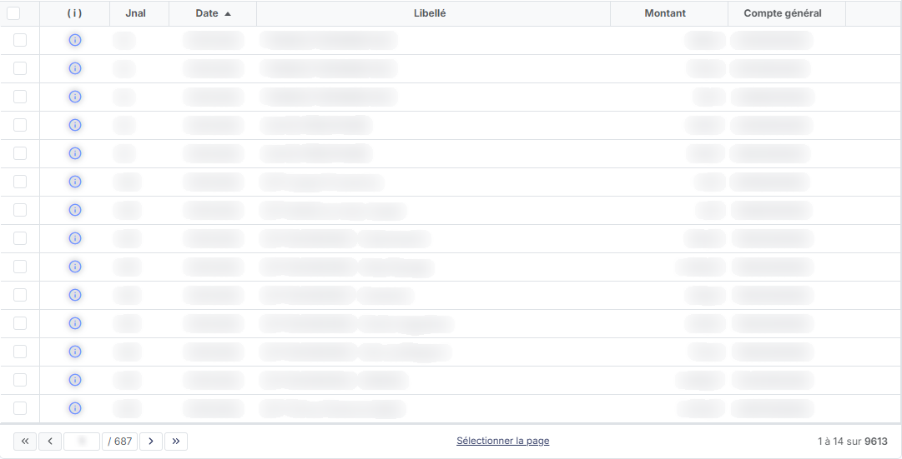
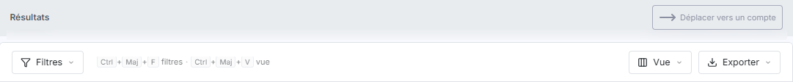

# Recherche


**Où le trouver :** Menu **Traitements › Recherche**



**En bref** — Cette option permet de rechercher des lignes d'écritures dans le dossier annuel en cours, puis de les déplacer vers un autre compte.

* Pour rechercher : saisissez un texte libre (libellé, compte, montant, date…) dans la zone de recherche.
* Pour déplacer des lignes : cochez-les dans la liste, puis bouton \[Déplacer vers un compte].


Cette option permet de rechercher des lignes d'écritures dans le dossier annuel en cours.

<figure><figcaption>
Écran « Recherche » de la nouvelle interface
</figcaption></figure>

Pour l'ouvrir, dans l'écran Révision, cliquez sur ⋮ (Plus d'actions), puis sur « Rechercher » : l'écran s'ouvre dans un panneau, à droite, intitulé « Rechercher une écriture », dont le sous-titre indique « Lancez une recherche » suivi de l'exercice. La croix « Fermer » de l'en-tête le referme.

Dès son ouverture, le panneau affiche la liste de toutes les écritures de l'exercice, sans recherche lancée : la zone de recherche sert à retrouver des écritures dans cette liste.

## La zone de recherche

<figure><figcaption>
Rubrique « a) La zone de recherche »
</figcaption></figure>

La zone « Rechercher : libellé, compte, montant, date… (ex. virement 440) » accepte un texte libre. Son infobulle indique comment il est interprété : « Les mots cherchent dans le libellé ou le début d'un compte auxiliaire, les nombres dans le montant (débit ou crédit) ou le début d'un n° de compte, les dates (jj/mm ou jj/mm/aaaa) dans la date d'écriture. Ex. : « virement 440 », « 401 », « DUPONT ». Un texte entre guillemets est toujours cherché dans le libellé. »

Le champ « Écart », précédé du signe ± et placé à côté de la zone, a pour infobulle « Écart toléré sur les montants recherchés (±) ».

## Les boutons de la barre

<figure><figcaption>
Rubrique « b) Les boutons de la barre »
</figcaption></figure>

Le panneau reprend la barre commune des listes de la nouvelle interface, avec les boutons \[Filtres], \[Vue] et \[Exporter], ainsi que le bouton \[Sélectionner la page].

## La liste des écritures

<figure><figcaption>
Rubrique « c) La liste des écritures »
</figcaption></figure>

<figure><figcaption>
Bouton [Déplacer vers un compte]
</figcaption></figure>

Les colonnes sont, dans l'ordre : « ( i ) », « Jnal », « Date », « Libellé », « Montant » et « Compte général ». La colonne « ( i ) » porte une icône d'information par ligne.

Chaque ligne porte une case à cocher, et l'en-tête de la colonne en porte une aussi ; vous pouvez également sélectionner une ligne en cliquant dessus.

Le pied de la liste indique le rang des lignes affichées et leur nombre total, par exemple « 1 à 16 sur 9613 », ainsi que la page courante, par exemple « 1 / 601 » : ces nombres dépendent du dossier.

bouton **\[Déplacer vers un compte]**

Ce bouton se trouve dans le pied du panneau. Le pied rappelle : « Cochez des lignes pour un déplacement groupé, ou cliquez sur une ligne pour la sélectionner. » Le bouton sert au déplacement groupé de lignes d'écritures vers un compte.
