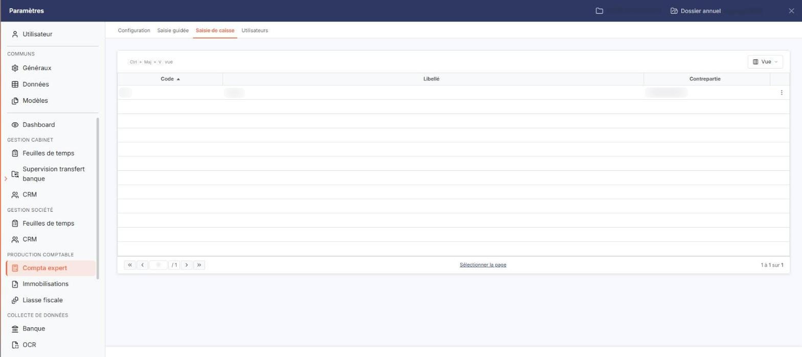
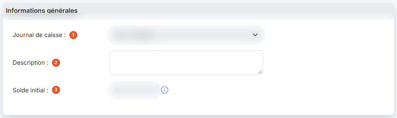
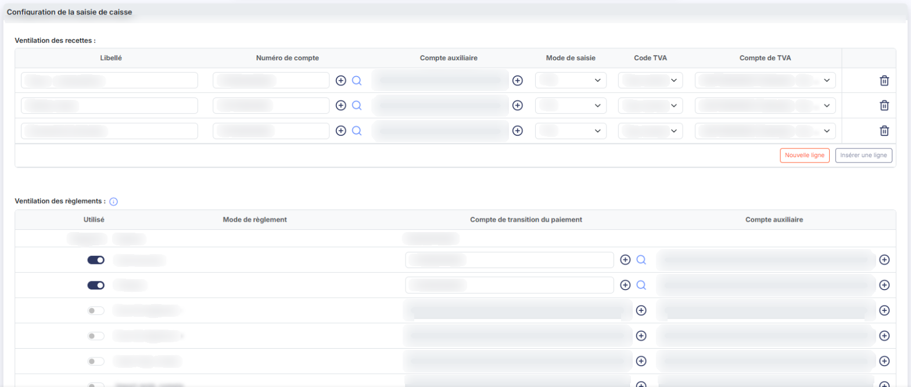
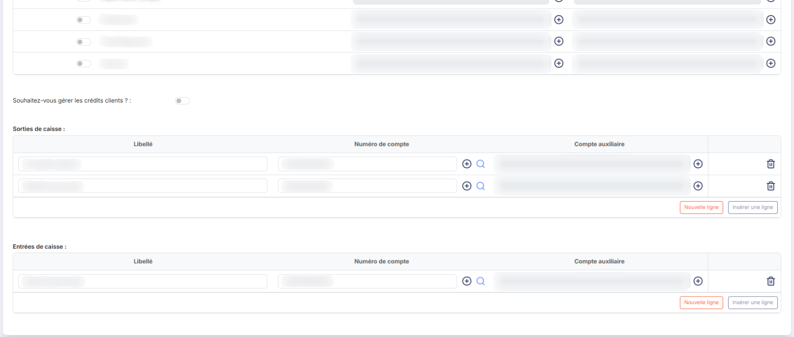
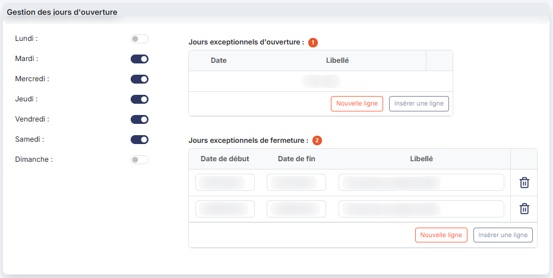
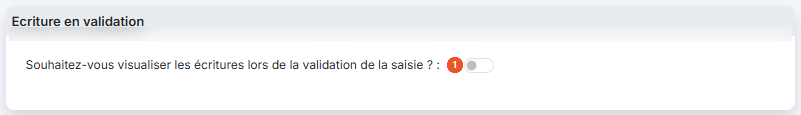

# Saisie de caisse — paramétrage


**Où le trouver :** Menu **Traitements › Saisie de caisse**



**En bref** — Cette option définit les éléments à renseigner lors de la saisie d'une caisse, journal de caisse par journal de caisse (un par point de vente).

* Pour paramétrer une caisse : choisissez le journal de caisse, renseignez les rubriques, ajoutez des lignes aux tableaux avec le bouton \[Nouvelle ligne], puis bouton \[Enregistrer].
* Pour quitter sans enregistrer : bouton \[Retour].


Cette option permet de définir les différents éléments à renseigner lors de la saisie d'une caisse.

<figure><figcaption>
Écran « Saisie de caisse » de la nouvelle interface
</figcaption></figure>

Si vous disposez de plusieurs points de vente, vous devez ouvrir un journal de caisse par point de vente et paramétrer la saisie de la caisse pour chacun d'entre eux. Les journaux se créent dans le menu « Fichiers », option « Journaux ».

## La liste des paramétrages

La liste présente un paramétrage par ligne, avec trois colonnes : **Code**, **Libellé** et **Contrepartie**. Elles reprennent le journal de caisse concerné et son compte de contrepartie.

Le pictogramme « Crayon » ouvre le paramétrage en modification : c'est la seule commande de ligne. La liste ne comporte ni fenêtre de filtres, ni impression, ni suppression, et l'en-tête de la colonne de commandes propose la case « tout cocher » et le pictogramme « Engrenage » qui permet de choisir les colonnes affichées.

## Rubrique « Informations générales »

<figure><figcaption>
Rubrique « Rubrique « Informations générales » »
</figcaption></figure>

| Champ                    | Ce qu'il faut savoir                                                                                                                                                                                                                                                                                                                                                                                                                                                                        |
| ------------------------ | ------------------------------------------------------------------------------------------------------------------------------------------------------------------------------------------------------------------------------------------------------------------------------------------------------------------------------------------------------------------------------------------------------------------------------------------------------------------------------------------- |
| 1. **Journal de caisse** | 
La liste propose les journaux de caisse pour lesquels la saisie de la caisse n'a pas encore été paramétrée. Si tous vos journaux de caisse sont déjà paramétrés, la liste est vide, sans que le logiciel vous l'explique : créez alors un journal de type caisse dans le menu « Fichiers », option « Journaux », avant de revenir ici. Cette règle ne vaut qu'à la création : lorsque vous ouvrez un paramétrage existant, la liste ne contient que le journal de ce paramétrage.
 |
| 2. **Description**       | Zone de texte libre, facultative.                                                                                                                                                                                                                                                                                                                                                                                                                                                           |
| 3. **Solde initial**     | C'est le montant du fonds de caisse, repris lors du calcul du premier jour de caisse saisi. Le solde initial ne peut plus être modifié une fois la première saisie de caisse validée : la zone apparaît alors grisée. Le pictogramme d'information placé à sa droite rappelle cette règle.                                                                                                                                                                                                  |

## Rubrique « Configuration de la saisie de caisse »

<figure><figcaption>
Rubrique « Rubrique « Configuration de la saisie de caisse » »
</figcaption></figure>

<figure><figcaption>
Rubrique « Rubrique « Configuration de la saisie de caisse » »
</figcaption></figure>

**Ventilation des recettes**

Indiquez selon quelle répartition les ventes devront être saisies chaque jour de caisse. Vous renseignez, pour chaque type de vente, une ligne du tableau :

| Champ                                           | Ce qu'il faut savoir                                                                                                                                                                                                                                                                                                                                                                                                                                                                          |
| ----------------------------------------------- | --------------------------------------------------------------------------------------------------------------------------------------------------------------------------------------------------------------------------------------------------------------------------------------------------------------------------------------------------------------------------------------------------------------------------------------------------------------------------------------------- |
| **Libellé**                                     | C'est ce libellé qui apparaîtra lors de la saisie de caisse.                                                                                                                                                                                                                                                                                                                                                                                                                                  |
| **Numéro de compte**                            | Le compte de vente dans lequel sera enregistré le montant du jour.                                                                                                                                                                                                                                                                                                                                                                                                                            |
| **Compte auxiliaire**                           | À renseigner uniquement si le compte indiqué ci-dessus est un compte collectif.                                                                                                                                                                                                                                                                                                                                                                                                               |
| **Mode de saisie**                              | Indique si le montant saisi sera **Sans TVA**, **HT** ou **TTC**.                                                                                                                                                                                                                                                                                                                                                                                                                             |
| **Code TVA**                                    | Indiquez le code TVA portant le taux appliqué à ce type de vente. La liste reprend les codes TVA que vous avez paramétrés dans le menu « Fichiers », option « Codes TVA » : son contenu dépend donc de votre dossier.                                                                                                                                                                                                                                                                         |
| **Compte de TVA**                               | 
Indiquez quel compte de TVA est concerné pour le code TVA en question. <strong>Ventilation des règlements</strong> Le logiciel vous demande de « cocher dans la liste ci-dessous les modes de règlements utilisés pour enregistrer les paiements des clients et indiquer leur compte d'enregistrement ». Ce tableau ne se remplit pas ligne à ligne : il présente d'office tous les modes de règlement paramétrés dans le fichier « Modes de règlement ». Pour chacun d'eux :
 |
| **Utilisé**                                     | Mettez à **Oui** le mode de règlement qui doit être proposé dans la saisie de la caisse. Le mode **Espèces** fait exception : il porte la mention **Obligatoire**, son compte n'est pas modifiable et il est toujours retenu.                                                                                                                                                                                                                                                                 |
| **Compte de transition du paiement**            | Il s'agit du compte sur lequel sera enregistré le règlement, le temps de sa remise en banque — un chèque en portefeuille, par exemple.                                                                                                                                                                                                                                                                                                                                                        |
| **Compte auxiliaire**                           | 
À renseigner uniquement si le compte de transition indiqué est un compte collectif. <strong>Gestion des crédits clients</strong>
                                                                                                                                                                                                                                                                                                                                                    |
| **Souhaitez-vous gérer les crédits clients ?**  | Vous pouvez gérer les crédits, c'est-à-dire les paiements différés, que vous accordez à vos clients. Si vous répondez **Oui**, le logiciel affiche deux zones supplémentaires :                                                                                                                                                                                                                                                                                                               |
| **Compte d'enregistrement des crédits clients** | Le compte dans lequel seront enregistrés ces crédits. Le bouton \[+] placé à droite vous permet de créer ce compte, et le pictogramme « Loupe » de le rechercher.                                                                                                                                                                                                                                                                                                                             |
| **Libellé**                                     | 
Renseigné par le logiciel d'après le compte indiqué ; la zone n'est pas saisissable. <strong>Sorties de caisse</strong> Si vous effectuez des sorties de caisse pour régler des dépenses, renseignez une ligne par type de dépense :
                                                                                                                                                                                                                                             |
| **Libellé**                                     | Nature de la dépense.                                                                                                                                                                                                                                                                                                                                                                                                                                                                         |
| **Numéro de compte**                            | Compte d'enregistrement de la sortie d'espèces — compte de charge, paiement de tiers, etc.                                                                                                                                                                                                                                                                                                                                                                                                    |
| **Compte auxiliaire**                           | À renseigner uniquement si le compte indiqué est un compte collectif.                                                                                                                                                                                                                                                                                                                                                                                                                         |

**Entrées de caisse**

Si vous effectuez des entrées de caisse ne correspondant pas à des ventes — un apport pour le fonds de caisse, par exemple —, renseignez une ligne par type d'entrée, avec les mêmes zones que pour les sorties de caisse : **Libellé**, **Numéro de compte** et **Compte auxiliaire**.

## Rubrique « Gestion des jours d'ouverture »

<figure><figcaption>
Rubrique « Rubrique « Gestion des jours d'ouverture » »
</figcaption></figure>

Les sept jours de la semaine, du **Lundi** au **Dimanche**, se présentent chacun sous la forme d'une question Oui/Non : indiquez pour quels jours la caisse devra être saisie.

| Champ                                   | Ce qu'il faut savoir                                                                                                                                                                                                                                                                                                                                                                                                         |
| --------------------------------------- | ---------------------------------------------------------------------------------------------------------------------------------------------------------------------------------------------------------------------------------------------------------------------------------------------------------------------------------------------------------------------------------------------------------------------------- |
| 1. **Jours exceptionnels d'ouverture**  | Indiquez dans ce tableau les jours théoriquement non travaillés qui le seront, et pour lesquels il faudra donc saisir la caisse. Chaque ligne comporte une **Date** et un **Libellé**.                                                                                                                                                                                                                                       |
| 2. **Jours exceptionnels de fermeture** | Indiquez dans ce tableau les jours théoriquement travaillés qui ne le seront pas, et pour lesquels il ne faudra donc pas saisir la caisse. À la différence du tableau précédent, chaque ligne porte une **Date de début** et une **Date de fin**, ce qui vous permet de saisir une période entière en une seule ligne, ainsi qu'un **Libellé**. Le pictogramme « Calendrier » de chaque cellule vous aide à choisir la date. |

## Rubrique « Ecriture en validation »

<figure><figcaption>
Rubrique « Rubrique « Ecriture en validation » »
</figcaption></figure>

**Souhaitez-vous visualiser les écritures lors de la validation de la saisie ?** : seule question de cette rubrique.

## Les commandes des tableaux

Cinq tableaux se remplissent ligne à ligne : **Ventilation des recettes**, **Sorties de caisse**, **Entrées de caisse**, **Jours exceptionnels d'ouverture** et **Jours exceptionnels de fermeture**. Chacun est suivi des deux mêmes boutons, et la croix placée en tête de chaque ligne la supprime. Tant qu'un tableau ne contient rien, le logiciel affiche la mention « Liste vide ».

bouton **\[Nouvelle ligne]**

Ajoute une ligne au tableau.

Dans les cellules de compte, le bouton \[+] vous permet de créer le compte, et le pictogramme « Loupe » de le rechercher.

bouton **\[Enregistrer]**

Enregistre le paramétrage. Si une saisie de caisse est en cours sur ce journal, le logiciel ne l'enregistre pas directement : il vous demande de confirmer, en vous avertissant que les données de la caisse en cours seront détruites.

bouton **\[Retour]**

Referme le paramétrage et vous ramène à la liste.
